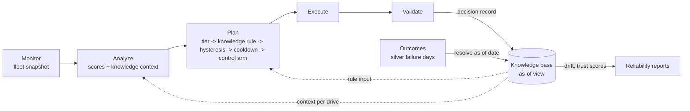

# A Knowledge component for the MAPE-K agent

Status: **design, 2026-11-07. Nothing is built or run yet.** Sections 1-10 are the
design and are committed before any code or run. Section 8, the rule that decides
whether a knowledge rule may change a decision, is not edited after that commit except by
dated amendments appended to it, made before any screening result exists (one so far:
Amendment 1); the Q3 step of the screen refuses to run if this file has uncommitted
changes. Sections
11-13 (Results, Decision, Provenance) are added when the runs are finished and their
outputs are frozen; the runbook gets the same record (sections 1.1.7 and 4.14).

## 1. Question

The agent is a MAPE-K loop with no K. Its "knowledge" is spread over
`configs/agent.yaml`, the trained `action_tiers.json`, a per-drive hysteresis
counter (`drive_risk_state`) and two ledgers. No outcome ever feeds back:
`src/reliability/batch.py::resolve_final_trust_scores` and
`src/reliability/drift.py::build_drift_report` are called only by tests.

Can a knowledge base, learned from the Q1+Q2 2026 period and kept up to date one day at
a time, make the agent's actions in Q3 2026 more precise without losing catches?

Two things limit the answer before any code is written.

- **Re-filtering the model's flags has not worked here.** ADR 0003 records that the
  loop "gets no new precision mechanism": gates added nothing, hysteresis cost 0.5-3.3
  points of recall, chronic-flag streaks have flat precision (18.6 / 20.6 / 22.2 / 21.9%
  for 0 / 1 / 2 / 3+ weeks flagged, runbook 4.9), per-family recalibration lost 1.4
  points of recall at a matched false-alarm rate (4.10), per-family thresholds were
  worse (ADR 0002), and the cluster action policy bought 8.0 points of precision for
  8.8 points of recall (1.1.6), which is a threshold move. The ADR's reopening
  condition is "evidence the model has not seen". The model's features cover at most
  30 days; a knowledge base can hold 60-180 days of a drive's history, which is the
  only candidate here that meets that condition.
- **History exists for few drives.** Out-of-sample scores exist only for the
  validation holdout (70,977 drives, 2026-01-01..05-01), which is 19.3% of the 368,688
  drives in Q3. The other drives' Q1+Q2 scores come from the model they trained, and
  17,852 Q3 drives are new. Any effect on Q3 is bounded by that coverage (section 7.3).

So the work has two parts. **First, build the K** (plumbing that changes no decision
and no number). **Then screen a few knowledge rules on validation**, under a rule written
down now, with at most one logged Q3 look per rule that passes. ADR 0003's record
predicts the screen will return a null; the plumbing is useful either way (outcome
feedback, trust-score resolution, drift monitoring).

## 2. Where it sits in the system

- **Analyze** attaches a `knowledge_context` to each candidate drive: what the store
  knew about that drive and its cohort as of the snapshot date.
- **Plan** may apply a knowledge rule between `determine_action_tier` and
  `apply_hysteresis` (`src/agent/nodes.py`), so hysteresis, cooldown and the control arm
  see the adjusted tier, and the control arm stays last. No rule is enabled unless it
  passes section 8; until then `configs/agent.yaml knowledge.rule` is `none`.
- **Validate** records the decision in the store.
- **Outcomes** are resolved from silver failure days up to a cutoff date, never from
  the label table's `event_type` (section 5.3).

## 3. Scorer: the 60-day stacked Stage 2

The knowledge base, the baseline and the screen run on the **stacked Stage 2**:
the LightGBM and Cox Stage 2 models blended by validation-ranked scores on the Stage 1
candidates (`src/models/stacking.py`, runbook 1.1.4a), at the **60-day horizon**, seed 0,
net 0.8. Two reference arms are reported beside it: the 60-day LightGBM cascade (frozen
run `804a20cec10048abb1bc3ccf510f96e1`) and the Cox Stage 2 alone.

Why this scorer, and what is known about it (runbook 1.1.4a, Q3 test, 3 seeds):

- At the same number of drives flagged, the stack catches more failing drives than the
  LightGBM cascade up to 500 flagged drives, in every seed and every horizon (about 4-11
  more out of about 1,100). From 1,000 flagged drives up there is no consistent
  difference, and above about 35% recall the curves coincide.
- The 60-day row at the 10% level looks better than it is. The stack flags about 255
  drives against 187 for LightGBM at the same precision (68.0% against 68.4%), so most
  of its recall gain (15.5% against 11.4%) is the validation threshold landing lower on
  test. At a matched 250 drives flagged it catches 167.7 failing drives, against 161.3
  for LightGBM and 174.7 for Cox alone (the stack beats Cox in 0 of 3 seeds there). At
  500 it beats both (287.3 against 276.0 and 284.7).
- The stack's result is "small strict-end gain, not confirmed", and that row was chosen
  after seeing all nine. **This work builds on an unconfirmed scorer**, which is why the
  cascade and Cox arms are carried through every comparison.
- **The 60-day horizon is not the goal's horizon.** The goal is stated at 30 days
  (runbook section 7). 60-day precision rises with the base rate and is not comparable
  with 30-day figures; results here are read as recall at a matched false-alarm rate and
  at a matched number of drives flagged, and precision is always quoted with its base
  rate.
- **Validation scores are slightly optimistic.** The stack's members stopped early on
  validation candidates and its blend weights were fitted there. Tiers are still set on
  validation only, as everywhere in this repository.

The stack runs saved no models and no per-drive scores, so the first step (Phase S,
section 9) reruns the seed-0 60-day stack on validation only, saves the scores and the
members, and freezes them in `frozen_runs/stack_h60_seed0/`. The rerun must reproduce
the frozen run's validation numbers (blend weights LightGBM 0.5 / Cox 0.5, validation
drive-level average precision 0.5959) or the work stops.

## 4. Tiers: lift tiers and cost tiers

The stack's score is a new scale, so its tiers are derived again on validation:

- **Lift tiers**, the repository's rule (runbook 1.9): each tier's target precision is
  its lift (`configs/model.yaml threshold.action_tier_lift`: 56.6 / 94.3 / 151.0 /
  226.4) times the validation failure rate, via `src/models/threshold.py::tune_action_tiers`.
- **Cost tiers**, new: `src/models/threshold.py::tune_cost_tiers` chooses, per tier, the
  validation threshold that maximises `r * caught - false_alarms`, where `r` is how many
  unnecessary actions of that kind one prevented failure is worth. Equivalently, a drive
  is flagged while the marginal precision is at least `1 / (1 + r)`. Tiers are forced to
  nest (warn <= cordon <= migrate <= drain); a tier with no profitable threshold gets none.

The low recall of the strict tiers is by design: drain and migrate sit at about 10%
recall because they must be precise. Recall for cheap actions comes from where warn and
cordon sit, and the lift rule places them without any cost. With `r = 20` (the ratio the
experiments use), flagging pays down to about 5% marginal precision, and on validation
80% recall still has about 7% precision (30-day cascade), so the cost-optimal point for
a cheap action is expected near 70-80% recall.

- `configs/model.yaml threshold.action_cost_ratio` holds placeholders (warn 100,
  cordon 20, migrate 5, drain 2). **They are an operations decision**, not a result,
  and are marked as such.
- `threshold.tier_rule: lift | cost` selects which set the agent uses; the default is
  `lift`, so nothing changes until someone sets it.
- Both sets are written to the scorer's thresholds file (`action_tiers` and
  `action_tiers_cost`), with a validation sensitivity table for `r` in
  {2, 5, 10, 20, 50, 100} for all three arms.
- The cost optimum depends on the failure rate, and Q3's is about half of validation's,
  so a cost tier set on validation flags more than is optimal on Q3. The table says so.
- The screen (section 8) is judged on the tier set configured in the commit that records
  the screen's verdicts; the other set is reported, not judged.

## 5. The knowledge base

### 5.1 What it stores

The store keeps **facts with dates**, appends them one day at a time, and derives
everything else for a requested date. Only **candidate days** are stored: the drive-days
the stack scores, i.e. p_fail at or above the Stage 1 candidate threshold (about 2% of
validation rows). Tier flags are derived when read, from the tier set named in the
store's metadata, so changing tier sets needs no re-ingest.

| Table | Key | Content |
|---|---|---|
| `metadata` | key | schema version, scorer run id, thresholds, candidate threshold, horizon (60), episode gap (7 days), source paths, git commit, `last_ingested_date`, `last_resolved_date` |
| `candidate_days` | drive, date | p_fail, source, ingested as of; append-only |
| `presence_weeks` | drive, week | days seen, max p_fail; past weeks never change |
| `episodes` | id | drive, first and last flag date, days flagged, days above cordon, max tier, max p_fail, opened as of, closed as of, reason (gap, failure, removed), resolved outcome (failed, survived the horizon, censored) |
| `drive_summary` | drive | first and last seen, model, family, running counts, open episode, last resolved outcome (a cache; a view at an earlier date recomputes from the fact tables) |
| `failure_days` | drive | failure date, from silver rows with `failure == 1` only |
| `outcomes` | drive, date, horizon | label 1 / 0 / null, failure date, resolved at, basis (failure, presence, censored removal, pending) |
| `decisions` | id | cycle, date, scorer, drive, proposed and final tier, withheld action, control arm, guardrail result, review flag, knowledge context, final trust score |
| `cohort_daily` | key type, key, date | drives, candidates, flags, failures, per model, family and fleet |
| `ingest_log` | date, source | rows in, stored, conflicts, seconds, memory, a hash of 500 fixed drives' contexts |

Expected size on validation: about 177,000 candidate days, 70,977 drive summaries,
about 1.2 million presence weeks (about 40 MB), a few thousand episodes. A Q3 extension
adds about 475,000 candidate days and 3.3 million presence weeks (about 100 MB). SQLite
on disk (WAL, batched upserts) or in memory, with the same code.

### 5.2 The as-of rule

A query for date `d` sees only facts dated `d` or earlier. Episodes record when they
closed (`closed_as_of = last flag date + gap + 1`), so a view at an earlier date sees
them open. An outcome for `(drive, d, h)` follows the label definition
(`src/labels/labeling.py`) on facts known by the query date:

- 1 if a failure day lies in `(d, d + h]`;
- 0 if the drive is seen on or after `d + h`;
- censored if neither and the query date is at least a week past `d + h`;
- pending otherwise.

### 5.3 What is never read

`event_type` and `event_date` in the label table and `feature_maturity`,
`last_seen_date` and the broadcast `failure_date` column in silver are computed from the
whole data range (`src/labels/event_types.py` uses the data's last date), so rows dated
before Q3 carry Q3 outcomes. The store reads only the dates of `failure == 1` rows,
presence rows and scores dated on or before the query date; tests assert the projected
columns.

### 5.4 Incremental build and memory

- The backfill reads the stack's score table seven days at a time (one lazy filter per
  chunk), stores the candidate days, then resolves outcomes up to the chunk's last date
  from silver failure days in that window. `last_ingested_date` and
  `last_resolved_date` advance per chunk, so an interrupted build resumes.
- The gold feature table is read only on point-in-time snapshot dates. It cannot skip
  row groups by date (every one of its 127 row groups spans the whole period), so
  scoring every day from it would mean about 120 full scans of a 6 GB file.
- Budget: under 1 GB peak for the validation build, under 2 GB for a Q3 extension,
  within the repository's 20 GB cap; every entry point calls
  `apply_memory_limit_from_config()`.

### 5.5 Self-checks

Each is a unit or integration test and an item of `build_agent_knowledge.py check`,
written to `knowledge_checks.json`.

| Id | Check |
|---|---|
| a | Building day by day, by 7-day chunks and in one pass gives identical tables |
| b | A view at date `d`, taken after ingesting later days, equals the state right after `d` (replay; on real data, per-day context hashes of 500 fixed drives) |
| c | Moving a failure later changes nothing dated before it (no look-ahead) |
| d | Resolved outcomes match the gold labels for the same drive, date and horizon on validation candidate days (mismatches reported; only censoring differences expected) |
| e | Coverage: share of the fleet with any history, with 60 days or more, and first seen within 30 days (measures the 19.3% bound) |
| f | Re-ingesting a day changes nothing (idempotence) |
| g | An interrupted build resumes to the same result |
| h | Point-in-time scores and score-table scores agree on a shared date (`max |delta| < 1e-6`) |
| i | Memory: 50,000 synthetic drives over 200 days add less than 1 GB and take under 120 s |
| j | The SQLite and in-memory stores produce identical contents |
| k | With no rule, decisions and point-in-time results are identical with and without the store attached |

## 6. Loop wiring and what stays unchanged

- `AgentDependencies.knowledge` (optional). The fleet wiring adds `as_of`, drive model,
  family and power-on hours to each candidate and lets the store annotate them.
- The plan node gains an optional knowledge rule at the seam in section 2, and the
  proposal carries `knowledge_context` and `as_of` (the guardrail adapter ignores
  unknown keys). The validate node records the decision.
- `run_agent_fleet.py` gains `--knowledge none | memory | sqlite`; outcome resolution
  past 2026-06-30 requires an explicit flag and is logged as a test access.
- `build_agent_knowledge.py resolve` feeds the store's decisions and outcomes to
  `resolve_final_trust_scores`, so final trust scores exist for the first time.
- `build_agent_knowledge.py drift` runs `build_drift_report` on the daily shares of
  drives at Stage 1, warn and cordon: the weekly monitor runbook 1.1.5 asked for.
- **Unchanged:** `drive_risk_state` stays the checkpointed input to hysteresis and
  cooldown; the store mirrors decisions but is never read by them. The control-arm
  fraction stays 0.0. The recommendation, recorded in ADR 0004 and runbook section 8, is
  to set it to 0.03 in the same commit that connects a real executor, because real
  actions censor their own outcomes (`src/reliability/checks.py`).
- **Phase 1 changes no decision and no number** (check k).

## 7. Candidate rules and the data behind them

Rules are pure functions of the proposed tier, the drive's knowledge context and the
thresholds (`src/agent/knowledge/rules.py`). A drive with no history is never changed.
For evaluation, each rule is also expressed as a score transform (a demotion caps the
score just below the next threshold, a promotion raises it to the threshold), so the
existing point-in-time metrics apply unchanged. "No rule" is always a candidate.

### 7.1 Rules

| Rule | What it does | Grid | Status at h = 60 |
|---|---|---|---|
| R1 cohort prior | Shrinks p_fail toward the drive model's failure rate (`src/agent/family_calibration.py`, tau chosen by a time split) | tau in {0, 0.1, 0.25, 0.5, 1, 2} | Screened; expected null (runbook 4.10 found no gain); acts as the screen's control |
| R2 chronic demote | Cordon or above becomes warn when the open episode and the days above cordon in 180 days are both at least N | N in {7, 14, 21, 28} | Screened |
| R2b first-flag promote | Warn becomes cordon when p_fail is within delta of the cordon threshold, the drive has no earlier episode and at most one day above warn in 180 days, and at least 60 days of history | delta in {0.05, 0.10} | Screened |
| R3 outcome memory | One band lower when the drive's last episode survived its horizon within the last M days | M in {14, 30, 60} | **Not screenable**: no validation date has an episode resolved 60 days after it closed. Implemented and tested, not run |

### 7.2 The data behind them (validation, 30-day cascade, runbook and exploration)

- 349 validation drives were ever at or above cordon; 83 stayed there for 7 days or more
  without a positive label, 15 for 30 days or more, and 13 of the 83 failed by June
  anyway (after their label window). So a "chronic but healthy" group exists, is small,
  and partly turns into late failures.
- Runbook 4.9 found no precision difference by weekly flag streak on the earlier model.
  That is the prior evidence against R2.
- R2 is the only rule that uses information outside the model's 30-day windows.

### 7.3 The ceiling on Q3

Only drives with history before Q3 can be affected: 19.3% of the Q3 fleet. From the
published 60-day cascade numbers (runbook 1.1.4: cordon 45.0% precision at 33.6% recall
of 1,117 failing drives, about 375 caught and 458 false alarms), the covered drives hold
about 87 of those false alarms. A perfect rule that removed all of them and lost no catch
would take cordon precision from 45.0% to about 50.3%. **About +5 points is the most any
rule here can do on Q3**; a realistic effect is a fraction of that.

## 8. Rule fixed in advance

A rule passes only if all four conditions hold on the **confirm half** of the screen set,
pooled over its dates. Hyperparameters are chosen on the **select half** by recall at the
tier's own validation false-alarm rate, with ties going to "no rule".

**Screen set.** Daily validation observations from 2026-02-01 to 2026-03-02 (every
60-day horizon ends by 2026-05-01, the end of validation), stack scores, each joined to the
knowledge context as of its date. Select half: 2026-02-01..02-15. Confirm half:
2026-02-16..03-02. No test row is read.

1. **Precision up, recall not down**, at warn-and-above and at cordon-and-above
   separately: the paired drive-bootstrap 95% interval (1,000 resamples of whole drives,
   both arms on the same resamples) of the precision difference against "no rule" lies
   entirely above 0, and the interval of the recall difference includes 0 or lies above it.
2. **Better than a plain stricter threshold**: at the two false-alarm budgets of
   (1e-4, 2e-4, 5e-4, 1e-3, 2e-3, 3e-3) that bracket the tier's validation false-alarm
   rate, the rule's recall minus the baseline's (`compare_scorings`) is above 0 with a
   lower interval bound of at least 0 at both; and at the recall the rule reaches, a plain
   threshold on the baseline score has lower precision, with the paired interval above 0.
3. **Enough evidence**: the flagged drive-days the rule changes number at least 300, from
   at least 60 distinct drives, on the confirm half. Otherwise the verdict is
   "underpowered", not "failed".
4. **A real choice**: the chosen hyperparameter is not "no rule", and is not at the edge of
   its grid unless the next value in also passes condition 1 (N = 28 passes only if N = 21
   also passes).

**Then:**

- **Pass:** exactly one Q3 look for that rule, with the hyperparameters frozen in
  `validation.json` and logged in `data/audit/test_access_log.jsonl`. It is reported with
  both base rates and **never as a confirmed gain**, because Q3 has been read many times
  before. The primary Q3 table covers drives with history as of each snapshot; a
  fleet-wide table sits beside it.
- **Fail or underpowered:** recorded as a null under ADR 0003. The plumbing stays, no
  rule is enabled.
- The Q3 step (`screen_agent_knowledge.py --q3`) refuses to run unless this file is
  committed and unchanged, `validation.json` records a passing rule, and no Q3 result
  exists yet.

**Amendment 1 (2026-11-07, before any screening code exists or any rule has been
evaluated).** Reason: the power measured from the frozen scorer (section 9) showed that
criterion 1, as written above, cannot be met by R2 or R2b. Both only move drives between
warn and cordon, so their warn-and-above set is unchanged and its precision difference is
exactly 0. The criteria above are kept as written; this amendment says where they apply.

- **Criterion 1 is judged at the tier set a rule can change.** A rule that only moves
  drives between warn and cordon (R2, R2b) is judged at cordon-and-above alone. The screen
  verifies that its warn-and-above flags are identical to "no rule"; if they are not, the
  rule is judged at both tier sets. A rule that changes scores or removes flags (R1, R3) is
  judged at both, as written.
- **Criterion 2** uses the false-alarm budgets that bracket the validation false-alarm rate
  of the tier set being judged.
- **Criteria 3 and 4 are unchanged**, including the floor of 300 changed flagged drive-days
  from 60 distinct drives. Only 92 drives reach cordon on the confirm half, so a rule judged
  at cordon alone is expected to be "underpowered"; that verdict is recorded as such.
- Nothing else in this section changes.

## 9. Phases, commands, outputs

| Phase | What | Main outputs | Test look |
|---|---|---|---|
| Design | This document, sections 1-10 | `docs/agent_knowledge_base.md` | none |
| S | Save and load for Cox and the stack; rerun the seed-0 60-day stack on validation only (`--validation-only --save-stack-scores`); derive lift and cost tiers for the stack and for Cox alone; reproduction check | `frozen_runs/stack_h60_seed0/` (members, references, tiers, cost-sensitivity table, README, checksums), `data/tmp/stack_scores/scores_h60_seed0.parquet` (validation rows) | none |
| 0 | Point-in-time baseline on validation drives, 9 weekly snapshots 2026-01-05..03-02 at h = 60, three arms (stack, 60-day cascade, Cox), one date at a time to partitioned files, resumable | `data/audit/agent_pit_validation_{stack,cascade,cox}_h60*` | none |
| 1 | The knowledge store, builder, self-checks and loop wiring; build from the stack scores, resolve outcomes to 2026-06-30, coverage and drift | `data/audit/agent_knowledge.sqlite` (local), `data/audit/agent_knowledge_h60/knowledge_checks.json`, coverage and drift JSON | none |
| 2 | The screen on validation; Q3 only for rules that pass | `data/audit/agent_knowledge_h60/validation.json`, `tables.md`, `figures/`; `q3_evaluation.json` only after a pass | one per passing rule |
| Freeze | Checksums and READMEs for every output folder; runbook 1.1.7 and 4.14; sections 11-13 here; ADR 0004 | `CHECKSUMS.sha256` files | none |

Q3 point-in-time dates, used only inside the logged Q3 look: 2026-07-04, 07-11, 07-18,
07-25, 08-01 (the last date whose 60-day label is observable).

**Power, filled in from Phase S before the screen runs** (measured 2026-11-07 from
`data/tmp/stack_scores/scores_h60_seed0.parquet` with the stack's lift tiers, warn 0.9342
and cordon 0.9825; candidate threshold 0.2716). This subsection is the one part of
sections 1-10 completed after the design commit; it records measurements, not choices.

| Validation rows | Candidates (>= 0.2716) | warn and above | cordon and above |
|---|---|---|---|
| All 8,242,015 | 2.84% | 0.26% | 0.067% |

| Half | Days | Drive-days | Drives | warn-and-above drive-days (drives) | cordon-and-above drive-days (drives) | Row failure rate |
|---|---|---|---|---|---|---|
| Select, 02-01..02-15 | 15 | 1,009,214 | 67,828 | 2,233 (295) | 528 (90) | 0.187% |
| Confirm, 02-16..03-02 | 15 | 1,013,502 | 68,064 | 2,534 (291) | 649 (92) | 0.223% |

Two consequences, found when these were measured and before any screening code exists:

- **Cordon-level rules are underpowered by design.** Criterion 3 of section 8 needs at
  least 60 distinct changed drives; only 92 drives reach cordon on the whole confirm half.
- **R2 and R2b cannot meet criterion 1 as written.** Both move drives between warn and
  cordon, so the warn-and-above set is unchanged and its precision difference is exactly
  0, never "entirely above 0". Only rules that change both tiers (R1; R3, which is not
  screenable at h = 60) can pass criterion 1 at both tiers.

Estimates: Phase S about 8 minutes of compute (under 14 GB), Phase 0 under 10 minutes
for three arms (3-4 GB per snapshot date), the store build about 3 minutes (under 1 GB),
the validation screen about 20 minutes, the Q3 look about 5 minutes.

## 10. Threats to validity

- **One unconfirmed scorer, one seed.** The stack's advantage was itself not confirmed,
  and the 60-day horizon was chosen from a row picked after the fact. The cascade and Cox
  arms are there so a result can be attributed.
- **Short history at screen time.** The store starts on 2026-01-01, so on the screen
  dates it holds 31-60 days of history. R2 is limited to N <= 28, R3 cannot be screened,
  and an "underpowered" verdict is likely.
- **Coverage.** Only the 19.3% of Q3 drives in the validation holdout have out-of-sample
  history before Q3; the ceiling in section 7.3 follows from that.
- **Optimistic validation scores** (section 3) affect tiers and history alike.
- **Base rate.** Q3's failure rate is about half of validation's; precision is quoted with
  it, and the judgement uses recall at matched false-alarm rate.
- **Q3 is spent.** Any Q3 number here is descriptive; confirmation needs an untouched
  quarter.
- **Simulated executor.** Outcomes are uncensored only because nothing is really acted
  on; with real actions, the control arm becomes necessary (section 6).
- **Removals.** Drives removed without a recorded failure are batch decommissions with no
  telemetry warning; the store records them as censored, not as successes or failures.
