# Model status, results and runbook

> **Current state (2026-11-07).** Read Section 1 first. The current model is
> the 30-day Q1+Q2 -> Q3 run of Section 1.1.4 (frozen run `c459046e`), tested
> on Q3 2026; Sections 1.1.1 to 1.1.3 hold the earlier frozen runs on the
> 2026-04/05 window. Section 4 is the
> measurement record in the order it was produced; Section 5 holds the
> lessons from the earlier Q1-only, 14-day work, which still apply. For a
> shorter overview see `docs/system_summary.md`. Section 1.8 maps every
> number to its file under `data/audit/` and `frozen_runs/`.
>
> The split design behind the Q3 results (drive holdout, 62-day test) and a
> stricter chronological alternative that is proposed and not built are in
> Section 1.1.8.

This document records what was run on real Backblaze data, what was learned,
what is still open, and how to run the pipeline end to end. Numbers are
copied from the run logs and experiment output; where something was not
measured on real data, it says so.

## 1. Where things stand

The pipeline runs end to end on real Q1 + Q2 2026 data (62.6 million
drive-days, 363,548 drives) within the 20 GB memory cap: ingest, silver,
features, labels, training, fleet scoring, plots and the final report.
**The stated goal is not met.** It was 95% precision at 35-50% recall, then
90% at >= 10% recall, both per drive on the real fleet (Section 7).

### 1.1.1 Frozen run for the quarter-aligned window (2026-11-05)

MLflow run `839d92bcd305494a8930d0dfbbb3f2a6` (name `h30_seed0`), trained with
`make train TRAIN_TAG=h30_seed0 TRAIN_ARGS="--keep-work-dir --save-scores"` on
the repository-default window of Section 2.2: train to 2026-01-15, validation
2026-02-15 to 2026-03-31, test 2026-04-01 to 2026-05-31, 30-day horizon,
two-stage LightGBM, 246 features. It was a **second frozen run, not a
replacement for the earlier frozen run (2026-10-09, no longer available)**: the two answer different windows, and
Section 4.6 found that earlier model slightly ahead at matched false-alarm
rate (not a confirmed regression). Use the earlier run's figures where its window is
the one you mean.

It reproduces the earlier run `0c183df0` exactly: the evaluation report and
`action_tiers.json` are byte-identical and the 36,656,465-row validation and
test score table is identical, so every figure in Sections 4.6 to 4.10 and the
point-in-time work applies to it. It was retrained because the earlier run is not in
the MLflow store on the machine that holds the data (that store held no runs).

| Per drive, threshold 0.9514 chosen on validation | Precision | Caught | False alarms | AUROC | AUPRC |
|---|---|---|---|---|---|
| Validation | 59.2% | 113 of 1,124 | 78 | 0.923 | 0.304 |
| Test | 57.1% | 178 of 1,479 | 134 | 0.923 | 0.339 |

Test recall is 12.0%. The goal (90% precision at >= 10% recall) is **not met**,
and the second-stage gain remains unconfirmed (Section 1.2).

**Do not retrain this run, and do not re-tag over it.** The run carries
`frozen_spec.json` (thresholds, the 246 feature columns, the calibrator),
`action_tiers.json` and `two_stage.json`; nothing is re-chosen at evaluation
time. Tagged outputs from `make train TRAIN_TAG=...` never overwrite another
tag's, and a rerun of the same tag refuses to start without `--overwrite`.

SHA-256 prefixes of what was frozen, to detect a changed file:

| File | SHA-256 (first 16) |
|---|---|
| `frozen_spec.json` | `3d8207f3a2e7ffe2` |
| `action_tiers.json` | `932aa5411173d542` |
| `two_stage.json` | `ca0d7c14631f6738` |
| `lightgbm_scores_h30_h30_seed0.parquet` | `3e1934466c109277` |

The MLflow store (`mlflow/mlflow.db`, `mlruns/`) is local and ignored by git,
and its artifact URIs are absolute paths on the machine that trained it, so
the run is not loadable from the repository by id. Its files are copied to
`frozen_runs/839d92bcd305494a8930d0dfbbb3f2a6/` (spec, tiers, both LightGBM
stages, model card, checksums; see its README) so they can be inspected and
checked; `score-fleet` and `evaluate-frozen` still read MLflow, not that folder.

**Void runs.** Two older runs must never be scored:

- **The previous freeze, `0ee06c01ff2a427ca76011fb1afb8ce3`, is void - not
  merely superseded.** It was trained when `attribute_coverage_factor` was a
  vendor proxy (0.6 for non-Seagate, 1.0 for Seagate) and `recency_factor`
  was pinned near 0.6065 (ADR 0002). Those are model *features*, and the
  current gold table has both at about 1.0, so scoring that run against the
  rebuilt data would feed it three features far outside their training
  distribution. Worse, it would do so silently: all 212 of its
  `frozen_spec.json` columns still exist in the 246-column frame, so
  `evaluate_frozen.py` would select them and score without complaint.
  The same applies to `c9845215896e47a397317cadd3983b6d` (commit `313bacb`).
  Neither may be scored on any held-out period.

### 1.1.2 Frozen merged-approach run (2026-11-05)

`make train-merged MERGED_TAG=h30_seed0` (MLflow run
`fb58d9576c6146ba94c13389005fa15b`), the first complete run of the merged
approach. It compares XGBoost AFT and Cox survival models, the LightGBM
two-stage (run `839d92bc`, Section 1.1.1), an LSTM and a TCN, and two
rank blends, all on the same 15,359,094 validation and 21,297,371 test
drive-days (100% coverage for every member) and the Section 2.2 split. Like
Section 1.1.1 it is **not a replacement** for the earlier frozen run (2026-10-09, no longer available).

| Per drive, threshold chosen on validation | Val precision | Test precision [95% CI] | Test recall | Caught / false alarms | Test AUROC | Test AUPRC |
|---|---|---|---|---|---|---|
| LightGBM two-stage | 59.2% | 57.1% [51.6, 62.6] | 12.0% | 178 / 134 | 0.923 | 0.339 |
| AFT | 64.2% | 68.5% [63.0, 74.1] | 12.4% | 183 / 84 | 0.921 | 0.387 |
| Cox | 60.6% | 62.9% [57.6, 67.9] | 13.7% | 202 / 119 | 0.927 | 0.357 |
| LSTM | 44.3% | 52.7% [48.2, 57.1] | 15.6% | 231 / 207 | 0.923 | 0.281 |
| TCN | 55.5% | 70.5% [65.2, 75.6] | 13.6% | 201 / 84 | 0.900 | 0.348 |
| Blend LightGBM + AFT + TCN | 66.8% | 70.1% [64.9, 75.0] | 13.7% | 202 / 86 | 0.921 | 0.389 |
| Blend LightGBM + LSTM + AFT + TCN | 64.5% | 69.7% [64.4, 75.0] | 12.6% | 186 / 81 | 0.925 | 0.382 |

The agent acts on the last blend (`merged_models.agent_ensemble` in
`configs/model.yaml`).

At matched test false-alarm rates the blends and AFT catch more than
LightGBM: at 0.1% the LightGBM + AFT + TCN blend recalls 33.3% against 26.8%,
and at 0.05% 23.6% against 15.7%.

**Read it as "AFT and the blends look better than LightGBM alone", not as a
confirmed gain.** It is one seed; the test window has been looked at many
times (`data/audit/test_access_log.jsonl`); the intervals resample drives only,
so they omit seed-to-seed variation; and the validation precisions are the
ones the thresholds were tuned on. The TCN's jump from 55.5% on validation to
70.5% on test comes partly from the higher test base rate (0.417% against
0.323% of drives; about 6 points) and partly from a 15% lower false-alarm
rate, on 84 false alarms, which is within sampling noise. AFT is the member
that beats LightGBM on both splits. **The goal (90% precision at >= 10%
recall) is not met**; the best figure here is about 70%.

**Do not retrain this run or re-tag over it.** Its files are in
`frozen_runs/fb58d9576c6146ba94c13389005fa15b/` (report, agent thresholds,
both boosters, the LSTM and TCN weights, checksums; see its README). The
1 GB blended score table is committed packed, as 14 parts under 45 MB
(`make unpack-merged-scores` rebuilds it with every value equal to the
original, Section 2A of `docs/pipeline_usage.md`); the LightGBM scores and the
sequence score archives are over GitHub's file limit, so only their checksums
are committed. Nothing loads from that folder: `score-fleet` and
`evaluate-frozen` read MLflow, which is local.

### 1.1.3 Current status of every model and blend (2026-11-05; cascade added 2026-11-06)

Every table in this section is generated from saved outputs, with no test-split access:

    make merged-tables REPORT=frozen_runs/fb58d9576c6146ba94c13389005fa15b/merged_evaluation_report.json \
        TABLES_ARGS="--status --recall-policy data/audit/recall_policy_h30_seed0_v2/summary.json \
        --cascade data/audit/cascade_wide_net_h30/experiment_two_stage.json"

The two `data/audit` inputs are tracked. The rows below match that output
verbatim (checked 2026-11-06).

Test window 2026-04-01 to 2026-05-31, **1,479 failing drives**. Each model's threshold was
chosen on validation, as the highest drive-level precision with at least 10% recall (the
`threshold.target_recall_range` floor in `configs/model.yaml`). "Missed" is the failing drives the
model did not flag, and "Missed %" is 100% minus recall. Every figure is per drive (Section 5.1)
and comes from the frozen merged run's report
(`frozen_runs/fb58d9576c6146ba94c13389005fa15b/merged_evaluation_report.json`, Section 1.1.2). A
failing drive counts as caught if the model flagged it on any day of its 30-day warning window;
no minimum notice is required, so this is not the stricter rule of the last table below.

**Test**

| Model | Precision | Recall | Caught | Missed | Missed % | False alarms |
|---|---|---|---|---|---|---|
| LightGBM two-stage | 57.1% | 12.0% | 178 | 1,301 | 88.0% | 134 |
| AFT | 68.5% | 12.4% | 183 | 1,296 | 87.6% | 84 |
| Cox | 62.9% | 13.7% | 202 | 1,277 | 86.3% | 119 |
| LSTM | 52.7% | 15.6% | 231 | 1,248 | 84.4% | 207 |
| TCN | 70.5% | 13.6% | 201 | 1,278 | 86.4% | 84 |
| Blend LightGBM + AFT + TCN | 70.1% | 13.7% | 202 | 1,277 | 86.3% | 86 |
| Blend LightGBM + LSTM + AFT + TCN | 69.7% | 12.6% | 186 | 1,293 | 87.4% | 81 |

**Validation** (1,124 failing drives)

| Model | Precision | Recall | Caught | Missed | Missed % | False alarms |
|---|---|---|---|---|---|---|
| LightGBM two-stage | 59.2% | 10.1% | 113 | 1,011 | 89.9% | 78 |
| AFT | 64.2% | 10.1% | 113 | 1,011 | 89.9% | 63 |
| Cox | 60.6% | 10.4% | 117 | 1,007 | 89.6% | 76 |
| LSTM | 44.3% | 13.1% | 147 | 977 | 86.9% | 185 |
| TCN | 55.5% | 10.8% | 121 | 1,003 | 89.2% | 97 |
| Blend LightGBM + AFT + TCN | 66.8% | 11.7% | 131 | 993 | 88.3% | 65 |
| Blend LightGBM + LSTM + AFT + TCN | 64.5% | 10.5% | 118 | 1,006 | 89.5% | 65 |

At these operating points every model **misses 84% to 88% of failing drives**. The threshold rule
favours precision at a recall of only about 10%. That is a setting, not a model limit: choosing
the threshold for a recall of at least 35% gives 37% to 41% recall at 46% to 52% test precision
for every model except the LSTM (31%), and the blends are best at 52% (the `precision_at_recall`
tables in the report).
Both blends use equal weights (Section 1.1.2); the table is not an endorsement of any one model,
and the intervals in Section 1.1.2 (about ±5.5 points on test precision) apply.

**The recall-first operating point** is from the day-by-day replay of Section 4.11 (recall-tuned
blend, weights LightGBM 0.2 / LSTM 0 / AFT 0.5 / TCN 0.3; `k` = 1). There a catch means warned at
least 1 day before the failure, so these rows are **not directly comparable** with the tables
above, which allow any flag inside the warning window.

| Tier (test) | Precision | Recall | Caught | Missed | Missed % | False alarms |
|---|---|---|---|---|---|---|
| Warn | 27.0% | 62.5% | 925 | 554 | 37.5% | 2,506 |
| Cordon | 33.5% | 56.6% | 837 | 642 | 43.4% | 1,662 |
| Migrate | 54.8% | 35.1% | 519 | 960 | 64.9% | 428 |
| Drain | 75.8% | 3.2% | 47 | 1,432 | 96.8% | 15 |

The tiers nest: a cordon drive is always a warn drive. Warn is non-disruptive, so its 2,506 false
alarms cost a watchlist entry each; the 1,662 false cordons are real actions. The goal (90%
precision at 10% or more recall) is still not met at any operating point in this section.

**The cascade with a wider Stage 1 net** (2026-11-06, Section 4.12 and
`docs/cascade_wide_net.md`, MLflow `c05a109a`). Test, means over 3 seeds. Stage 1 is refitted
in each seed rather than taken from the frozen model, so its 10% row (59.4%, 171 caught) differs
slightly from the production LightGBM row above. Compare these rows with each other, not with the
first table. **No net was adopted by that rule**: it kept the 50% net (`candidate_recall: 0.5`),
because every wider net caught slightly fewer drives at 60% recall, and the decision rule fixed
before the run required recall not to drop. On 2026-11-06 the 80% net was adopted anyway, post
hoc, and run on Q3 2026 (Section 1.1.4), where its gain is weaker and it is not confirmed; the
rows below labelled "production setting" are the 50% net as it was then.

| Model | Recall level | Precision | Recall | Caught | Missed % | False alarms |
|---|---|---|---|---|---|---|
| Stage 1 alone | 10% | 59.4% | 11.5% | 171 | 88.5% | 117 |
| Cascade, 50% net (production setting) | 10% | 61.7% | 14.2% | 210 | 85.8% | 131 |
| Cascade, 70% net | 10% | 64.5% | 13.0% | 192 | 87.0% | 106 |
| Cascade, 80% net | 10% | 64.3% | 11.9% | 177 | 88.1% | 99 |
| Cascade, 90% net | 10% | 64.0% | 12.5% | 185 | 87.5% | 104 |
| Stage 1 alone (= 50% net) | 60% | 22.8% | 64.5% | 953 | 35.5% | 3,228 |
| Cascade, 70% net | 60% | 23.8% | 64.2% | 950 | 35.8% | 3,038 |
| Cascade, 80% net | 60% | 24.8% | 64.3% | 951 | 35.7% | 2,894 |
| Cascade, 90% net | 60% | 24.7% | 63.8% | 943 | 36.2% | 2,873 |

- At 60% recall, the 80% net removes about 330 false alarms per test window for 2 fewer drives
  caught. It is the candidate for a confirmatory run on unused data.
- A failing drive here counts as caught if it is flagged inside its 30-day window. As in the
  first table, positive rows run from 1 to 30 days before failure, so every catch had at least a
  day's notice.

### 1.1.4 Q1+Q2 2026 to Q3 2026: three horizons, cascade and survival Stage 2 (2026-11-06)

Three LightGBM two-stage runs trained on identical rows (80% of drives,
2026-01-01 to 05-01; the other 20% of drives are the validation holdout over the
same dates) and tested on Q3 2026, a quarter nothing in the pipeline had seen.
Each horizon tests up to the last day its label is observed (`observation_end`
minus the horizon). The method was written before the runs
(`docs/q3_horizon_and_cascade_run.md`, sections 1-6); the results below are its
section 7. The three runs are frozen in `frozen_runs/<run id>/` with spec,
tiers, both stages, figures and checksums.

**Training reports** (test, per drive, thresholds chosen on validation; each
model against its own labels, so the columns are not a like-for-like comparison):

| | 30-day (`c459046e`) | 44-day (`a2cd06d5`) | 60-day (`804a20ce`) |
|---|---|---|---|
| Test window (Q3 2026) | 07-01 .. 08-31 (62 d) | 07-01 .. 08-17 (48 d) | 07-01 .. 08-01 (32 d) |
| Failing / healthy test drives | 1,105 / 367,583 | 1,106 / 363,685 | 1,117 / 359,895 |
| **Primary threshold: precision** [95% CI] | **59.0%** [52.3, 65.5] | **62.6%** [55.3, 69.4] | **63.3%** [55.7, 70.6] |
| **Primary threshold: recall** [95% CI] | **12.5%** [10.5, 14.3] | **9.9%** [8.2, 11.7] | **9.0%** [7.4, 10.7] |
| Caught / missed / false alarms | 138 / 967 / 96 | 109 / 997 / 65 | 100 / 1,017 / 58 |
| Validation precision / recall (same point) | 75.0% / 10.0% | 81.3% / 11.5% | 83.6% / 10.6% |
| Drive AUROC / AUPRC | 0.926 / 0.288 | 0.925 / 0.298 | 0.919 / 0.300 |
| Recall at 0.1% false-alarm rate | 30.4% | 31.0% | 29.5% |
| Warn tier: precision / recall | 17.3% / 60.9% | 20.2% / 58.0% | 23.7% / 53.4% |
| Cordon tier: precision / recall | 34.8% / 42.4% | 38.8% / 40.1% | 45.0% / 33.6% |
| Migrate = drain tier: precision / recall (drives) | 33.3% / 0.2% (6) | 70.3% / 2.4% (37) | 80.0% / 0.7% (10) |
| Stage 1 (0.8 net) recall on test / drives passed | 79.9% / 6.3% | 81.7% / 6.2% | 78.5% / 5.2% |
| Stage 2 gain at the primary point [95% CI] | +4.2 [-0.1, +8.5] | +1.1 [-5.0, +6.9] | -3.8 [-10.5, +3.0] |
| Median warning lead time | 20 days | 22.5 days | 20 days |
| Trees: Stage 1 / Stage 2 | 310 / 74 | 225 / 201 | 281 / 54 |

- The stated goal (90% precision at >= 10% recall) is **not met**: 59-63% at
  9-12.5% recall. The 30-day run is the model `score-fleet` and the agent now
  use (`primary_horizon_days: 30`, latest run for the horizon).
- Validation shows 15-20 points more precision than test in every run. That is
  **the base rate, not overfitting** (Section 1.1.5): validation spans 121 days
  in which 0.59% of drives fail, test 62 days with 0.30%. The ranking
  transferred intact (AUROC 0.922 on validation, 0.926 on test; the same
  recall at a matched false-alarm rate), and test precision restated at the
  validation base rate is 73.9% against validation's 75.0%.
- Precision at the strict operating points rises with the horizon, but the
  paired comparison below shows that is the base rate, not the model.
- The 0.8 Stage 1 net kept 79-82% of failing Q3 drives, as it did on
  validation; it passes 5-6% of drives to Stage 2 (the drift signal recorded in
  `frozen_spec.json`).

**Figures** from the frozen runs (`frozen_runs/<run id>/figures/`; every run
also has train, in-sample and optimistic, and validation versions). Per drive,
Q3 2026 test. The precision-recall curve is the drive-level curve (solid) and
the drive-day curve (dashed), with the primary threshold, the action tiers and
the top-K points marked; the dotted line is the base rate. The confusion
matrices show drive counts and the share of failing and of healthy drives in
each cell at the primary threshold and each tier. Curves are thinned to about
2,000 points before drawing, which smooths the steep high-precision tip, so a
marker there (e.g. the primary point on the validation curve below) can sit a
few points off the line; the marker values, which come from the report, are
exact.

*30-day model, run `c459046e`*

| Precision-recall (test) | Confusion matrices (test) |
|---|---|
| 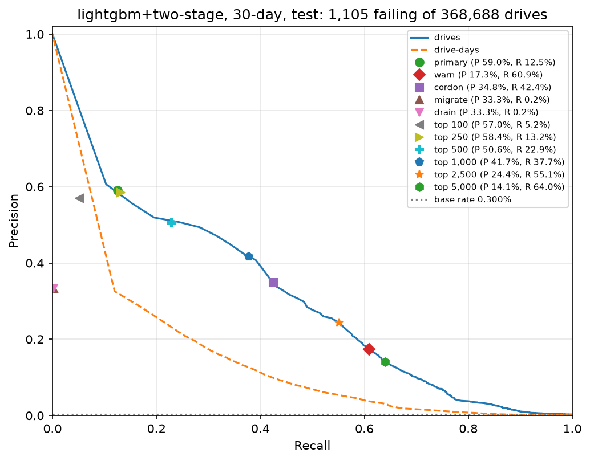 |  |

*44-day model, run `a2cd06d5`*

| Precision-recall (test) | Confusion matrices (test) |
|---|---|
| 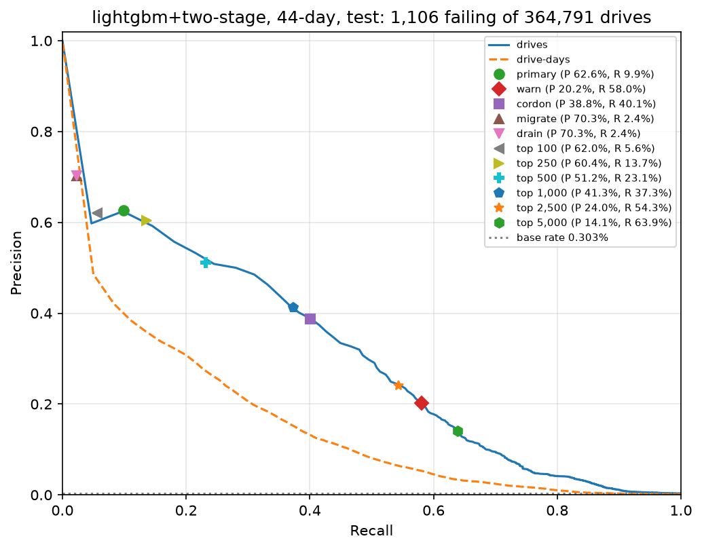 |  |

*60-day model, run `804a20ce`*

| Precision-recall (test) | Confusion matrices (test) |
|---|---|
| 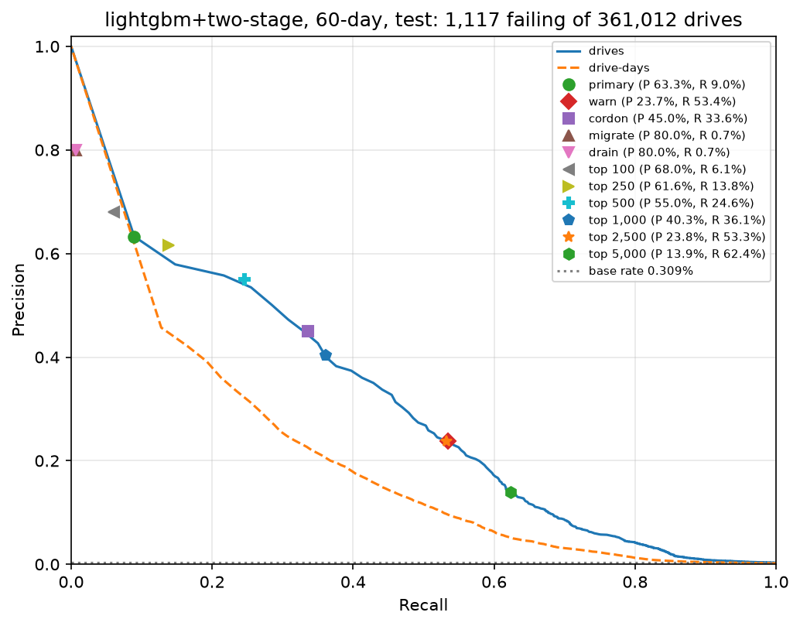 |  |

Validation curves and matrices (the same thresholds on the holdout that chose
them) sit beside these in each bundle; the precision gap between the two is
mostly the higher validation base rate (above and Section 1.1.5). For
example, the 30-day model on validation:

| Precision-recall (validation) | Confusion matrices (validation) |
|---|---|
| 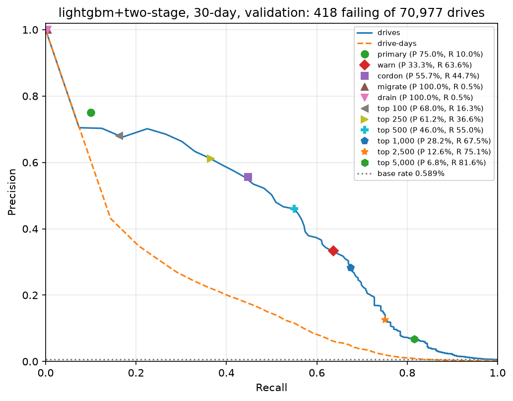 | 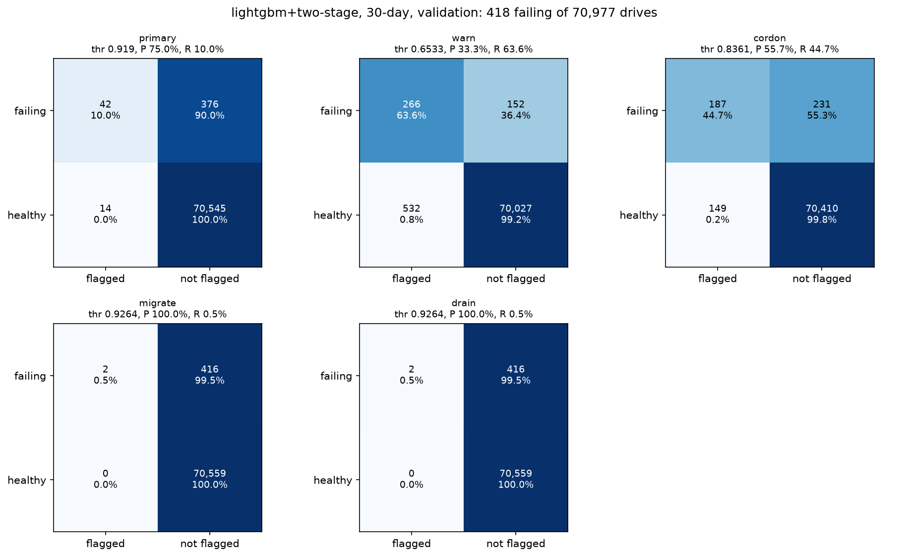 |

**Horizon comparison, paired** (`scripts/compare_horizons.py`; every model
scored on the same 361,012 drives in 2026-07-01 .. 08-01, 1,000 drive
resamples; `data/audit/horizon_q3/`). Scored against the 30-day labels,
777 failing drives:

| Model | AUROC [gap vs 30-day, 95%] | Recall at 0.1% false alarms [gap] | Recall at 0.5% false alarms [gap] | Median lead at 0.1% |
|---|---|---|---|---|
| 30-day | 0.916 | 30.6% | 51.7% | 14 days |
| 44-day | 0.918 [-0.001, +0.006] | 30.9% [-1.4, +1.9] | 52.1% [-0.9, +1.7] | 15 days |
| 60-day | 0.919 [-0.001, +0.008] | 29.6% [-2.9, +0.6] | 52.9% [-0.3, +2.8] | 15 days |

The same holds against the 44- and 60-day labels (AUROC gaps +0.002 to
+0.003, recall gaps within 1.3 points, all intervals including 0). Precision
moves with the label definition, not the model:

| 30-day model scored against | Base rate | Precision at 0.1% false alarms | Recall |
|---|---|---|---|
| 30-day labels | 0.215% | 40.1% | 30.6% |
| 44-day labels | 0.264% | 44.8% | 30.1% |
| 60-day labels | 0.309% | 49.0% | 30.9% |

Figures (drive precision-recall curves for the three models on the same
drives, and confusion matrices at the 0.1% false-alarm rate; `docs/figures/q3_2026/`).
The curves overlap: no horizon dominates.

*Scored against the 30-day labels (777 failing drives)*

| Precision-recall | Confusion matrices at 0.1% false alarms |
|---|---|
| 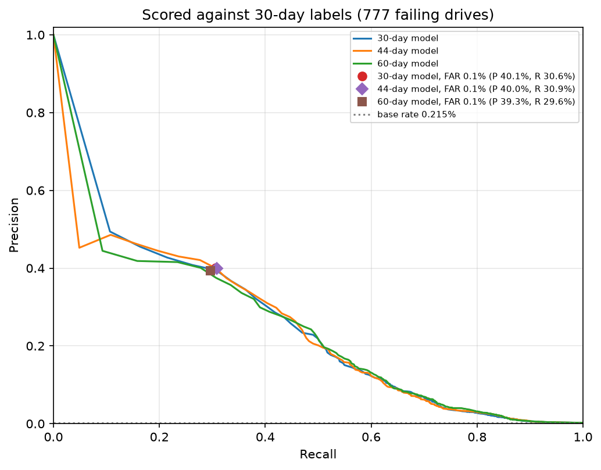 |  |

*Scored against the 44-day labels (952 failing drives)*

| Precision-recall | Confusion matrices at 0.1% false alarms |
|---|---|
| 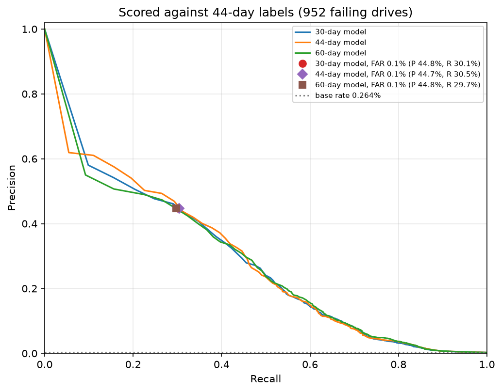 | 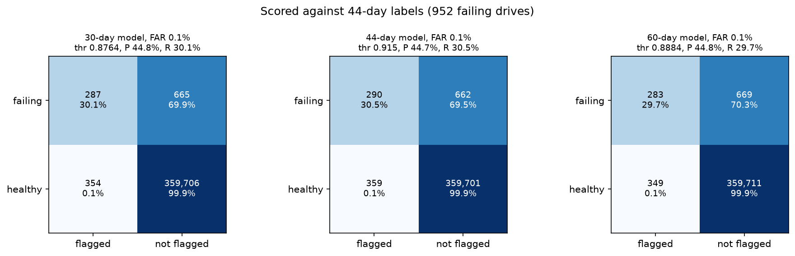 |

*Scored against the 60-day labels (1,117 failing drives)*

| Precision-recall | Confusion matrices at 0.1% false alarms |
|---|---|
| 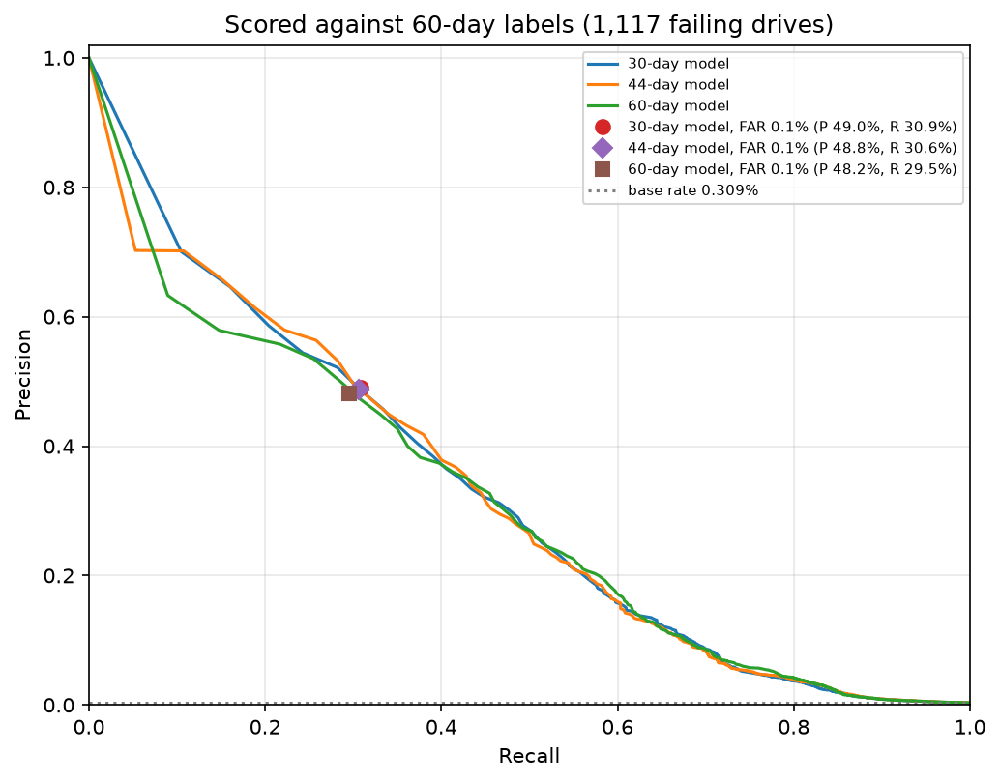 | 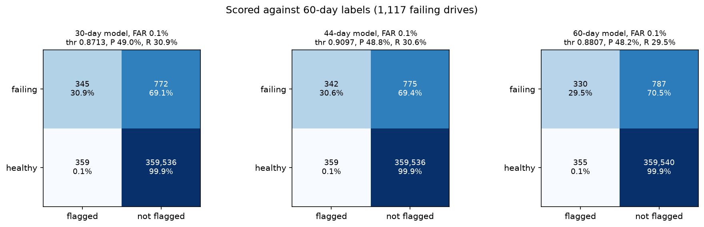 |

**Decision: 30 days stays the primary horizon.** No longer horizon ranks
drives better, catches more at a matched false-alarm rate, or warns earlier
(14-15 days median lead for all three). Section 2.4's hypothesis is answered.

**Cascade and survival Stage 2** (`make experiment-model ... --two-stage
--stage2-kinds lightgbm cox aft`, 3 seeds per horizon, paired drive
bootstrap; `data/audit/cascade_q3_h<horizon>/`, MLflow `f760b06d`,
`a4f74561`, `cabc3023`). Cascade minus Stage 1 alone, test precision points,
mean over seeds, with the number of seeds whose 95% interval lies above / below
0:

| Horizon | Stage 2 variant (net) | 10% recall | 35% | 60% | 70% |
|---|---|---|---|---|---|
| 30 | LightGBM (0.5, the old net) | +3.8 (1 / 0) | -2.5 (0 / 3) | not reached | not reached |
| 30 | **LightGBM (0.8)** | **+5.1** (1 / 0) | +0.6 (0 / 0) | -0.2 (1 / 2) | +0.2 (2 / 1) |
| 30 | Cox (0.8) | +4.5 (0 / 0) | -0.9 (0 / 1) | +0.2 (1 / 1) | +0.5 (2 / 0) |
| 30 | AFT (0.8) | -6.5 (0 / 2) | -6.6 (0 / 3) | -2.8 (0 / 3) | -1.7 (0 / 3) |
| 44 | LightGBM (0.8) | -0.5 (0 / 0) | +0.6 (1 / 0) | -0.1 (1 / 1) | -0.8 (0 / 2) |
| 44 | Cox (0.8) | +4.2 (1 / 0) | -0.1 (0 / 0) | -0.3 (1 / 1) | -0.1 (0 / 1) |
| 44 | AFT (0.8) | -2.3 (0 / 0) | -7.6 (0 / 3) | -3.2 (0 / 3) | -1.7 (0 / 3) |
| 60 | LightGBM (0.8) | -1.3 (0 / 1) | +1.8 (2 / 0) | +1.3 (3 / 0) | -0.8 (0 / 2) |
| 60 | Cox (0.8) | +0.9 (0 / 0) | +0.6 (1 / 1) | -0.1 (0 / 1) | -0.3 (0 / 2) |
| 60 | AFT (0.8) | -5.8 (0 / 1) | -6.7 (0 / 3) | -3.3 (0 / 3) | -1.8 (0 / 3) |

- **Above 20% recall no Stage 2 beats Stage 1 alone by more than about 1
  point**, in any horizon. The precision-recall curves lie on top of each other
  past 30% recall. The 60-day LightGBM's +1.3 at 60% (3/3 seeds) loses 0.8 at
  70% (2/3 below 0).
- **The 0.8 net is not confirmed.** Its strict-end gain is +5.1 points at 10%
  recall for 30 days with only 1 of 3 seeds above 0, and absent for 44 and 60
  days. It is not worse than the 0.5 net, which loses 2.5 points at 35% recall
  in 3 of 3 seeds. `candidate_recall` stays 0.8 (section 6 of the run document
  gives the rule any future untouched data must apply).
- **Cox matches the LightGBM Stage 2** within about 1 point everywhere, with no
  consistent sign; its C-index on the test candidates equals Stage 1's (0.90).
- **AFT is worse at every level in every horizon** (2-8 points, 3/3 seeds): its
  validation thresholds do not carry to test. Not a candidate.
- The ceiling held: Stage 1 at the 0.8 cutoff keeps 79-81% of failing test
  drives, and nothing above it changes.

Generated tables (same command as Section 1.1.3, `--cascade` with each
horizon's `experiment_two_stage.json`; 10%, 35% and 60% levels):

30-day:

| Model | Recall level | Precision | Recall | Caught | Missed % | False alarms |
|---|---|---|---|---|---|---|
| Stage 1 alone | 10% | 56.5% | 11.2% | 123 | 88.8% | 97 |
| Cascade, 50% net | 10% | 60.3% | 9.7% | 107 | 90.3% | 72 |
| Cascade, 80% net (production setting) | 10% | 61.7% | 10.4% | 115 | 89.6% | 72 |
| Cascade, 80% net, Cox Stage 2 | 10% | 61.0% | 15.7% | 173 | 84.3% | 113 |
| Cascade, 80% net, AFT Stage 2 | 10% | 50.0% | 20.5% | 227 | 79.5% | 246 |
| Stage 1 alone | 35% | 41.6% | 37.5% | 414 | 62.5% | 582 |
| Cascade, 50% net | 35% | 39.1% | 34.8% | 384 | 65.2% | 599 |
| Cascade, 80% net (production setting) | 35% | 42.3% | 36.3% | 401 | 63.7% | 548 |
| Cascade, 80% net, Cox Stage 2 | 35% | 40.7% | 37.0% | 408 | 63.0% | 594 |
| Cascade, 80% net, AFT Stage 2 | 35% | 35.0% | 41.4% | 457 | 58.6% | 849 |
| Stage 1 alone (= 50% net) | 60% | 20.1% | 59.2% | 654 | 40.8% | 2,600 |
| Cascade, 80% net (production setting) | 60% | 19.9% | 58.6% | 648 | 41.4% | 2,605 |
| Cascade, 80% net, Cox Stage 2 | 60% | 20.3% | 58.3% | 644 | 41.7% | 2,528 |
| Cascade, 80% net, AFT Stage 2 | 60% | 17.3% | 61.6% | 681 | 38.4% | 3,260 |

44-day:

| Model | Recall level | Precision | Recall | Caught | Missed % | False alarms |
|---|---|---|---|---|---|---|
| Stage 1 alone | 10% | 59.0% | 9.9% | 110 | 90.1% | 77 |
| Cascade, 50% net | 10% | 61.7% | 7.8% | 87 | 92.2% | 54 |
| Cascade, 80% net (production setting) | 10% | 58.4% | 15.4% | 171 | 84.6% | 121 |
| Cascade, 80% net, Cox Stage 2 | 10% | 63.2% | 16.1% | 178 | 83.9% | 115 |
| Cascade, 80% net, AFT Stage 2 | 10% | 56.7% | 15.6% | 173 | 84.4% | 133 |
| Stage 1 alone | 35% | 45.2% | 33.1% | 366 | 66.9% | 443 |
| Cascade, 50% net | 35% | 45.7% | 30.2% | 334 | 69.8% | 399 |
| Cascade, 80% net (production setting) | 35% | 45.9% | 32.7% | 361 | 67.3% | 427 |
| Cascade, 80% net, Cox Stage 2 | 35% | 45.1% | 35.1% | 388 | 64.9% | 472 |
| Cascade, 80% net, AFT Stage 2 | 35% | 37.7% | 41.6% | 460 | 58.4% | 761 |
| Stage 1 alone (= 50% net) | 60% | 23.2% | 56.2% | 622 | 43.8% | 2,062 |
| Cascade, 80% net (production setting) | 60% | 23.1% | 55.7% | 616 | 44.3% | 2,056 |
| Cascade, 80% net, Cox Stage 2 | 60% | 22.9% | 56.5% | 625 | 43.5% | 2,109 |
| Cascade, 80% net, AFT Stage 2 | 60% | 20.0% | 58.7% | 650 | 41.3% | 2,603 |

60-day:

| Model | Recall level | Precision | Recall | Caught | Missed % | False alarms |
|---|---|---|---|---|---|---|
| Stage 1 alone | 10% | 69.6% | 8.4% | 94 | 91.6% | 41 |
| Cascade, 50% net | 10% | 68.5% | 10.2% | 114 | 89.8% | 52 |
| Cascade, 80% net (production setting) | 10% | 68.4% | 11.4% | 127 | 88.6% | 59 |
| Cascade, 80% net, Cox Stage 2 | 10% | 70.6% | 13.4% | 150 | 86.6% | 63 |
| Cascade, 80% net, AFT Stage 2 | 10% | 63.8% | 16.7% | 186 | 83.3% | 113 |
| Stage 1 alone | 35% | 49.6% | 28.7% | 320 | 71.3% | 327 |
| Cascade, 50% net | 35% | 49.2% | 28.6% | 320 | 71.4% | 332 |
| Cascade, 80% net (production setting) | 35% | 51.5% | 28.0% | 312 | 72.0% | 296 |
| Cascade, 80% net, Cox Stage 2 | 35% | 50.3% | 31.2% | 349 | 68.8% | 346 |
| Cascade, 80% net, AFT Stage 2 | 35% | 43.0% | 35.8% | 399 | 64.2% | 530 |
| Stage 1 alone (= 50% net) | 60% | 26.6% | 50.9% | 568 | 49.1% | 1,570 |
| Cascade, 80% net (production setting) | 60% | 27.9% | 49.6% | 554 | 50.4% | 1,431 |
| Cascade, 80% net, Cox Stage 2 | 60% | 26.5% | 51.5% | 575 | 48.5% | 1,600 |
| Cascade, 80% net, AFT Stage 2 | 60% | 23.2% | 54.7% | 611 | 45.3% | 2,019 |

Figures (seed 0 of each experiment; the tables above average three seeds;
`docs/figures/q3_2026/`). The curves of Stage 1 alone and every Stage 2 kind
coincide above about 30% recall; the markers are the 10% and 60% recall levels
(thresholds from validation, so a survival model's marker lands at a different
recall on test). The confusion matrices give the counts behind each marker.

| 30-day | 44-day | 60-day |
|---|---|---|
| 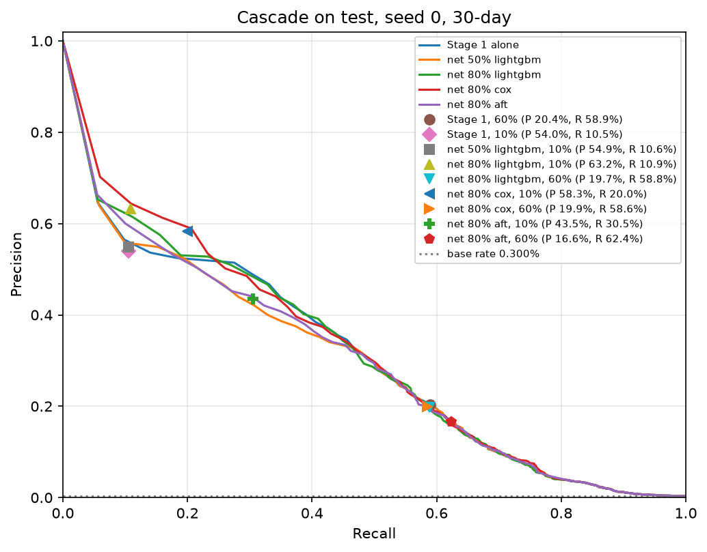 | 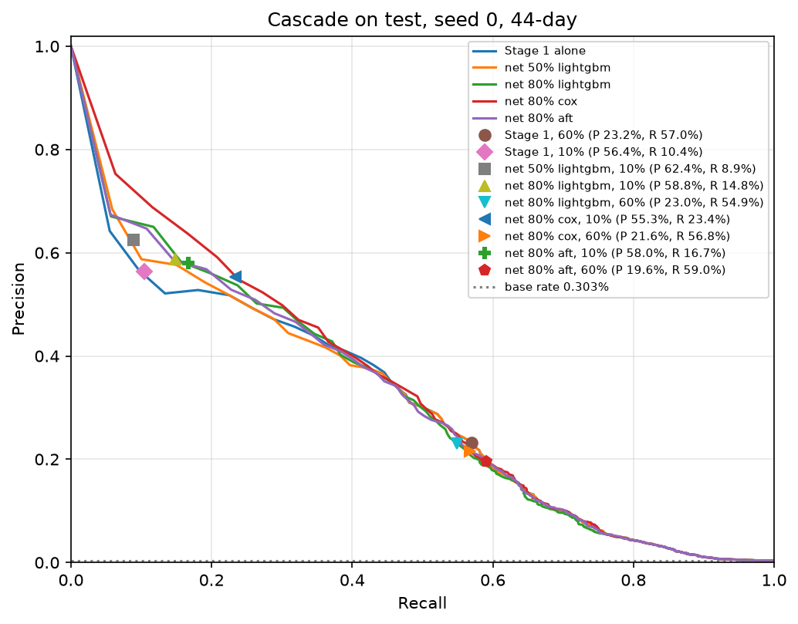 | 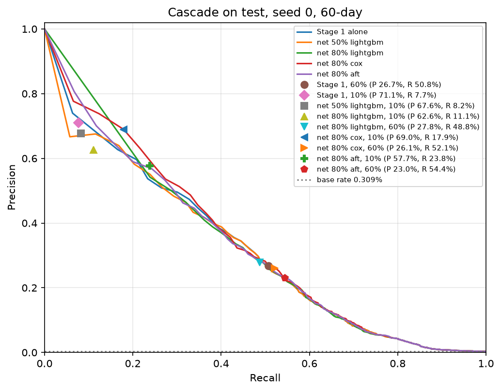 |

*30-day, confusion matrices at the 10% and 60% recall levels*

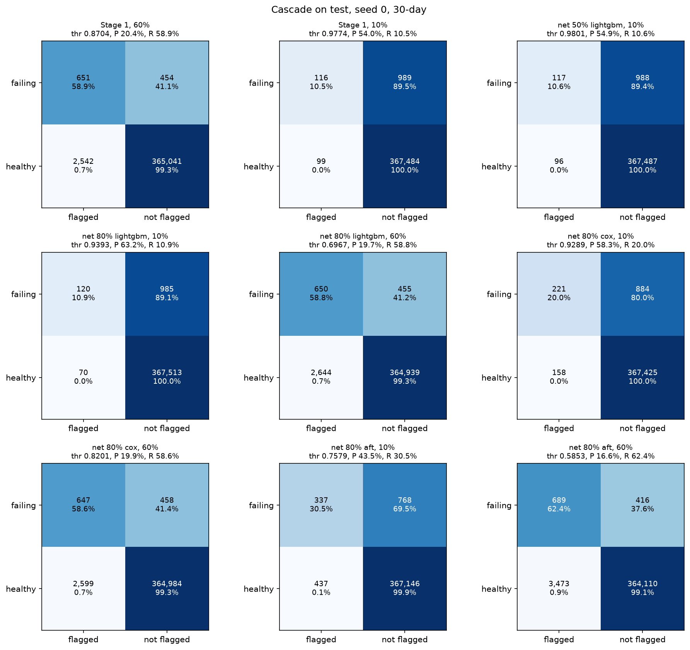

*44-day, confusion matrices at the 10% and 60% recall levels*


*60-day, confusion matrices at the 10% and 60% recall levels*

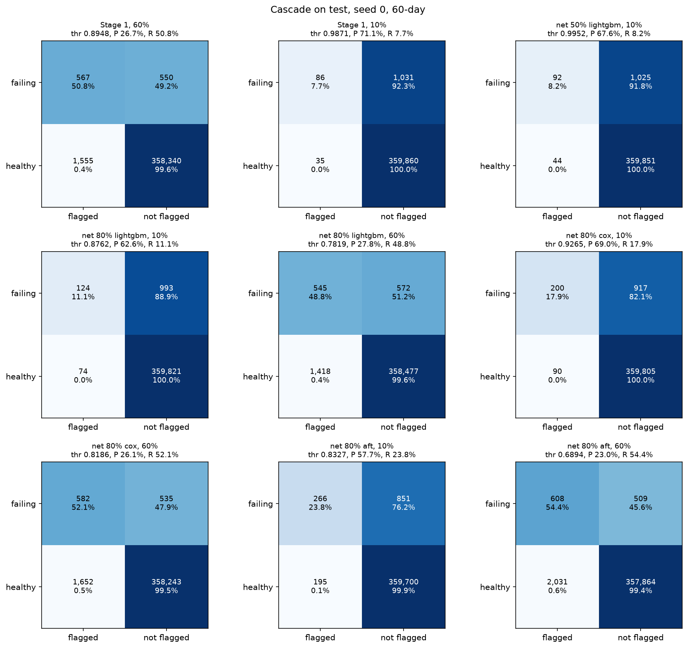

**Commands that produced Section 1.1.4** (all from the repository root, 2026-11-06;
times are IST, the access-log and log-file times are UTC; `ARGS`-style options are
passed through `make` as shown). Each step names the code commit it ran at.

*Data refresh to include Q3 2026.* Bronze, silver and gold from before the ingest
were first copied to `data/tmp/backup_pre_q3_20261106/` (local, not committed).

| # | Command | Code | What it did |
|---|---|---|---|
| 1 | `make download-backblaze ARGS="--quarters Q3_2026"` | `e226bdb` | Downloaded the Q3 2026 archive |
| 2 | `make ingest-backblaze ARGS="--start-date 2026-07-01 --end-date 2026-09-30"` | `e226bdb` | Bronze for July to September (92 days) |
| 3 | `make build-silver` | `5a93d86` | Silver; `build_drive_metadata` in 8 hash partitions (`resource_limits.drive_metadata_partitions`) to stay under the 20 GB cap |
| 4 | `make build-features` | `f8bab86` | Gold features, rebuilt after the fix that computes the model-family z-score statistics and each model's expected attributes on rows before `sealed_start` only (the first build, before the fix, was replaced; the code was committed after the rebuild started) |
| 5 | `make build-labels` | `edeb1b3` | Labels for horizons 30, 44, 60 with a 20% drive holdout, at 14:49 |

*Training* (`data/audit/q3_logs/run_q3.sh` in this order; code `edeb1b3`, the two
later runs also saw the docs-only commits `b81a0ff` and `9dbadd8`, which is why
access-log lines 115 and 116 show `9dbadd8`):

```bash
make train TRAIN_TAG=h30_q1q2_q3 TRAIN_ARGS="--horizon-days 30 --keep-work-dir --save-scores"   # line 114, run c459046e
make train TRAIN_TAG=h44_q1q2_q3 TRAIN_ARGS="--horizon-days 44 --keep-work-dir --save-scores"   # line 115, run a2cd06d5
make train TRAIN_TAG=h60_q1q2_q3 TRAIN_ARGS="--horizon-days 60 --keep-work-dir --save-scores"   # line 116, run 804a20ce
```

Kept work directories (`data/tmp/`, local): `train_model_frame_fag3o60h` is the 30-day
run, `train_model_frame_ff5ejt7a` the 44-day, `train_model_frame_xjxdieoe` the 60-day.
Score tables: `data/tmp/lightgbm_scores_h<H>_h<H>_q1q2_q3.parquet`.

*Horizon comparison* (code `6c61e35`, line 117):

```bash
uv run python scripts/compare_horizons.py \
    --scores 30=data/tmp/lightgbm_scores_h30_h30_q1q2_q3.parquet \
             44=data/tmp/lightgbm_scores_h44_h44_q1q2_q3.parquet \
             60=data/tmp/lightgbm_scores_h60_h60_q1q2_q3.parquet
```

*Cascade and survival Stage 2* (`data/audit/q3_logs/run_cascade.sh`, 3 seeds each, lines
118-126; code `6c61e35` for the 30-day seeds 0-1 and `3bfe609` after, which changed only
config comments, docs and a docstring; nets, Stage 2 kinds, survival parameters and
seeds come from `configs/model.yaml` `model.two_stage.experiment`):

```bash
make experiment-model EXPERIMENT_ARGS="--work-dir data/tmp/train_model_frame_fag3o60h --variants --skip-baseline --two-stage --two-stage-out data/audit/cascade_q3_h30"
make experiment-model EXPERIMENT_ARGS="--work-dir data/tmp/train_model_frame_ff5ejt7a --variants --skip-baseline --two-stage --two-stage-out data/audit/cascade_q3_h44"
make experiment-model EXPERIMENT_ARGS="--work-dir data/tmp/train_model_frame_xjxdieoe --variants --skip-baseline --two-stage --two-stage-out data/audit/cascade_q3_h60"
```

*Tables and figures in this section:*

```bash
# generated cascade tables (10%, 35% and 60% levels), one per horizon
make merged-tables REPORT=frozen_runs/fb58d9576c6146ba94c13389005fa15b/merged_evaluation_report.json \
    TABLES_ARGS="--cascade data/audit/cascade_q3_h30/experiment_two_stage.json --cascade-levels 0.10 0.35 0.60"
# (repeat with cascade_q3_h44 and cascade_q3_h60)
# figures embedded above: copies of the seed-0 cascade and horizon-comparison figures
cp data/audit/cascade_q3_h<H>/figures/cascade_{precision_recall,confusion}_seed0.png docs/figures/q3_2026/   # renamed cascade_h<H>_*.png
cp data/audit/horizon_q3/figures/labels_<H>d_{precision_recall,confusion}.png docs/figures/q3_2026/horizon_labels_<H>d_*.png
```

*Frozen bundles.* `frozen_runs/<run id>/` were assembled by following the steps in
`frozen_runs/README.md` ("Adding a run") with an inline script that is not kept in the
repository; every file is checked by `cd frozen_runs/<run id> && sha256sum -c SHA256SUMS`.

*Test looks:* `data/audit/test_access_log.jsonl` lines 114-126 (3 training runs, 1
horizon comparison, 9 cascade seeds).

### 1.1.4a A stacked Stage 2: LightGBM + Cox (run 2026-11-06, small strict-end gain, not confirmed, outputs frozen)

Question: does a blend of the LightGBM and Cox Stage 2 re-rank the Stage 1
candidates better than either alone? Section 1.1.4 found Cox matches LightGBM
within about 1 point at every level, so any gain would sit at the strict end.

**Method.** A new Stage 2 kind, `stack` (`src/models/stacking.py`), blends the
two Stage 2 models already fitted for the same net; nothing is retrained. Each
member's score becomes its rank against that member's validation candidate
scores (`src/models/ensemble.py::validation_rank`, so test is not used), and
the weights are searched on a 0.1 simplex grid for drive-level average
precision on the validation candidates. The members early-stopped on the same
validation rows, so the blend's validation score is optimistic; only the paired
test comparison counts. A stack is compared, not deployed (`log_two_stage`
accepts a LightGBM Stage 2 only). Same settings as Section 1.1.4: nets 0.5 and
0.8, survival nets 0.8, 3 seeds, paired drive bootstrap against Stage 1 alone
and against the LightGBM Stage 2 (`paired_vs_lightgbm`).

**Commands.** The Q3 runs below read the kept work directories of the three
Q1+Q2 -> Q3 training runs (`data/tmp/train_model_frame_fag3o60h` for 30 days,
`ff5ejt7a` for 44, `xjxdieoe` for 60). Run from the repository root:

```bash
# 1. The runs this one repeats (Section 1.1.4); scripts as run on 2026-11-06:
bash data/audit/q3_logs/run_q3.sh        # build-labels, then make train per horizon
                                         #   TRAIN_ARGS="--horizon-days H --keep-work-dir --save-scores"
bash data/audit/q3_logs/run_cascade.sh   # make experiment-model ... --two-stage, kinds from config

# 2. The stacked run: lightgbm + cox + stack, per horizon
bash data/audit/stack_q3_logs/run_stack.sh "$PWD"
#   which runs, for H in 30 (fag3o60h), 44 (ff5ejt7a), 60 (xjxdieoe):
make experiment-model EXPERIMENT_ARGS="--work-dir data/tmp/train_model_frame_<dir> \
  --variants --skip-baseline --two-stage --stage2-kinds lightgbm cox stack \
  --two-stage-out data/audit/stack_q3_h<H>"

# 3. Tests of the new code
uv run pytest tests/unit/test_two_stage.py
```

The three horizons are the three frozen runs of Section 1.1.4. The experiment
reads the data and kept work directory of each and refits Stage 1 and the Stage 2
models per seed; it does not load the frozen models (`frozen_runs/README.md`).

| Horizon | Frozen run folder (`frozen_runs/<id>/`) | Tag | Kept work dir | Stack output |
|---|---|---|---|---|
| 30 days | `c459046e4f1645169151e7be25ff064d` (the current model) | `h30_q1q2_q3` | `fag3o60h` | `data/audit/stack_q3_h30/` |
| 44 days | `a2cd06d53e624c09b0d12f81076def8a` | `h44_q1q2_q3` | `ff5ejt7a` | `data/audit/stack_q3_h44/` |
| 60 days | `804a20cec10048abb1bc3ccf510f96e1` | `h60_q1q2_q3` | `xjxdieoe` | `data/audit/stack_q3_h60/` |

Each run appends a line to `data/audit/test_access_log.jsonl` and writes
`experiment_results.json` into the work directory, as the Section 1.1.4 run
did. Outputs: `data/audit/stack_q3_h30/`, `_h44/`, `_h60/` (`tables.md`,
`experiment_two_stage.json`, `figures/`, `code.patch` = the uncommitted diff at
launch) and `data/audit/stack_q3_logs/` (the launcher and one log per horizon).
The table headed "Survival Stage 2 against the LightGBM Stage 2" also lists the
stack; the numbers are right, the heading predates the stack kind.

**Results** (Q3 2026 test, per drive, 0.8 net, mean of 3 seeds, thresholds from
validation; run 2026-11-06 20:12-21:37 IST; the LightGBM and Cox rows reproduce
the Section 1.1.4 tables exactly, so the repeat is consistent with that run).
Precision / recall at each recall level; the last column is the stack minus
the LightGBM Stage 2 in **precision points only**, with how many of the 3 seeds
have the paired 95% interval above / below 0. Read it with the recall columns
beside it and with the two tables below: each model's threshold is set on
validation for a recall target, so on test the models land at different recall
and flag different numbers of drives, and precision alone is not a fair
comparison between them (the 60-day 10% row is the clearest case):

| Horizon | Level | Stage 1 alone | LightGBM Stage 2 | Cox | Stack | Stack minus LightGBM |
|---|---|---|---|---|---|---|
| 30 | 10% | 56.5% | 61.7% / 10.4% | 61.0% / 15.7% | **64.9% / 11.6%** | +3.2 (1 / 0) |
| 30 | 35% | 41.6% | 42.3% / 36.3% | 40.7% / 37.0% | 41.7% / 37.2% | -0.5 (0 / 0) |
| 30 | 60% | 20.1% | 19.9% / 58.6% | 20.3% / 58.3% | 19.9% / 58.9% | 0.0 (0 / 0) |
| 44 | 10% | 59.0% | 58.4% / 15.4% | 63.2% / 16.1% | **64.6% / 14.1%** | +6.1 (3 / 0) |
| 44 | 35% | 45.2% | 45.9% / 32.7% | 45.1% / 35.1% | 45.9% / 34.2% | 0.0 (0 / 0) |
| 44 | 60% | 23.2% | 23.1% / 55.7% | 22.9% / 56.5% | 23.4% / 56.2% | +0.3 (1 / 1) |
| 60 | 10% | 69.6% | 68.4% / 11.4% | 70.6% / 13.4% | 68.0% / 15.5% | -0.4 (0 / 0) |
| 60 | 35% | 49.6% | 51.5% / 28.0% | 50.3% / 31.2% | 52.0% / 29.8% | +0.6 (1 / 0) |
| 60 | 60% | 26.6% | 27.9% / 49.6% | 26.5% / 51.5% | 27.0% / 50.5% | -0.9 (0 / 3) |

**Both axes at the 10% level, per seed** (stack minus LightGBM Stage 2, points,
paired 95% interval in brackets; **bold** = interval entirely above 0, *italic*
= entirely below 0):

| Horizon | Seed | Precision | Recall | Drives caught, LightGBM / Cox / stack |
|---|---|---|---|---|
| 30 | 0 | +2.4 [-1.7, +6.6] | **+1.9** [+0.5, +3.2] | 120 / 221 / 141 |
| 30 | 1 | **+5.3** [+1.2, +9.8] | +0.5 [-0.6, +1.6] | 119 / 159 / 124 |
| 30 | 2 | +1.9 [-2.5, +6.0] | **+1.1** [+0.2, +2.0] | 107 / 140 / 119 |
| 44 | 0 | **+5.3** [+2.5, +8.4] | -0.8 [-1.7, +0.1] | 164 / 259 / 155 |
| 44 | 1 | **+8.8** [+4.6, +13.3] | -1.0 [-2.2, +0.2] | 142 / 148 / 131 |
| 44 | 2 | **+4.3** [+1.4, +7.6] | *-2.2* [-3.5, -0.9] | 206 / 126 / 182 |
| 60 | 0 | +3.5 [-0.4, +7.7] | **+3.8** [+2.5, +5.0] | 124 / 200 / 166 |
| 60 | 1 | -2.0 [-7.7, +3.5] | **+6.4** [+4.8, +8.0] | 123 / 123 / 194 |
| 60 | 2 | -2.8 [-7.1, +1.7] | **+2.1** [+1.1, +3.3] | 135 / 126 / 159 |

- 30 and 60 days: in every seed the stack is better on at least one axis and
  significantly worse on none. At 60 days it catches more drives in 3 / 3 seeds
  at a precision whose interval includes 0, which a precision-only reading (-0.4)
  hid. 44 days is a trade: higher precision in 3 / 3 seeds, but fewer drives
  caught in all three (significantly so in one).

**Matched budget: failing drives caught when exactly K drives are flagged**
(mean of 3 seeds; no thresholds involved; "seeds" = in how many of the 3 seeds
the stack catches more than that model):

| Horizon | K | LightGBM | Cox | Stack | Stack > LightGBM | Stack > Cox |
|---|---|---|---|---|---|---|
| 30 | 100 | 64.7 | 70.7 | 69.0 | 3 / 3 | 0 / 3 |
| 30 | 250 | 146.3 | 156.7 | 153.7 | 3 / 3 | 0 / 3 |
| 30 | 500 | 266.0 | 267.3 | 270.3 | 3 / 3 | 3 / 3 |
| 30 | 1,000 | 413.0 | 408.0 | 415.0 | 2 / 3 | 3 / 3 |
| 44 | 100 | 67.3 | 73.0 | 72.7 | 3 / 3 | 1 / 3 |
| 44 | 250 | 149.0 | 162.7 | 159.3 | 3 / 3 | 1 / 3 |
| 44 | 500 | 267.3 | 271.7 | 274.0 | 3 / 3 | 3 / 3 |
| 44 | 1,000 | 415.7 | 419.3 | 417.3 | 1 / 3 | 0 / 3 |
| 60 | 100 | 70.7 | 76.3 | 75.0 | 3 / 3 | 1 / 3 |
| 60 | 250 | 161.3 | 174.7 | 167.7 | 3 / 3 | 0 / 3 |
| 60 | 500 | 276.0 | 284.7 | 287.3 | 3 / 3 | 3 / 3 |
| 60 | 1,000 | 413.3 | 409.3 | 414.3 | 1 / 3 | 1 / 3 |

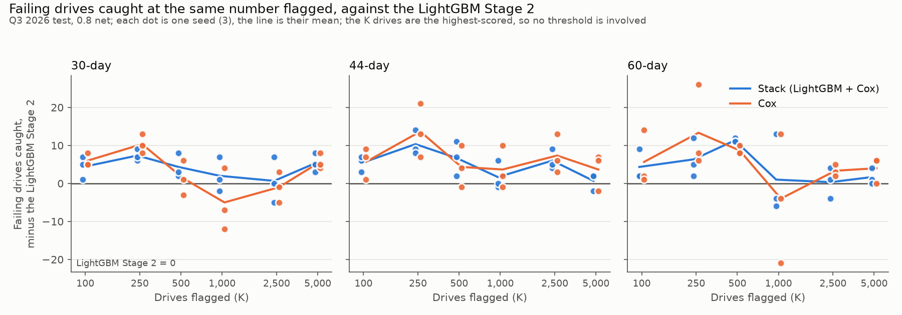

*Q3 2026 test, 0.8 net. Each dot is one seed, the difference being taken within
the seed against the LightGBM Stage 2; the line is the mean over the 3 seeds. The
K drives are the highest-scored of each model, so no threshold is involved.
Drawn by `scripts/plot_stack_topk.py` from the saved `top_k` results of the three
stack folders; no new look at the test set.* Up to K = 500 the stack is above zero
in every seed in all three horizons (9 of 9 seed-and-K points each, +1 to +14);
Cox is above zero in 25 of 27, with a larger spread (up to +26 in a seed); from
K = 1,000 the differences are mixed in sign (stack -6 to +13, Cox -21 to +13).

**Reading.**
- **A small, consistent strict-end gain over LightGBM.** Flagging the same
  number of drives, the stack catches more failing drives than LightGBM at K =
  100, 250 and 500 in 3 / 3 seeds in all three horizons: about 4 to 11 more
  drives out of about 1,100 failing (0.4 to 1 point of recall). From K = 1,000
  there is no consistent difference, and above about 35% recall the curves
  coincide (the figures below).
- **At K = 100 and 250 the gain is Cox's, not the blend's.** Cox alone catches
  as many or more than the stack there (the stack beats Cox in 0 to 1 seeds). At
  K = 500 the stack beats both LightGBM and Cox in 3 / 3 seeds in every horizon,
  the only place a blend adds something over its better member.
- **The same applies to the 44-day precision gain:** Cox alone reaches 63.2% at
  the 10% level against 58.4% for LightGBM, so the stack's +6.1 is +1.4 over
  Cox.
- **Not confirmed, because the evidence is weaker than "3 / 3" sounds.** (1)
  The matched-K counts have no confidence intervals. (2) The three seeds share
  the same test drives, so they are not independent samples of the test set.
  (3) This is a second look at the same data after the precision-only reading
  and the rule suggested before the run (interval above 0 in at least 2 of 3
  seeds at both 10% and 35% recall, met by no horizon, written in conversation
  and not in a file) disagreed, so which view is "the" result was not fixed in
  advance. (4) Q3 is already a test set. Treat the K <= 500 gain as a lead.
- **The weights are not stable:** LightGBM / Cox 0.4 / 0.6, 0.5 / 0.5 and 0.6 /
  0.4 at 30 days; 0.5 / 0.5, 0.4 / 0.6 and 0.3 / 0.7 at 44; 0.5 / 0.5, 0.3 /
  0.7 and 0.5 / 0.5 at 60. Validation drive-level average precision of the
  stack is 0.544-0.547 (30), 0.573-0.581 (44), 0.587-0.596 (60), within about
  0.01 of either member and partly optimistic (members early-stopped on the
  same rows).
- **Not adopted.** The production Stage 2 stays the LightGBM at the 0.8 net
  (`c459046e` and the 44- and 60-day runs). A confirmation needs an untouched
  quarter, one stated metric (caught drives at a fixed number flagged, with a
  paired interval), Cox alone as a third arm, and the rules of
  `docs/q3_horizon_and_cascade_run.md` section 6.

**Figures** (seed 0 only; the table above averages three seeds; copies of
`data/audit/stack_q3_h<H>/figures/cascade_*_seed0.png` in `docs/figures/q3_2026/`,
named `stack_h<H>_*.png`). The precision-recall curves of Stage 1 alone, the 0.5
and 0.8 LightGBM nets, Cox and the stack coincide above about 35% recall; the
markers are the 10% and 60% recall levels, with thresholds from validation, so
each model's marker lands at a different test recall. The confusion matrices
give the counts behind each marker, and are exact.

**These curves cannot show the strict end, where the stack differs.** The figure
code draws about 2,000 of the roughly 360,000 points of each drive-level curve,
evenly spaced, so the highest-scored 500 drives, the region of the matched-budget
table below, are drawn with about three points and appear as straight segments
(the 60-day 0.8 LightGBM curve is one: its own 10% marker lies about 25 points
below it). Do not read differences below about 30% recall from them. Marker colours
follow matplotlib's cycle, not the curve they belong to (a green marker is not on
the green curve). Redrawing them needs the per-drive scores, which these runs did
not save. The matched-budget figure after the table uses the saved top-K counts
instead.

| 30-day | 44-day | 60-day |
|---|---|---|
| 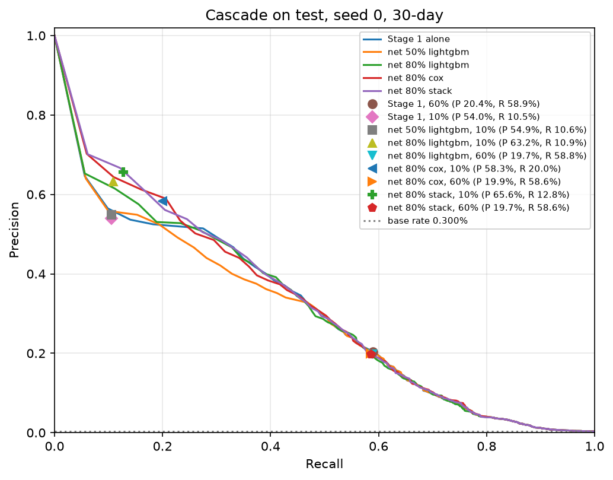 | 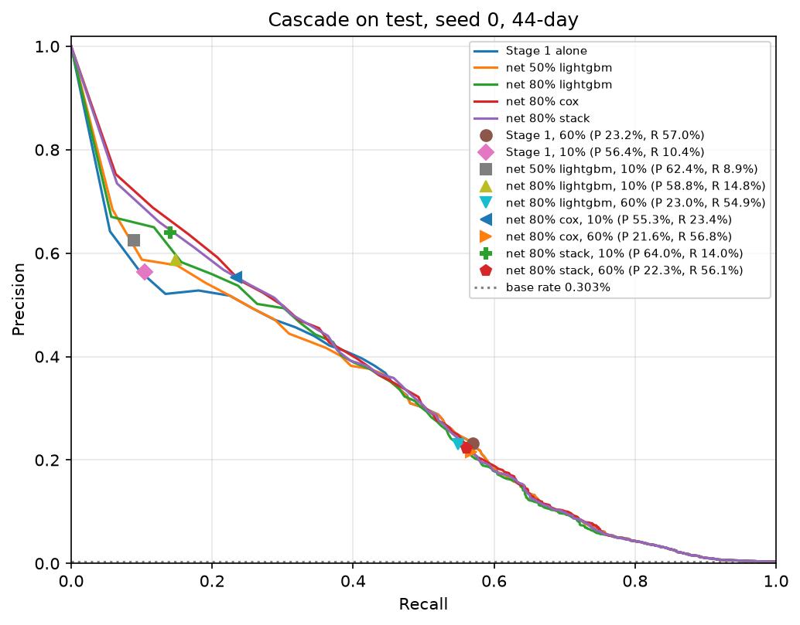 | 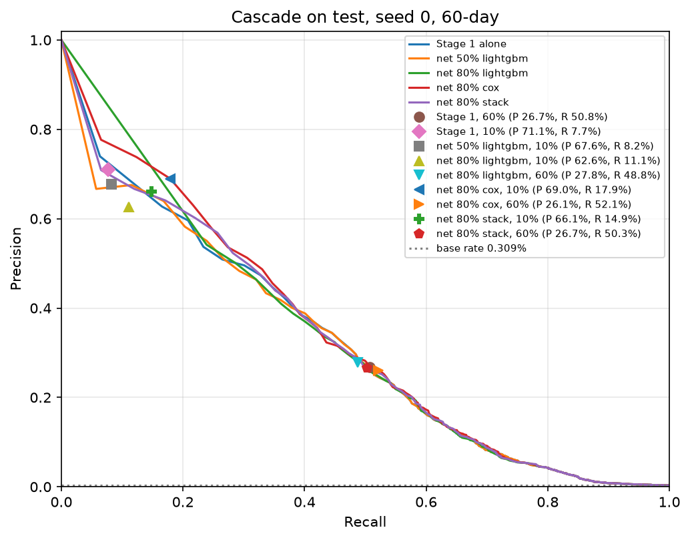 |

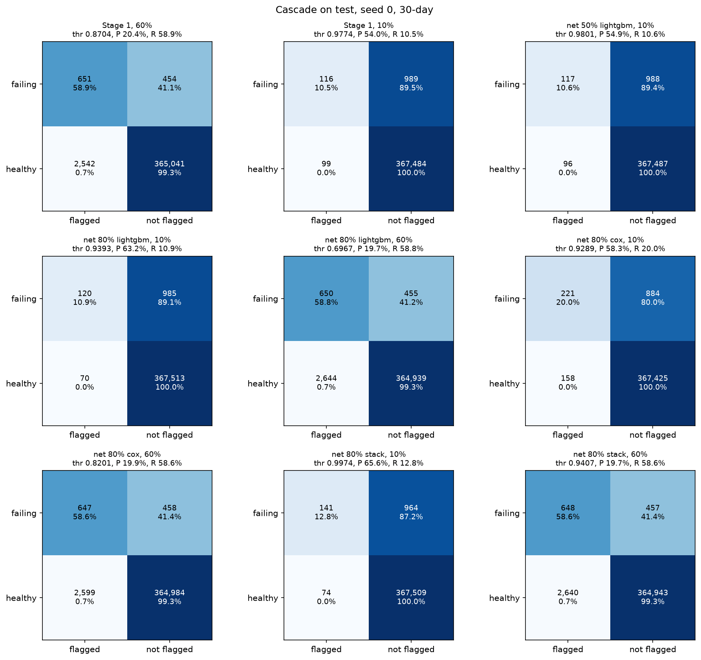


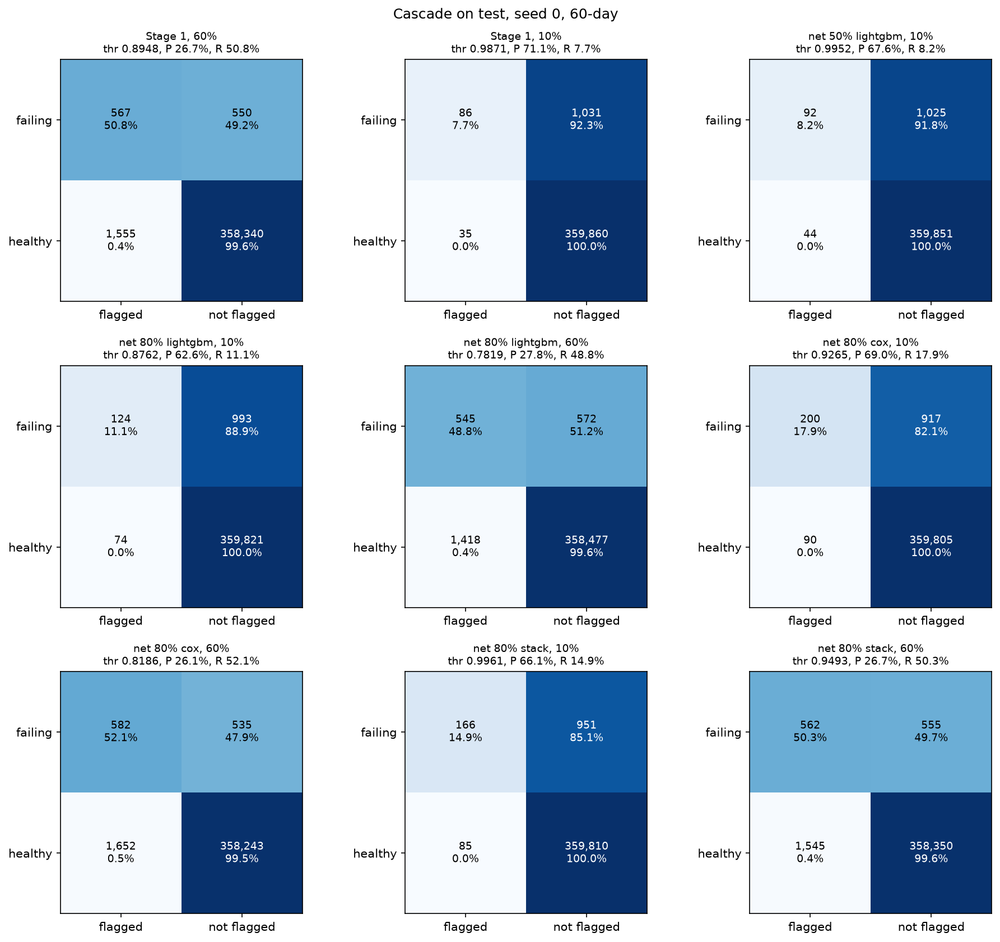

**Frozen outputs.** Do not re-run into these folders (the runner refuses to
overwrite) and do not edit them. SHA-256 prefixes (first 16), full list in
`data/audit/stack_q3_logs/CHECKSUMS.sha256`; verify from the repository root
with `sha256sum -c data/audit/stack_q3_logs/CHECKSUMS.sha256`:

| File | SHA-256 (first 16) |
|---|---|
| `stack_q3_h30/experiment_two_stage.json` | `28e34940a6c1a904` |
| `stack_q3_h44/experiment_two_stage.json` | `2cebafd0a4210cac` |
| `stack_q3_h60/experiment_two_stage.json` | `38ec83854ab4e699` |
| `stack_q3_h30/tables.md`, `_h44/`, `_h60/` | `c4c275ba13058c8a`, `ffc7bfb976d6240d`, `34344e99f016b60c` |
| `stack_q3_logs/run_stack.sh` | `b44c437016a87086` |

These folders are tracked (`.gitignore`, `data/audit/README.md`); the checksums
let a later reader detect a changed file. MLflow runs: `5ab8f0bb` (30 days), `7a568b77` (44), `47d8ff0c` (60).

**Overlap check, not yet reproducible.** A drive-level comparison of the
`cox` and `lightgbm` columns of `data/tmp/merged/merged_scores_h30_h30_seed0.parquet`
(April-May test window, Cox as a standalone model, not as a Stage 2) found
Spearman 0.90 and, at a false-alarm rate of 1e-4, 22 failing drives shared of
54 (LightGBM) and 92 (Cox); at 1e-3, 322 shared of 397 and 415. That script
was a one-off in a scratch directory and is not in the repository.

### 1.1.5 Deep dive into the 30-day Q3 run (2026-11-06)

What sits under the 30-day numbers of Section 1.1.4: which failing drives are
missed and why, who the false alarms are, how stable Q3 was week by week, and
why validation precision runs above test. Frozen run `c459046e`, its own
thresholds (Stage 1 0.235, warn 0.653, cordon 0.836, primary 0.919), per drive
on Q3 2026 (1,105 failing and 367,583 healthy drives). Script
`scripts/deep_dive_q3.py`; outputs `data/audit/deep_dive_q3_h30/` (`tables.md`
holds every table, including the full week-by-week one). Test looks: lines
127 and 129 of the access log; line 128 is a run stopped before it computed
anything (it used the unfixed age column).

Commands (code `f2e1805`; line 129 also had the power-on-hours age fix that commit
`42c2a89` contains):

```bash
uv run python scripts/deep_dive_q3.py --run-dir frozen_runs/c459046e4f1645169151e7be25ff064d \
    --scores data/tmp/lightgbm_scores_h30_h30_q1q2_q3.parquet \
    --test-ids data/tmp/train_model_frame_fag3o60h/test_ids.parquet           # line 127 (age column unfixed)
# the same with --overwrite after the age fix                                 # line 129 (line 128: stopped early)
uv run python scripts/deep_dive_q3.py --run-dir x --scores x --test-ids x --figures-only   # redraw figures from the JSON, no test look
```

**Missed failures.** Each failing drive placed at the strictest point that
catches it. "Core counter" = the six priority SMART counters; "warned before
window" = flagged at warn more than 30 days before failing; lead = days from the
first alert at the group's own point to failure.

| Group | Drives | Share | Any core counter > 0 | Counter rose in window | Active defects (median) | Telemetry coverage | Power-on age (years, median) | Warned before window | Median lead (days) |
|---|---|---|---|---|---|---|---|---|---|
| caught at primary | 138 | 12.5% | 92.0% | 75.4% | 4324 | 0.83 | 5.5 | 42.8% | 14 |
| caught at cordon only | 331 | 30.0% | 96.7% | 72.2% | 1866 | 0.81 | 5.5 | 42.6% | 16 |
| caught at warn only | 204 | 18.5% | 99.5% | 66.7% | 703 | 0.95 | 5.2 | 43.1% | 21 |
| passed Stage 1, below warn | 210 | 19.0% | 82.4% | 38.6% | 40 | 0.99 | 3.6 | 12.9% | 26 |
| never passed Stage 1 | 222 | 20.1% | 21.6% | 1.4% | 0 | 0.96 | 2.9 | 0.0% | - |

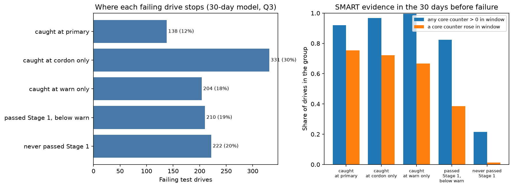

- **The roughly 20% that Stage 1 never passes are silent.** 98.6% of them show
  no rise in any core counter in the 30 days before failing, with complete
  telemetry (coverage 0.96), so it is not missing data. Overall 21.2% of
  failing drives have every core counter at zero throughout; Stage 1 passes
  25.6% of them and 94.5% of the rest. That is the recall ceiling, and only new
  information can move it.
- **They are young:** median power-on age 2.9 years against 5.5 for drives
  caught at the primary threshold. Silent failures are mostly early-life ones.
- **Many catches come early:** 43% of caught drives were already flagged at
  warn more than 30 days before failing, which the 30-day label does not count.
- By family, the primary point is mostly Seagate; Western Digital reaches 78%
  at Stage 1 but 1.2% at primary, HGST 92% at Stage 1 and 82% at warn but 7% at
  primary:

| Family | Failing | Stage 1 recall | Warn recall | Primary recall | No core signal |
|---|---|---|---|---|---|
| Seagate HDD | 537 | 80.8% | 63.7% | 18.4% | 23.6% |
| Toshiba HDD | 247 | 71.7% | 54.7% | 10.5% | 26.7% |
| Western Digital HDD | 165 | 78.2% | 42.4% | 1.2% | 17.6% |
| HGST HDD | 153 | 92.2% | 82.4% | 7.2% | 5.9% |
| WUH721816ALE6L4 | 3 | 66.7% | 0.0% | 0.0% | 100.0% |

**False alarms.** The healthy drives flagged at each point. "Failed later" is
limited by the data, which ends 2026-09-30.

| Point | Flagged healthy | Still active | Removed without failure | Failed later | Any core counter > 0 (fleet) | Counter rose | Power-on age, years (fleet) |
|---|---|---|---|---|---|---|---|
| stage1 | 22,463 | 97.6% | 2.3% | 23 | 59.8% (8.9%) | 39.6% | 3.9 (3.5) |
| warn | 3,208 | 90.4% | 9.0% | 20 | 99.8% (8.9%) | 87.5% | 5.4 (3.5) |
| cordon | 877 | 79.6% | 18.5% | 17 | 99.3% (8.9%) | 86.7% | 5.7 (3.5) |
| primary | 96 | 60.4% | 35.4% | 4 | 97.9% (8.9%) | 81.2% | 5.5 (3.5) |

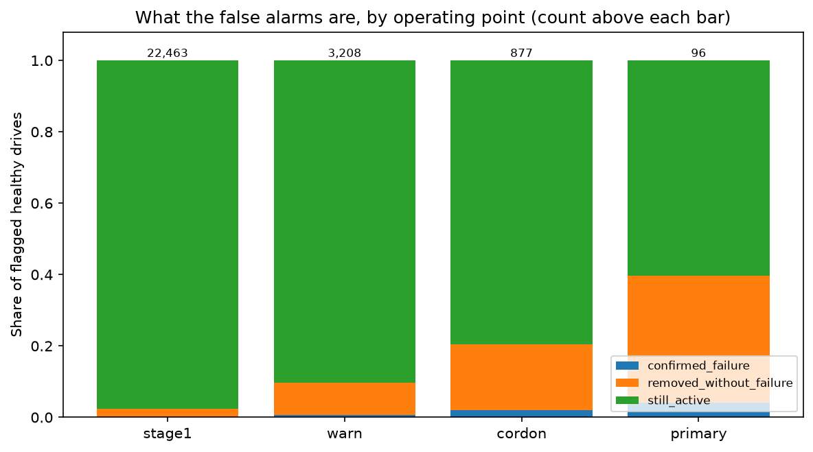

- **False alarms are damaged drives, not noise:** 98-99.8% of those at warn and
  above have a non-zero core counter, against 8.9% of the healthy fleet, and
  they are older (median 5.4-5.7 years against 3.5).
- **The stricter the point, the more of its false alarms were removed from
  service anyway:** 2.3% at Stage 1, 9.0% at warn, 18.5% at cordon, 35.4% at
  primary. Counting removals as correct would take primary precision from 59%
  to about 74%; that is a definition to decide, not a result.
- **HGST is 4.2 times over-represented among warn false alarms**, Seagate 2.2
  times among primary ones:

| Family | Flagged | Share | Fleet share | Lift |
|---|---|---|---|---|
| HGST HDD | 925 | 28.8% | 6.9% | 4.2 |
| Seagate HDD | 884 | 27.6% | 30.3% | 0.9 |
| Toshiba HDD | 793 | 24.7% | 36.1% | 0.7 |
| Western Digital HDD | 604 | 18.8% | 25.7% | 0.7 |
| WUH721816ALE6L4 | 2 | 0.1% | 0.2% | 0.4 |

| Family | Flagged | Share | Fleet share | Lift |
|---|---|---|---|---|
| Seagate HDD | 64 | 66.7% | 30.3% | 2.2 |
| Toshiba HDD | 24 | 25.0% | 36.1% | 0.7 |
| HGST HDD | 8 | 8.3% | 6.9% | 1.2 |

**Week by week** (thresholds fixed; a drive is failing in a week if it has a
positive row in it; full table in `data/audit/deep_dive_q3_h30/tables.md`).
Primary recall stays at 6-8% and warn recall at 45-53% in all nine Q3 weeks;
primary precision is 36-43% in most weeks and 57-58% in the last two, as
failing drives per week fell from 461 to 352. Weekly figures are below the
62-day ones because each week is a shorter window with a lower base rate. The
share of drives passing Stage 1 rises from 3.4% to 3.8% across Q3 and is above
every validation week (2.0-3.4%) with no matching rise in failures: SMART
counters only accumulate, so more healthy drives look suspicious over time. A
2x drift threshold would never fire on this; a weekly trend check would.

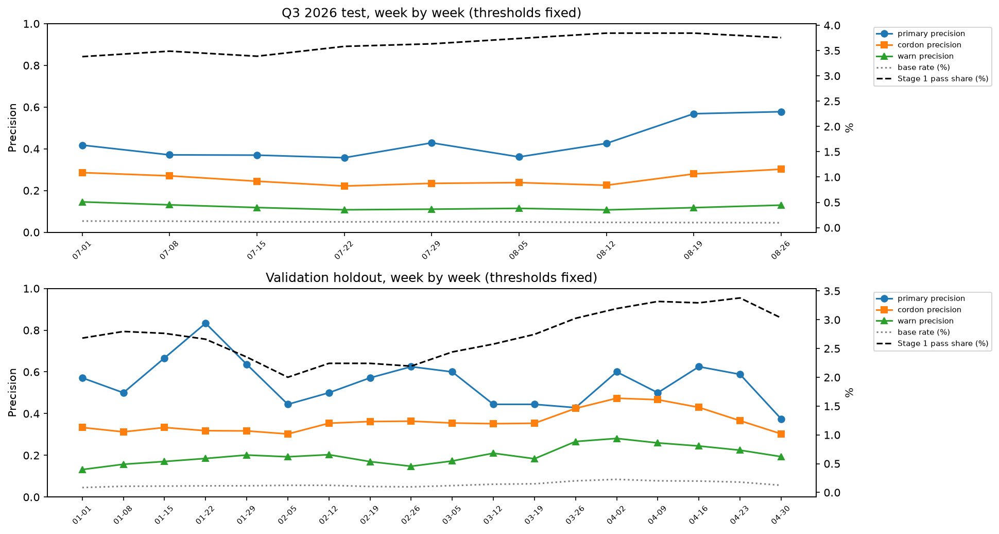

**Validation against test.** The 15-20 point precision gap is the base rate,
not overfitting:

| | Window | Drives | Failing | Base rate | AUROC | Recall at 0.01% / 0.1% false alarms | Primary P / R / false-alarm rate | Warn P / R |
|---|---|---|---|---|---|---|---|---|
| validation | 121 d | 70,977 | 418 | 0.589% | 0.922 | 3.8% / 30.6% | 75.0% / 10.0% / 0.020% | 33.3% / 63.6% |
| validation, last 62 days | 62 d | 70,638 | 295 | 0.418% | 0.947 | 4.1% / 36.6% | 68.3% / 9.5% / 0.018% | 30.1% / 69.2% |
| test | 62 d | 368,688 | 1,105 | 0.300% | 0.926 | 4.2% / 30.4% | 59.0% / 12.5% / 0.026% | 17.3% / 60.9% |

| Point | Validation precision | Test precision | Test restated at the validation base rate | Validation restated at the test base rate |
|---|---|---|---|---|
| warn | 33.3% | 17.3% | 29.2% | 20.2% |
| cordon | 55.7% | 34.8% | 51.3% | 38.9% |
| primary | 75.0% | 59.0% | 73.9% | 60.4% |

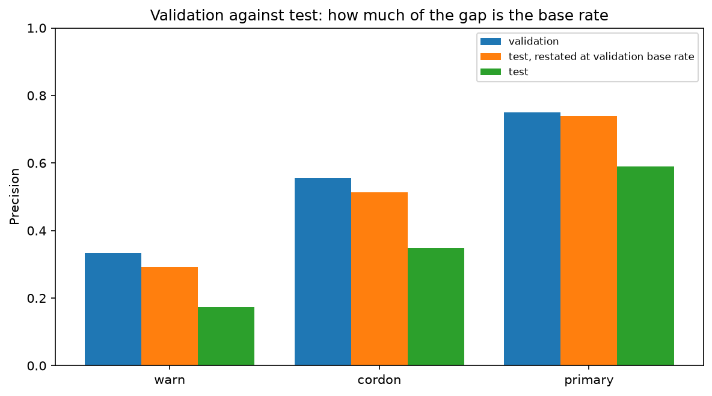

- **The ranking transferred intact:** AUROC 0.922 on validation and 0.926 on
  test, the same recall at matched false-alarm rates.
- **The base rate explains about 90% of the primary gap.** Validation spans
  121 days with 0.59% failing drives, test 62 days with 0.30%. At the
  validation base rate, test precision would be 73.9% (validation 75.0%).
- **Drives first seen after training** (18,698, 33 failing) have the same
  precision but lower recall (9% at primary and 52% at warn, against 13% and
  61%), probably because their features have less history. Suggestive only, on
  33 failing drives.

**Candidates these findings point to** (untested): a separate warn threshold
for HGST; reporting removed-without-failure drives as their own outcome when
judging alerts; a weekly trend monitor on the Stage 1 pass share; features that
could see early-life failures, the one group SMART does not reach.

### 1.1.6 Cluster-based action policy (2026-11-06; rule not passed)

Method, rule and results: `docs/cluster_action_policy.md`; outputs
`data/audit/cluster_policy_h30/`. The idea: cluster the Stage 1 suspects by SMART
signature (never the score or the vendor) and let the agent's action depend on
(tier, cluster) instead of the tier alone, judged on Q3 against the tier-only policy
with the rule written down before the Q3 look.

**Clusters** (GMM, 4 clusters, chosen on validation from a 35-candidate ablation by
stability and failure-rate separation within band; `tables.md`):

| Cluster | Name | Share of suspects (Q3) | Failure rate validation / Q3 | Action kind |
|---|---|---|---|---|
| C0 | no clear damage | 53.5% (49.6%) | 1.1% / 0.7% | watch |
| C1 | reallocated sectors rising, defect acceleration | 14.9% (14.3%) | 4.7% / 2.7% | replace |
| C2 | pending sectors, pending vs reallocated | 22.1% (23.6%) | 11.7% / 4.5% | migrate data |
| C3 | reallocated sectors rising, defect velocity | 9.6% (12.4%) | 33.4% / 16.1% | replace |

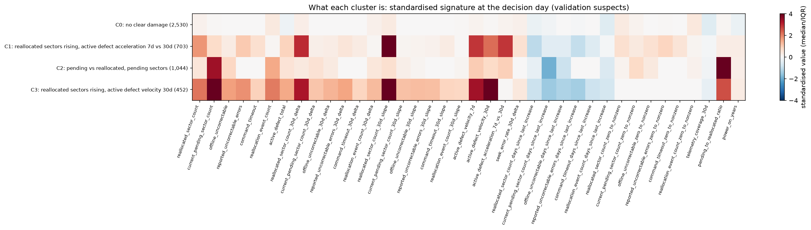

The clusters are stable (Q3 shares within a factor of 2 of validation, refit ARI
0.87) and separate risk from 1% to 33%. The action map, fixed on validation, moved
three cells, all down (C1 and C2 at warn, C2 at cordon):

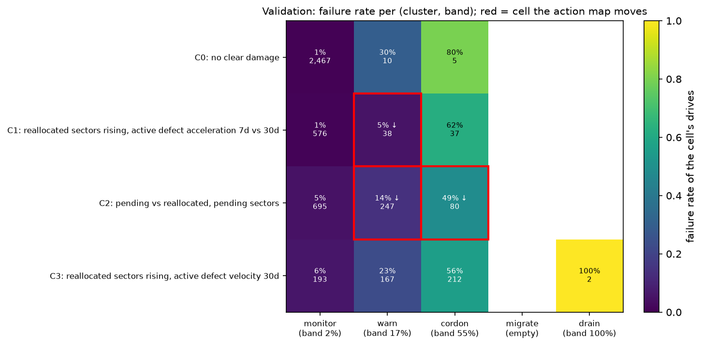

**Q3 result** (one look, test-access log line 133; cumulative tiers, 1,105 failing
drives):

| Tier | Tier-only P / R | Cluster policy P / R | Precision gap [95%] | Recall gap [95%] | Cost 20:1 |
|---|---|---|---|---|---|
| warn | 17.3% / 60.9% | 25.3% / 52.1% | +8.0% [+7.1, +8.9] | **-8.8% [-10.5, -7.1]** | 11,848 -> 12,279 |
| cordon | 34.8% / 42.4% | 39.4% / 36.2% | +4.6% [+3.1, +5.9] | **-6.2% [-7.7, -4.9]** | 13,597 -> 14,715 |

| Policy comparison | Where each policy operates on the score's curve |
|---|---|
| 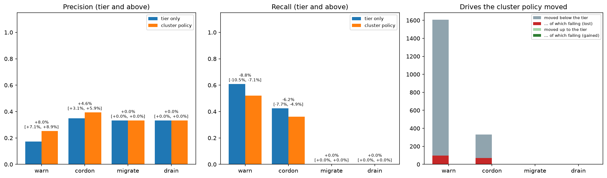 | 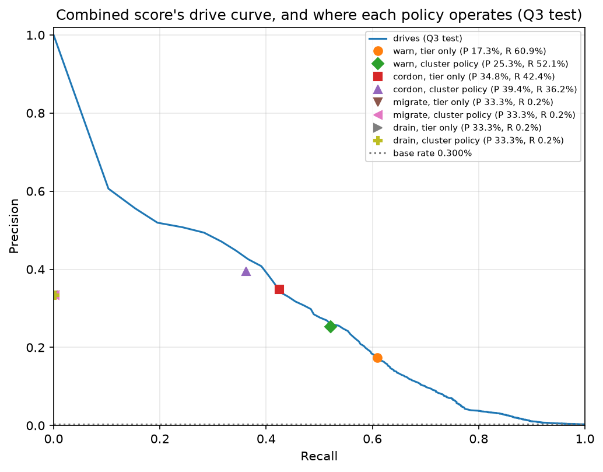 |

- **Rule not passed:** precision is up but recall is lower at warn and cordon, so the
  agent integration was not built and the agent is unchanged.
- **The precision gain is not a gain:** at the recall the cluster policy reaches, a
  plain stricter threshold gives 26.0% (warn) and 42.5% (cordon) against its 25.3% and
  39.4%: its points lie on or below the curve.
- Demoting at warn avoided 1,509 false alarms for 97 lost failing drives, which pays
  only if a missed failure costs under about 16 false alarms.
- The clusters stay useful as a description and a watch list (C3: 12% of suspects,
  16% failing on Q3), not as a policy.

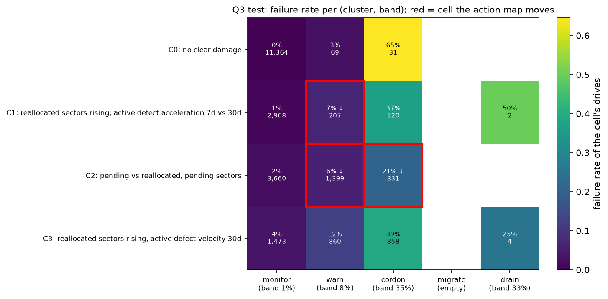

**Commands** (code `8dcca9b`; the first ablation run, stopped after 39 minutes
because spectral clustering with an RBF kernel did not converge, produced nothing):

```bash
# validation only: suspects, signatures, 35-candidate ablation, map; reads no test row
uv run python scripts/cluster_action_policy.py --run-dir frozen_runs/c459046e4f1645169151e7be25ff064d \
    --scores data/tmp/lightgbm_scores_h30_h30_q1q2_q3.parquet --validation-only
# the Q3 step with the committed map (one test look, access-log line 133)
uv run python scripts/cluster_action_policy.py --run-dir frozen_runs/c459046e4f1645169151e7be25ff064d \
    --scores data/tmp/lightgbm_scores_h30_h30_q1q2_q3.parquet
# redraw the tables and figures from the saved JSON, no data read
uv run python scripts/cluster_action_policy.py --run-dir x --scores x --figures-only
```

The validation step resumes from `ablation_partial.json` if interrupted (and was
rerun once with `--overwrite` after a naming fix, resuming all 35 candidates).

### 1.1.7 A Knowledge component for the agent (2026-11-07; no rule passed, outputs frozen)

Design, rule, results and provenance: `docs/agent_knowledge_base.md`. The question: can a
knowledge base learned from Q1+Q2 2026 and kept up to date one day at a time make the agent's
actions more precise in Q3 2026 without losing catches? The MAPE-K loop had no K: no outcome
ever fed back into a decision. The work built the K (a time-indexed store, wired into the
loop as read-only context) and screened knowledge rules on validation under a rule fixed
before any screening (design section 8, with a dated Amendment 1 made before any code
existed). **No rule passed, so there was no Q3 look, and the agent's decisions are
unchanged.** Everything ran on validation; the test-access log stayed at 139 lines.

**Scorer: the 60-day stacked Stage 2** (user's choice; 1.1.4a), refitted from the `804a20ce`
work dir without opening the test matrix and frozen in `frozen_runs/stack_h60_seed0/`. The
refit reproduces the 1.1.4a seed-0 run in 14 of 14 checks (weights 0.5 / 0.5, validation AP
0.5959, every count and tree number), and reloading the folder gives the saved scores exactly.
New tiers on validation, lift and cost-based (`tune_cost_tiers`; the cost ratios are
placeholders, an operations decision): at warn and cordon the stack, its LightGBM and Cox
members are nearly identical (38.5% / ~63%, ~64% / 42-44%), and at equal cost they are worth
the same (ratio 20: 5,724 / 5,725 / 5,753; frozen cascade 5,729).

**Validation point-in-time baseline** (9 weekly snapshots 2026-01-05..03-02, 60-day horizon,
validation drives only, base rate 0.196%): the four arms are indistinguishable.

| Arm | >= warn P / R | >= cordon P [95% CI] / R |
|---|---|---|
| Stack | 28.3% / 31.2% | 53.7% [44, 64] / 13.4% |
| LightGBM Stage 2 | 28.2% / 31.0% | 49.5% [40, 60] / 12.3% |
| Cox Stage 2 | 28.6% / 30.8% | 56.2% [46, 67] / 12.9% |
| Cascade `804a20ce` | 28.6% / 29.8% | 49.6% [40, 60] / 11.6% |

**The knowledge store** (`src/agent/knowledge/`): only dated facts (candidate days, weekly
presence, failure days, cohort counts, outcomes, decisions); episodes, contexts and outcomes are
derived for the requested date, so a day-by-day build equals a one-pass build and a view never
sees a later fact; columns computed over the whole data range (`event_type`, `feature_maturity`,
the broadcast `failure_date`) are never read. Built from the stack's validation scores
(234,275 candidate days, exactly the stack run's validation candidates) and silver presence to
2026-06-30, in 193 s. **Every self-check passes:** incremental equals batch, as-of replay (500
drives, 26 dates), 234,034 outcomes with 0 disagreements against the gold labels, idempotence,
model-versus-table scores. Checks found and fixed three flaws before the result: episodes need
their own outcome rule (a drive is usually still flagged on its failure day), "censored" is not
final (930 rows of 112 drives came back after a telemetry gap longer than a week), and a store
reopened with default settings was refused.

What the store shows: 1,419 episodes on 797 drives as of 2026-06-30; **of the 222 with 7 or more
days above cordon, 138 failed and 83 survived**. A long episode is mostly a real failure.

**The screen** (confirm half 2026-02-16..03-02, 1,013,502 drive-days):

| Rule | Verdict |
|---|---|
| R1 cohort prior (shrink toward the drive model's rate) | Failed: warn precision -0.2 [-2.2, +1.8], cordon +1.9 [-2.5, +6.3]; not better than a plain threshold at matched false-alarm rate (the 4.10 result again) |
| R2 demote chronic cordon drives | Failed at selection (no value beat "no rule") |
| R2b promote a first near-cordon flag | Failed at selection |
| R3 one band lower after a survived episode | Not screenable at 60 days (no validation episode resolves in time) |

The selection criterion (recall at the tier's own false-alarm rate) compares rankings, and a
pure tier rule keeps a demoted drive above the rest of its new tier, so R2 and R2b could not win
there whatever their merit. A descriptive look outside the verdict (`--describe-tier-rules`)
settles R2 anyway: at the fixed cordon threshold it **lowers recall at every N** (N = 7: -10.2
points [-14.1, -6.3]; N = 28: -4.1 [-7.0, -1.7]) and raises no precision, because more than half
the drive-days it demotes belong to drives that failed. R2b changes 2 drive-days.

**Reading.** ADR 0003 said re-filtering the model's flags would not help and that only evidence
the model has not seen could; 60-180 days of a drive's own history was the candidate, and it
points the wrong way (chronic means failing). The plumbing stays: outcomes and final trust
scores can now be resolved from recorded decisions (`build_agent_knowledge.py resolve`), a drift
report on the daily Stage 1, warn and cordon shares exists (it flags the rise from 2.71% to
3.17% of drives at Stage 1 between Q1 and April), and the loop can carry a rule if a future one
passes. `configs/agent.yaml knowledge.backend` and `knowledge.rule` stay `none`.

Commands (in order; each launcher is beside its log):

```bash
# Phase S: freeze the 60-day stack as a scorer (validation only)
bash data/audit/stack_scorer_h60_logs/run_freeze.sh "$PWD"
#   = uv run python scripts/freeze_stack_scorer.py --work-dir data/tmp/train_model_frame_xjxdieoe
# Phase 0: point-in-time baseline on validation drives, four arms
bash data/audit/agent_pit_validation_h60_logs/run_pit.sh "$PWD"     # = make agent-pit-validation
# Phase 1: build and check the knowledge store, coverage, drift
bash data/audit/agent_knowledge_h60_logs/run_build.sh "$PWD"
#   = scripts/build_agent_knowledge.py build --overwrite; check; coverage --as-of 2026-03-02;
#     coverage --as-of 2026-05-01; drift --reference 2026-01-01:2026-03-31 --current 2026-04-01:2026-05-01
# Phase 2: the pre-registered screen, and the descriptive tier-rule table
bash data/audit/agent_knowledge_h60_logs/run_screen.sh "$PWD"     # = scripts/screen_agent_knowledge.py
uv run python scripts/screen_agent_knowledge.py --describe-tier-rules
# The store: pack it into the tracked gzip, or restore and verify the tracked one
make pack-knowledge       # data/audit/agent_knowledge.sqlite -> agent_knowledge_h60/agent_knowledge.sqlite.gz
make unpack-knowledge     # the reverse; checks the SHA-256, then the content fingerprint
# Tests
uv run pytest tests/unit/test_stack_scorer.py tests/unit/test_threshold_cost_tiers.py \
  tests/unit/test_run_point_in_time.py tests/unit/test_agent_knowledge_*.py
```

Outputs, all frozen with a README and `CHECKSUMS.sha256`: `frozen_runs/stack_h60_seed0/`
(scorer, tiers, cost-sensitivity table; `stack.json` SHA-256 starts `5b587b964b67e8c2`),
`data/audit/agent_pit_validation_h60/` (`stack.json` `55bea04b297820a3`),
`data/audit/agent_knowledge_h60/` (`knowledge_checks.json` `aa9a3f80f019bd71`, `validation.json`
`a637496d70e35ebd`). The store is tracked compressed as
`data/audit/agent_knowledge_h60/agent_knowledge.sqlite.gz` (24.1 MB from 100.5 MB, over GitHub's
file limit uncompressed; SHA-256 `8e39368aa8d75a3c`, content fingerprint `662ab2647de72126`, both
in `agent_knowledge_pack.json`); `make unpack-knowledge` restores and verifies it. The score
table `data/tmp/stack_scores/scores_h60_seed0.parquet` is local and rebuilt by the commands above.

### 1.1.8 The split design: drive holdout with a Q3 test (in use), and a chronological split with gaps (proposed, not built) (2026-11-10)

Every result in Sections 1.1.4 to 1.1.7 comes from one split design. This section records it
as it is, what it costs, and a stricter alternative that was worked out on 2026-11-10 and **not
built or run**. Nothing in the code or the config changed because of this section. The failing-drive
counts below were taken from the 30-day label table (`data/gold/labels/part.parquet`) on
2026-11-10: a drive counts as failing in a window if any of its rows in the window has label 1.

#### The design in use: "Old: drive holdout, Q3 test"

| Role | Rows | Used for |
|---|---|---|
| Train | 80% of drives, 2026-01-01 to 05-01 | Stage 1, Stage 2 (out-of-fold Stage 1 scores, folds by drive), Cox |
| Validation | the other 20% of drives, same dates (`splits.holdout_fraction: 0.2`, seed 42, drawn from drives first seen before 07-01) | Early stopping, the candidate cutoff, tier thresholds, the primary threshold, the stack's blend weights |
| Unused | 2026-05-02 to 06-30 | Their 60-day labels depend on Q3 outcomes |
| Test | all drives, Q3 from 07-01, cut at the last row whose label is observed (data ends 09-30): 08-31 for 30 days (62 days), 08-17 for 44 (48 days), 08-01 for 60 (32 days) | Scored after thresholds are fixed |

Config that produces it (`configs/model.yaml`): `train_end` and `validation_end` 2026-05-01,
`purge_label_window: false`, `validation_after_train_only: false`, `test_split: sealed`,
`sealed_start: 2026-07-01`, `test_end: 2026-08-31`, `observation_end: 2026-09-30`. Q4 2025 is
feature history only. The fleet-wide feature statistics (model-family z-scores, expected SMART
attributes) are computed on rows before `sealed_start`.

Section 1.1.4a uses the same frames: it reads the kept work directory of each 1.1.4 training run
(`fag3o60h`, `ff5ejt7a`, `xjxdieoe`) and refits Stage 1 and the Stage 2 models per seed, with nets
0.5 and 0.8, survival nets at 0.8, 3 seeds, the stack's weights searched on validation candidate
rows, and paired drive bootstraps on test.

**Why it was chosen** (`docs/q3_horizon_and_cascade_run.md`): all three horizons train on identical
rows, so only the label differs; it needs one gap (60 days, 05-01 to 07-01) because validation
shares the training dates; a later validation period would either read June labels that depend on
Q3 or shorten training to Q1; and 20% of drives gives about twice as many failing validation
drives as the earlier 10% (the config comment says about 500; the 30-day label table has 418 failing
drives among 70,977 validation drives, measured 2026-11-10).

**What it costs**

- **Validation and test sit at different base rates.** Validation spans 121 days with 0.59% of
  drives failing, test 62 days with 0.30% (re-derived from the 30-day label table on 2026-11-10:
  418 of 70,977 validation drives, 0.589%; 1,105 of 368,688 test drives, 0.300%). At the 30-day primary threshold validation reads
  75.0% precision and test 59.0%, with AUROC 0.922 and 0.926 (Section 1.1.5: the base rate, not
  overfitting). A threshold tuned on validation to reach a given precision therefore lands lower
  on test. For a goal stated as precision (68% at >= 10% recall, Section 7), the threshold would
  be tuned to the validation rate and measured at about half of it.
- **Validation is not later in time than training.** The drives differ, the dates do not.
  `_split_period_predicate` in `pipelines/train_model.py` records that thresholds chosen on a
  held-out-drive validation "carried over to test worse than ones chosen on a later period".
- **Q3 is not a fresh test set.** `data/audit/test_access_log.jsonl` had 139 entries on
  2026-11-10, and the 30-day horizon, the 0.8 net, the stack and the 68% goal were chosen or
  evaluated while looking at Q3 (Section 1.4). It is a held-out quarter, not a prospective one.
- **The same boundary gap was missing in the quarter-aligned window** (Section 2.2): validation ended
  03-31 and test began 04-01, so its validation labels for the last 30 days (to 04-30) reach into the
  test period. Measured on 2026-11-10 over every drive with a validation-window row (02-15 to 03-31):
  615 of the 1,124 failing drives (55%) failed on or after 04-01, inside the test window, and they are
  41.6% of that window's 1,479 failing test drives. Thresholds and weights fitted on those validation
  labels therefore used outcomes the test then scored. How much this moved the Section 4.6 to 4.8
  numbers was **not measured**: that needs a re-run of that window, and only the extent of the overlap
  is known. If validation used only a subset of those drives, the counts apply to that subset. The drive-holdout design avoids that by construction, since validation shares the
  training dates and 60 days stay unused before Q3.
- **Feature statistics reach past the train boundary.** They use every row before 07-01, which
  includes validation and the unused months; test rows are excluded.

**What it is good for.** Identical rows across 30, 44 and 60 days (the horizon comparison of
Section 1.1.4 and the paired stack comparison of Section 1.1.4a), the largest test window (1,105
failing drives at 30 days), and continuity with every frozen run.

#### The alternative: a chronological split with gaps (proposed, not built)

Train, validation and test are consecutive periods, with a gap of one label horizon at each
boundary. A row's 30-day label is decided by events up to 30 days later, so a boundary is clean only
if the later period starts at least 30 days after the earlier period's last labelled row.

| Split | Row dates | Days | Failing drives (30-day label) |
|---|---|---|---|
| Train | 01-01 to 04-20 | 110 | 2,018 |
| Gap (train labels run to 05-20) | 04-21 to 05-20 | 30 | not used |
| Validation | 05-21 to 06-16 | 27 | 684 |
| Gap (validation labels run to 07-16) | 06-17 to 07-16 | 30 | not used |
| Test | 07-17 to 08-31 | 46 | 864 |

A variant with a longer train (01-01 to 04-30, validation 05-31 to 06-30, test 07-31 to 08-31) gives
2,158, 755 and 684 failing drives. Rows from 09-01 have no observable 30-day label, so the last test
row is 08-31. Confirmed failures by month (distinct drives, 30-day label table): 2025-10 467, 11 326,
12 152, 2026-01 306, 02 320, 03 404, 04 660, 05 522, 06 340, 07 451, 08 371, 09 351; the failure rate
falls from the April and May peak into the test months, so test precision carries a lower base rate
and is always quoted with it (Section 1.7).

A plain 50/5/45 calendar division of Q1 and Q2 (train 01-01 to 03-31, validation 04-01 to 04-09, test
04-10 to 06-30) was also checked and rejected: without the label purge, train labels run into the
validation and test periods, and validation labels (to 05-09) run into the test window, so thresholds
would be tuned on test-period outcomes. A strict version of that split needs both gaps: train 01-01 to
03-01 (974 failing drives), validation 04-01 to 04-09 (777), test 05-10 to 06-30 (1,070; 636 if labels
may not be read past 05-31).

**What strict separation needs (none of it exists yet)**

1. **Label purge on:** `purge_label_window: true` and `validation_after_train_only: true`. The code
   supports both.
2. **An embargo between validation and test:** a setting for the test start (for example
   `splits.test_embargo_days`). The code has no such setting, so validation-to-test label overlap is
   currently unchecked.
3. **A feature-statistics cutoff at the train boundary:** a `feature_stats_end` setting used in place
   of `sealed_start` in `pipelines/build_gold_features.py`, then a gold-feature rebuild. Rolling
   windows look backward only and are unaffected.
4. **Automated checks that fail the run:** no drive-day in two splits; each split's last label date
   before the next split's start; the statistics cutoff at or before `train_end`; no test row inside
   the embargo.
5. **A frozen record before the test look:** thresholds, blend weights and model hashes committed
   before the test scorer runs, with the test access log counting every look.

**What it changes.** Validation and test base rates get close (about 0.19% and 0.23% of drives in
the proposed layout, against 0.59% and 0.30%; each is failing drives over drives in the window, the
same definition that reproduces Section 1.1.4's 0.59% and 0.30% from the label table), which should let a
threshold tuned to 68% on validation transfer to test. That transfer is an expectation, not a
measurement: nothing has been trained on this layout. The costs: training stops at 04-20 and keeps 2,018 failing drives (the failing-drive count of the
old design's training set was not recounted for this comparison), the test
window shrinks from 62 days (1,105 failing drives) to 46 (864), and Q3 stays a looked-at test set.

**Horizons do not carry over.** A 44- or 60-day label needs gaps of 44 or 60 days at both
boundaries and its last row is 08-17 or 08-01. Keeping the same 60/15/25 shares gives, for 44 days,
train 01-01 to 03-26, validation 05-10 to 05-30, test 07-14 to 08-17 (35 days); for 60 days, train 01-01
to 02-25, validation 04-27 to 05-10, test 07-10 to 08-01 (23 days). Failing drives for these two
layouts were not counted. The three horizons would no longer share training rows, which was the point
of Section 1.1.4. The horizon question is already answered there (longer horizons rank no better once
the base rate is removed; 30 days stays primary), so the chronological split would be used for the
30-day goal only. A repeat of the horizon comparison would keep the drive-holdout design above and
compare in ROC space.

**Run time of the chronological design for 30 days**, from the logs of the same steps on 2026-11-06:
gold features about 29 min (`q3_build_gold.log`), labels about 3 min (`build_labels.log`),
`make train` about 26 min (`train_h30.log`), the cascade comparison about 28 min (`cascade_h30.log`),
the stack run about 39 min (`stack_h30.log`): about 2 hours. Not timed: freezing the stack as a
scorer, the checks and the unit tests (about 2 min). The code changes are development time.

**Keeping both designs runnable.** The new settings would be opt-in with defaults equal to today's
behaviour: an embargo of 0 days, and a statistics cutoff that falls back to `sealed_start`. The
checks would apply to the chronological profile only, because the drive-holdout design shares dates
by construction. Tests would pin the old split predicates and cutoff. The frozen runs are files on
disk and are untouched. Switching designs means rebuilding the labels (about 3 min) and the gold
features (about 29 min), because the label `split` column and the feature statistics depend on the
config; unless the pipelines can write to separate output folders (not checked), the two designs share
`data/gold/`. A re-run of the old design would reproduce the method, not the same files.

**Status.** Proposed on 2026-11-10; nothing built, rebuilt or trained for it. The recommendation for
the 68% goal (Section 7) is the chronological split, for the base-rate reason above; the
drive-holdout design stays the record for Sections 1.1.4 to 1.1.7 and the one to use for the horizon
comparison.

### 1.2 The two-stage gain is not established

Two paired bootstraps now exist, both over the same resampled drives with
both models at matched test recall, and they disagree about significance:

| Run | Features | Stage 1 | Two-stage | Gap | 95% CI |
|---|---|---|---|---|---|
| `0ee06c01` | 212 | 0.389 | 0.496 | 0.107 | [0.032, 0.185] |
| Earlier frozen run (2026-10-09) | 246 | 0.450 | 0.486 | 0.036 | **[-0.055, 0.128]** |

The second interval includes 0, so the gain is **not** confirmed on the
current feature set. The two runs do not contradict each other - each point
estimate sits inside the other's interval, which is consistent with a true
gain somewhere near 0.03 to 0.08 that the first run measured at the high end.
What is no longer defensible is the earlier claim that a single paired test
had settled it.

Standing evidence, in order of strength: the five-seed repeat (Section 4.5)
showed a gain in every seed (42.4% to 47.7%, about 5 points); the two paired
tests give 0.107 and 0.036. Neither point estimate is negative, so the second
stage does not appear to hurt - but "about 5 points, not yet significant on a
single run" is the honest summary, not "real, not noise".

The decisive experiment is already built and has not been run: paired
comparison across seeds, which separates the gain from seed variance rather
than reporting one of the two:

    make full-experiment FULL_EXPERIMENT_ARGS="--variants reg_spw --skip-baseline --two-stage --two-stage-seeds 5"

Until that runs, treat the second stage as retained on weak evidence rather
than as a measured improvement.

### 1.3 Calibration

The raw score is class-weighted and is not a failure probability: a score of
0.9 does not mean 90% of such drive-days fail. A monotone isotonic
calibrator fitted on validation (`src/models/calibration.py`) reports
calibrated test metrics beside the raw ones (`test_calibrated_*` in MLflow)
and is stored in `frozen_spec.json`. Decisions are unchanged, because a
monotone map preserves ranking.

**Caveat.** The calibrated test curve is close to the diagonal up to about
0.5. Above that the bins hold 21 to 70 rows, so their observed rates are
noisy. **Do not quote calibrated probabilities above 0.5.**

### 1.4 Sealed, and not yet measured

- **Nothing is sealed at present.** Q3 2026 was the sealed quarter for run
  `839d92bc`; its single-shot evaluation was skipped by decision on 2026-11-06
  and Q3 is the test set of Section 1.1.4 (`splits.test_split: sealed`).
  `make evaluate-frozen` refuses a sealed evaluation while that is so. Rows
  dated on or after `splits.sealed_start` are still labeled `split=sealed`,
  and that date is also the cutoff of the fleet-wide feature statistics. The
  rules a future untouched quarter must apply are in
  `docs/q3_horizon_and_cascade_run.md` section 6.
- **Cross-vendor result: pending.** The SMART-Z split
  (`split=external_smartz`) is built by `build_labels`, and
  `make evaluate-frozen ARGS="--run-id <id> --split external_smartz"` scores
  the frozen run on it once, writing `data/audit/frozen_evaluations/`. No
  result exists until that runs on data that includes SMART-Z, so
  generalization beyond Backblaze is unmeasured.
- **Every look at test is recorded.** Each test-split computation appends a
  line to `data/audit/test_access_log.jsonl` (`src/models/access_log.py`), so
  the number of comparisons behind a reported gain is a fact rather than a
  recollection.

### 1.5 What moved the number, and what did not

- **Moved it:** fixing the training collapse (Section 5.2), and the 30-day
  horizon (34% to 46% near 10% recall on the same test period). The second
  stage then added about 5 points at the primary threshold (Sections 1.2 and
  4.5) and is now the default.
- **Did not:** hyperparameters, XGBoost, per-family models, a second quarter
  of data, more SMART attributes and features, persistence rules, a survival
  model, anomaly detection (Sections 4.1 to 4.3 and 5), `smart_196`, and
  per-family action-tier thresholds.
- **Per-family thresholds made it worse** (ADR 0002): 7 of 81 models cleared
  the 50-failing-drive gate, and against fleet-wide thresholds on the same
  test drives they lost 7 to 8 points of recall for under 1 point of
  precision at the lenient tiers. At drain they were worse on both axes (64
  caught from 173 alerts against 76 from 162). Different families sitting at
  different operating points under one threshold turns out to be what a
  calibrated score does to populations of differing risk, not a mis-set
  threshold.

### 1.6 Found by the attribute screen (2026-10-09)

- **Guardrails could not act on ANY of the fleet (both causes fixed, needs a
  rebuild).** Two multiplicative factors in `feature_confidence` each pinned
  it below the 0.80 destructive-action floor. (1) `attribute_coverage_factor`
  divided by every priority attribute, including Seagate's
  `smart_187`/`smart_188` (~32% coverage), capping non-Seagate drive-days at
  0.60; it is now scored against the attributes each drive MODEL reports.
  (2) `recency_factor` charged the normal daily telemetry cadence as a full
  day of staleness, capping every drive-day at exp(-24/48) = 0.6065; it now
  charges only the time beyond `expected_cadence_days`. Measured on the
  rebuilt gold table, 0.0% of 62,565,487 drive-days cleared the floor even
  after fix (1), which is how (2) was found. `build_gold_features` now fails
  outright if no drive-day can reach the floor, and
  `scripts/check_confidence_distribution.py` reports the per-factor breakdown.
  Measured after both fixes: **86.1%** of drive-days now reach the floor
  (0.0% before), with 0.00% newly blocked. The ~13% still blocked is the
  30-day telemetry warm-up (a drive needs 24 of the trailing 30 days for
  coverage >= 0.80, so its first 23 days are below it: 23/181 = 12.7%), which
  is intended. The largest model in the fleet, `WDC WUH722222ALE6L4` at 8.1M
  drive-days, went from 0% to 87% actionable.
- **`smart_196` (reallocation event count) is now a priority attribute.** It
  out-separates four of the five existing ones (0.306) at double the coverage
  of `smart_187`, reaching the drives where the Seagate attributes are null.
- **No neighbour-failure features.** Failure clustering weakens at finer
  spatial grain (1.33x per chassis against 3.35x per vault), so it is a cohort
  effect from filling a vault with one drive batch, not local correlation -
  and model and age are already featurized.
- Both code changes need a full re-ingest through train to take effect, which
  **invalidated the frozen run that preceded the earlier frozen run (2026-10-09, no longer available)**. Do it before Q3
  is ingested;
  afterwards it costs the sealed evaluation. Full reasoning, including the
  hypotheses the screen refuted, is in
  `docs/adr/0002-attribute-selection-and-vendor-aware-confidence.md`.

### 1.7 Three conventions these numbers depend on

(How the action tiers are derived from the score, step by step: Section 1.9.)

- **Action tiers are set in lift, not precision.**
  `threshold.action_tier_lift` (56.6 / 94.3 / 151.0 / 226.4) replaces the
  earlier per-tier precision targets, because precision moves with the base
  rate and lift does not. On validation they reproduce the former targets
  (0.15 / 0.25 / 0.40 / 0.60), so the thresholds should not move. Test lift
  is reported beside test precision.
- **Evaluated base rates differ from the label report.** The split date
  windows (`configs/model.yaml`, `splits`) decide which rows are scored. Test
  keeps dates up to 2026-05-31, and its last 30 days are censored for healthy
  drives, so the label table keeps only the failing drives' positives there.
  The label report's test rate (0.150%) therefore counts positives the
  evaluation never scores. The rate the evaluation scores is 0.094% on test
  and 0.132% on validation (`data_build.evaluated_failure_rate` in the
  evaluation report). Quote the evaluated rate, and compare models across
  splits on drive-level lift rather than on raw precision.
- **The length of the TEST WINDOW moves the base rate, so precision is not
  comparable across split dates.** A drive counts as failing if any of its
  test rows falls inside a failure's horizon, so a longer test period catches
  proportionally more failing drives while the healthy denominator stays the
  size of the fleet. Lengthening the test window from 21 to 61 days took the
  evaluated base rate from 0.175% to 0.417% and precision from 48.6% to
  57.1%, with a model that is not better (Section 4.6). Per test-day the rate
  barely moves - 0.836, 0.717 and 0.683 x 10^-4 across 21-, 45- and 61-day
  windows - which is how you can tell the jump is the window and not the
  fleet.

  This is the same mechanism as a longer label horizon (Section 2.4), which
  the project went looking for deliberately, arriving instead through a
  change nobody flagged as a base-rate change. Two different routes to the
  same inflation, so treat **any** edit to `splits` or `horizons_days` as a
  change to what precision means.

  Compare runs whose windows differ in ROC space, where neither axis depends
  on the base rate: drive-level `auroc`, `positive_likelihood_ratio`
  (= recall / false_alarm_rate) and `test_drive_recall_at_far_*`, all logged
  by `make train`. Precision may be restated at a common base rate with
  `precision_at_failure_rate`, but that is arithmetic on the measured rates,
  not a second measurement, and it does not fix a mismatch in recall.

### 1.8 Where the evidence lives

Every number in this runbook comes from a file in the repository, in one of
three places:

| Folder | What is there | Description of every file |
|---|---|---|
| [`data/audit/`](../data/audit/) | Reports and results the pipelines write: training reports, experiment outputs, horizon comparison, deep dive, agent runs, run logs, the test-access log | [`data/audit/README.md`](../data/audit/README.md) |
| [`frozen_runs/`](../frozen_runs/) | One folder per frozen training run: spec, thresholds, both model stages, model card, figures, checksums | [`frozen_runs/README.md`](../frozen_runs/README.md) |
| [`docs/figures/`](figures/) | Copies of figures embedded here (Q3 cascade and horizon comparison) | [`docs/figures/q3_2026/README.md`](figures/q3_2026/README.md) |

Where each section's numbers come from:

| Section | Source |
|---|---|
| 1.1.4 (Q1+Q2 -> Q3 runs) | Training reports `data/audit/data_quality_reports/model_evaluation_report_h<H>_q1q2_q3.json` and `action_tiers_h<H>_q1q2_q3.json`; cascade and survival Stage 2 `data/audit/cascade_q3_h30/`, `_h44/`, `_h60/`; horizon comparison `data/audit/horizon_q3/`; runs `frozen_runs/c459046e.../`, `a2cd06d5.../`, `804a20ce.../` |
| 1.1.4a (stacked Stage 2, not confirmed, frozen) | `data/audit/stack_q3_h30/`, `_h44/`, `_h60/`; launcher, logs and `CHECKSUMS.sha256` in `data/audit/stack_q3_logs/` (tracked) |
| 1.1.5 (deep dive) | `data/audit/deep_dive_q3_h30/` |
| 1.1.7 and 4.13 (knowledge component) | Scorer `frozen_runs/stack_h60_seed0/`; validation baseline `data/audit/agent_pit_validation_h60/`; store checks and rule screen `data/audit/agent_knowledge_h60/`; launchers in `data/audit/{stack_scorer_h60,agent_pit_validation_h60,agent_knowledge_h60}_logs/`; design and rule `docs/agent_knowledge_base.md` |
| 1.1.6 (cluster action policy) | `data/audit/cluster_policy_h30/` |
| 1.1.1 - 1.1.3 (April-May runs) | `frozen_runs/839d92bc.../`, `frozen_runs/fb58d957.../`; `data/audit/recall_policy_h30_seed0_v2/` and `data/audit/cascade_wide_net_h30/` |
| 4.7 - 4.10 (point-in-time policy, family calibration) | `data/audit/agent_point_in_time*`, `agent_pit_validation*`, `family_calibration.json` |
| Every look at test | `data/audit/test_access_log.jsonl` (tracked, append-only) |

What git tracks under `data/audit/` and what stays local is listed in its
README; the Q1+Q2 -> Q3 results are all tracked.

### 1.9 How the tiers are set

The agent's four action tiers (warn, cordon, migrate, drain) are four thresholds on
one score. Stage 2 does not create them; it produces the score, and the thresholds
are chosen on the validation holdout to meet a precision target each. For the
current 30-day model (frozen run `c459046e`):

1. **The score.** Stage 1 scores every drive-day; at or above the candidate
   threshold (0.235, `frozen_runs/c459046e.../two_stage.json` `candidate_threshold`)
   Stage 2 re-scores it and the combined score is `0.235 + 0.765 x stage2`;
   below, the Stage 1 score stands (`src/models/two_stage.py::TwoStageModel.final_scores`).
   Per drive, the highest score in its window: a failing drive over the 30 days
   before failure, a healthy drive over the whole period
   (`src/models/evaluation.py::drive_level_table`).
2. **Lift to precision target.** `configs/model.yaml` `threshold.action_tier_lift`
   gives a lift per tier; times the validation drive failure rate (0.589%, 418 of
   70,977 drives) it is the precision the tier must earn
   (`src/models/threshold.py::precision_targets_from_lift`). Lift is used so a target
   keeps its meaning when the failure rate changes between windows (Section 1.7).
3. **Threshold per tier.** On the validation drive-level precision-recall curve,
   each tier takes the cutoff with the most recall whose precision still meets its
   target (`tune_action_tiers`). A target no cutoff meets falls back to the curve's
   most precise point:

| Tier | Lift | Target on validation | Threshold | Validation precision / recall | Q3 test precision / recall |
|---|---|---|---|---|---|
| warn | 56.6 | 33.3% | 0.653 | 33.3% / 63.6% | 17.3% / 60.9% |
| cordon | 94.3 | 55.5% | 0.836 | 55.7% / 44.7% | 34.8% / 42.4% |
| migrate | 151.0 | 88.9% | 0.926 | 100% / 0.5% (2 drives) | 33.3% / 0.2% |
| drain | 226.4 | 133% (stored capped at 100%), unreachable | 0.926 | same cutoff | same |

   Source: `data/audit/data_quality_reports/model_evaluation_report_h30_q1q2_q3.json`
   (`action_tiers`: `threshold`, `target_lift`, `target_precision`, `validation`,
   `test`) and `action_tiers_h30_q1q2_q3.json`. Migrate's target is met only at the
   very top of the curve and drain's is impossible, so both share 0.926 and flag 6
   drives on Q3: on this model they are not usable tiers.
4. **The primary threshold is separate** (`tune_drive_level_threshold`): it aims at
   90% precision with at least 10% recall, cannot reach it, and takes the most
   precise cutoff with 10% recall: 0.919, giving 75.0% on validation and 59.0% on Q3
   (`model_evaluation_report_h30_q1q2_q3.json` `threshold`).
5. **Run-time gates** (`src/models/action_tiers.py::determine_action_tier`): migrate
   and drain need feature confidence >= 0.80 (`configs/agent.yaml`
   `feature_confidence.min_confidence_for_destructive_action`), a mature drive and
   fresh telemetry, otherwise they become cordon. Then `src/agent/nodes.py::make_plan_node`
   applies hysteresis (2 consecutive cycles before escalating) and a cooldown after
   an action (3,600 s), both in `configs/agent.yaml` `loop`.
6. **Where the cluster policy enters** (`docs/cluster_action_policy.md`): between 3
   and 5, the drive's (cluster, tier) cell can move it one band up or down, by how
   often that cell failed on validation compared with each band. The clustering never
   sees the score, so Stage 2's precision shapes which drives sit in each tier, not
   the clusters.

**The same thresholds give lower precision on Q3** because fewer drives fail there
(0.300% against 0.589%); recall holds (Section 1.1.5). Lift times each base rate
gives the precision each tier would be expected to reach:

| How the tiers are set (validation curve, lift-derived targets) | Lift x base rate = target |
|---|---|
| 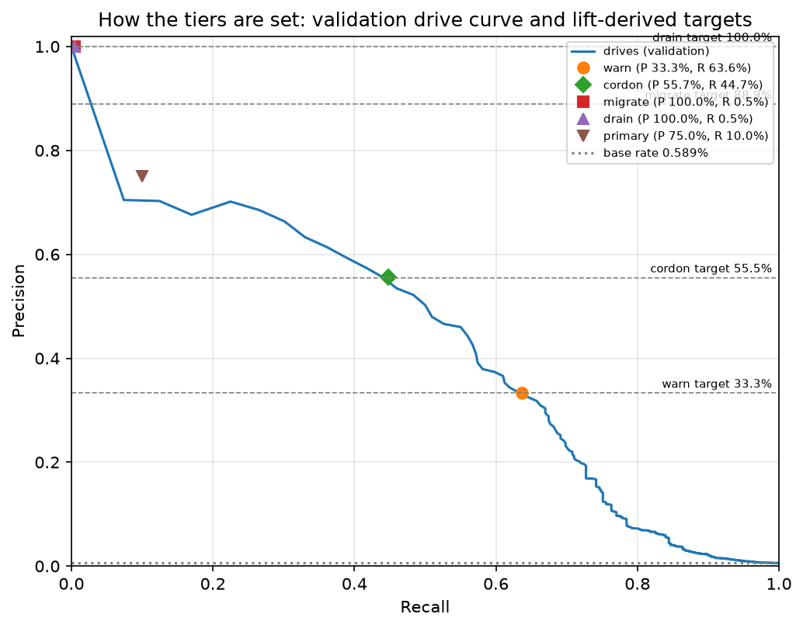 | 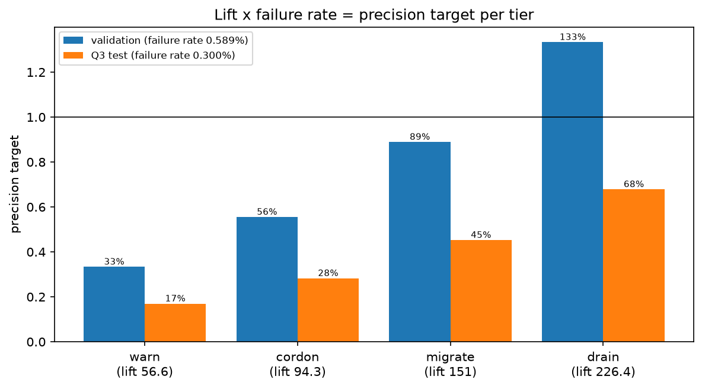 |

The per-run curves are in `frozen_runs/c459046e.../figures/`
(`validation_precision_recall.png`, `test_precision_recall.png`).

**Cost-based tiers (2026-11-07, Section 1.1.7).** `src/models/threshold.py::tune_cost_tiers`
places each tier where its action pays for itself on validation (`r x caught - false alarms`,
i.e. flag while marginal precision >= 1 / (1 + r)), with `r` per action in
`configs/model.yaml threshold.action_cost_ratio`. The ratios there (warn 100, cordon 20,
migrate 5, drain 2) are placeholders for an operations decision. `threshold.tier_rule: lift`
(the default) keeps the lift tiers above; `cost` makes the agent read a scorer's
`action_tiers_cost`. On the 60-day stack at r = 20, cordon would sit at 67% recall (30%
precision) instead of 44% (64%): the strict tiers' low recall is a choice of targets, not a
property of the model. The optimum depends on the failure rate (Q3's is half validation's).

**Where a knowledge rule would enter.** Between the score tier and hysteresis
(`src/agent/nodes.py`, `make_plan_node(knowledge_rule=...)`), so hysteresis, cooldown and the
control arm see the adjusted tier. No rule is enabled (`configs/agent.yaml knowledge.rule:
none`); none passed the screen of Section 1.1.7.

## 2. How to run the pipeline

### 2.1 Setup

```bash
make install
```

### 2.2 Q4 2025 - Q2 2026, quarter-aligned (the default until 2026-11-06)

**Superseded as the default** by the Q1+Q2 -> Q3 window of Section 1.1.4
(`configs/model.yaml` `splits`; the key table in Section 9 lists the old and
new values). The window below is kept as the record of the runs made on it.

**Run once, on 2026-10-18** - results in Section 4.6. The numbers of
the earlier frozen run (2026-10-09, no longer available) come from a narrower window, below, and this window's
precision is not comparable to them (Section 1.7).

Q4 2025 and Q1 2026 train and validate; Q2 2026 tests. `configs/data.yaml`
ingests 2025-10-01 to 2026-06-30 (273 days). `configs/model.yaml` uses a
30-day horizon with `train_end: "2026-02-14"`, `validation_end:
"2026-03-31"`, `test_end: "2026-05-31"`.

| Window | Dates | Days | Was (frozen run) |
|---|---|---|---|
| train rows | 2025-10-01 .. 2026-01-15 | 107 | 75 |
| purge gap | 2026-01-16 .. 2026-02-14 | 30 | 30 |
| validation | 2026-02-15 .. 2026-03-31 | 45 | 25 |
| test | 2026-04-01 .. 2026-05-31 | 61 | 21 |
| inference | 2026-06-01 .. 2026-06-30 | 30 | 30 |

Three things follow from it:

- **The test period roughly triples**, 21 days to 61. Test failing drives
  should go from 621 to around 1,800, which is the direct lever on the
  frozen run's precision CI of [38.9%, 58.2%] - 19 points wide, and the
  weakest part of the current measurement.
- **`train_end` splits inside Q1 rather than on the quarter boundary.** Strict
  Q4-trains / Q1-validates would leave only 62 days of training rows after the
  30-day purge, fewer than the 75 the frozen run had. Splitting at 2026-02-14
  gives 107 days of training and still 45 of validation.
- **June 2026 is not evaluated, but is scorable.** Rows after
  `validation_end` are labeled `split="test"`, and `train_model` applies
  `test_end` as a hard cap when extracting, so June stays out of every
  metric. Its 30-day labels are censored anyway (the data ends 2026-06-30).
  It is what `make score-fleet` scores.

This is **not** the frozen run's window, so its figures will not be directly
comparable to the earlier frozen run (2026-10-09, no longer available). To reproduce it instead: `sources.backblaze.start_date:
"2026-01-01"` with `2026-04-15` / `2026-05-10` / `2026-05-31`.

Bronze reflects whatever was last ingested, and `make build-silver` reads
Bronze rather than the raw CSVs, so narrowing `start_date` does not narrow
what the pipeline sees until Bronze is rebuilt. Coming from a wider window:

```bash
rm -rf data/bronze/backblaze
make clean-data clean-kept
make ingest-backblaze
make build-silver
make build-features
make build-labels
make train                     # add TRAIN_ARGS=--keep-work-dir to keep arrays
make experiment-model          # optional, see Section 6
make score-fleet
make final-report              # runs make plots first
```

Expect about 94M drive-days - 1.5x the 62,565,487 of the 2026-10-06 build,
and well under the 123,351,646 that surfaced the memory bugs in Section 3.
Changing only model or split settings needs `make train` onwards, not a
rebuild of features or labels.

### 2.3 Measuring the agent, not the model (`make agent-fleet`)

**Not yet run.** Section 1.1.1's figures - 57.1% precision at 12.0% recall -
describe a threshold applied to scores. They say nothing about the agent.
Between a score and an action sit the guardrails, the 0.80 confidence
floor, two-cycle hysteresis, the per-drive cooldown, the control arm and
one-action-per-cycle. Every one can only *remove* actions, and nobody has
measured by how much.

`src/agent/fleet.py` binds the MAPE-K loop to the real gold features and
the trained model (`make agent-fleet`); execution stays simulated, because
there is no datacenter to cordon a drive in. `src/agent/backtest.py` scores
the decisions against the label table.

**Which window, and the horizon trap.** A row is scoreable only if the data
outlives its horizon. With data to 2026-06-30:

| Horizon | Last scoreable row | Usable June days |
|---|---|---|
| 7 days | 2026-06-23 | 23 |
| 14 days | 2026-06-16 | 16 |
| 30 days | 2026-05-31 | 0 |

So the inference window has no 30-day label, but it *does* have 7- and
14-day labels. That gives an agent-level measurement on data no model
choice has ever touched - it does not consume the test split:

```bash
make agent-fleet ARGS="--start-date 2026-06-01 --end-date 2026-06-23 \
    --cycles 200 --score --score-horizon-days 7"
```

Two things that figure is not. It is **7-day** precision and belongs in no
column beside a 30-day one (Section 1.7). And the model is trained for 30
days, so a drive that fails on day 20 is a 7-day false positive - expect
the number to be lower than Section 1.1.1's for that reason alone, before any
agent filter has removed anything.

The `--end-date` matters more than it looks: `latest_row_per_drive` keeps
each drive's *last* row, so snapshotting through 2026-06-30 yields rows
that are censored at every horizon and nothing to score. The run warns when
the window extends past the boundary.

The test-split backtest below has ground truth but **is not point-in-time**
- the maturity gate and the latest-row snapshot both look ahead - so quote
nothing from `--score`; use `make agent-pit` (Section 4.7) for any precision
or recall figure. It remains useful for exercising the loop itself, and it
records a test-split access (`src/models/access_log.py`):

```bash
make agent-fleet ARGS="--start-date 2026-04-01 --end-date 2026-05-31 \
    --cycles 500 --score"
```

**One action per cycle**, so `--cycles` bounds how many drives the agent can
reach; drives never selected are reported as attrition rather than as
policy rejections. The snapshot is fixed for the run and the candidate pool
advances as drives are acted on or found permanently blocked - without
that, the plan node's `max(drives, key=p_fail)` re-picks the same drive
every cycle forever.

### 2.4 The 60-day horizon experiment (parked 2026-10-18; run 2026-11-06, Section 1.1.4)

**Run on 2026-11-06** on the Q1+Q2 -> Q3 window, as 30 / 44 / 60 days on
identical training rows: no horizon ranks drives better or warns earlier than
30 days, and the precision gain is the base rate (Section 1.1.4). The setup
below is kept as written.

Set up, then parked before any result existed. Nothing in Sections 1 or 4
comes from it. Recorded here because the setup cost a day and the reasoning
still stands.

**Why it was worth trying.** Precision moves with the base rate, and
lengthening the label raises it directly: 14 to 30 days took precision from
about 33% to 46.3% at comparable recall (Sections 4.2 and 4.3). A 60-day label
roughly doubles the positive rate again. Holding the frozen run's measured
recall and false-alarm rate, that arithmetic implies about 65% precision -
separability degrades against it, but the 14-to-30 result shows the net can
come out positive.

**Why it needs four quarters.** The test period has to end a full horizon
before the data does (Section 5.7), and the purge window stops training a
horizon before `train_end`. On two quarters a 60-day horizon leaves too little
of either.

**To resume.** Q3/Q4 2025 are already downloaded and still listed in
`download.backblaze.quarters`, so no download is needed. Set
`sources.backblaze.start_date: "2025-07-01"`, add `60` to `horizons_days`, and
set `train_end: "2026-02-01"`, `validation_end: "2026-03-17"`, `test_end:
"2026-05-01"` - boundaries sized so the same dates serve both the 30-day
control and the 60-day treatment, which is what makes the horizon the only
variable between the two runs. Then rebuild from `make ingest-backblaze` and
train twice:

```bash
make train                                          # 30-day control
make train TRAIN_ARGS="--horizon-days 60"           # 60-day treatment
```

**What it costs.** 123,351,646 drive-days against 62,565,487, and a label
table about 2.7x larger - twice the drive-days across four horizons rather
than three. That volume is what surfaced two memory bugs, both since fixed:
Bronze profiling aggregating every column at once
(`src/ingest/profiling.py`), and two whole-table collects in
`build_silver`'s finalize stage (`src/preprocess/quality_checks.py`,
`src/preprocess/feature_maturity.py`). A third failure in the same run was
never localized - the stage was not captured in the log - so expect to
diagnose one more before the chain completes.

**How to read the result, when it is run.** Not on precision. Precision and
AUPRC both rise mechanically with the base rate, so compare in ROC space -
drive-level `auroc` and recall at a matched false-alarm rate, both logged by
`make train` (Section 1.7). Flat AUROC means the precision gain is
definitional and must be reported as such.

Three consequences to expect:

- **The drain tier breaks.** `action_tier_lift` converts at each split's own
  failure rate, so at a doubled rate the drain tier asks for 226.4 x 0.53% =
  1.20 precision and becomes unreachable. `tune_action_tiers` flags
  `target_met: false` and falls back, which is correct but reads as a
  regression.
- **The purge window is asymmetric.** At 30 days training rows run to
  2026-01-02, at 60 days only to 2025-12-03, so the 60-day model trains on
  about a month less data. If 60 days wins it wins despite that; if it loses,
  the confound is live and the clean follow-up is a 30-day run with
  `train_end` pulled back to match.
- **A 60-day claim is a weaker claim.** "Fails within 60 days" is less
  specific than "within 30". More lead time is operationally fine, but a
  precision figure earned that way does not satisfy the goal in Section 7,
  which names a 30-day horizon.

### 2.5 Q1 2026 only (the configuration of Sections 4, 4.1 and 5)

`configs/data.yaml`: `sources.backblaze.end_date: "2026-03-31"`.
`configs/model.yaml`: `primary_horizon_days: 14` and `splits` with
`train_end: "2026-02-22"`, `validation_end: "2026-03-06"`, `test_end:
"2026-03-17"`. One quarter is too short for the 30-day horizon once training
stops a horizon before `train_end`. Then the same commands as 2.2.

### 2.6 Things that go wrong, and where to look

- **Empty or tiny test split:** the split dates do not match the data. Check
  `train_model_splits_loaded` in the log.
- **`memory_limit_exceeded` (exit code 86):** the process exceeded its RSS cap.
  Lower `model.max_train_rows`, `diagnostics.baseline_max_rows` or
  `diagnostics.shap_max_rows`, or raise `resource_limits.max_memory_gb`.
- **Scratch files:** the kept work directory `data/tmp/train_model_frame_*`
  holds several GB. Delete it with `make clean-kept` when you are done.
- **Stale results after a code change:** re-run `make train` before judging
  any experiment. Runs made on older code are not comparable.
- **`make agent-fleet` exhausting RAM on a long run:** three compounding
  allocations, fixed on 2026-10-18. `apply_hysteresis` rebuilds
  `drive_risk_state` as `{**state, drive: ...}` every cycle and never removes
  an entry, so it grew one entry per drive ever decided and every copy was
  checkpointed; the checkpoint store defaulted to `:memory:`, which retains
  all history, so 10,000 cycles held ~19 GB; and `score_snapshot` built the
  whole fleet as one float64 matrix (0.7 GB at 356k x 246, copied twice on
  the way to the model). Now: scoring is batched, the runner prunes the risk
  state to the live pool each cycle (which holds it at about one entry, since
  a drive is decided twice and then leaves), and the default checkpoint is a
  temporary file deleted on exit. `peak_risk_state_entries` is in the report
  so a pruning regression shows up as a number rather than as memory growth.
- **`make agent-fleet` dying within seconds of starting, before any cycle:**
  the snapshot loader, not the loop. `chunked_inner_join` slices its left
  side with `left.slice(offset, n)`, which pushes into the Parquet reader
  only when the scan is UNFILTERED. Filtered, Polars must evaluate the
  filter across the whole scan to resolve row offsets, so each slice
  materializes the entire window at full width: 16 GB for a 23-day window at
  246 columns, 43 GB for a 61-day one. The first squeezed under the cap, the
  second did not. `load_fleet_snapshot` now applies the window to a
  two-column projection and joins those `(drive_id, date)` pairs against the
  unfiltered scan - the shape `pipelines/score_fleet.py` uses. A test asserts
  the plan reaching the join contains no FILTER.
- **`memory_limit_exceeded` at the very end of `make ingest-backblaze`,
  after every file logged successfully:** this was Bronze profiling, not the
  ingest. It ran one 16-column `null_count()` over the whole Bronze dataset,
  which materialized every column at once - about 20 GB at 365 days and
  within the cap at 181. Row and null counts now come from the Parquet
  footers and everything else is accumulated per partition
  (`src/ingest/profiling.py`). If you hit it on an older checkout, Bronze is
  already complete - profiling runs after the loop - so `make build-silver`
  can go ahead; only the audit report is missing, and nothing downstream
  reads it. `backblaze_ingest_complete` in the log marks the point where the
  ingest itself finished.

## 3. Memory: what was wrong and what fixed it

The first real runs crashed with allocation failures ("Cannot allocate memory",
Rust "memory allocation of N bytes failed") at different steps, each time one
step later after a fix.

**Root cause.** The cap was `RLIMIT_AS` (virtual address space). Polars
(jemalloc), glibc's per-thread arenas, and LightGBM/OpenMP thread pools
reserve address space they never touch, so measured resident memory was 6–10 GB
when the cap tripped at a 20 GB limit.

**Fix.** The cap is now enforced on resident memory (RSS) by a watchdog thread
in `src/resource_limits.py`. It samples `/proc/self/statm` every 0.25 s and
exits the process with code 86 and a `memory_limit_exceeded` log line when RSS
exceeds `resource_limits.max_memory_gb`. It is Linux-only.

**Pipeline shape that keeps real memory low** (`pipelines/train_model.py`):

1. Each heavy step is its own subprocess (`--stage assemble`,
   `--stage extract-split --split {train,validation,test}`), handing results to
   the next step as Parquet or `.npy` files.
2. Large Parquet files are read one row group at a time, and each slice is
   written to disk as soon as it is filtered. This avoids uncontrolled
   parallel decoding and in-memory accumulation.
3. Numpy feature matrices are built directly from the spilled parts, never via
   a combined DataFrame (combining and then converting needed about 10 GB at
   once).
4. Training rows are capped (`model.max_train_rows: 5000000`): all failure rows
   are kept, healthy rows are sampled deterministically by hash.

**Measured peaks on Q1** (from the `memory_checkpoint` logs, since removed):
about 3.0 GB during the join, 6.0 GB for the train extraction, 6.8 GB for
validation, 2.1 GB for test; training and evaluation completed under the cap.

**Scratch location.** Scratch files go to `resource_limits.scratch_dir`
(default `<gold_dir>/../tmp`), because `/tmp` was too small on the reference
machine.

### 3.1 DuckDB spike (not in the pipeline)

`pipelines/spike_duckdb_extract.py` reimplements the train-split extraction
in DuckDB to test whether it needs less memory than the Polars version. It
does the filter, the negative-row sample, the casts and the null handling in
SQL, spills to a temp directory under a memory limit, and then reads the
result into a preallocated float32 matrix.

**Status:** tested on a small synthetic table only. The uncapped output
matches the pipeline's `feature_matrix` exactly, including nulls and labels.
Nothing has been measured on real data yet.

**To measure on real data:**

```bash
make train TRAIN_ARGS=--keep-work-dir
uv run python pipelines/spike_duckdb_extract.py --work-dir data/tmp/train_model_frame_XXXX --memory-limit 8GB
```

The script prints JSON with `peak_rss_mb`, `total_seconds` and `row_count`.
Compare `peak_rss_mb` with the Polars extraction's peak of about 6.0 GB
(Section 3). Add `--compare` only on data small enough to hold twice in
memory.

**Caveats:**

- The negative-row sample uses DuckDB's hash, so the kept rows differ from
  the Polars sample. Both are deterministic, but a DuckDB run is not
  comparable row for row with a Polars run.
- It writes `x_train.duckdb.npy` and `y_train.duckdb.npy`, so the existing
  arrays are not overwritten. Delete them after the measurement.
- Delete the kept work directory with `make clean-kept` when finished.

**Decision rule:** if DuckDB's peak is clearly lower at a similar runtime,
move the other heavy steps (join, validation and test extraction, silver and
gold) to DuckDB one at a time, each checked for exact equality first. If it
is not clearly lower, keep the Polars pipeline and the RSS watchdog.

## 4. Model results, in the order they were measured

Sections 4.1 to 4.5 run chronologically, each building on the baseline
recorded immediately below; 4.5 is the most recent full breakdown, and
The earlier frozen run (2026-10-09, no longer available) superseded it.

**Q1 2026, 14-day horizon - the first working model.**
All drive-level numbers use the per-drive rule in Section 5.1. The validation
split chooses thresholds; the test split reports them.

| Run | Val drive AUPRC | Test drive AUPRC | Test drive precision at recall |
|---|---|---|---|
| Logistic regression baseline | 0.056 | 0.070 | – |
| First real run: `is_unbalance`, no regularization, no early stopping | ~0.04 | 0.028 | 25% at 0.3% |
| `is_unbalance` + regularization (early stopping on logloss, bug) | – | – | stopped at ~13 trees |
| Shipped: sqrt weight + regularization + early stopping on average precision | 0.230 | 0.158 | 23% at 30% (92/309 failing) |
| Same config, later data build (297 failing test drives) | 0.233 | 0.121 | 22% at 26% (78/297) |
| Same config, rebuilt data (2026-10-06, 309 failing test drives) | 0.212 | 0.165 | 22% at 36% (111/309) |

**Run-to-run spread is larger than first assumed.** The last two rows used
the same code but different gold and label builds, and the test drive AUPRC
moved from 0.121 to 0.165. The data changes between builds (the test split
row count moved between runs, for example 3,767,355 and 3,768,140), so this
is not pure sampling noise. Treat any single run's AUPRC as approximate to
about ±0.04 until the data build is frozen and the same build is rerun.
Compare variants only within one build.

**Action tiers** (same run as the last row): thresholds chosen on validation
for each tier's precision target:

| Tier | Target precision | Validation precision / recall | Test precision / recall |
|---|---|---|---|
| warn | 15% | 15% / 49% | 12% / 41% |
| cordon | 25% | 25% / 40% | 17% / 30% |
| migrate | 40% | 40% / 26% | 26% / 17% |
| drain | 60% | 61% / 10% | 29% / 5% |

Validation-chosen thresholds lose precision on test, and the drain tier
reaches only about 5% recall. Set tier targets with that shrinkage in mind.

### 4.1 Per drive family (2026-10-06 build, top 3 families)

Each family's own model was compared with the pooled model on the same test
drives. AUPRC does not depend on the threshold, so it is the fair comparison.

| Family | Train rows | Failing test drives | Own model AUPRC | Pooled model AUPRC |
|---|---|---|---|---|
| ST12000NM0008 | 274,779 | 32 | 0.267 | 0.303 |
| HGST HUH721212ALN604 | 143,574 | 34 | 0.128 | 0.217 |
| TOSHIBA MG08ACA16TA | 581,298 | 30 | 0.123 | 0.207 |

**Conclusion:** a separate model per family did worse than the pooled model
for all three families. The pooled model learns from more failures than any
one family has, and that outweighs whatever the family-specific signal adds.
Per-family models are not the route to the goal. The per-family report had a
bug (it counted positive rows instead of drives), fixed in `e854b63`.

### 4.2 Q1 + Q2 2026, extended features (2026-10-06, 14-day horizon)

First run on two quarters: 62,565,487 drive-days, 363,548 drives, 620 failing
drives in the test split (the Q1 runs had about 300). Splits: train to
2026-04-15, validation to 2026-05-10, test to 2026-05-31. All numbers are
drive level, on test, with thresholds chosen on validation. Source: the
`make experiment-model` output of that run.

> **Caveat found after this run.** `splits.test_end` was not applied: the
> test set ran to the last day of the data (2026-06-30), not 2026-05-31. In
> the final 14 days a healthy drive-day has no label and is dropped, while a
> failing drive-day keeps its positive label. So some of the 620 failing test
> drives were scored with no healthy rows from the same dates beside them.
> The comparisons between variants below are unaffected (all share the same
> rows); the absolute precision figures are likely somewhat flattering. Fixed
> in `pipelines/train_model.py::_split_period_predicate`. **Re-measured on
> 2026-10-06 with the test set cut at 2026-05-31** (same model: 447 trees,
> same validation; 455 failing and 353,633 healthy test drives):
>
> | Validation recall target | Test, corrected window | As first reported below |
> |---|---|---|
> | 5% | P 36.2%, R 3.7% (17 caught, 30 false alarms) | P 44.0%, R 5.3% |
> | 10% | P 33.6%, R 7.9% (36, 71) | P 39.6%, R 10.5% |
> | 20% | P 33.9%, R 13.6% (62, 121) | P 37.1%, R 15.8% |
> | 35% | P 26.8%, R 26.6% (121, 330) | P 30.2%, R 29.5% |
>
> So the 14-day figures below overstate precision by about 4 to 8 points,
> and test drive AUPRC is 0.154, not 0.192. Against this corrected baseline
> the 30-day horizon (Section 4.3: 46.3% at 9.2% recall, AUPRC 0.213) is a
> larger gain than it first appeared. Of the 330 healthy test drives alerted
> at the 35% threshold, 43 failed 15-60 days later. The two-stage model was
> again no better (33.0% at 6.6% recall for the 10% target).

**Feature ablation** (same rows, same settings, columns zeroed out):

| Variant | Columns removed | Trees | Drive AUPRC val | Drive AUPRC test | Test at val "precision >= 50%" |
|---|---|---|---|---|---|
| `reg_spw` (all features) | 0 | 447 | 0.318 | 0.192 | P 33.8%, R 25.8% (160 caught, 314 false alarms) |
| `reg_spw_old_features` | 26 | 336 | 0.328 | 0.189 | P 32.1%, R 26.9% (167, 353) |
| `reg_spw_no_lifetime` | 7 | 391 | 0.326 | 0.198 | P 31.9%, R 26.3% (163, 348) |
| `reg_spw_no_secondary` | 15 | 431 | 0.333 | 0.195 | P 32.9%, R 25.0% (155, 316) |

The four variants are within 0.01 test AUPRC of each other, well inside the
run-to-run spread seen before (about 0.04). **The new features did not improve
the model.** `active_defect_total` takes 37-45% of the split gain when present,
but it restates information the rolling counters already carried. Removing
lifetime counters (the paper's choice) made no measurable difference either.

**Precision at fixed recall** (`reg_spw`, test):

| Recall target | Stage 1 alone | Two stage |
|---|---|---|
| 5% | P 44.0%, R 5.3% (33 caught, 42 false alarms) | P 43.2%, R 5.6% (35, 46) |
| 10% | P 39.6%, R 10.5% (65, 99) | P 40.6%, R 9.4% (58, 85) |
| 20% | P 37.1%, R 15.8% (98, 166) | P 35.3%, R 18.7% (116, 213) |
| 35% | P 30.2%, R 29.5% (183, 423) | P 29.0%, R 30.8% (191, 467) |

- **The 90% at 10% recall target is not met: 39.6%.** The Q1 result at the
  same recall was about 37.5% (30 caught, 50 false alarms), so doubling the
  data confirmed the number rather than changing it.
- **The two-stage model is no better than Stage 1 alone** at any recall level.
  It stays an experiment and is not wired into training or scoring.
- At the validation threshold for 95% precision the model flags 4 test drives
  (2 right, 2 wrong); `reg_spw_no_secondary` cannot reach 95% on validation
  at all.
- Validation is consistently better than test (drive AUPRC 0.32 against 0.19).
  The split quirk in Section 8 (held-out drives' history inside validation) is
  one likely cause; it has not been isolated.

**False alarms** (`reg_spw`, threshold for 35% recall):

| | Validation | Test |
|---|---|---|
| "Healthy" drives alerted | 331 | 423 |
| ...that failed later (after the 14-day window) | 71 (53 of them 31-60 days later) | 8 |
| ...removed without a recorded failure | 23 | 45 |
| ...still active at the end of the data | 237 | 370 |

About a fifth of validation false alarms were real failures that arrived
later than 14 days. Test shows fewer only because the data ends 30 days after
the test period, so later failures cannot be seen. This is the strongest
evidence so far that the 14-day window, not the model, is cutting precision,
but even counting every later failure and removal as correct, most alerted
drives were still running when the data ended.

**Persistence rules** again did not help: every smoother lowered precision at
35% recall (raw 30.2%; best smoother 29.1%), and the best gain at the
high-precision point was median5 at 37.6% precision for 9.5% recall.

### 4.3 30-day horizon, survival model and anomaly detection (run 2026-10-06)

Two changes test whether the 14-day window is what costs precision:

- **30-day label:** `make train TRAIN_ARGS="--keep-work-dir --horizon-days 30"`.
  With `test_end` now enforced, the test set is 2026-05-11 to 2026-05-31 and
  every row in it has a full 30 days of follow-up.
- **Survival variants** `xgboost_aft` and `xgboost_aft_spw`
  (`src/models/survival.py`): XGBoost's accelerated failure time objective,
  trained on each train row's time to failure. A drive that fails after the
  label window is a failure at that time, not a negative; a drive that has
  not failed is "not failed so far". Outcomes are used only up to the last
  train date plus the horizon, the same information the binary label uses.
  The predicted time is mapped to a 0-1 risk score and evaluated on the same
  binary label and drives as every other variant.

```bash
make clean-kept
make train TRAIN_ARGS="--keep-work-dir --horizon-days 30"
make experiment-model EXPERIMENT_ARGS="--variants reg_spw xgboost xgboost_aft xgboost_aft_spw --skip-baseline --two-stage --anomaly-stage --deep-dive reg_spw" 2>&1 | tee experiment-30d.log
```

`--anomaly-stage` tests the "learn what healthy looks like" proposal: an
isolation forest fitted on healthy train rows, reported three ways against
the pooled model on the same test drives: the anomaly score alone, an
anomaly-filter-then-LightGBM cascade (keeping the most anomalous 5% and 1% of
rows, with the share of failing drives the filter keeps), and the pooled
model with the anomaly score as an extra feature.

`reg_spw` and `xgboost` give the 30-day classifier baseline on the same rows;
the two-stage table prints precision at 5/10/20/35% recall for `reg_spw`.

**Results.** Branch `adi_dev`, 30-day label, test set 2026-05-11 to 2026-05-31
(`test_end` enforced): 7,381,381 test rows, 621 failing and 353,328 healthy
test drives; 1,055 failing validation drives; 213 features; train capped at
4,998,190 of 32,139,507 rows. The run finished with the 20 GB cap in place.
Drive level, test, thresholds chosen on validation.

| Validation recall target | Pooled `reg_spw` | Two stage | Pooled + anomaly feature | Anomaly cascade (keep 5%) | Anomaly score alone |
|---|---|---|---|---|---|
| 5% | P 52.4%, R 5.3% (33 caught, 30 FA) | P 54.5%, R 5.8% (36, 30) | P 46.5%, R 3.2% (20, 23) | P 56.8%, R 3.4% (21, 16) | P 33.0%, R 4.7% (29, 59) |
| 10% | P 46.3%, R 9.2% (57, 66) | P 52.1%, R 9.8% (61, 56) | P 50.5%, R 7.9% (49, 48) | P 52.8%, R 6.1% (38, 34) | P 24.1%, R 8.4% (52, 164) |
| 20% | P 44.8%, R 12.6% (78, 96) | P 44.5%, R 15.8% (98, 122) | P 48.4%, R 14.7% (91, 97) | P 45.4%, R 11.9% (74, 89) | P 14.3%, R 16.1% (100, 599) |
| 35% | P 35.2%, R 27.7% (172, 317) | P 36.3%, R 26.9% (167, 293) | P 36.4%, R 27.7% (172, 301) | P 35.1%, R 22.9% (142, 262) | P 9.0%, R 28.5% (177, 1,786) |

| Variant | Trees | Drive AUPRC val | Drive AUPRC test | Test at val "precision >= 50%" |
|---|---|---|---|---|
| `reg_spw` (LightGBM) | 786 | 0.375 | 0.213 | P 33.3%, R 29.0% (180, 361) |
| `xgboost` | 586 | 0.369 | 0.208 | P 34.1%, R 28.3% (176, 340) |
| `xgboost_aft` (survival) | 600 | 0.367 | 0.216 | P 33.0%, R 30.8% (191, 388) |
| `xgboost_aft_spw` (survival, weighted) | 90 | 0.284 | 0.197 | P 38.7%, R 22.2% (138, 219) |

- **The target is still not met.** The pooled 30-day model gives 46.3%
  precision at 9.2% recall. The best single figure near 10% recall is the
  two-stage model at 52.1%.
- **The 30-day label helps.** On the same test window the 14-day model gives
  33.6% at 7.9% recall (Section 4.2 caveat, re-measured), against 46.3% at
  9.2% here.
- **The survival model is no better than the classifier** (test drive AUPRC
  0.216 against 0.213). Unweighted, it put 62% of its gain on drive age.
- **Anomaly detection does not beat the pooled model.** The anomaly score
  alone is much worse. The cascade is not better at matched recall, and its
  filter removes failing drives before the second model sees them: keeping
  the most anomalous 5% of rows keeps 443 of 621 failing test drives, and 1%
  keeps 295. As an extra feature the score takes 25% of the gain and changes
  the counts by a handful of drives.
- **Differences between the columns are small.** At the 10% row the columns
  differ by about 10 false alarms out of 50-65, at slightly different recall.
  None of these is a clear improvement over the pooled model.
- **Validation thresholds do not transfer to test.** Validation shows 72.5%
  precision at 13.7% recall where test shows 46.3% at 9.2%, and the "20%
  recall" threshold reaches 12.6% recall on test. Validation contains the
  held-out drives' rows from the training period (Section 8), which is the
  likely cause; not yet isolated.
- **False alarms** (35% recall threshold, test): 317 healthy drives alerted;
  284 still running at the end of the data, 31 removed without a recorded
  failure, 2 failed 31-60 days later. On validation 41 of 345 failed later.
- **Persistence rules** again lowered precision at every setting.

### 4.4 Changes after the 30-day run: the enforced split rules (2026-10-06)

Decisions taken after Section 4.3, all in `configs/model.yaml` and
`pipelines/train_model.py`. The results at the end of this section are the
first produced with them. They are for the single model; the current
figures, with the second stage, are in Section 4.5.

- **30 days is the primary horizon** (`primary_horizon_days: 30`). `make
  train`, `make score-fleet` and the agent's decision records now use it.
- **Split dates are enforced when each split is extracted**
  (`_split_period_predicate`):
  - *Train* keeps only rows dated at least 30 days before `train_end`
    (to 2026-03-16). A later row's label depends on what happens after
    `train_end`, inside the validation period. `purge_label_window: false`
    turns this off.
  - *Validation* keeps only dates after `train_end` (2026-04-16 to
    2026-05-10). It no longer includes the held-out drives' rows from the
    training period. `validation_after_train_only: false` turns this off.
  - *Test* stops at `test_end` (already in Section 4.3's run).
  The aim is that thresholds chosen on validation carry over to test. Expect
  validation figures to fall towards the test figures; test precision may
  move either way, since training loses its last 30 days.
- **Precision is also reported at stated failure rates.** Every drive-level
  result now carries `fleet_failure_rate`, `lift`, and
  `precision_at_failure_rate` for 15% and 50% failing drives
  (`src/models/evaluation.py::precision_at_failure_rate`). These restate the
  measured catch rate and false-alarm rate for a test set with more failures,
  which is how most published results are reported; they are not a separate
  measurement, and the configured target is still judged on the fleet figure.
  They appear in the training log (`precision_at_recall` lines), the
  evaluation report, the model card, the final report (`goal_status`) and
  the experiment tables (`P@15%`).

No rebuild of features or labels is needed:

```bash
make full-experiment FULL_EXPERIMENT_ARGS="--variants reg_spw --skip-baseline --two-stage --deep-dive reg_spw" 2>&1 | tee full-experiment.log
make score-fleet
make final-report
```

**Results with these changes** (`adi_dev` at `715f10d`; 30-day label; train
22,844,327 rows before the cap, 5,000,295 used; validation 8,734,540 rows and
934 failing drives; test 7,381,381 rows, 621 failing and 353,328 healthy
drives; 220 trees). Drive level, test, thresholds from validation.

| Validation recall target | Test, real fleet | Lift | Test at 15% failing | Test at 50% failing | Validation precision | Two stage, real fleet |
|---|---|---|---|---|---|---|
| 5% | P 48.9%, R 3.7% (23 caught, 24 FA) | 279 | 99.0% | 99.8% | 69.1% | P 60.9%, R 4.5% (28, 18) |
| 10% | P 41.4%, R 8.5% (53, 75) | 236 | 98.6% | 99.8% | 56.7% | P 50.8%, R 9.8% (61, 59) |
| 20% | P 37.1%, R 18.7% (116, 197) | 211 | 98.3% | 99.7% | 49.9% | P 39.6%, R 20.0% (124, 189) |
| 35% | P 28.5%, R 34.1% (212, 531) | 163 | 97.6% | 99.6% | 39.3% | P 28.2%, R 32.4% (201, 512) |

| Action tier | Validation target | Test precision | Test recall |
|---|---|---|---|
| warn | 15% | 9.9% | 62.5% |
| cordon | 25% | 17.4% | 51.2% |
| migrate | 40% | 29.5% | 32.4% |
| drain | 60% | 47.4% | 5.8% |

- **Recall now carries over from validation to test** (targets 10 / 20 / 35%
  gave 8.5 / 18.7 / 34.1% on test; before the split fix the 20% and 35%
  thresholds gave 12.6% and 27.7%).
- **Validation precision is still above test** (56.7% against 41.4% at the
  primary threshold). More drives fail in the validation period (0.265% of
  drives against 0.175%); the test alerts would show about 52% precision at
  the validation failure rate, so that accounts for roughly half of the gap.
  At a fixed 15% failure rate the two agree: 98.9% and 98.6%.
- **Test ranking is slightly lower than before the fix** (drive AUPRC 0.200
  against 0.213), the expected cost of training on one month less. The
  figures are the honest ones: no training label depends on the validation
  or test periods.
- **Two stage:** better than the single model at the 5% and 10% targets in
  both 30-day runs (here 50.8% against 41.4%, earlier 52.1% against 46.3%),
  with more drives caught and fewer false alarms each time. It showed no
  gain at 14 days and none at 35% recall, and the differences rest on about
  15 to 20 drives, so it is a candidate for the strictest tiers, not yet an
  established improvement.
- **False alarms** (35% threshold, test): 531 healthy drives alerted; 500
  still running at the end of the data, 29 removed, 2 failed later.
- **Persistence rules** did not help.
- Warning lead time at the primary threshold: median 12 days, mean 15.3.
- `make score-fleet` scored 363,548 drives and proposed an action for 3,973.
  `make final-report` passed its chaos, guardrail-latency and crash-recovery
  sections. No `memory_limit_exceeded`.

### 4.5 Two-stage model: confirmed across seeds and adopted (2026-10-06)

The second stage is now part of the pipeline as an option, and the experiment
runs the same code (`src/models/two_stage.py`; design in
`docs/developer_guide.md` section 5.13).

- `model.two_stage.enabled: true` (the default since it was adopted, below),
  or `make train TRAIN_ARGS=--two-stage` for one run. Thresholds, action tiers and reports are then built on the
  combined score, and the first model alone is reported beside it.
- `make score-fleet` uses the second stage automatically for a run trained
  with it.
- Tiers that need more than 50% recall (`candidate_recall`) behave exactly as
  with the first model alone; only the stricter tiers change.

Evidence so far (test, drive level):

| Run | Target | First model alone | Two stage |
|---|---|---|---|
| 14-day, corrected test window | 10% | P 33.6%, R 7.9% | P 33.0%, R 6.6% |
| 30-day (Section 4.3) | 5% | P 52.4%, R 5.3% | P 54.5%, R 5.8% |
| 30-day (Section 4.3) | 10% | P 46.3%, R 9.2% | P 52.1%, R 9.8% |
| 30-day, corrected splits (Section 4.4) | 5% | P 48.9%, R 3.7% | P 60.9%, R 4.5% |
| 30-day, corrected splits (Section 4.4) | 10% | P 41.4%, R 8.5% | P 50.8%, R 9.8% |

Each gain rests on about 15 to 20 drives, so it is not yet established. To
confirm it, repeat it with several seeds (fold assignment and model
sampling), then, if it holds, train the pipeline model with it:

```bash
make full-experiment FULL_EXPERIMENT_ARGS="--variants reg_spw --skip-baseline --two-stage --two-stage-seeds 5" 2>&1 | tee two-stage-seeds.log
# only if the summary shows a consistent gain:
make train TRAIN_ARGS=--two-stage
make score-fleet
make final-report
```

Read the `TWO STAGE ACROSS SEEDS` lines: the mean precision and recall of
each model, the range of the precision gain, and in how many seeds the
two-stage model was better on both. A gain that is positive in every seed at
the 5% and 10% targets is worth adopting for the strict tiers; a range that
straddles zero is chance.

The experiment's second stage now uses a fixed seed per run and gives
non-candidates their first-stage score instead of zero, so its numbers do
not match Sections 4.3 and 4.4 to the last drive.

**Five-seed result** (`adi_dev` at `4f884e0`; same data build and splits as
Section 4.4; test, drive level; each seed changes the fold assignment and
both models' sampling, not the test drives):

| Validation recall target | First model alone (mean) | Two stage (mean) | Precision gain, range over seeds | Mean caught / false alarms |
|---|---|---|---|---|
| 5% | P 48.0%, R 3.9% | P 57.4%, R 4.2% | -1.1 to +14.9 points | 24.4 / 27.4 -> 26.0 / 19.6 |
| 10% | P 42.4%, R 8.3% | P 47.7%, R 8.7% | +2.4 to +8.6 | 51.6 / 70.0 -> 54.0 / 59.4 |
| 20% | P 37.3%, R 19.2% | P 39.8%, R 19.2% | +0.5 to +4.2 | 119.2 / 200.8 -> 119.0 / 180.6 |
| 35% | P 28.3%, R 33.9% | P 28.9%, R 32.5% | -1.0 to +3.3 | 210.6 / 535.2 -> 201.8 / 495.8 |

- **The gain is real but modest.** At the 10% and 20% targets the two-stage
  model was more precise in all five seeds, catching as many or more drives
  with about 10 to 20 fewer false alarms. At 5% it was better in four of
  five (in the fifth it traded 1 point of precision for more drives caught).
  At 35% there is no gain.
- **Size:** about +9 points at the strictest setting, +5 at the primary
  threshold, +2.5 at 20% recall. It does not approach the 90% target.
- **What the seeds do and do not show.** They show the gain does not depend
  on training randomness. All five are judged on the same 621 failing test
  drives, so they do not show how it would vary on a different test period.
- The first model alone also varies by seed: 40.9% to 43.6% at the 10%
  target. Differences of that size between single runs elsewhere in this
  document should be read with that in mind.

**Adopted.** The pipeline model was then trained with the second stage
(`make train TRAIN_ARGS=--two-stage`, seed 0; 220 + 38 trees; 9,454 candidate
train rows, 5,262 positive; candidate threshold 0.830), and
`model.two_stage.enabled` is now `true`. **This run is the detailed
breakdown the reader-facing documents cite for counts, action tiers and
warning lead time**; the earlier frozen run (2026-10-09, no longer available) superseded its headline
precision and recall (test, drive level, thresholds from validation):

| Validation recall target | Two stage (current model) | First model alone, same run | At 15% failing | At 50% failing | Lift |
|---|---|---|---|---|---|
| 5% | P 45.0%, R 2.9% (18 caught, 22 FA) | P 48.9%, R 3.7% (23, 24) | 98.8% | 99.8% | 256 |
| 10% (primary) | P 46.2%, R 9.7% (60, 70) | P 41.4%, R 8.5% (53, 75) | 98.9% | 99.8% | 263 |
| 20% | P 44.0%, R 20.8% (129, 164) | P 37.1%, R 18.7% (116, 197) | 98.7% | 99.8% | 251 |
| 35% | P 29.0%, R 33.3% (207, 506) | P 28.5%, R 34.1% (212, 531) | 97.6% | 99.6% | 165 |

| Action tier | Validation target | Test precision | Test recall | Single model (Section 4.4) |
|---|---|---|---|---|
| warn | 15% | 9.9% | 62.5% | identical |
| cordon | 25% | 17.4% | 51.2% | identical |
| migrate | 40% | 29.1% | 33.0% | 29.5% at 32.4% |
| drain | 60% | 46.0% | 10.3% | 47.4% at 5.8% |

- The gain is at the 10% and 20% targets, as in the seed test: more drives
  caught with fewer false alarms. At the 5% target this seed is slightly
  worse than the first model alone (18 against 23 caught), within the spread
  the seeds showed there.
- **The drain tier catches nearly twice as many failing drives at the same
  precision** (10.3% against 5.8% recall, about 46%).
- Warn and cordon are unchanged by construction: they need more recall than
  the candidate threshold allows the second stage to touch.
- Validation at the primary threshold: 60.4% precision at 10.3% recall. At
  15% failing, validation and test agree (99.0% and 98.9%).
- Warning lead time: median 14 days, mean 17.9 (65 drives warned).
- `make score-fleet` loaded the second stage (`two_stage_model_loaded`),
  scored 363,548 drives and proposed an action for 3,973. `make final-report`
  passed its chaos, guardrail-latency and crash-recovery sections.

### 4.6 Quarter-aligned splits (2026-10-18): the window moved, the model did not

> Caveat added 2026-11-10: this window had no gap between validation and test, so 55% of its
> validation failing drives failed inside the test window (Section 1.1.8). The effect on the figures
> below was not measured.

First run on the quarter-aligned window of Section 2.2 - Q4 2025 and Q1 2026
train and validate, Q2 2026 tests. 93,507,195 drive-days over 273 days, nine
Bronze partitions, 47 silver batches. Both memory fixes from Section 3 held;
nothing in the chain exceeded the 20 GB cap.

| | test days | base rate | recall | false-alarm rate | precision | PLR |
|---|---|---|---|---|---|---|
| Earlier frozen run (2026-10-09) | 21 | 0.175% | 8.70% | 1.61e-04 | 48.6% | 539 |
| This run, validation | 45 | 0.323% | 10.05% | 2.25e-04 | 59.2% | 447 |
| **This run, test** | **61** | **0.417%** | **12.04%** | **3.79e-04** | **57.1%** | **318** |

Test held 1,479 failing and 353,552 healthy drives; 178 caught, 134 alerted
in error. Drive AUPRC 0.339, AUROC 0.923.

**The 8.5-point precision gain is not a model improvement.** The evaluated
base rate rose 2.4x because the test window tripled, for the reason in
Section 1.7. Converting the frozen run's three published operating points to
ROC points and interpolating to this run's false-alarm rate:

| | false-alarm rate | recall |
|---|---|---|
| This run, test | 3.79e-04 | 12.0% |
| Frozen run, same false-alarm rate | 3.79e-04 | 15.3% (interpolated) |

**At matched false-alarm rate the frozen model catches 3.3 points more**, and
neither axis there depends on the base rate. Restating precision at a common
base rate agrees: at the frozen run's 0.175% this model gives 35.8% against
the frozen run's 48.6%.

Read as "the wider window did not improve the ranking and plausibly cost a
little", not as a confirmed regression. The interpolation spans a wide gap in
the curve, the two operating points sit at different recall (12.0% against
8.7%), and the runs saw different fleets over different calendar periods.

What the run did buy:

- **1,479 failing test drives against 621.** The drive-level bootstrap CI
  should narrow by roughly 1.5x, which was the point of the wider test
  period. The frozen run's [38.9%, 58.2%] was 19 points wide.
- **Validation AUROC 0.9232, test AUROC 0.9226** - the first AUROC this
  project has logged, and they are near-identical, so threshold selection on
  validation is not overfitting the split boundary.

**The hypothesis for why it is slightly worse: the training data is older, not
just more.** Training now ends 2026-01-15 against a test starting 2026-04-01;
the frozen run trained to 2026-03-16 for a test starting 2026-05-11. 107 days
of training instead of 75, but further from the period being predicted. If
recency beats volume here, that is worth knowing on its own, and it argues
against widening the window backwards again.

The test: pull `train_end` forward with everything else fixed and compare
`test_drive_recall_at_far_*` between the two runs. Both log it, so that is a
direct read rather than the interpolation used above. Not yet run.

Update (Section 4.7): measured point-in-time on one date, this model's ROC
sits 1.2 to 1.3 recall points below the frozen run's at matched false-alarm
rate, inside that snapshot's sampling error. That weakens the case that the
wider window cost anything real, though it does not settle it.

### 4.7 The agent backtest is not point-in-time (2026-10-18): do not quote it

First run of the agent over the test window (`make agent-fleet`, Apr-May
2026, 30-day horizon, 2,173 candidates, none truncated): **61.8% precision at
48.3% recall** on 1,157 labelled actions. **Neither figure is the agent's
performance.** The per-tier breakdown (`scripts/score_agent_run.py`) shows
why:

| Tier | Drives | Labelled | Failed | Precision |
|---|---|---|---|---|
| warn | 982 | 978 | 203 | 20.8% |
| cordon (scored) | 799 | 775 | 434 | 56.0% |
| cordon (downgraded) | 321 | 311 | 281 | **90.4%** |
| migrate | 62 | 62 | 0 | **0.0%** |
| drain | 9 | 9 | 0 | **0.0%** |

The two most extreme tiers are the wrong way round: the highest-scoring
drives that passed the evidence gates were never right, and the ones the
gates distrusted nearly always were. A trustworthy gate would show the
reverse.

**Cause 1 - the maturity gate reads the outcome.** `feature_maturity` is
assigned from the dataset's last date (`src/preprocess/feature_maturity.py`):
a drive whose final row is earlier than 2026-06-30 is DECOMMISSIONED, checked
before every other state. `determine_action_tier` downgrades migrate/drain to
cordon unless the drive is MATURE. In a window ending 2026-05-31 that makes
"MATURE" mean "was still reporting a month after the snapshot", and a drive
that reports on the last day cannot have failed inside a 30-day horizon. So
migrate/drain are selected from drives that survived (0/71) and the
downgraded cordons are the drives that vanished (281/311). The model never
sees `feature_maturity`; only the gate does. Pinned in
`tests/unit/test_maturity_lookahead.py`.

**Cause 2 - "latest row" picks a dying drive's last day.** The snapshot takes
each drive's most recent in-window row. For a drive that left mid-window that
is the final row before it disappeared: maximum signal, zero lead time, and a
drive that a fleet scored at a fixed date would not contain. This is the
likelier source of the agent's recall (48.3%) beating the model's (12.0%) on
the same window and the same 1,479 failing drives, and of PLR 387 against
318. It is the same asymmetry `drive_level_table` documents, in the
opposite direction. `scripts/check_agent_lookahead.py` reports how many acted
drives left mid-window and the lead time of the ones it "caught".

What this does and does not invalidate:

- **Not invalidated:** the finding that the evidence filters remove nothing
  on this data - hysteresis sees identical evidence on a fixed snapshot,
  cooldown never fires because each drive leaves the pool once acted on, and
  the guardrails carrying information the model lacks are fed defaults. The
  gates downgrade migrate/drain to cordon, which still acts, so they never
  prevent an action. `decided_but_not_acted` measures the width of the warn
  band, not a filter's cost; an earlier claim here that 45% of drives were
  "filtered" was wrong.
- **Not invalidated:** `cordon (scored)` at 56.0% is free of Cause 1, because
  the gates only touch destructive tiers. It is still exposed to Cause 2.
- **Invalidated:** the 61.8% / 48.3% headline, the migrate/drain precision,
  and any recommendation drawn from the downgraded-cordon row. An earlier
  suggestion to return WARN instead of CORDON when the gates fail was based on
  reading that row as evidence the score is untrustworthy there; it is
  evidence of nothing, and acting on it would have been wrong.
- **Also not comparable to the June run:** the 31.25% at 9.9% recall is
  7-day, top 100, and shares Cause 2.

**What the diagnostic measured** (`scripts/check_agent_lookahead.py` on the
run above, 2,173 flagged drives):

| Maturity | Flagged | Failed | Precision |
|---|---|---|---|
| DECOMMISSIONED | 1,032 | 916 | 88.8% |
| MATURE | 1,132 | 2 | 0.2% |
| STALE | 9 | 0 | 0% |

Maturity separates the flagged list almost perfectly, and it is knowledge of
the future. 66.9% of acted drives (797 of 1,191) stopped reporting before the
data ended (89.6% failed, against 0.3% for the rest), and 708 of 1,191
(59.4%) were scored on a row that is not the window's last day - they left
the fleet mid-window, so their "latest row" is the final one before they
disappeared. Both causes are confirmed, not just argued.

Two readings to avoid. The 2 MATURE failures are consistent with drives that
failed on 2026-06-30 itself and so still reported that day. And "high-scoring
survivors are almost never right" is **not** a finding about the model: for a
drive that reports on the data's last day, failing inside the horizon is
structurally impossible, so 0.2% would appear whatever the scores were.

**A correction to the diagnostic itself.** Its first version reported a
median lead time of 13 days for caught drives, on n=108 of 715. That sample
was the easy 15%. The label definition uses `event_date > date`, strictly, so
a drive's final row - the failure day - has a NULL label (no event falls
strictly inside the horizon, and the drive is not observable to its end), and
the script filtered to labelled scored rows, silently dropping exactly the
drives caught on their last day. Lead time is now measured to the drive's
last row, over every caught drive; `tests/unit/test_check_agent_lookahead.py`
pins the label behaviour against the real labeller. The 13-day figure should
not be quoted.

**Lead time, measured over every caught drive.** 607 of the 715 "caught"
drives (84.9%) were scored on the day they died: median notice 0 days, mean
2.1. Only 108 (15.1%) had any notice at all, which is exactly the labelled
sample the first version of the diagnostic mistook for the whole. 93.3% had
14 days or less. The agent's 48.3% recall is, for the most part, drives
detected at the moment of failure. A drive caught the day it dies is not a
save.

**The clean number hiding in the run: the fleet as of 2026-05-31.** The 483
acted drives whose scored row IS the window's last day were alive at a fixed
date, so they are a legitimate snapshot - a real label at T and no
dying-drive selection. Tiers come from `p_fail` and the thresholds alone,
ignoring the maturity gate, and recall is against every drive alive at T.
352,024 drives alive and labelled, 301 failed in the next 30 days (base rate
0.086%):

| Flagged at | Drives | Failed | Precision (95% CI) | Recall (95% CI) | FAR | PLR |
|---|---|---|---|---|---|---|
| >= warn | 1,214 | 124 | 10.2% [9, 12] | 41.2% [36, 47] | 3.10e-03 | 133 |
| >= cordon | 447 | 80 | 17.9% [15, 22] | 26.6% [22, 32] | 1.04e-03 | 255 |
| >= migrate | 106 | 28 | 26.4% [19, 36] | 9.3% [7, 13] | 2.22e-04 | 419 |
| >= drain | 18 | 9 | 50.0% [29, 71] | 3.0% [2, 6] | 2.56e-05 | 1,169 |

(Section 4.8 later showed this single date had the lowest base rate of nine; pooled over nine dates the cordon figure is 23.4% at 29.3%.) This is the number the 61.8% headline was standing in for: **17.9%
precision at 26.6% recall at cordon and above**, 3.5x lower precision and
half the recall. A prediction made before running it, from the maturity
table, was about 80 caught and about 17%; the run gave 80 and 17.9%.

How it compares with the frozen run, on the base-rate-free axes (Section
1.7): at the same false-alarm rate the frozen run's published operating points
interpolate to 10.5% recall at 2.22e-04 and 27.9% at 1.04e-03, against 9.3%
and 26.6% here - gaps of 1.2 and 1.3 points, inside this snapshot's own
sampling error (+/-3.3 and +/-5.0 on 301 failures). Restated at the frozen
run's 0.175% base rate, the migrate point is 42.4% against its 48.6%. So the
model's discrimination holds up under a proper point-in-time design; what was
wrong was the evaluation, not the model.

Two caveats on that. It is one date, 301 failures, and successive days share
most of their drives, so extra dates add power slowly. And the frozen run's
points are read off a coarse three-point curve and interpolated.

This also withdraws a claim made while reading the contaminated run: that the
drive-level metric is pessimistic relative to how the model would be used,
because the agent's PLR of 387 beat the model's 318 on the same window. That
gap was the look-ahead. Measured cleanly there is no such gap.

**What the clean numbers say about the policy.** At cordon and above, 367 of
447 actions (82%) are on drives that do not fail within 30 days, to catch 80
of 301 failures. Whether that is acceptable is a cost question that precision
cannot answer. Acting is worth it when `precision x P(save) x C_failure >
C_action`. With the 17.9% above, a cordon pays for itself if it costs less
than about 18% of an unplanned failure, scaled by how often a cordon actually
prevents one; at warn and above the figure is 10%. The cost model in
`configs/agent.yaml` does not exist yet, so there is no principled place to
put the thresholds - only operating points to choose among.

**The clean measurement, built.** `make agent-pit`
(`pipelines/run_point_in_time.py`, `src/agent/point_in_time.py`) snapshots the
fleet at fixed dates: every drive with a gold-feature row ON that date,
scored once, judged on the label at that same row. Drives that had already
gone are not in it, and no maturity label is consulted. It replaces
`make agent-fleet --score` for any figure you intend to quote.

Taken at several dates it reports pooled precision and recall per tier with
**drive-cluster bootstrap intervals**, and it supports the one loop mechanism
that could add information rather than strictness: a second, independent
look. A drive is flagged only if it scores above threshold at both T-lag and
T. That is a policy over two different days' telemetry, which is not the
experiment that failed three times as a persistence *feature* inside one
row's window. The two-look score is `min(p_T-lag, p_T)`, so it is compared
with the one-look policy on the same drives at a matched false-alarm rate,
with a paired interval on the difference. Hysteresis on the old fixed
snapshot could not have done this: it looked twice at the same row.

Cautions that govern reading it. Snapshots a week apart share most of their
drives, and a failing drive is positive in about four weekly snapshots, so
observations are not independent - every interval resamples whole drives, and
pooled precision is "of flagged drive-snapshots, the share that fail within
the horizon", not a count of distinct drives. Precision still lives at the
base rate printed beside it. And these are test-window snapshots, so the run
is recorded in the test-access log.

Run a single date first to check memory before the full sweep (a date's fleet
is ~0.7 GB at 356k drives x 246 features):

```bash
/usr/bin/time -v make agent-pit ARGS="--start-date 2026-05-31 --end-date 2026-05-31 --bootstrap 200" \
    2>&1 | grep -iE "maximum resident|point_in_time_snapshot"
```

### 4.8 Point-in-time over nine dates, and the second look (2026-10-18)

`make agent-pit`, weekly snapshots 2026-04-05 to 2026-05-31, 30-day horizon,
model run `0c183df0`. 3,142,390 drive-snapshots, 3,832 of them failing, pooled
base rate 0.122%. Peak memory 5.9 GB, 62 seconds. The final date reproduces
the earlier single-date diagnostic exactly (352,024 alive, 301 failing), so
two separately written code paths agree on who was in the fleet.

**Per snapshot, flagged at cordon and above:**

| Date | Base rate | Precision | Recall | FAR | PLR | Lift |
|---|---|---|---|---|---|---|
| 04-05 | 0.150% | 26.8% | 26.3% | 1.08e-03 | 244 | 178 |
| 04-12 | 0.150% | 29.6% | 30.9% | 1.11e-03 | 279 | 197 |
| 04-19 | 0.160% | 31.3% | 30.6% | 1.07e-03 | 285 | 196 |
| 04-26 | 0.140% | 27.1% | 30.7% | 1.16e-03 | 266 | 194 |
| 05-03 | 0.114% | 20.9% | 27.1% | 1.17e-03 | 232 | 184 |
| 05-10 | 0.108% | 18.8% | 28.7% | 1.34e-03 | 214 | 174 |
| 05-17 | 0.101% | 19.7% | 32.5% | 1.34e-03 | 243 | 195 |
| 05-24 | 0.091% | 17.6% | 29.2% | 1.24e-03 | 235 | 194 |
| 05-31 | 0.086% | 17.9% | 26.6% | 1.04e-03 | 255 | 209 |

Pooled (summed from the rows above): 4,800 flagged, 1,121 caught, **23.4%
precision at 29.3% recall**, FAR 1.17e-03, PLR 250. At drain: 149 flagged, 60
caught, 40.3% precision [29, 52] at 1.6% recall. The warn, migrate and
interval rows for the other tiers are in `data/audit/agent_point_in_time.json`
and the run's log.

**Precision followed the base rate; the model did not move.** The 30-day
failure rate fell 1.76x across the nine dates, from 0.150% to 0.086%.
Precision fell 1.50x, from 26.8% to 17.9%. Recall stayed between 26.3% and
32.5% and PLR between 214 and 285, with no trend. This is Section 1.7's
warning on real data: the same model at the same thresholds gave anything from
17.6% to 31.3% precision depending on the date. It also means:

- **The single-date 17.9% in Section 4.7 was the lowest of the nine, not a
  typical value.** It is the final date, which has the lowest base rate. The
  pooled 23.4% is the better summary, and the honest statement is a range with
  its base rate.
- **There is no sign the model decays with distance from training.** Training
  ends 2026-01-15. Recall on 04-05, nearest the training period, is 26.3%; on
  05-31 it is 26.6%. That is further evidence against the staleness
  hypothesis in Section 4.6.
- **Failures per month fell about 40%** over the window (518 failing drives
  per snapshot to 301). Whether that is a cohort passing, seasonality or
  something in the data is unexplained.

**The second look hurts.** Flagging a drive only when it scores above threshold
at both T-7 and T, against flagging on T alone, on the same 2,783,355
drive-pairs, at matched false-alarm rate:

| FAR budget | One look | Two looks | Difference (95% CI) |
|---|---|---|---|
| 1e-04 | 5.0% | 4.5% | -0.5% [-1.2, +0.3] |
| 2e-04 | 9.4% | 8.6% | -0.7% [-1.7, +0.2] |
| 5e-04 | 18.5% | 16.4% | **-2.0%** [-3.1, -0.9] |
| 1e-03 | 25.8% | 23.5% | **-2.3%** [-3.6, -1.2] |
| 3e-03 | 41.9% | 38.7% | **-3.3%** [-4.4, -2.3] |

Every difference is negative, and the intervals exclude zero at three of five
budgets. A week-old reading is a weaker signal than today's for a drive that
is deteriorating, and `min` lets it veto the current one, so requiring
persistence discards true positives faster than it removes false alarms. This
is the fourth refutation of persistence - three as a feature, now one as a
decision - and the first measured at the decision level on a point-in-time
fleet. It supports changing `loop.hysteresis_cycles_required` from 2 to 1 in
`configs/agent.yaml`; not changed here because it is a policy setting.

What is and is not established. Lag 7 only: a shorter lag makes the two looks
nearly identical, so it can cost less but has less to add, and a longer lag
should cost more. Two looks combined by `min` only; `max`, a mean or a trend
were not tried, though slope and delta features already give the model the
trend. And the loop's hysteresis operates per cycle, not per week, so the
measured cost does not transfer exactly to a daily loop.

What remains. Nothing in the loop's own mechanisms (hysteresis, cooldown,
confidence and maturity gates, guardrails on defaulted topology) improves
precision on this telemetry. What can change the operating point is a cost
model that chooses it, and what can raise the ceiling is evidence the model
has not seen.

### 4.9 Can the agent remove false positives? How to find out

A policy cannot change the ranking, so the only false positives it can remove
are ones that share something the score does not account for. Whether any
such group exists is unmeasured. `make agent-pit` now saves every scored
drive-snapshot with context columns (drive model, power-on hours, the six
priority attributes) to
`data/audit/agent_point_in_time_observations.parquet`, and
`scripts/analyze_false_positives.py` profiles them without re-scoring:

1. **Late hits** - flagged, healthy for 30 days, failing in days 31-60.
   Counted only on snapshots whose days 31-60 lie inside the data. A
   measurement of what the 30-day label calls a false alarm, not a fix, and
   reported beside the 30-day figure, never instead of it.
2. **Composition** by drive model and age, largest false-alarm count first,
   with small groups folded together so a family with eight flags cannot
   pose as a target.
3. **Flag streaks** - precision of first-time flags against drives flagged in
   several consecutive snapshots that never fail.
4. **Attribute profile** - which priority attributes are non-zero among false
   positives against true ones.
5. **Other ways to combine two looks** - `max`, `mean` and `rising`
   (`p_T + (p_T - p_T-lag)`) beside the `min` that already failed.

**What it found** (nine weekly snapshots, flagged at cordon and above: 4,800
flagged, 1,121 caught, 3,679 false alarms):

- **Late hits: 12.8% of false alarms are early, not wrong.** On the four
  snapshots whose days 31-60 lie inside the data, 195 of 1,528 false alarms
  failed in days 31-60. Precision there is 28.7% by the 30-day label and
  37.8% crediting them. That matches the 61 of 510 (12%) seen on validation
  in Section 7, so it is stable. It is a fact about the label, not a fix.
- **No attribute separates false positives from true ones.** Each priority
  attribute is non-zero in nearly the same share of both: reallocated sectors
  83% / 80%, pending sectors 88% / 81%, reallocation events 82% / 81%. On
  SMART telemetry, a false positive looks like a failing drive. This is the
  informational ceiling seen directly.
- **No chronic-flag group.** Precision by consecutive weekly flags is 18.6%,
  20.6%, 22.2%, 21.9% for streaks of 0, 1, 2, 3+. Drives flagged for weeks
  without failing are not a distinct, suppressible population.
- **No combination of two looks helps.** Against one look at matched
  false-alarm rate: `max` within +/-1 point and never clear of zero, `mean`
  -0.5 to -1.6 points, `min` -0.5 to -3.3, and `rising` -3.6 to -16.8. The
  week-on-week change in score is mostly noise, so weighting it hurts.
- **The model's ranking quality varies 73-fold across drive families.**
  Measured on PLR (recall / false-alarm rate), which unlike precision and
  lift does not move with a family's failure rate: from 22 (ST24000NM002H)
  to 1,583 (WDC WUH722222ALE6L4), against 250 pooled. Six families sit below
  100 - ST24000NM002H 22, TOSHIBA MG08ACA16TEY 60, ST14000NM0138 68, WDC
  WUH721816ALE6L4 72, HGST HUH721212ALN604 78, HGST HUH721212ALE604 80. They
  hold 33% of the false alarms and 35% of the failing drive-snapshots, and
  recall inside them is 21.2% against 33.5% everywhere else. Pooled figures
  hide this. Counts are drive-snapshots without intervals, and the smallest
  families rest on a handful of failures (ST24000NM002H: 5 caught), so rank
  the families, do not quote them to a decimal.

  This corrects an earlier reading in this section. Precision alone picked
  the "worst" four families, and one of them, ST14000NM001G at 13.4%
  precision, is not weak at all: PLR 207, near the pooled 250 - it simply
  fails rarely (0.075%). Precision mistook a low base rate for a weak model,
  which is the Section 1.7 trap again. Suppressing the low-precision families
  still behaves like a threshold move (23.4% to 26.6% precision for 29.3% to
  25.3% recall, against about 26.0% from a global threshold), but the reason
  is not that the differences are illusory.

  What it implies. A score that means different things in different families
  makes one global threshold sub-optimal: the same `p_fail` carries a
  different chance of failure depending on the drive model. Per-family
  *calibration*, pooled toward the fleet so small families do not overfit,
  is the principled way to use that - it reorders flags across families
  rather than just raising the bar. Per-family *thresholds* were tried before
  and lost on test (Section 1.5), tuned on 50-100 failing drives with lift
  targets; calibration with shrinkage is a different test, and it has to be
  fitted on the validation window and judged point-in-time on test, never fit
  on the numbers above. On the model side, the six weak families are where
  better features would pay: they are mixed-vendor, so the Seagate-only
  attribute gap of ADR 0002 does not explain them by itself.

**Seeing the late hits.** `make plot-late-hits` (`scripts/plot_late_hits.py`)
draws them from the same saved snapshots: what became of every flagged
drive-snapshot, days from the alert to the failure (one bar per day, so the
30-day boundary falls between day 30 and day 31), and one row per early alert
with the alert at day 0 and the failure at day N. It reads the event date from
the label table, so on the four snapshots whose days 31-60 are observed (cordon
and above; 2,144 flagged, 1,528 false alarms by the 30-day label) it counts 227
drives that failed in days 31-60, not the 195 above. The 195 comes from
requiring the drive to still report telemetry on exactly day 30; 32 drives
failed in days 31-59 after they stopped reporting, and every one of the 195 is
among the 227. A further 66 failed after day 60 (a lower bound, seen only to the
end of the data), so 293 of the 1,528 (19.2%) went on to fail. Precision by the
30-day label is 28.7%; crediting days 31-60 it is 39.3% (37.8% by the 195
count). The 30-day figure stays the headline: the goal is pinned to it.

**Conclusion.** The loop's filters cannot reduce the model's false
positives: on SMART telemetry a false positive looks like a failing drive, and
no streak, attribute or two-look combination separates them. One structure
does exist - ranking quality differs sharply by drive family - and the only
policy-layer use of it is per-family calibration, which was untested here and had to
be validated out of sample before anyone believes it. Beyond that the levers
are outside the loop: count late hits honestly when judging cheap actions,
choose the operating point with a cost model, and add evidence the model has
not seen.

What would justify a policy change: a group carrying a large share of the
false alarms at clearly lower precision, with enough drives that the
difference survives an interval - and then the change is a targeted rule
for that group, measured point-in-time before it ships. What would not: a
small group, a one-snapshot effect, or a precision gain bought with an equal
loss of recall, which is a threshold move with extra steps.

### 4.10 Per-family recalibration (built and run 2026-10-18: no gain)

Section 4.9 found ranking quality varies 73-fold by drive family, so the same
score carries a different chance of failure by family and one global
threshold cannot be optimal. `make family-calibration` tests the one
policy-layer use of that.

**The method.** A fleet-wide logistic recalibration of the score's log-odds,
plus one intercept per drive family, pulled toward zero by a Gaussian prior
of width `tau` (`src/agent/family_calibration.py`). The intercept says "in
this family a given score means k times the odds of failure"; a family with
few failures stays near the fleet unless the evidence is strong. Within a
family the map is monotone, so only the order *across* families changes.
Deliberately not a per-family slope or a per-family threshold: those fit
noise at a few dozen failures, which is how per-family thresholds lost on
test (Section 1.5).

**Out of sample, by construction.** It fits on point-in-time snapshots from
the validation window (2026-02-15 to 2026-03-31) and is judged on the test
snapshots from `make agent-pit`. `tau` is chosen by a time split inside the
fitting window - earlier dates predicting later ones, with `tau = 0` (fleet
only) always a candidate - so nothing is selected by looking at test data.
The script refuses to run if any fitting snapshot is on or after the first
evaluation snapshot, since the two files come out of the same pipeline.

**The comparison** is the raw score against the recalibrated one, on the same
test drive-snapshots, as recall at matched false-alarm rate with a paired
drive-cluster bootstrap interval. The raw score is the right baseline because
a fleet-only recalibration ranks identically. A gain whose interval clears
zero means per-family calibration is worth adopting - it would sit between
the model and the action tiers. One that straddles zero closes the last
policy-layer idea for false positives on this telemetry.

Checked on synthetic families with known offsets: it recovers them, shrinks a
60-drive family hard under a tight prior, leaves within-family ranking
unchanged, finds a gain clear of zero when a family effect exists and none
when it does not. Dropping the offsets, or the window guard, each fail a
test.

```bash
make family-calibration
```

**Result** (`data/audit/family_calibration.json`, written 2026-10-18). Fitted on
the validation snapshots 2026-02-17 to 2026-03-31, judged on the test snapshots
2026-04-05 to 2026-05-31; `tau` chosen at 0.25 by the time split inside the
fitting window (log loss 0.006016, against 0.006054 at `tau = 0`); three
families in the test window were never seen in the fit. Recall at matched
false-alarm rate, raw score against recalibrated:

| False-alarm rate | Raw | Recalibrated | Difference (95% CI, drive-cluster bootstrap) |
|---|---|---|---|
| 1e-4 | 5.11% | 4.88% | -0.23 pts [-1.26, +0.82] |
| 2e-4 | 9.19% | 9.32% | +0.13 pts [-1.40, +1.28] |
| 5e-4 | 19.65% | 18.24% | **-1.41 pts** [-2.58, -0.03] |
| 1e-3 | 28.11% | 27.92% | -0.18 pts [-0.82, +0.73] |
| 2e-3 | 37.24% | 37.87% | +0.63 pts [-0.27, +1.50] |
| 3e-3 | 43.76% | 43.87% | +0.10 pts [-0.78, +0.90] |

- **No gain.** Five of six intervals straddle zero with differences of at most
  0.6 points either way; at 5e-4 the interval excludes zero on the wrong side.
  Precision moves the same way (for example 32.4% to 30.8% at 5e-4).
- **This closes the last policy-layer idea for false positives on this
  telemetry**, as Section 4.9 said it would if the interval straddled zero. A
  family-level offset on the score does not recover the 73-fold difference in
  ranking quality between families; that difference is in how well the
  features rank drives within a family, which an intercept cannot change.
- The remaining levers are the ones Section 4.9 named: count late hits honestly
  when judging cheap actions, choose the operating point with a cost model, and
  add evidence the model has not seen (for which the LSTM blend of Sections 5.9
  to 5.12 is the only candidate measured so far, and it is a ranking change, not
  a way to classify a false positive).

### 4.11 A recall-first policy, replayed day by day (2026-11-05)

The goal: catch more than 60% of failing drives, with the agent's tiers making the
low precision affordable. `make recall-policy` (`scripts/run_recall_policy.py`,
`src/agent/recall_replay.py`) replays a policy in date order over the frozen
merged run's score table (runbook 1.1.2), using the recall-first blend weights
LightGBM 0.2, LSTM 0, AFT 0.5, TCN 0.3, taken from the validation-only search
`make tune-blend-weights` (`docs/pipeline_usage.md`); they are not adopted into
`train-merged`, which still blends with equal weights.

**Policy.** WARN (non-disruptive) the first day the score reaches a threshold set on
validation so that 60% of failing drives were warned at least 1 day before failing
(0.99579 in rank-score units). Escalate to cordon, migrate or drain when the score has
cleared that tier's threshold (the existing lift-target tiers, tuned on validation) on
`k` consecutive scored days; `k` = 1 and 2 are both shown. **A catch needs a warning in
the 30 days before the failure but not on the failure day**; a same-day flag is not a
save (Section 4.7). Precision is over drives and uses the same rule as recall; tiers
therefore nest.

**Result** (one replay of the test window 2026-04-01 to 05-31, 1,479 failing drives
judged; thresholds from validation):

| Split | k | Recall (lead >= 1 d) | Recall (lead >= 7 d) | Warn precision | Cordon precision | Migrate precision | Drain precision | Median lead |
|---|---|---|---|---|---|---|---|---|
| validation | 1 | 60.1% | 54.0% | 24.0% | 30.0% | 47.4% | 73.3% | 25 d |
| validation | 2 | 60.1% | 54.0% | 24.0% | 30.2% | 49.2% | 75.0% | 25 d |
| test | 1 | **62.5%** | 51.9% | 27.0% | 33.5% | 54.8% | 75.8% | 21 d |
| test | 2 | **62.5%** | 51.9% | 27.0% | 34.2% | 55.3% | 70.7% | 21 d |

Test volume, k = 1: 3,431 drives warned (about 1% of the fleet; 925 caught), 2,499 reached
cordon (837 caught, so 1,662 false cordons), 947 reached migrate (519 caught) and 62
reached drain (47 caught). By recall: cordon and above catches 56.6% of failing drives,
migrate and above 35.1%, drain 3.2%. About 37 new warnings a day and a watchlist of about
390 drives (peak 501), after 1,188 drives that were already above the threshold when the
window opened.

**What it shows.**

- **60% recall is reachable, at a price.** Warned drives are right 24% to 27% of the time.
  The warn tier absorbs that cheaply (a watchlist, no fleet change); it is the destructive
  tiers that need precision.
- **The tiers do not absorb the warn volume.** 73% of warned drives (2,499 of 3,431) also
  reach cordon, because the cordon threshold (0.9973) sits just above the warn threshold
  (0.9958) in rank-score space. Cordon is 34% precise, so two of three cordons are on drives
  that do not fail in time. Covering the low precision needs the destructive tiers set
  higher than the existing lift targets, which is a cost-model decision (Section 4.7), not
  something this replay settles.
- **A second look does not help here either.** k = 2 gives about the same precision (34.2%
  against 33.5% at cordon) for a 9-point lower share of caught drives that were escalated (81% against 90%),
  as in Section 4.8.
- **This does not improve the model.** It picks a looser operating point and counts the
  alerts. The chosen weights are not worse than equal weights at very low false-alarm
  rates on validation (recall at 1e-4, 2e-4, 5e-4: 7.2%, 11.3%, 20.6% against 6.6%, 10.8%,
  19.4%), but their gain is about one recall point and was picked from 287 vectors.

**Limits.** One test window and one blend; the replay spent two recorded test looks
(the first used a stricter tier-precision rule that made tiers look worse than warn, and
counted drives already warned at the window's start as new; both were fixed and the replay
re-run, so only the second is reported). The live loop's confidence, maturity and
staleness gates and topology guardrails are not modelled; daily consecutive-day hysteresis
approximates the loop's per-cycle hysteresis. Late hits (warned, failing 31 to 60 days
after the last warning) are 222 of 2,808 on validation but 12 of 1,041 on test, where only
warnings before 2026-05-01 have 60 days of follow-up, so the test figure is not comparable.

### 4.12 A wide Stage 1 net for the cascade (run 2026-11-06)

The second stage only reaches recall levels up to its net (`candidate_recall`,
0.5), so the 60% warn region has always been Stage 1 alone. This run compares
nets of 0.5, 0.7, 0.8 and 0.9 against Stage 1 alone at 5-80% recall, paired
across 3 seeds with a drive bootstrap. On validation, a 95% net would pass 56% of
healthy drives and enrich the candidate pool only 2.5x, so it was not run. The
method, the decision rule fixed before the results, reproducibility and threats
to validity are in `docs/cascade_wide_net.md`; results are in its Section 9.

**Result** (test, per drive, 3 seeds, MLflow `c05a109a`):

| Recall level | Stage 1 alone | Net 50% (current) | Net 70% | Net 80% |
|---|---|---|---|---|
| 10% | 59.4% | 61.7% (+2.3) | 64.5% (+5.1, 3/3 seeds) | 64.3% (+4.8) |
| 35% | 46.2% | 47.9% (+1.7) | 50.9% (+4.7, 3/3) | 49.7% (+3.5, 3/3) |
| 60% | 22.8%, R 64.5% | (not reached) | 23.8%, R 64.2% | 24.8%, R 64.3% (+1.9, 3/3) |

- A wider net helps both at 60% recall and at the strict levels.
- Past about 70% recall it hurts, because the pool is mostly healthy drives.
- At 60% recall every net catches slightly fewer failing drives (2-16 out of
  1,479; not significant). The decision rule fixed in advance required recall
  not to drop, so **`candidate_recall` stays 0.5**.
- The 80% net was adopted on 2026-11-06 (post hoc) and run on Q3 2026 with
  survival Stage 2 variants: Section 1.1.4. On Q3 its strict-end gain is
  weaker (1 of 3 seeds) and it is not confirmed.
- Goal still unmet.

### 4.13 A Knowledge component and a screen of knowledge rules (run 2026-11-07; no rule passed)

Recorded in Section 1.1.7 and `docs/agent_knowledge_base.md` (sections 11-13). In short: a
time-indexed knowledge store for the MAPE-K loop, built from the frozen 60-day stacked Stage 2's
validation scores, passes every self-check; wired into the loop it changes no decision. Three
knowledge rules were screened on validation under a pre-registered rule; none passed (R1 no
precision gain; R2 and R2b failed at selection, and R2 descriptively costs 4-10 points of recall
because chronic cordon drives mostly fail; R3 not screenable at 60 days). No Q3 look was taken.
This extends ADR 0003's list with a drive's own long-run history, which carries information the
30-day features do not but points toward failure, not away from it (ADR 0004).

## 5. What we learned

### 5.1 Evaluation is per drive, not per drive-day

A failing drive contributes about 14 near-identical positive rows (one per day
in its 14-day window), so row-level precision counts it many times.
`src/models/evaluation.py::drive_level_metrics` evaluates per drive:

- A **failing** drive is *caught* if any day inside its warning window scores
  at or above the threshold.
- A **healthy** drive is a *false alarm* if any of its rows does.

Row-level metrics are still reported next to these.

### 5.2 The early-stopping bug and the collapse

- **The first real run was broken:** one tree, leaf values about 1e7, and a
  SHAP additivity failure. The full negative/positive class ratio
  (`is_unbalance`) was part of the cause.
- **Fixed by regularization and early stopping on average precision.** With
  those in place, `is_unbalance` trains normally (549 trees, test drive AUPRC
  0.154), so the class-weight choice is second order.
- **A bug in our own fix:** early stopping was watching the unweighted
  `binary_logloss` as well. Class weighting makes logloss worse by design, so
  training stopped after about 13 trees (validation AUPRC 0.0005). The
  experiment script did not show this because it used sample weights. Fixed
  in commit `9cae7ca`: only average precision is monitored, and the weight is
  applied as per-row sample weights.

Lesson: an experiment must use exactly the code path the pipeline uses.

### 5.3 Which settings matter

| Factor | Effect on test drive AUPRC |
|---|---|
| Regularization + early stopping | Large (the difference between a collapsed model and a working one) |
| Positive weight power (0.25 / 0.5 / 0.75 / full ratio) | Within noise (0.148–0.161) |
| Tree size (15 / 31 / 63 leaves) | Within noise |
| Stronger regularization | Within noise (0.165) |
| Drop identity features (drive age, capacity) | Lowers AUPRC; not harmful, not helpful |
| Per-drive sample weights | No gain (0.145) |
| XGBoost, same weights/regularization/early stopping | Lower (0.096–0.109) |

The plateau is about 0.12–0.17 test drive AUPRC across all variants.

### 5.4 False alarms

On validation at the 35%-recall operating point, 296 healthy drives alerted.
Breakdown (lift = share among alerts ÷ share among all healthy drives):

- **Still active:** 239 drives, lift 0.8× (ordinary drives).
- **Removed without a recorded failure:** 36 drives, lift 21×.
- **Failed later:** 21 drives, lift 200×. Their failures came 15–60 days after
  the first alert, so these are arguably early warnings the 14-day label
  missed.

About 19% of "false alarms" are plausibly early warnings; the rest are genuine
false alarms.

### 5.5 Persistence rules did not help

Requiring the score to stay high over 3–7 days (rolling mean, min or median)
lowered precision at every recall level. The false alarms are drives whose
SMART signals stay elevated, not one-day spikes.

### 5.6 Model family does not change the ceiling

XGBoost (depth 6 and 8) did no better than LightGBM. The precision ceiling is
in the data, not the model type.

### 5.7 A horizon needs a test window that ends before the data does

A 30-day run showed validation drive AUPRC 0.37 (53% precision at 35% recall),
but its test split had only 2,862 rows, all positive. The data ends
2026-03-31, and the test window was sized for 14 days, so every healthy row
after 2026-03-01 lost its label. Treat 30 days as promising but unproven until
the splits end at least 30 days before the data does.

### 5.8 Discrimination does not depend on the horizon (run 2026-10-22)

`make train TRAIN_ARGS="--horizon-days H"` for H = 7, 14 and 30 on the
current gold tables and the current splits (`configs/model.yaml`, `splits`), default
settings, two-stage on, one seed. Drive-level, thresholds chosen on
validation:

| Horizon | Validation AUROC | Test AUROC | Test recall at 1e-4 false-alarm rate | Test recall at 2e-3 |
|---|---|---|---|---|
| 7 days | 0.9154 | 0.9246 | 2.3% | 12.5% |
| 14 days | 0.9168 | 0.9236 | 4.0% | 13.7% |
| 30 days | 0.9232 | 0.9226 | 3.7% | 15.7% |

- **Test AUROC is flat** (spread 0.002, within noise for one seed and no
  interval). The precision gain from 14 to 30 days (Sections 4.2, 4.3) is
  therefore the higher base rate, not better separation.
- **A shorter horizon does not give a high-precision alert.** At the
  threshold chosen for 10% validation recall, test precision is 46.2% at 7
  days (recall 8.4%), 53.4% at 14 days (11.5%) and 57.1% at 30 days (12.0%). Nothing here supports a 24-72 hour model reaching 90%.
- Test rows differ by horizon (1171, 1308 and 1479 failing test drives), so
  the columns are comparable in ROC space, not in precision.
- Each run adds an entry to `data/audit/test_access_log.jsonl`. The shipped
  `model_evaluation_report.json`, `action_tiers.json` and the 30-day model
  card were restored after the runs; the 7- and 14-day cards were not kept.

### 5.9 A sequence model reading the raw history does no better (run 2026-10-22)

`make train-sequence` (`pipelines/train_sequence_model.py`): a 2-layer LSTM over
each drive's raw 30 days of nine SMART attributes (log1p, with a per-attribute
"reported" flag), drive age, vendor and capacity. It is trained and scored on the
same labelled drive-days, split date rules and drive-level metrics as `make
train`, 30-day horizon, so the columns below are the same drives. One seed,
untuned; trained on a 3,000,000-row sample (LightGBM: 5,000,000).

| Test, 1,479 failing / 353,552 healthy drives | LSTM | LightGBM |
|---|---|---|
| Drive AUROC | 0.9146 | 0.9226 |
| Drive AUPRC | 0.248 | 0.339 |
| Recall at 1e-4 false-alarm rate | 3.5% | 3.7% |
| Recall at 2e-4 | 6.4% | 7.0% |
| Recall at 5e-4 | 12.8% | 15.7% |
| Recall at 1e-3 | 20.1% | 26.8% |
| Precision at 10% recall | 55.2% (95% CI 49.2-61.0%) | 57.1% (51.6-62.6%) |
| Precision at 35% recall | 29.1% | 48.8% |

- **No gain, and a loss at looser budgets.** At the strictest false-alarm rates
  the two are within noise; the gap grows as more false alarms are allowed. The
  LSTM's validation average precision peaked after epoch 1 and then fell while
  training loss kept falling, so it began memorizing training drives.
- **Not a pure architecture test.** LightGBM also has model-family z-scores,
  feature confidence and a two-stage re-ranker, and more training rows. A tuned
  LSTM would probably close part of the gap; nothing here suggests it would
  open one.
- **Not tested: whether it catches different drives.** The LightGBM runs do not
  save per-drive scores, so a blend or overlap check on the same drives was not
  possible.
- Together with Sections 4.3, 5.6 and 5.8 this is a fourth independent route
  (survival model, anomaly score, a different horizon, a different input
  representation) to the same ceiling, which points at the telemetry, not the
  model. The run adds one entry to `data/audit/test_access_log.jsonl`.

### 5.10 The LSTM catches some different drives; a blend gains a little (run 2026-10-23)

Same rows as Section 5.9 (the 30-day horizon, 1,479 failing and 353,552 healthy
test drives). `make train TRAIN_ARGS=--save-scores` saved LightGBM's final
scores (two-stage included; it reproduced Section 5.9's figures exactly) and
`scripts/compare_sequence_vs_tree.py` matched them to the LSTM's on (drive,
date). Drive-level scores correlate at Spearman 0.65.

Failing test drives caught at a matched false-alarm rate (each model alone):

| False-alarm rate | LightGBM | LSTM | Both | Only LightGBM | Only LSTM |
|---|---|---|---|---|---|
| 1e-4 | 54 | 51 | 14 | 40 | 37 |
| 5e-4 | 232 | 189 | 121 | 111 | 68 |
| 1e-3 | 397 | 297 | 216 | 181 | 81 |

The two overlap less than their AUROCs suggest: at the strictest budget only 14
of 54 are shared. The union is not free, since each model spends its own
false-alarm budget, so it is not the gain a combined system would see.

A rank-average blend, with the LSTM's weight chosen on validation only (0.1,
by recall at a 5e-4 false-alarm rate) and applied to test:

| Test recall at false-alarm rate | LightGBM | Blend | Blend minus LightGBM, 95% bootstrap CI |
|---|---|---|---|
| 1e-4 | 3.65% | 5.00% | +1.35 pts [-0.20, +2.39] |
| 5e-4 | 15.7% | 17.4% | +1.7 pts [+0.03, +3.27] |
| 1e-3 | 26.8% | 29.4% | +2.6 pts [+0.58, +4.10] |

- **A small gain, not a break in the ceiling.** AUROC is unchanged (0.9226). The
  gain is 1.4 to 2.6 points of recall, about 10% relative at the loosest budget;
  at the strictest budget the interval includes zero. Recall at 1e-4 is still 5%.
- **Treat it as promising, not settled.** One seed, an untuned LSTM, three
  budgets compared, and the bootstrap resamples drives with the weight fixed.
  The first two intervals only just exclude zero.
- **It does not move the precision goal.** The blend is a ranking improvement
  at the margin; nothing here approaches the 95% target.
- This run added two entries to `data/audit/test_access_log.jsonl` (the
  LightGBM re-run and the comparison).

### 5.11 The blend gain holds across four LSTM seeds, but stays small (run 2026-10-23)

Four LSTM runs (the original plus seeds 1-3, same settings), each scored on the
same 1,479 failing / 353,552 healthy test drives, then blended with LightGBM by
rank-average. A short tuning pass first (`--train-only`, validation only: lower
learning rate, more dropout, a smaller network) found no setting better than
the current one by more than noise (best validation average precision 0.5276 for
the current setting, 0.5295, 0.5286 and 0.5176 for the three variants), so the
current setting was kept. Every run peaks after one or two epochs and then
overfits, whatever the regularization.

Test, drive level. `Blend` uses the LSTM weight chosen on validation for that
run (0.1, or 0.2 for seed 3 and the ensemble). `Gain` is blend minus LightGBM
recall, in points, with the 95% paired bootstrap interval.

| Run | LSTM alone AUROC | Blend AUROC | Gain at 1e-4 | Gain at 5e-4 | Gain at 1e-3 |
|---|---|---|---|---|---|
| seed 0 | 0.9146 | 0.9227 | +1.4 [-0.2, +2.4] | +1.7 [+0.0, +3.3] | +2.6 [+0.6, +4.1] |
| seed 1 | 0.9191 | 0.9230 | +1.0 [-0.3, +2.1] | +0.9 [-0.1, +2.6] | +0.9 [-0.5, +2.8] |
| seed 2 | 0.9172 | 0.9229 | +0.8 [-0.4, +2.1] | +1.4 [+0.1, +3.1] | +1.4 [-0.4, +3.7] |
| seed 3 | 0.9111 | 0.9221 | +0.8 [-0.7, +2.5] | +3.0 [+1.0, +4.6] | +3.4 [+1.7, +5.6] |
| mean-rank ensemble of the four | 0.9185 | 0.9229 | +0.5 [-0.5, +2.9] | +2.4 [+0.7, +4.1] | +2.5 [+0.8, +4.9] |

LightGBM alone: AUROC 0.9226; recall 3.65%, 15.7% and 26.8% at false-alarm
rates of 1e-4, 5e-4 and 1e-3.

- **The sign is consistent, the size is small.** All five blends beat LightGBM
  at all three budgets (+0.5 to +3.4 points), so the earlier single-seed gain
  was not a lucky seed. Only the ensemble and seed 3 have intervals clearly
  above zero at the two looser budgets; the strictest budget never does.
  AUROC is unchanged at 0.922-0.923.
- **Read the intervals as optimistic.** They resample the same test drives, so
  the four runs are not independent evidence; three budgets were compared; the
  weight was fitted per run on validation. Roughly +2 points of recall at a
  5e-4 to 1e-3 false-alarm rate (about +10% relative) is the supported claim.
- **The LSTM ensemble alone** catches 79 failing drives at a 1e-4 false-alarm
  rate against LightGBM's 54 (17 in common), ties it at 5e-4 and loses at 1e-3
  (22.6% against 26.8%). Averaging seeds helps it at the strict end only.
- **It does not change the goal status.** Recall at a 1e-4 false-alarm rate is
  still about 5%, and nothing here approaches 95% precision.
- **Test-split accesses.** `data/audit/test_access_log.jsonl` now has 46
  entries; this section added the three seed runs, a check run and the
  comparison. Any further use of these test numbers
  to choose a method (including this blend) needs a period not yet used (Q3
  2026 was spent on the LightGBM-only runs of Section 1.1.4).

### 5.12 Precision and recall of the blend at each operating point

Sections 5.9 to 5.11 measure recall at fixed false-alarm rates, not precision.
Precision at those points follows from the counts: caught = recall x 1,479
failing drives; false alarms = the budget x 353,552 healthy drives (35, 176 and
353 at 1e-4, 5e-4 and 1e-3), so precision = caught / (caught + false alarms).
These are **derived, not separately measured**, and the false-alarm counts are
exact only to a drive or two (ties at the cut). They are test numbers, so the
sealed-quarter caveat of Section 5.11 applies.

| False-alarm rate | LightGBM recall / precision | Blend, seed 0 | Blend, four-seed ensemble |
|---|---|---|---|
| 1e-4 (about 35 alerted) | 3.7% / 60.7% | 5.0% / 67.9% | 4.2% / 63.9% |
| 5e-4 (about 176) | 15.7% / 56.9% | 17.4% / 59.4% | 18.1% / 60.4% |
| 1e-3 (about 353) | 26.8% / 52.9% | 29.4% / 55.2% | 29.3% / 55.1% |

- At the same number of false alarms the blend catches more failing drives
  (about 2 points of recall at the looser budgets) and its precision is 2 to 7
  points higher.
- **No point on this curve approaches the goal.** The best precision is about
  64 to 68% at 4 to 5% recall, falling to about 55% at 30% recall. Nothing
  reaches the 35 to 50% recall range at a high precision.
- These are at the test period's own failure rate (about 0.4% of drives). The
  same alerts restated for a test set where 15% of drives fail would score
  97 to 99% precision, the convention of most published results.
- **No deployable threshold has been set for the blend.** LightGBM's own
  operating point (threshold chosen on validation for 10% recall) gives 57.1%
  precision at 12.0% recall on test. The equivalent for the blend would be
  chosen on validation and then read once on an untouched period (the sealed
  quarter was used as a test set on 2026-11-06, Section 1.1.4).

## 6. The experiment tool

```bash
make train TRAIN_ARGS=--keep-work-dir
make experiment-model EXPERIMENT_ARGS="--variants reg_spw xgboost --skip-baseline --deep-dive reg_spw --per-model 3"
```

- `--variants`: named configurations in `pipelines/experiment_model.py`
  (`regularized`, `reg_spw`, `spw_power_0.25`, `spw_power_0.75`, `leaves_15`,
  `leaves_63`, `min_child_1000`, `strong_reg`, `xgboost`, `xgboost_deep`, and
  the feature/weighting ablations).
- `--deep-dive`: false-alarm breakdown and persistence rules.
- `--per-model N`: one model per drive family, for the N families with the most
  failing validation drives, each compared with the pooled model on the same
  test drives. Ran on real data for the first time on 2026-10-06 (Section 4.1).
- `--two-stage --stage2-kinds lightgbm cox aft stack`: Stage 2 models compared
  per net; `stack` blends the fitted LightGBM and Cox Stage 2 by
  validation-fitted rank weights and needs both (Section 1.1.4a).
- Results go to `experiment_results.json`, `experiment_deep_dive.json` and
  `experiment_per_model.json` in the kept work directory.

Thresholds are always chosen on validation and applied to test.

## 7. Goal status and what would change it

**Goal revised 2026-11-10: 68% precision at >= 10% recall, per drive, on the
stacked cascade (Stage 1 LightGBM; Stage 2 a stack of LightGBM and Cox, Section
1.1.4a), 30-day horizon** (`configs/model.yaml` `threshold.target_precision`, was
0.90). That stack is a compared model, not part of `make train`: it is not logged
to MLflow and is frozen as a scorer only at 60 days (`frozen_runs/stack_h60_seed0`).
**Measured against the revised goal, the 30-day stack gives 64.9% precision at
11.6% recall at the 10% recall level (3-seed mean, Q3 2026 test): below 68%, by
3 points; the three seeds give 65.6%, 66.7% and 62.3%, all below 68%.** The statements below that call the
goal "90%" are the record of how it stood when each result was measured.
The model `make train` ships, the LightGBM two-stage
(frozen run `c459046e`, Q3 2026 test), gives 59.0% precision at 12.5% recall: **below 68% on the test set**.
On validation the primary threshold gives 75.0%, but that is the validation
failure rate (Section 1.1.5), so the test figure at its own base rate is the
one that counts. The saved thresholds were tuned for 90% and have not been
re-tuned for 68%; the statuses in this section were not re-measured.

**Neither goal is met on the real fleet.** The original goal was 95%
precision at 35-50% recall per drive; it was later set to 90% at >= 10%
recall (`configs/model.yaml` `threshold`). The frozen model gives 49.6% at
10.5% recall and 28.7% at 32.4% (the earlier frozen run (2026-10-09, no longer available)). At the validation threshold
for 95% precision it flags a single test drive.

**The goal is stated on the frozen run's 21-day test window too, not only its
horizon.** The quarter-aligned run of Section 4.6 shows 57.1% precision at
12.0% recall, which is *not* 8 points of progress towards 90%: its 61-day
test window carries a 0.417% base rate against the frozen run's 0.175%.
Restated at the frozen run's rate it is 35.8%, and at matched false-alarm
rate it catches 3.3 points *less*. Any precision figure quoted against this
goal needs its evaluated base rate beside it (Section 1.7).

**As the policy would actually run, the goal is further away than any figure
above suggests.** Measured point-in-time on one date (Section 4.7): 26.4%
precision at 9.3% recall at migrate and above, 17.9% at 26.6% at cordon and
above, 50% (n=18, interval 29 to 71) at 3.0% at drain. That date had the
lowest base rate of nine; pooled over nine weekly dates (Section 4.8), cordon
and above is 23.4% at 29.3%, ranging 17.6% to 31.3% by date as the base rate
moved. The agent's earlier
61.8% / 48.3% headline came from a backtest that looked ahead and is not
usable. None of these is 90%, and the evidence-gate and hysteresis stages
added nothing to precision on this data.

**On Q3 2026 the goal is still not met** (Section 1.1.4): the 30-day model
gives 59.0% precision at 12.5% recall (63.3% at 9.0% for the 60-day model, at a
higher base rate), the warn tier 17.3% at 60.9%, and above 60% recall false
alarms outnumber catches about 4 to 1. No Stage 2 kind, horizon or net moved the
curve above 20% recall by more than about a point. At 70% recall precision is
about 12%, so 80% precision there is roughly eight times beyond what the data
supports; the 20% of failing drives that show no SMART change before failure
cap recall near 80%.

**The goal is stated at a 30-day horizon, and the horizon is part of it.**
Precision moves with the base rate, so a longer label raises it mechanically:
at an identical operating point, doubling the positive rate takes precision
from 48.6% to 65.5% and *drops* lift from 277 to 187 with the model unchanged.
Lift is no escape - it is base-rate invariant only in the limit of rare
events. The invariant readings are drive-level `auroc` and recall at a matched
false-alarm rate (the positive likelihood ratio is 539 here, and holds); both
are logged by `make train`. A 60-day precision figure therefore does not
satisfy this target, belongs in no column beside a 30-day one, and changing
the horizon of the goal is a decision to record here rather than a
config edit.

The limit is how rare failures are, not the false-alarm rate: at the primary
threshold fewer than 1 healthy drive in 5,000 is alerted, but only 621 drives
fail out of 353,949. On a test set where 15% of drives fail the same alerts
are 99.0% precise (the earlier frozen run (2026-10-09, no longer available)). The paper we reviewed (Amram et al.,
2021) reports about 44% precision at a 12% false-alarm rate on one drive
model with random splits and about 15% positives, so it does not support a
95% real-fleet target either.

What was tried, in the order it was tested:

1. ~~More failing drives~~: a second quarter doubled the failing test drives
   and left precision where it was (Section 4.2).
2. ~~Per-drive-family models~~: worse than the pooled model for the three
   largest families (Section 4.1).
3. ~~Richer SMART features~~: no measurable difference (Section 4.2).
4. **A longer horizon:** done. 30 days is now the default and gave the one
   clear gain (Section 4.3).
5. ~~Survival model, anomaly detection~~: no better than the classifier
   (Section 4.3).
6. **Two-stage model:** adopted, but not confirmed. A five-seed repeat
   showed a gain in every seed (about +5 points at the primary threshold,
   Section 4.5); a direct paired-bootstrap test on the current feature set
   gave an interval that includes 0 (Section 1.2). Kept as the default on
   the standing evidence, not reported as a settled result.

7. **Sequence model (LSTM):** run and recorded. Alone it is no better than
   LightGBM; blended with it, it adds a small recall gain (about 2 points at a
   5e-4 to 1e-3 false-alarm rate) that held across four seeds. Not reported as
   settled until it is read once on an untouched period (Sections 5.9 to 5.12;
Q3 2026 was used for the LightGBM runs of Section 1.1.4, not for the blend).

What could still change the picture:

- **A longer horizon again (60-90 days).** On validation, 61 of 510
  false alarms failed 31 or more days after the alert. Set up and then
  **parked on 2026-10-18 without being run** (Section 2.4); the data is
  downloaded, so resuming is a config change rather than a download.

  Read it in ROC space, because precision and AUPRC will both rise whether or
  not anything improved. If 60-day `auroc` matches the 30-day control, the
  precision gain is definitional and should be reported as "precision rose
  because the positive rate doubled; discriminative performance unchanged."
  If `auroc` rises, the gain is real. Either answer is worth having: a flat
  AUROC is evidence that the telemetry's discriminative content does not
  depend on the horizon, which is the strongest test yet of the claim that
  the ceiling is informational rather than a modelling failure.

  Two consequences to expect. `action_tier_lift` is converted at each split's
  own failure rate, so at a doubled rate the drain tier asks for 226.4 x
  0.53% = 1.20 precision and becomes unreachable; `tune_action_tiers` will
  flag `target_met: false` and fall back, which is correct but reads as a
  regression. And a longer horizon spends drive life to buy alert accuracy -
  it retires drives with weeks of life left - so which horizon is better is a
  cost question, not a precision one, and the cost model
  (`configs/agent.yaml`) does not exist yet.
- **Tiered goals:** keep the destructive action at a high precision target
  and let warnings accept more false alarms. The tiers exist (Section 4.4);
  their targets in `configs/model.yaml` are placeholders to be set from the
  real cost of a false alarm per action.
- **Signals beyond daily SMART** (I/O latency, error logs, drive workload).
  Not available in the Backblaze data.

## 8. Open items

**Implemented and run on 2026-10-06 (results in Section 4.2):**

- SMART 7, 9, 194 and 199 ingested with a light feature family; active defect
  velocity, days since last increase, temperature spike, power-on days.
- Validation and test matrices memory-mapped and scored in chunks; the
  watchdog counts allocated memory only. Two-quarter runs complete under the
  20 GB cap; the training stage's peak was not recorded.
- Precision at 5/10/20/35% recall and the data build recorded in every report.
- Ablations `reg_spw_old_features`, `reg_spw_no_lifetime`,
  `reg_spw_no_secondary`, and `--two-stage`.

The command that produced Section 4.2:

```bash
make ingest-backblaze build-silver build-features build-labels
make full-experiment FULL_EXPERIMENT_ARGS="--variants reg_spw reg_spw_old_features reg_spw_no_lifetime reg_spw_no_secondary --skip-baseline --two-stage --deep-dive reg_spw"
```

The run completed end to end with the 20 GB cap in place. The training
stage's peak memory was not recorded here (the estimate was 5-7 GB).

**Data and features (not started):**

- **More attributes still.** SMART 7, 9, 194 and 199 were added and made no
  difference (Section 4.2). Not tried: 3 (spin-up time), 190, normalized
  values beside raw ones, and the other lifetime counters (4, 12, 192, 193,
  240-242). Given the result above, expect little.
- **Longer windows** (60 and 90 days) and "days since an error counter first
  became nonzero".

**Closed since (2026-10-07 to 2026-11-06):**

- **Uncertainty on the headline numbers.** `src/models/uncertainty.py`
  reports a drive-level bootstrap interval for test precision and recall, and
  a paired interval for the two-stage gap (Sections 1.1, 1.2).
- **Calibrated probabilities** beside the raw scores (Section 1.3).
- **A sealed final quarter and a single-shot frozen evaluation**
  (`pipelines/evaluate_frozen.py`, Section 1.4).
- **An append-only log of every test-split computation** (Section 1.4).
- **Action-tier targets expressed as lift** rather than precision
  (Section 1.7).
- **The multi-seed second-stage comparison and the 60-day horizon run**
  (2026-11-06, Sections 1.1.4 and 4.12): Stage 2 helps only at the strict end;
  no longer horizon ranks better.
- **The raw `failure` flag excluded from the feature list**: it marks the failure day
  itself, a label in disguise.

**Agent knowledge (2026-11-07, Section 1.1.7):**

- **Cost ratios per action** (`configs/model.yaml threshold.action_cost_ratio`) are placeholders;
  setting them is an operations decision, after which `threshold.tier_rule: cost` can be judged
  point-in-time against the lift tiers.
- **Control fraction before a real executor**: recorded decisions and outcomes now exist in the
  knowledge store; set `control_arm.control_fraction` (0.03 recommended) in the same commit that
  connects a real executor, or outcomes become self-censored (ADR 0004).
- **R3 and longer-history rules** need more history than validation holds at a 60-day horizon;
  they become screenable only on an untouched later period with the store running through it.
- **The Q3 step of the screen is not built**, since no rule passed; it needs the stack's Q3
  scores and the store advanced through Q3, with one logged look.
- `GuardrailSettings.load` takes PRED_THRESHOLD from `configs/agent.yaml`
  `action_thresholds.migrate` (0.80), not from the trained tiers. Noted, not changed.

**Model and evaluation:**

- **No untouched period.** Q3 2026 was used as a test set (Section 1.1.4);
  the choices examined on it (0.8 net, survival Stage 2, horizon) are
  descriptive and unconfirmed. The rules new data must apply are in
  `docs/q3_horizon_and_cascade_run.md` section 6. `evaluate_frozen.py` needs a
  sealed-split date cap before any quarter is sealed again.
- **Stacked Stage 2 (LightGBM + Cox) was run and not adopted** (2026-11-06,
  Section 1.1.4a): at the same number of drives flagged it catches about 4 to 11
  more failing drives than LightGBM at K <= 500 in 3 / 3 seeds in every horizon,
  but Cox alone is as good at K <= 250, the intervals are not computed and the
  seeds share the test drives; nothing above about 35% recall; unstable weights.
  A lead for an untouched quarter, with Cox alone as a third arm. Outputs frozen.
- **Untested ideas for the 60-80% recall band** (2026-11-06 review): a cohort
  feature (trailing failure rate of the drive's batch or vault; screen on
  validation first) and a sequence-model third stage on the Stage 1 suspects
  (variants: a TCN blended on the suspects, or pretrained then fine-tuned on
  the pool). Expected gain is a few points at most. SVM or autoencoder stages
  and a PatchTST were judged unlikely to add information (same features, same
  signal); a longer window is the first thing to test for PatchTST.
- **Validation precision runs 15-20 points above test**, which on Q3 is almost
  all the base rate (Section 1.1.5): the ranking transfers, the failure share
  does not. Quote precision with its base rate (Section 1.7).
- **Validation precision is still above test** after the split fix (56.7%
  against 41.4%); about half is the higher failure rate in the validation
  period, the rest is unexplained (Section 4.4).
- **The held-out drives are no longer evaluated separately.** They are kept
  out of training, but their training-period rows are now unused; a separate
  "unseen drives" report would use them.
- **Per-drive-family results** are in Section 4.1. The top three families were
  tested; the other families were not scored (too few failures).
- **Tier targets** are still placeholders. They are now expressed as lift
  (56.6 / 94.3 / 151.0 / 226.4, Section 1.7), which makes them comparable
  across splits, but the numbers themselves should come from the real cost of
  a false alarm per action, not from the precisions they were converted from.
- **The live agent loop's predictor is still a fixture.** The API and
  `make agent-demo` score a hardcoded two-drive fleet; only `make agent-fleet`
  scores real drives with the trained model. The tier thresholds are no longer
  the issue: every entry point resolves the trained run's thresholds through
  `src/models/trained_thresholds.py` and falls back to `configs/agent.yaml` only
  when no run is resolvable.
- **The DuckDB spike** (Section 3.1) was never measured on real data; the
  Polars pipeline fits the memory cap, so it is no longer needed for that.

**Other:**

- **HDD vs SSD:** not analyzed. `drive_model` is in the gold table, so a
  breakdown by drive type is cheap, but we expect it to explain few of the
  false alarms.
- **Branches:** current work is on `adi_dev`; `main` holds the state before
  the 30-day default and the split fix.
- **The earlier frozen run (2026-10-09) is not in this repository's MLflow
  store.** It was made on the data machine, and `data/audit/` holds no report
  for it. Re-running `make train` locally will not reproduce it.

## 9. Reference: key config values

| File | Key | Current value | Meaning |
|---|---|---|---|
| `configs/data.yaml` | `sources.backblaze.start_date` / `end_date` | 2025-10-01 / 2026-09-30 | Which raw daily CSVs `make ingest-backblaze` reads. Q3 2025 is downloaded but excluded (Section 2.2) |
| `configs/data.yaml` | `download.backblaze.quarters` | Q3_2025, Q4_2025, Q1_2026, Q2_2026, Q3_2026 | Quarterly archives `make download-backblaze` fetches. Wider than what is ingested, so the parked 60-day run needs no download |
| `configs/model.yaml` | `primary_horizon_days` | 30 | Horizon the shipped model is trained and scored for (was 14) |
| `configs/model.yaml` | `model.max_train_rows` | 5000000 | Training-row cap |
| `configs/model.yaml` | `model.positive_weight_power` | 0.5 | Positive weight = (neg/pos)^0.5 |
| `configs/model.yaml` | `model.early_stopping_rounds` | 50 | Early stopping patience (average precision) |
| `configs/model.yaml` | `threshold.target_precision` | 0.68 | Goal precision, at recall >= 10%, on the stacked cascade (Stage 1 LightGBM, Stage 2 LightGBM + Cox), **30-day horizon** (was 0.90 until 2026-11-10, 0.95 at 35-50% before that). See Section 7: the horizon is part of the goal |
| `configs/model.yaml` | `threshold.target_recall_range` | [0.10, 0.50] | Goal recall range |
| `configs/model.yaml` | `splits.train_start` / `train_end` / `validation_end` | 2026-01-01 / 2026-05-01 / 2026-05-01 | Q1+Q2 2026 train, validation a drive holdout over the same dates (Section 1.1.4). Was 2026-02-14 / 2026-03-31 with Q2 2026 as test (Section 2.2); the earlier frozen runs used 2026-04-15 / 2026-05-10 / 2026-05-31 |
| `configs/model.yaml` | `splits.test_end` / `observation_end` / `test_split` | 2026-08-31 / 2026-09-30 / sealed | Test is the sealed-labeled window (Q3 2026) up to min(test_end, observation_end - horizon) |
| `configs/model.yaml` | `splits.holdout_fraction` | 0.2 | Share of pre-sealed drives held out as validation (was a fixed 0.1) |
| `configs/model.yaml` | `splits.purge_label_window` | false | Off: validation shares the training dates (was true) |
| `configs/model.yaml` | `splits.validation_after_train_only` | false | Off: validation is the held-out drives (was true) |
| `configs/model.yaml` | `splits.sealed_start` | 2026-07-01 | Rows from here on are `split=sealed`, now the test set; also the feature-statistics cutoff (Section 1.4) |
| `configs/model.yaml` | `horizons_days` | [30, 44, 60] | Label horizons (was [7, 14, 30]) |
| `configs/model.yaml` | `model.two_stage.candidate_recall` | 0.8 | Stage 1 net (was 0.5; Section 1.1.4) |
| `configs/model.yaml` | `evaluation.top_k` | 100 .. 5000 | Precision/recall at K drives flagged, in reports and figures |
| `configs/model.yaml` | `model.two_stage.enabled` | true | Second-stage model (Section 4.5) |
| `configs/model.yaml` | `threshold.action_tier_lift` | 56.6 / 94.3 / 151.0 / 226.4 | Per-action lift targets (= former precision 0.15 / 0.25 / 0.40 / 0.60 at the validation rate) |
| `configs/model.yaml` | `diagnostics.shap_enabled` | false | SHAP is slow on real data and fails its additivity check with extreme leaves |
| `configs/data.yaml` | `resource_limits.max_memory_gb` | 20 | RSS cap for every pipeline process |
| `configs/data.yaml` | `resource_limits.scratch_dir` | null | Scratch location (default `<gold_dir>/../tmp`) |
| `configs/data.yaml` | `sources.backblaze.end_date` | 2026-06-30 | Last date ingested (was 2026-03-31) |

## 10. Related documents

- `docs/system_summary.md`: the short overview for a reviewer.
- `docs/q3_horizon_and_cascade_run.md`: method, results and provenance of the
  Q1+Q2 -> Q3 runs (Sections 1.1.4 and 1.1.5).
- `data/audit/README.md` and `frozen_runs/README.md`: what every output and
  frozen-run file is (Section 1.8).
- `docs/feature_engineering.md`: what the model sees, and why.
- `docs/developer_guide.md` sections 5.10 to 5.14: the memory cap, how
  `make train` fits in RAM, the model experiment workflow, the current
  evaluation rules and second stage, and the frozen-run evaluation.
- `docs/pipeline_usage.md`: every command and option.
- `docs/adr/0001-training-memory-isolation.md`: why `make train` runs as four
  processes, and the debugging history behind it.
- `docs/design_goal.md`, `docs/dataset_strategy.md` and
  `docs/project_plan.md`: the original goals, kept as written.
