# AI-Based Autonomous System Validation and Reliability Checker

## Predictive Disk-Failure Self-Healing Agent for Server Fleets

* Author: Aditri Paul.
* Repository: `github.com/MUJ-2026-HPE-CPP2/MUJ_Predictive-Disk-Failure-Self-Healing.git`, branch `main`.

---

## Abstract

Storage drives fail, and a failed drive can take data and service with it.
This project builds a system that predicts drive failure from SMART health
telemetry and acts on the prediction autonomously - and then asks the harder
question: can an autonomous system be trusted to act safely on predictions
that are often wrong? It has two layers: a self-healing agent (a data
pipeline, a failure model and a guardrailed LangGraph loop that chooses among
warn, cordon, migrate and drain) and a reliability checker that audits every
decision and vetoes any that breaks a safety rule. Everything was run on real
Backblaze telemetry, from Q4 2025 to Q3 2026, within a 20 GB memory cap.

**The central finding is that the prediction problem has to be split in two.**
Tuned for precision, the seven models of one comparison on the April-May 2026
test window - the two-stage LightGBM, XGBoost AFT and Cox survival models, an
LSTM, a TCN and two rank blends - reached 52.7% to 70.5% precision at
thresholds set for at least 10% recall (12.0% to 15.6% on test), and every one
missed 84% to 88% of the failing drives. The project therefore rebuilt its
two-stage model as a coverage-first **cascade** (Section 8).
**Stage 1** is a LightGBM over 246 trajectory features whose threshold is set
on validation to keep **80% of failing drives**, deliberately giving up
precision: it is a filter, not an alarm. Its width was chosen by experiment
over nets of 50% to 90%; a 95% net was rejected because it would pass 56% of
healthy drives and enrich the pool only 2.5 times. **Stage 2** is trained only
on the drives Stage 1 passes, with the Stage 1 score as a feature and
out-of-fold Stage 1 scores for its training rows, and maps its output onto the
range above the cutoff (`0.235 + 0.765 x stage2`), so the cascade yields one
score from which every action tier is cut.

**Tested first on Q3 2026, a quarter nothing in the pipeline had seen** (the drive-holdout run of Section 9.2), Stage 1
reached 79.9% of failing drives (78.5% to 81.7% across 30-, 44- and 60-day
horizons) while passing only 6.3% of the fleet - a candidate pool at 3.8%
precision, about 13 times the fleet's 0.30% failure rate. Of the 222 failing
drives it missed, 98.6% showed no rise in any core SMART counter in their last
30 days, with complete telemetry; they are mostly young drives failing early in
life, and no model on this telemetry reaches them. On the pool, three Stage 2
learners were compared over three seeds and three horizons with a paired drive
bootstrap: the LightGBM Stage 2 adds 5.1 precision points at 10% recall for the
30-day model, Cox matches it, AFT is 2 to 8 points worse, and above about 20%
recall no learner beats Stage 1 alone by more than about a point. The last refinement, a **stacked Stage
2**, blends the LightGBM and Cox re-rankers by their ranks against validation,
with weights searched for drive-level average precision. Flagging the same
number of drives, it catches more failing drives than the production Stage 2
among the top 100 to 500 in every seed and every horizon (4 to 11 more on
average), and at 500 it beats both of its members - a consistent lead, not yet
confirmed on untouched data.

**The current model** is the chronological split run (Section 9.1). It is trained on 2026-01-01 to 04-20, validated on
05-21 to 06-16 and tested on 07-17 to 08-31, with a 30-day gap at each boundary, no drive holdout and feature statistics
taken from training rows only (Sections 4.3 and 7.4). Validation and test then have nearly the same failure rate (0.19%
and 0.23%, against 0.59% and 0.30% on the first Q3 run), and nothing fitted on an earlier period can have seen a later
one. Stage 1 behaves as designed: it keeps 80.3% of failing validation drives and 85.0% of test drives at about 2%
precision, passing 7% and 9% of the fleet.

**The resulting operating points**, per drive on its test period: the warn tier reaches 65.2% of failing drives at
10.8% precision, cordon 56.1% at 18.1%, migrate 44.4% at 28.0%, drain 20.4% at 52.4%, and the primary threshold 13.3%
at 59.9% (95% confidence interval 52.5% to 66.3%). The goal, revised on 2026-11-10 from 90% to 68% precision at 10%
or more recall on the stacked cascade (Stage 1 LightGBM, Stage 2 LightGBM + Cox), **is not met, on validation or on
test**: the LightGBM two-stage gives 51.5% at 10.2% recall on validation and 59.9% at 13.3% on test, and the stack
55.4% at 16.2% on test (mean of three seeds; 50.6% to 58.6% across seeds). Validation no longer reads higher than
test, so the earlier gap between them was not what kept the goal out of reach: the silent failures Stage 1 never
passes cap recall, and the failing drives it passes look like the 9% of healthy drives beside them. On this model all
four action tiers fire, because at the validation failure rate of 0.19% the lift targets convert to 10.9%, 18.1%,
28.9% and 43.4% precision.

The previous model, the drive-holdout run (80% of drives trained, the other 20% the validation, all of Q3 the test;
Section 9.2), gave warn 60.9% at 17.3%, cordon 42.4% at 34.8% and 59.0% at 12.5% at its primary threshold (95%
confidence interval 52.3% to 65.5%). There validation read higher (75.0%) because validation failed at 0.59% against
0.30% on test, and the lift targets of migrate and drain converted to 89% and 133% precision, so both shared one
cutoff that flagged 6 drives: the agent warned and cordoned. Whether to open migrate and drain at lift-derived targets
of 28.9% and 43.4% precision, or to wait for targets set from the cost of each action, is a policy decision the model
cannot make.

Twenty-four approaches were measured, each paired with the standard model on
the same drives of its own test window and reported at the strength of its
evidence. A 30-day horizon raised precision; a blend with
an LSTM catches more failing drives at the same false-alarm rate (+0.5 to +3.4
points of recall across four seeds); longer horizons, survival second stages
and a clustering of suspects into action classes did not help. Many "false
alarms" are early warnings: followed for 60 days, 19.2% of the alerts the
30-day label counts as false were on drives that went on to fail, 87 to 254
times the background rate. The earlier, retired model of record caught 8.7% of
failing drives at 48.6% precision, with alerts about 277 times likelier than
chance to be right.

Testing against real data also put the safety design to the test. A defect in
one of its independent checks - a feature-confidence floor that no drive scored
through the real pipeline could reach - made the system decline destructive
actions, never take unsafe ones; it was found, fixed (86.1% of drive-days now
clear the floor) and guarded in the build. Measured as the agent's policy would run, on
nine fixed weekly dates, the cordon tier and above is 23.4% precise at 29.3%
recall, with precision following each month's failure rate and the model's
ranking steady throughout.

---

## 1. Introduction

### 1.1 The problem

Data-centre operators replace failed drives constantly. Predictive
maintenance tries to move the work earlier: detect a failing drive, move its
data, and take it out of service before it fails. The next step, and the
subject of this project, is to let software take those actions without
waiting for a person.

Autonomy changes the cost of a wrong prediction. A wrong warning costs a
glance at a dashboard. A wrong drain takes healthy capacity out of service,
and a drain issued at the wrong moment, for example on the last healthy node
of a replication group, can itself cause the outage it was meant to prevent.
So the central question is not only whether failures can be predicted but
whether a system can act safely on predictions that are uncertain.

### 1.2 What was built

1. A **data pipeline** that turns raw daily SMART telemetry into model-ready
   features and labels at fleet scale, within a fixed memory budget.
2. A **failure-prediction model** with thresholds tied to actions.
3. An **autonomous agent** that runs a Monitor - Analyze - Plan - Execute loop
   with a guardrail engine, human approval, rollback and crash recovery.
4. A **fleet simulator** in which the agent's actions and failures can be
   exercised safely.
5. A **reliability checker** that scores every decision.
6. A **dashboard and API** for operators.

### 1.3 Contributions

- A complete, tested pipeline from raw telemetry to audited action, run on
  real fleet data sets of two and three quarters.
- A measurement of what SMART-based prediction achieves on a time-ordered
  split at real fleet failure rates, with twenty-four approaches each compared
  with the standard model on the same drives of its test window, and each
  result reported at the strength of its evidence.
- An evaluation method that reports results per drive and at stated failure
  rates, five corrections to the evaluation found during the work, each
  of which had made results look better than they were, and a sixth, a missing
  gap between validation and test labels whose effect was not measured
  (Section 7).
- A raw-attribute screen that went beyond re-slicing the nine SMART counters
  already in use, and that found a safety-relevant bug no synthetic test
  fixture could have caught.
- A point-in-time evaluation of the agent's policy at fixed dates, which
  found and withdrew an earlier backtest that had looked ahead (Section 7.3).
- A measurement, with figures, of the failures among the "false alarms" when
  the agent's alerts are followed for a longer horizon (Section 10.4).
- A sequence model scored on exactly the tree model's rows and metrics, and a
  blend of the two that catches more failing drives (Section 10.3).
- A two-stage cascade whose first stage is tuned for coverage (80% of failing
  drives) and whose second stage re-ranks only what passes, with the net's width
  chosen by experiment, three second-stage models and a stack compared on the
  same pool, and a test on a new quarter under a method written before the runs
  (Section 8); and a deep dive into which failing drives are missed and who the
  false alarms are (Section 9).
- A system design in which safety does not depend on the model being right -
  demonstrated, in this case, by the fact that a structural bug in one of
  its independent checks degraded the system toward being unable to act at
  all, not toward acting unsafely.

---

## 2. Objectives and outcome

| Objective | Target | Outcome |
|---|---|---|
| Prediction precision, per drive, real fleet | 95% in the original specification, later 90%, and 68% on the stacked cascade since 2026-11-10 | **Not met.** Current model (chronological split, tested 2026-07-17 to 08-31): **59.9%** at the primary threshold, 95% CI [52.5%, 66.3%] (Section 9.1); the stack of LightGBM and Cox Stage 2 models 55.4% at 16.2% recall, and about 52% on validation. Previous model (drive-holdout run, all of Q3): 59.0%, 95% CI [52.3%, 65.5%] (Section 9.2). Retired model (test 2026-05-11 to 05-31): 48.6%, and 99.0% on a 15%-failure test set, the published convention (Section 10.7). The agent's policy on the quarter-aligned model: 39.3% at cordon and above when failures within 60 days are counted (Section 10.4). The gap to the specification is set by the fleet's failure rate (Section 13.1) |
| Prediction recall | 35-50% (later at least 10%) | **Not met at the stated precision.** Current model: 13.3% at the primary threshold, at 59.9% precision, not 68%; 56.1% at the cordon tier (18.1% precision) and 65.2% at the warn tier (10.8%). Previous model: 12.5% at the primary threshold at 59%; 37.7% recall at 41.7% precision (top 1,000 drives); 60.9% at the warn level (17.3% precision). Retired model: 8.7% at the primary threshold; 33.3% at 29.5% precision |
| All four action tiers usable on the trained model | yes | **Met on the current model, not on the previous.** Current: four distinct cutoffs, each flagging drives (warn 5,224, cordon 2,677, migrate 1,371, drain 336 on the 46-day test; Section 9.1), at lift-derived targets that are placeholders. Previous: warn (17.3% precision, 60.9% recall on Q3) and cordon (34.8%, 42.4%) operated, and migrate and drain shared one cutoff that flagged 6 drives (Section 9.3) |
| Pipeline runs on real fleet data within a memory cap | 20 GB | **Met.** Four quarters ingested (Q4 2025 to Q3 2026); 93.5 million drive-days in the three-quarter run |
| Guardrail evaluation latency | under 500 ms | **Met** in test: every one of 2,000 evaluations under the budget |
| Hard-guardrail compliance in simulation | 100% | **Met** in the integration and chaos tests |
| Data loss and quorum violations in simulation | 0 | **Met** in the chaos tests |
| Duplicate actions after crash recovery | 0 | **Met** in the replay test |
| Human review of blocked or uncertain actions | approve and reject paths work | **Met** in the integration tests |
| Every decision audited with a trust score | all | **Met** |
| A safety-critical check actually enforces what it claims to | yes | **Found and fixed.** Testing on real data showed the feature-confidence floor was unreachable for drives scored through the real pipeline; 86.1% of drive-days now clear it, and the build refuses a table in which none can (Section 7.2) |
| Live agent driven by the trained model | yes | **Partly.** The agent and batch scoring now take their tier thresholds from the trained run through one shared path, and the agent's policy was measured offline against the real fleet (Section 10.5). The live service still runs on a two-drive demonstration snapshot |
| An agent figure that can be quoted | measured point-in-time | **Met.** 23.4% precision at 29.3% recall at cordon and above, pooled over nine weekly snapshots (Sections 7.3, 10.5) |
| Failures among false alarms over a longer horizon | measured | **Met.** 19.2% of the alerts the 30-day label counts as false went on to fail (Section 10.4) |
| Second data source (SMART-Z) | evaluated | **Ready, pending data.** Supported in code, with a split reserved for it |
| A final period held back from every modelling choice | yes | **Not met since 2026-11-06.** Q3 2026 was sealed; its single-shot evaluation was skipped by decision and it became the test set of the Q1+Q2 -> Q3 runs (runbook 1.1.4). No untouched period remains until new data arrives; 146 test looks are logged (Section 14) |
| Train, validation and test kept strictly separate | yes | **Met on the chronological split.** A 30-day gap at each boundary, feature statistics from training rows only, and checks that fail the run (`make check-splits`, 27 unit tests). The earlier splits were not strict (Section 7.4) |

---

## 3. System design

### 3.1 How one decision flows

```text
SMART telemetry (daily, per drive)
   -> data pipeline: ingest -> harmonize -> features -> labels
   -> failure model: score that the drive fails within 30 days
   -> action tier: warn / cordon / migrate / drain, each with its own cut-off
   -> guardrail engine: 11 rules; a hard violation always blocks
   -> execute in the fleet simulator, or pause for human approval
   -> validate the outcome; roll back if the action failed
   -> reliability checker: trust score, veto on any safety violation
   -> dashboard and audit trail
```

### 3.2 Components

| Component | Role | Technology |
|---|---|---|
| Data pipeline | Bronze (raw), Silver (harmonized) and Gold (features, labels) tables | Polars, PyArrow, Parquet |
| Model | Failure score per drive-day | LightGBM, two stages; MLflow for tracking |
| Agent | Decision loop with checkpoints | LangGraph |
| Guardrails | Rule engine between plan and execution | Python rule catalogue, optional Redis state |
| Simulator | Drives, nodes, replication groups, injected faults | Python |
| Reliability checker | Trust score per decision, drift measures | Python |
| Operator interface | Approval queue, audit trail, fleet view | FastAPI, Streamlit |

### 3.3 Designing for an imperfect model

Failure is rare: in the test periods between 1 drive in 570 (the retired
run's test, 2026-05-11 to 05-31) and 1 in 330 (Q3 2026) failed. At that rate
any predictor raises false alarms, so the design makes a false alarm cheap
and a wrong destructive action unlikely.

- **Graduated actions.** A low score only warns. Draining needs the highest
  score.
- **Two independent checks before a destructive action.** Low feature
  confidence or stale telemetry downgrades an action when it is planned, and
  the guardrail engine blocks it again if the first check is bypassed.
- **Fleet-safety rules that ignore the model.** The agent may not drain the
  last healthy node in a failure domain, break replication quorum, or exceed
  a limit on concurrent drains, however confident the model is.
- **Human approval** for anything blocked or uncertain.
- **Rollback and idempotence.** A failed action is compensated; an action
  ledger prevents a crash from repeating an action.
- **Audit.** The reliability checker scores each decision on correctness,
  necessity and timeliness, and sets the score to zero on any safety or
  hard-guardrail violation.

The guardrail catalogue has six hard pre-action rules (score cut-off, feature
confidence, telemetry freshness, last healthy node, quorum, concurrent
drains), three soft rules (high I/O, maintenance window, rate limit) and two
hard post-action checks (data integrity, service continuity).

**The first of those two independent checks failed closed, not open, and
that distinction matters.** Section 7.2 describes a bug that made the
feature-confidence check fail every drive scored through the real pipeline,
fleet-wide, regardless of actual telemetry quality. The system never took an
unsafe destructive action because of it - the opposite failure, "this check
never blocks anything," is the one a safety design has to fear, and it is
not what happened here. But a check that always fails is not doing the job
it was built for either: it is indistinguishable, from the outside, from a
fleet that genuinely never clears the bar. Designing so that safety does not
depend on the model being right does not, by itself, guarantee the safety
mechanism is implemented correctly; only testing against real data found
this, because every synthetic fixture in the test suite builds drives with
ideal confidence inputs.

---

## 4. Data

### 4.1 Source and volume

The data is the public Backblaze drive statistics, one row per drive per day
with SMART attributes and a failure flag, now covering Q4 2025 to Q3 2026. The
project's three model windows are below, oldest first.

| | |
|---|---|
| Period | Q1 and Q2 2026 (181 daily files) |
| Drive-days | 62,565,487 |
| Drives | 363,548 |
| Failing drives in the test period | 621 of about 354,000 (0.18%) |

That is the window of the retired frozen model of record (Section 10.7). The repository
default until 2026-11-06 was a quarter-aligned window, used for the runs in
Sections 8.1, 8.3 and 10.2 to 10.6 and Section 11 items 13 to 18 and 22:

| | |
|---|---|
| Period | Q4 2025 to Q2 2026 (273 days) |
| Drive-days | 93,507,195 |
| Drives | 364,674 |
| Failing drives in the test period | 1,479 of 355,031 (0.42%) |

The current model (Section 9) uses the data refreshed to include Q3 2026, with
the splits below:

| | |
|---|---|
| Training and validation | 2026-01-01 to 05-01; 80% of drives train, the other 20% are the validation holdout over the same dates |
| Test | Q3 2026, 2026-07-01 to 08-31 (62 days, up to the last day its 30-day label is observed): 1,105 failing and 367,583 healthy drives (0.30%) |

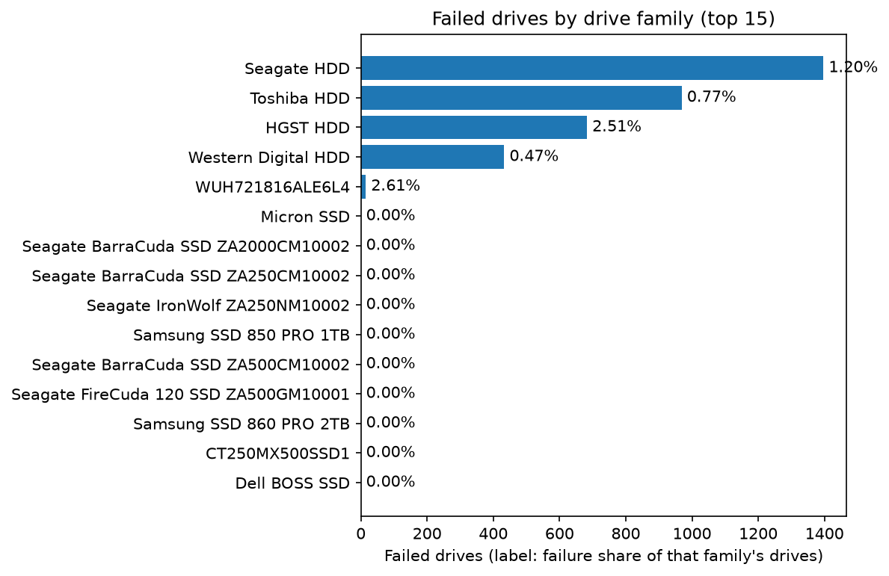

*Figure 1. Failed drives by drive family over the quarter-aligned window
(`make plots`). Bar length is the count of failed drives; the label is the
share of that family's drives that failed. Four hard-drive vendors account for
almost every failure; the SSD families have none in this period.*

### 4.2 Processing

Ingestion reads every SMART column as a number and replaces rows by drive and
date, after an early run failed on a column that was empty at the start of
one file and was read as text. Harmonization maps vendor attribute numbers to
canonical names and records telemetry gaps. The whole pipeline works in
batches of whole drives and writes results to disk batch by batch, so its
memory use is set by the batch size and not by the size of the data. A
watchdog stops any process whose resident memory exceeds 20 GB.

### 4.3 Labels and splits

A drive-day is positive if the drive fails within the horizon (30 days) after
that day, negative if the drive is observed for the whole horizon without
failing, and unlabelled otherwise.

The split is by time:

| Split | Dates | Rule |
|---|---|---|
| Train | the first 75 days | stops 30 days before the training cut-off, so every training label is settled before validation begins |
| Validation | the 25 days after the cut-off | only days after the training cut-off |
| Test | the following 21 days | ends 30 days before the data does, so every test label is complete |

The quarter-aligned window splits the same way:

| Split | Dates | Rule |
|---|---|---|
| Train | the first 107 days | the 30-day purge before the cut-off, as above |
| Validation | 2026-02-15 to 03-31 (45 days), a month after the 2026-01-15 cut-off | ends at the end of Q1 |
| Test | the first 61 days of Q2 | ends 30 days before the data does |
| Sealed | Q3 2026 | read by no training, validation or test step, until 2026-11-06 |

Ten percent of drives are also held out of training altogether. Random
splitting of drive-days is not used: it would let the model see each drive's
future.

The previous model (Section 9.2) split differently. Training and validation
share the dates 2026-01-01 to 05-01: 80% of drives train, the other 20% are the
validation holdout, so validation is a drive holdout over the training period
rather than a later window. The test set, Q3 2026, is strictly later than
every training and validation row, and thresholds chosen on that validation
carried to it: drive-level AUROC 0.922 on validation and 0.926 on test.

The current model (Section 9.1) uses a third design, a chronological split with gaps (Section 7.4). Rows are
separated by date only, with a gap of one label horizon (30 days) at each boundary and no drive holdout; the
Q4 2025 rows are feature history only. Failing drives are those with any positive 30-day label in the window.

| Split | Row dates | Drives | Failing drives | Rule |
|---|---|---|---|---|
| Train | 2026-01-01 to 04-20 | 353,011 | 2,018 | stops 30 days before the training cut-off (05-20) |
| Gap | 04-21 to 05-20 | | | training labels resolve; no row used |
| Validation | 2026-05-21 to 06-16 | 356,811 | 684 | only days after the training cut-off |
| Gap | 06-17 to 07-16 | | | validation labels resolve; no row used |
| Test | 2026-07-17 to 08-31 | 368,124 | 864 | ends 30 days before the data does |

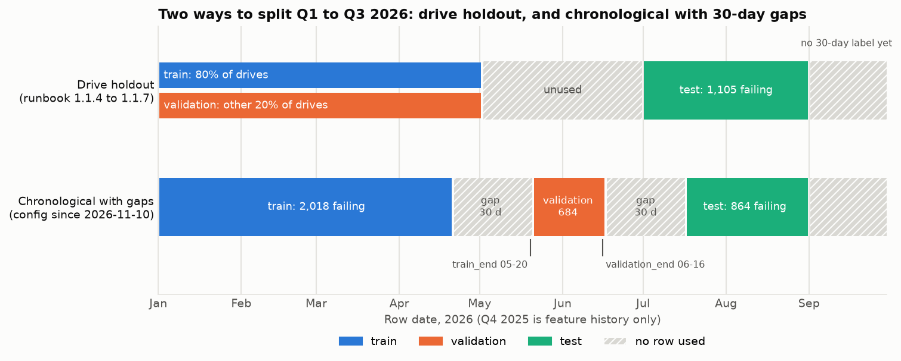

*Figure 30. The drive-holdout design of the previous model (train and validation share 2026-01-01 to 05-01, as 80%
and 20% of drives; 60 days unused; test Q3) against the chronological design (30-day gaps, hatched, at each
boundary; counts are failing test or validation drives).*

---

## 5. Features

The model sees 246 features per drive-day (`docs/feature_engineering.md`).

- **Core error counters** (SMART 5, 187, 188, 197, 198 and
  196: reallocated, reported uncorrectable, command timeout,
  pending and offline uncorrectable sectors, and reallocation event count)
  receive the full family: rolling mean, maximum and standard deviation over
  7, 14 and 30 days, deltas, slopes, counts of days with increases, spike
  counts, and z-scores against other drives of the same model.
- **Context attributes** (seek error rate, power-on hours, temperature, CRC
  error count) receive a light family: the value and its 7- and 30-day change.
- **Cross-attribute features:** total active defects and its velocity and
  acceleration, days since each counter last increased, age, ratios such as
  uncorrectable errors per power-on hour, and a temperature spike measure.
- **Telemetry quality:** coverage and freshness, combined into a feature
  confidence that the agent uses to block destructive actions on thin data -
  computed against the attributes each drive's own model is
  expected to report, and charging recency only for time beyond the normal
  daily telemetry cadence (Section 7.2).

SMART attribute 196, the sixth priority counter, was added on measured
evidence, not literature priors: a
raw-attribute screen (`scripts/screen_raw_attributes.py`) measured
single-attribute drive-day AUC for every SMART column Backblaze publishes,
and SMART 196 separated failing from healthy drive-days better than four of
the existing five core counters, at roughly double the coverage of SMART 187,
reaching the non-Seagate drives where the Seagate attributes are null. The same screen tested whether Backblaze's newer
`vault_id`/`pod_id` fields carried a genuinely new signal (clustered failure
within a chassis) and found the clustering was a cohort effect of filling a
vault with one drive batch, not local correlation worth featurizing.

The tiering keeps the feature table narrow enough for the memory budget.

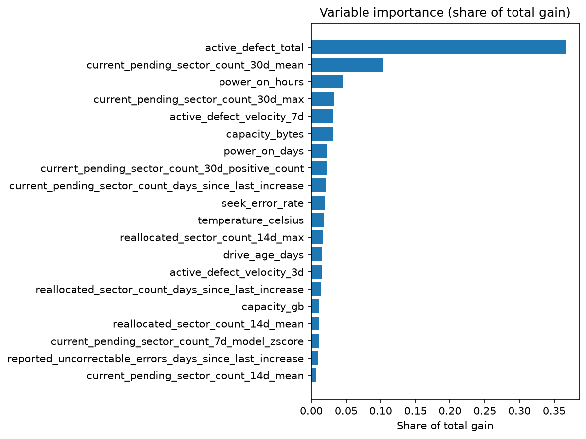

*Figure 2. The 20 features with the largest share of the first-stage model's
total gain, quarter-aligned run. The total of active defect counters carries
over a third of the gain on its own; pending-sector windows, age and the
velocity of new defects follow. The ranking is gain, not a causal claim, and it
describes the first stage only.*

---

## 6. Model

### 6.1 First stage

A LightGBM binary classifier. Failing rows are weighted by the square root
of the class ratio, trained on every failing row plus a hash-sampled subset
of healthy rows up to a 5,000,000-row cap. The trees are regularized (31
leaves, at least 200 rows per leaf, L2 penalty 10, capped leaf output) and
training stops when average precision on validation stops improving.

These choices came from a failure early in the project. With the standard
class-balancing option the model collapsed on real data, producing extreme
scores for a handful of drives. A later attempt at early stopping watched the
wrong metric and stopped after about 13 trees. Regularization, square-root
weighting and early stopping on average precision alone produced the first
working model.

### 6.2 Second stage

A second LightGBM re-ranks the drive-days the first model passes: those
scoring above the validation threshold that still catches 80% of failing
drives (50% until 2026-11-06). It is trained only on those rows, with the first
model's score as an extra feature; rows below the threshold keep their
first-stage score. This two-stage cascade is the core of the system, and
Section 8 describes it in full: why the net was widened to 80%, how the second
stage is trained, which models were compared for it, and the stacked second
stage tried last.

### 6.3 Thresholds and action tiers

All thresholds are chosen on validation at the drive level and then applied
unchanged to test. The primary threshold is the most precise point that
still catches 10% of failing drives. Each action tier has its own threshold,
set from the **lift** that action can tolerate - how many times more likely
an alerted drive must be to fail than a drive picked at random. Lift is used
rather than precision because precision depends on the failure rate of
whichever split it is measured on, while lift does not, so a target
expressed in lift carries from validation to test and from one fleet to
another.

On the previous model the lift rule reached its limit. Each tier takes the
cutoff with the most recall whose validation precision still meets lift times
the validation failure rate (0.589%): 33.3% for warn and 55.5% for cordon,
which the curve meets at 0.653 and 0.836; but 88.9% for migrate, met only at
the top of the curve (2 drives), and 133% for drain, which nothing can meet.
Drain falls back to the curve's most precise point, which is where migrate's
target is met, so both share the cutoff 0.926 and together flag 6 drives on Q3 (Section 9.3). Until the targets come from the cost of each action
rather than from lift, the destructive tiers did not operate on that model. On the current model the validation failure rate is 0.19%, the same
lifts convert to 10.9%, 18.1%, 28.9% and 43.4%, and every tier has its own cutoff (Section 9.1); those targets are still
placeholders.

A per-drive-model variant of this policy - one set of tier thresholds per
drive model instead of one fleet-wide set - was built and measured on test, and the fleet-wide policy proved better;
Section 11 and ADR 0002 give the result and why.

A monotone isotonic map, fitted on validation, is reported beside the raw
scores so that a number presented as a probability means what it says; it
leaves every decision unchanged, because a monotone map preserves ranking.
Above a calibrated probability of about 0.5 the bins hold too few drives to
be read with confidence.

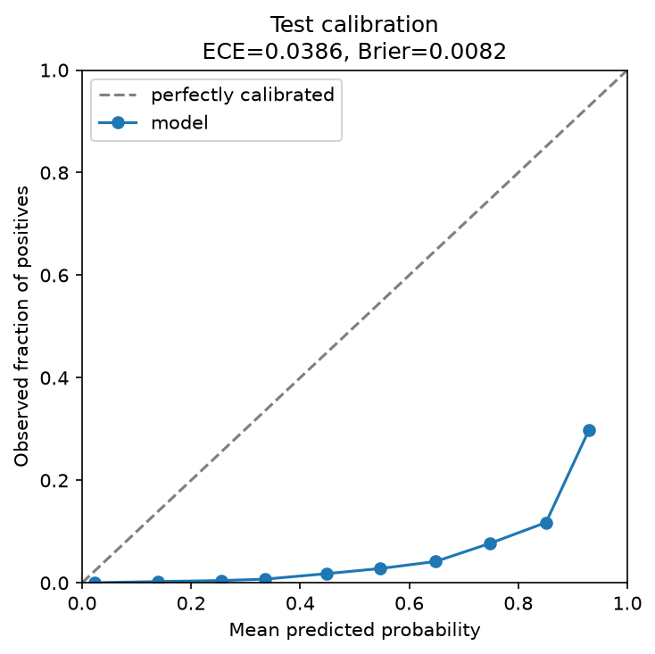

*Figure 3. Reliability of the raw first-stage score on the test split,
quarter-aligned run, per drive-day. The raw score is class-weighted, so it sits
far below the diagonal: drive-days scored 0.9 fail about 30% of the time. This
is why the raw score is never read as a probability and the isotonic map is
reported beside it.*

---

## 7. Evaluation method

- **Per drive, not per drive-day.** A failing drive produces about thirty
  nearly identical positive rows, so row-level figures count it thirty times.
  A failing drive is *caught* if any day in its window scores above the
  threshold; a healthy drive is a *false alarm* if any of its days does.
- **Later data only.** The test period follows training. In the earlier runs
  validation was a later period too; for the previous model it was a 20% drive
  holdout over the training dates (Section 4.3), and the Q3 test quarter was
  later than every training and validation row; for the current model it is a later
  period again, with a gap at each boundary (Sections 4.3 and 7.4).
- **Thresholds from validation.** No number in this report was obtained by
  tuning on test, and every computation that touched the test split is
  recorded in an append-only log, so the number of comparisons behind a
  reported figure is a fact rather than a recollection.
- **Headline numbers carry an interval.** Test precision and recall are given
  with a 1000-draw bootstrap interval that resamples whole drives, and the
  second stage is judged by a paired interval on shared drives rather than
  by comparing two point estimates - which is precisely how its earlier,
  stronger-sounding claim came to be revised (Section 11).
- **A final period was sealed, and has been used.** Q3 2026 is labelled
  `sealed` and was read by no training, validation or test step until
  2026-11-06, when the single-shot evaluation of the frozen run was skipped by
  decision and Q3 became the test set of the Q1+Q2 -> Q3 runs (runbook 1.1.4).
  `make evaluate-frozen` now refuses it. Nothing is sealed at present; the
  rules a future untouched period must apply are in
  `docs/q3_horizon_and_cascade_run.md` section 6.
- **Precision is reported with its failure rate.** Precision depends on how
  common failures are among the drives judged. For catch rate *r*,
  false-alarm rate *f* and failure rate *p*,
  precision = *r·p* / (*r·p* + *f*·(1 − *p*)). The catch rate and false-alarm
  rate do not depend on *p*; precision does. Results are therefore given at
  the fleet's own failure rate and, restated, at 15% and 50%, the rates
  typical of published evaluations. The restated figures are arithmetic on
  the measured rates, not separate experiments.

### 7.1 Corrections made to the evaluation

Three errors were found and fixed early in the project. Each had flattered
the results, and each is recorded with its effect in
`docs/model_status_and_runbook.md`.

1. **The test set ran past its intended end.** In the last days of the data a
   healthy drive-day has no label yet, but a failing one does, so those days
   added failing drives with no healthy drives beside them. Correcting this
   lowered 14-day precision near 10% recall from 39.6% to 33.6%.
2. **Training labels reached into the validation period.** A training row
   dated just before the cut-off is labelled by what happens after it.
   Training now stops one horizon earlier.
3. **Validation contained rows from the training period** (the held-out
   drives' history), which made validation look easier than the future.
   Validation now holds only later dates. After this, a threshold chosen to
   catch 20% of failing drives on validation caught 18.7% on test with the
   single model; before, it caught 12.6%.

### 7.2 A fourth correction, found after a model was already frozen

A fourth error was found later, by a different route: not a leak into the
evaluation, but a bug in a safety mechanism that only real data could expose.

**What was found.** `feature_confidence` - the score the
`FEATURE_CONFIDENCE` guardrail compares against a 0.80 floor before any
migrate or drain - was computed by multiplying three factors together. Two
of them were wrong in a way that pinned the product below 0.80 regardless of
the third:

1. **Attribute coverage counted every priority attribute for every drive**,
   including SMART 187/188, which only Seagate drives report. A non-Seagate
   drive therefore capped at 3 of 5 = 0.60, however complete its own
   telemetry was.
2. **Recency charged the ordinary daily telemetry cadence as staleness.**
   Backblaze and SMART-Z both report once a day, so the interval since the
   last reading is always about 24 hours; the formula charged that interval
   in full, capping every drive-day at `exp(-24/48) = 0.6065` however fresh
   the reading actually was.

Measured directly on the gold feature table built from the real data: **0%
of 62,565,487 drive-days cleared the 0.80 floor** before either fix. For any
drive scored through this pipeline, no migrate or drain action was ever
reachable, fleet-wide, however confident the underlying model prediction
was - a scope that includes every one of the 3,973 actions `make
score-fleet` proposed against the real fleet (Section 10.9), none of which
could have been anything stronger than Cordon. It does **not** include the
hardcoded two-drive demonstration fleet `make agent-demo`/`make api` run
against by default, whose confidence values are set directly rather than
computed, so that path was never exposed to this bug.

**Why no test caught it.** Every guardrail and chaos test fixture in the
suite builds synthetic drives with complete, fresh telemetry - exactly the
input these two bugs needed to still produce a value near 1.0 under the
wrong formula, so the tests could not distinguish the broken computation
from a correct one. Only computing it over real data, where drive models and
telemetry intervals vary, exposed the gap.

**What was fixed, and the measured effect.** Attribute coverage is now
scored against the attributes each drive's own model is expected to report
(`src/features/cross_vendor.py::model_expected_attributes`); recency now
charges only the time beyond the expected one-day cadence. Measured on the
rebuilt gold table: **86.1%** of drive-days now clear the floor, with 0.00%
newly blocked - a per-model denominator can only be as strict as the global
one it replaced, never stricter. The remaining ~13% is the expected 30-day
telemetry warm-up a new drive has not yet accumulated, not residual
breakage. `build_gold_features` now refuses to produce a gold table in which
no drive-day can ever clear the floor, so a third bug of this exact
multiplicative shape would fail the build rather than ship silently.

Because both fixes change feature *values*, not just the confidence formula
itself (the attribute set a model expects is now a real per-model property
of the data, the recency term is now a different number for the same raw
interval), the model previously frozen on the old feature set could not
simply be re-scored on the corrected data - its own trained splits would
have been fed three features far outside the distribution they were fitted
on. The frozen run in Section 10.7 is a genuinely new training run on the
corrected gold table, not the same model re-evaluated.

### 7.3 A fifth correction: the agent backtest looked ahead

The first run of the agent's policy over the test window reported 61.8%
precision at 48.3% recall. Its per-tier breakdown showed why that could not be
right: migrate and drain were 0 of 71 correct, while the actions the evidence
gates had downgraded were 90% correct. Two causes were confirmed:

1. **The maturity gate read the outcome.** `feature_maturity` is assigned from
   the dataset's last date, so in a backtest "mature" meant "still reporting a
   month after the snapshot" - a drive that cannot have failed inside the
   horizon. Of the flagged drives, those marked decommissioned were 88.8%
   failures and those marked mature 0.2%.
2. **The latest row of a departed drive is its last day alive.** 85% of the
   "caught" drives were scored on the day they died, with a median notice of
   0 days.

The point-in-time design that replaced it (`make agent-pit`) scores every drive
reporting on a fixed date, judges it on the label at that date, and consults no
maturity label. Its results are in Section 10.5. The mechanism is pinned by
`tests/unit/test_maturity_lookahead.py`.

### 7.4 A sixth correction: validation labels reached into the test period

The split rules of Section 4.3 purge the 30 days before the training cut-off, so training labels never run into
validation. Nothing did the same between validation and test. In the quarter-aligned window validation ended on
03-31 and test began on 04-01, so the labels of the last 30 days of validation, which look 30 days ahead, were
decided inside the test period. Counting over every drive with a validation-window row, 615 of the 1,124 failing
drives (55%) failed on or after 04-01, and they are 41.6% of the 1,479 failing drives of that test window.
Thresholds and blend weights fitted on those validation labels used outcomes the test then scored. How far this
moved the figures of Section 10.6 was **not measured**, since that needs a re-run of the window; only the extent of
the overlap is known. A second leak was smaller: the fleet-wide feature statistics (model-family z-scores, expected
SMART attributes) were computed on every row before the sealed window, which includes validation.

The drive-holdout design of the previous model avoids both by construction: validation shares the training dates,
and 60 days stay unused before Q3. The chronological split of Section 9.1 closes them by rule.
`splits.test_embargo_days` keeps test rows more than one horizon after validation ends,
`splits.feature_stats_end` stops the feature statistics at the last training row, `splits.strict_separation` makes
`make train` run the checks first, and `make check-splits` runs them on demand (`src/labels/split_checks.py`, 27
unit tests). The checks fail the run if the purge or the holdout flag is wrong, if the embargo or the statistics
cutoff is shorter than the horizon allows, or if any role's first row falls within one horizon of the previous
role's last row in the label table. They are off for the drive-holdout design, which shares dates by construction.
Only one safeguard is still missing: a frozen record of thresholds and model hashes committed before the test
scorer runs.

---

## 8. The two-stage cascade

This section is the centre of the project. It describes the design the project
arrived at, and the one the current model runs: a first stage tuned to reach as
many failing drives as the telemetry allows, accepting very low precision to do
so, and a second stage that works only on the drives the first stage lets
through. It ends with the last refinement tried, a stacked second stage that
blends two re-rankers. Section 9 then reports the current model's results in
full, and Section 10 how the design was reached. The sources are the runbook's
Sections 1.1.1 to 1.1.4a, 1.9, 4.11 and 4.12, and `docs/cascade_wide_net.md` and
`docs/q3_horizon_and_cascade_run.md`.

### 8.1 Why the design changed

**The strict end looked promising, and missed most failing drives.** On the
April-May 2026 test window (1,479 failing drives), the two-stage LightGBM of the
time (frozen run `839d92bc`) gave 57.1% precision at 12.0% recall. A merged run
(`fb58d957`) then scored XGBoost AFT and Cox survival models, an LSTM, a TCN and
two rank blends on the same drive-days, each with its threshold chosen on
validation as the most precise point with at least 10% recall (Section 10.2).
Several looked more precise than LightGBM (one seed, not confirmed) - but laid out as failing
drives missed, every one of them left most failures unflagged:

| April-May test, threshold for at least 10% recall | Precision | Recall | Caught | Missed | Missed % | False alarms |
|---|---|---|---|---|---|---|
| LightGBM two-stage | 57.1% | 12.0% | 178 | 1,301 | 88.0% | 134 |
| AFT | 68.5% | 12.4% | 183 | 1,296 | 87.6% | 84 |
| Cox | 62.9% | 13.7% | 202 | 1,277 | 86.3% | 119 |
| LSTM | 52.7% | 15.6% | 231 | 1,248 | 84.4% | 207 |
| TCN | 70.5% | 13.6% | 201 | 1,278 | 86.4% | 84 |
| Blend LightGBM + AFT + TCN | 70.1% | 13.7% | 202 | 1,277 | 86.3% | 86 |
| Blend LightGBM + LSTM + AFT + TCN | 69.7% | 12.6% | 186 | 1,293 | 87.4% | 81 |

Precision ranges from 52.7% to 70.5%, yet every model catches between 178 and
231 of 1,479 failing drives, and the least precise, the LSTM, catches the most.
The 84% to 88% missed is a setting, not a model limit: the threshold rule
favours precision at about 10% recall. Choosing each threshold for at least 35%
recall instead gives 37% to 41% recall at 46% to 52% precision for every model
except the LSTM. And the precision gain itself is not confirmed: one seed, a
test window read many times, intervals that resample drives only.

**Coverage was reachable, at a price the mild tiers can carry.** A recall-first
policy replayed day by day over the merged run's scores (runbook 4.11; Section
10.2) warned 62.5% of failing drives at least a day before failure at 27.0%
precision, and took 56.6% to cordon at 33.5%. A warning is a watchlist entry,
so its false alarms are cheap; the destructive tiers are where precision is
needed.

**The old cascade could not help there.** Its second stage only re-ranked
drive-days above a candidate threshold set to keep **50%** of failing drives on
validation, so it only reached recall levels up to 50%. The 60% warn region had
always been the first stage alone; the second model never saw those drives
(runbook 4.12). Two questions followed: how wide can the first stage's net be
made before it stops being a filter, and what should the second stage do with
what passes?

### 8.2 The design

```text
every drive-day in the fleet (Q3 2026: 368,688 drives, 0.30% failing)
   |
   v
STAGE 1  LightGBM on 246 features, trained on all failing rows and a sample of
         healthy ones; threshold set on validation to KEEP 80% OF FAILING DRIVES
   |-- below the cutoff (0.235): keeps its Stage 1 score; never re-scored
   v
CANDIDATE POOL  ~6% of drives; precision ~4% - a filter, not an alarm
   |
   v
STAGE 2  a model trained ONLY on candidate rows, with the Stage 1 score as an
         extra feature; LightGBM in production (Cox, AFT and a stack compared)
   |
   v
COMBINED SCORE  candidate: 0.235 + 0.765 x stage2;  non-candidate: stage1
   |
   v
thresholds on validation -> warn 0.653, cordon 0.836, primary 0.919,
                            migrate = drain 0.926 (shared)
```

**Stage 1: recall first, precision deliberately given up.** Stage 1 is the
ordinary LightGBM of Section 6.1. Its only change is where its cut-off sits:
`model.two_stage.candidate_recall` is 0.8, so the candidate threshold is the
validation score that still catches 80% of failing drives. For the previous
model that was 0.235 (`frozen_runs/c459046e.../two_stage.json`) and for the current
model it is 0.1431 (`frozen_runs/6ea7a5bc.../two_stage.json`). At that point
Stage 1 is a poor alarm and a good filter: on the first Q3 run it flagged 22,463 healthy drives
to reach 883 failing ones, a precision of 3.8% (on the current model's test period, 32,579 to reach 734, 2.2%). That is still about 13 times the
fleet's 0.30% failure rate (arithmetic on the reported counts), so the pool
Stage 2 receives is far richer in failures than the fleet, while it has lost only
a fifth of them.

**Stage 2: a specialist for the hard cases.** Stage 2 is trained only on the
candidate rows, so all of its capacity goes to telling failing drives from
healthy drives that already look suspicious; the easy healthy drives, more than
nine in ten of the fleet, never reach it. Three details keep it honest
(`src/models/two_stage.py`; developer guide Section 5.13):

- **Out-of-fold Stage 1 scores for training rows.** Each training row's Stage 1
  score, used both to decide whether it is a candidate and as a feature, comes
  from a Stage 1 fitted without that row's drive. Stage 2 therefore learns from
  scores like those it meets on new drives, not from Stage 1's memorized ones.
- **The Stage 1 score is an input.** Stage 2 refines Stage 1's judgement rather
  than starting over.
- **Early stopping on the validation candidates**, with at least 50 rows per
  leaf. The code caps the healthy candidate rows used for this; for `c459046e`
  the cap did not bind and all 176,616 validation candidate rows were used
  (`two_stage.json`).

**One combined score.** A candidate scores `0.235 + 0.765 x stage2`, which maps
Stage 2's output onto the range above the cut-off; a non-candidate keeps its
Stage 1 score. The ranking below the cut-off is Stage 1's, the ranking above it
is Stage 2's, and the two never cross. Every threshold - the action tiers and the
primary threshold - is then chosen on validation on this combined score.

### 8.3 Choosing the width of the net

The net was chosen by experiment on the April-May window (runbook 4.12,
`docs/cascade_wide_net.md`): nets of 50%, 70%, 80% and 90% were compared against
Stage 1 alone at recall levels from 5% to 80%, three seeds, paired drive
bootstrap. A 95% net was not run: on validation it would pass 56% of healthy
drives and enrich the pool only 2.5 times, so it would no longer filter.

| April-May test, mean of 3 seeds | Recall level | Precision | Recall | Caught | False alarms |
|---|---|---|---|---|---|
| Stage 1 alone | 10% | 59.4% | 11.5% | 171 | 117 |
| Cascade, 50% net (then the setting) | 10% | 61.7% | 14.2% | 210 | 131 |
| Cascade, 80% net | 10% | 64.3% | 11.9% | 177 | 99 |
| Stage 1 alone (= 50% net) | 60% | 22.8% | 64.5% | 953 | 3,228 |
| Cascade, 80% net | 60% | 24.8% | 64.3% | 951 | 2,894 |
| Cascade, 90% net | 60% | 24.7% | 63.8% | 943 | 2,873 |

- **The wide net brings Stage 2 into the warn region.** At 60% recall the 80%
  net removed about 330 false alarms per test window (3,228 to 2,894) for 2 fewer
  drives caught; the 50% net cannot reach 60% recall at all, so there it is
  Stage 1 alone.
- **Past about 70% recall every net hurt**, because the pool is then mostly
  healthy drives.
- **The adoption was post hoc, and is recorded as such.** The decision rule
  written before the run required recall not to drop at 60%, and every wider
  net caught 2 to 16 fewer drives there (not significant), so by that rule the
  50% net stayed. On 2026-11-06 the 80% net was adopted anyway and taken to Q3,
  where it would be tested on data it had not been chosen on.

### 8.4 Stage 1 on a quarter it never saw: 80% of failing drives reached

The three Q1+Q2 -> Q3 runs (Section 9) are the first test of the 80% net on
new data. Its coverage held at every horizon:

| Q3 2026 test | 30-day (`c459046e`) | 44-day (`a2cd06d5`) | 60-day (`804a20ce`) |
|---|---|---|---|
| Stage 1 recall on test (target 80% on validation) | **79.9%** | **81.7%** | **78.5%** |
| Drives passed to Stage 2 | 6.3% | 6.2% | 5.2% |
| Trees, Stage 1 / Stage 2 | 310 / 74 | 225 / 201 | 281 / 54 |
| Stage 2 gain at the primary point, precision points [95% CI] | +4.2 [-0.1, +8.5] | +1.1 [-5.0, +6.9] | -3.8 [-10.5, +3.0] |

For the 30-day model, the funnel from the fleet to each operating point:

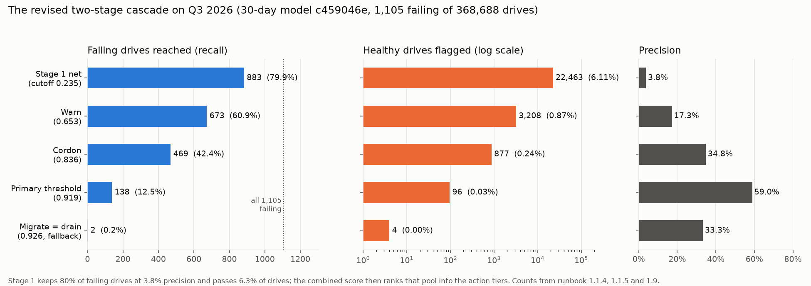

*Figure 4. The funnel of the previous model on Q3 2026: failing drives reached
(left), healthy drives flagged (centre, log scale) and precision (right) at the
Stage 1 net and at each threshold of the combined score. Drawn by
`scripts/plot_cascade_funnel.py` from the counts of runbook Sections 1.1.4,
1.1.5 and 1.9; no data is read.*

| Point on the combined score | Failing reached | Recall | Healthy flagged | Precision |
|---|---|---|---|---|
| Stage 1 net (0.235) | 883 | 79.9% | 22,463 | 3.8% |
| Warn (0.653) | 673 | 60.9% | 3,208 | 17.3% |
| Cordon (0.836) | 469 | 42.4% | 877 | 34.8% |
| Primary threshold (0.919) | 138 | 12.5% | 96 | 59.0% |
| Migrate = drain (0.926) | 2 | 0.2% | 4 | 33.3% |

Each step down the funnel gives up failing drives to shed healthy ones much
faster: from the net to warn, 24% of the failing drives are lost and 86% of the
healthy ones; from warn to cordon, 30% and 73%.

**The fifth that Stage 1 does not reach is not reachable with this telemetry.**
The deep dive (Section 9.6) placed every failing drive at the strictest point
that catches it. Of the 222 that never passed Stage 1, 98.6% show no rise in any
core SMART counter in their last 30 days, with complete telemetry (coverage
0.96), at a median power-on age of 2.9 years. The 210 that passed Stage 1 but
stayed below warn are in between: a counter rose in 38.6% of them. The drives
the net misses are therefore almost all drives whose SMART readings do not
change before they fail, and a wider net mostly adds healthy drives (Section
8.3). In the runbook's words, "the ceiling held": Stage 1 at the 0.8 cutoff
keeps 78.5% to 81.7% of failing test drives, and nothing above it changes that.

### 8.5 Stage 2 on the filtered pool: which re-ranker

With the pool fixed, the next question was what model should re-rank it. Three
kinds were fitted on the same candidates of the same net, three seeds per
horizon, each paired against Stage 1 alone on the same test drives
(`make experiment-model ... --two-stage --stage2-kinds lightgbm cox aft`;
`data/audit/cascade_q3_h<H>/`). Cox and AFT are XGBoost survival models fitted
to each candidate's censored time to failure (`src/models/survival.py`), a
different view of the same rows. The experiment refits Stage 1 in each seed, so
its "Stage 1 alone" differs slightly from the production model.

30-day model, Q3 test, mean of 3 seeds, thresholds from validation:

| Model | Recall level | Precision | Recall | Caught | False alarms |
|---|---|---|---|---|---|
| Stage 1 alone | 10% | 56.5% | 11.2% | 123 | 97 |
| Cascade, 50% net | 10% | 60.3% | 9.7% | 107 | 72 |
| **Cascade, 80% net, LightGBM Stage 2 (production)** | 10% | **61.7%** | 10.4% | 115 | 72 |
| Cascade, 80% net, Cox Stage 2 | 10% | 61.0% | 15.7% | 173 | 113 |
| Cascade, 80% net, AFT Stage 2 | 10% | 50.0% | 20.5% | 227 | 246 |
| Stage 1 alone | 35% | 41.6% | 37.5% | 414 | 582 |
| Cascade, 50% net | 35% | 39.1% | 34.8% | 384 | 599 |
| **Cascade, 80% net, LightGBM Stage 2 (production)** | 35% | **42.3%** | 36.3% | 401 | 548 |
| Cascade, 80% net, Cox Stage 2 | 35% | 40.7% | 37.0% | 408 | 594 |
| Stage 1 alone (= 50% net) | 60% | 20.1% | 59.2% | 654 | 2,600 |
| **Cascade, 80% net, LightGBM Stage 2 (production)** | 60% | **19.9%** | 58.6% | 648 | 2,605 |
| Cascade, 80% net, Cox Stage 2 | 60% | 20.3% | 58.3% | 644 | 2,528 |

Cascade minus Stage 1 alone, precision points, mean of 3 seeds, with the number
of seeds whose paired 95% interval lies above / below zero:

| Horizon | Stage 2 (net) | 10% recall | 35% | 60% | 70% |
|---|---|---|---|---|---|
| 30 | LightGBM (0.5) | +3.8 (1 / 0) | -2.5 (0 / 3) | not reached | not reached |
| 30 | **LightGBM (0.8)** | **+5.1** (1 / 0) | +0.6 (0 / 0) | -0.2 (1 / 2) | +0.2 (2 / 1) |
| 30 | Cox (0.8) | +4.5 (0 / 0) | -0.9 (0 / 1) | +0.2 (1 / 1) | +0.5 (2 / 0) |
| 30 | AFT (0.8) | -6.5 (0 / 2) | -6.6 (0 / 3) | -2.8 (0 / 3) | -1.7 (0 / 3) |
| 44 | LightGBM (0.8) | -0.5 (0 / 0) | +0.6 (1 / 0) | -0.1 (1 / 1) | -0.8 (0 / 2) |
| 60 | LightGBM (0.8) | -1.3 (0 / 1) | +1.8 (2 / 0) | +1.3 (3 / 0) | -0.8 (0 / 2) |

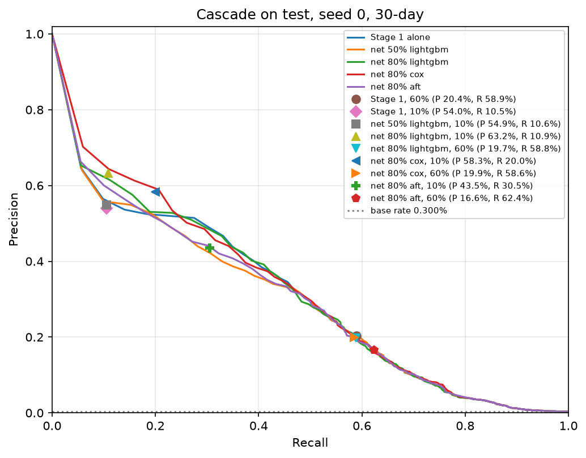

*Figure 5. Drive-level precision-recall curves on Q3 for Stage 1 alone, the 50%
and 80% LightGBM nets, and Cox and AFT as Stage 2 on the 80% net (30-day, seed
0). The markers are the 10% and 60% recall levels, with thresholds from
validation, so a survival model's marker lands at a different test recall. The
curves coincide above about 30% recall.*

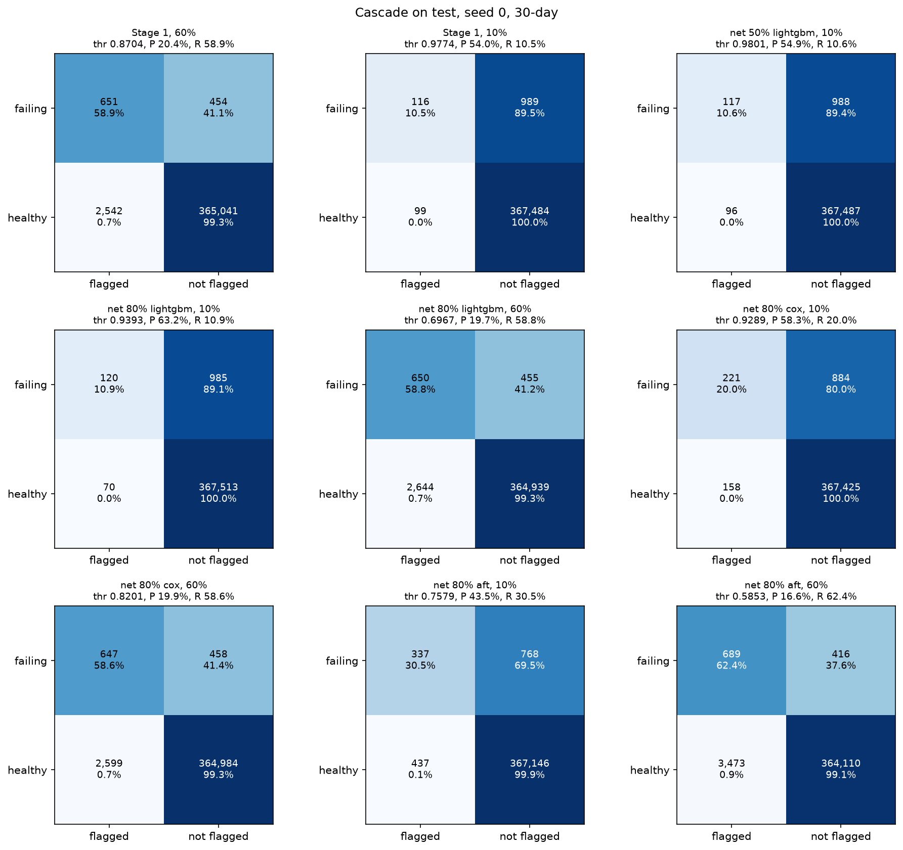

*Figure 6. The drive counts behind each marker of Figure 5 (30-day, seed 0).
At 10% recall the 80% LightGBM net catches 120 failing drives for 70 false
alarms, against Stage 1 alone's 116 for 99.*

- **Stage 2 sharpens the top of the list.** At 10% recall the 80% LightGBM net
  adds 5.1 precision points for the 30-day model, and at the primary threshold
  of the frozen run +4.2 points with an interval that just touches zero. In seed
  0 the same 10% level costs 29 fewer false alarms for 4 more catches (Figure 6).
- **Above about 20% recall the Stage 2 gains are within about a point**, in
  any horizon; the largest, the 60-day LightGBM's +1.8 at 35% and +1.3 at 60%
  recall, turns into -0.8 at 70%. The precision-recall curves lie on top of each
  other there (Figure 5). The limit is the information in SMART, not the
  Stage 2 learner: three learners rank the same suspects the same way
  (`docs/q3_horizon_and_cascade_run.md` section 7.5).
- **The 80% net is not worse than the 50% net**, which loses 2.5 points against
  Stage 1 alone at 35% recall in 3 of 3 seeds.
- **Cox matches the LightGBM Stage 2** within about a point everywhere, with no
  consistent sign; on the 30-day model its C-index on the test candidates
  equals Stage 1's (0.90).
- **AFT is worse at every level in every horizon** (2 to 8 points; in 3 of 3
  seeds at 35%, 60% and 70% recall): its validation thresholds do not carry to test, so its "10%" point
  catches 16% to 21%. It is not a candidate.
- **The strict-end gain is not confirmed.** At 30 days only 1 of 3 seeds clears
  zero, and the gain is absent at 44 and 60 days. `candidate_recall` stays 0.8,
  not confirmed; section 6 of `docs/q3_horizon_and_cascade_run.md` sets the rule
  that untouched data must apply.

### 8.6 Landing on a stacked Stage 2

Cox and the LightGBM Stage 2 reached the same precision on the same pool, but by
different routes: one models time to failure, the other the failure label. If
they rank different failing drives near the top, a blend of the two should
catch more than either. A separate, standalone comparison on April-May is
consistent with that: with Cox as a standalone model, not a Stage 2, at a
1-in-10,000 false-alarm rate LightGBM and Cox shared only 22 of the 54 and 92
failing drives they each caught (runbook 1.1.4a, which marks it "not yet
reproducible": a one-off script not kept in the repository).

**Method** (runbook 1.1.4a; `src/models/stacking.py`). A new Stage 2 kind,
`stack`, blends the LightGBM and Cox Stage 2 already fitted for the same net;
nothing is retrained.

1. Each member's candidate score is turned into its rank against that member's
   own **validation** candidate scores (`src/models/ensemble.py::validation_rank`),
   so test scores are placed without looking at test.
2. The blend is the weighted mean of the two ranks. The weights are searched on
   a 0.1 grid (LightGBM / Cox = 0.0 / 1.0 to 1.0 / 0.0) for the highest
   drive-level average precision on the validation candidates.
3. The blended rank is the stack's Stage 2 score. Everything else - the net,
   the thresholds chosen on validation, the paired comparisons - is as in
   8.5, now also paired against the LightGBM Stage 2 (`paired_vs_lightgbm`).

The members early-stopped on the same validation rows the weights are searched
on, so the stack's validation score is optimistic; only the paired test
comparison counts. It was run on Q3 at all three horizons, 0.8 net, three seeds
(`make experiment-model ... --stage2-kinds lightgbm cox stack`; outputs frozen in
`data/audit/stack_q3_h<H>/`, MLflow `5ab8f0bb`, `7a568b77`, `47d8ff0c`). The
LightGBM and Cox rows reproduced the Section 8.5 tables exactly.

**At the thresholds**, precision / recall, mean of 3 seeds:

| Horizon | Level | Stage 1 alone | LightGBM Stage 2 | Cox | Stack | Stack minus LightGBM, precision (seeds above / below 0) |
|---|---|---|---|---|---|---|
| 30 | 10% | 56.5% | 61.7% / 10.4% | 61.0% / 15.7% | **64.9% / 11.6%** | +3.2 (1 / 0) |
| 30 | 35% | 41.6% | 42.3% / 36.3% | 40.7% / 37.0% | 41.7% / 37.2% | -0.5 (0 / 0) |
| 30 | 60% | 20.1% | 19.9% / 58.6% | 20.3% / 58.3% | 19.9% / 58.9% | 0.0 (0 / 0) |
| 44 | 10% | 59.0% | 58.4% / 15.4% | 63.2% / 16.1% | **64.6% / 14.1%** | +6.1 (3 / 0) |
| 44 | 35% | 45.2% | 45.9% / 32.7% | 45.1% / 35.1% | 45.9% / 34.2% | 0.0 (0 / 0) |
| 44 | 60% | 23.2% | 23.1% / 55.7% | 22.9% / 56.5% | 23.4% / 56.2% | +0.3 (1 / 1) |
| 60 | 10% | 69.6% | 68.4% / 11.4% | 70.6% / 13.4% | 68.0% / 15.5% | -0.4 (0 / 0) |
| 60 | 35% | 49.6% | 51.5% / 28.0% | 50.3% / 31.2% | 52.0% / 29.8% | +0.6 (1 / 0) |
| 60 | 60% | 26.6% | 27.9% / 49.6% | 26.5% / 51.5% | 27.0% / 50.5% | -0.9 (0 / 3) |

Precision alone is not a fair comparison here: each model's threshold is set on
validation for a recall target, so on test the models land at different recall.
At the 10% level both axes, stack minus LightGBM per seed, paired 95% interval
(**bold** = entirely above 0, *italic* = entirely below):

| Horizon | Seed | Precision | Recall | Drives caught, LightGBM / Cox / stack |
|---|---|---|---|---|
| 30 | 0 | +2.4 [-1.7, +6.6] | **+1.9** [+0.5, +3.2] | 120 / 221 / 141 |
| 30 | 1 | **+5.3** [+1.2, +9.8] | +0.5 [-0.6, +1.6] | 119 / 159 / 124 |
| 30 | 2 | +1.9 [-2.5, +6.0] | **+1.1** [+0.2, +2.0] | 107 / 140 / 119 |
| 44 | 0 | **+5.3** [+2.5, +8.4] | -0.8 [-1.7, +0.1] | 164 / 259 / 155 |
| 44 | 1 | **+8.8** [+4.6, +13.3] | -1.0 [-2.2, +0.2] | 142 / 148 / 131 |
| 44 | 2 | **+4.3** [+1.4, +7.6] | *-2.2* [-3.5, -0.9] | 206 / 126 / 182 |
| 60 | 0 | +3.5 [-0.4, +7.7] | **+3.8** [+2.5, +5.0] | 124 / 200 / 166 |
| 60 | 1 | -2.0 [-7.7, +3.5] | **+6.4** [+4.8, +8.0] | 123 / 123 / 194 |
| 60 | 2 | -2.8 [-7.1, +1.7] | **+2.1** [+1.1, +3.3] | 135 / 126 / 159 |

- **At 30 and 60 days the stack is better on at least one axis in every seed
  and significantly worse on none.** At 60 days it catches more failing drives
  in 3 of 3 seeds at a precision whose interval includes zero, which the
  precision-only reading (-0.4) hid.
- **At 44 days it is a trade:** higher precision in 3 of 3 seeds, but fewer
  drives caught in all three, significantly in one.

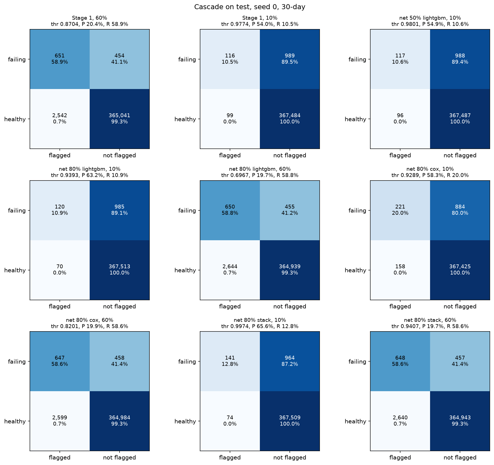

*Figure 7. Drive counts on Q3 for Stage 1 alone, the 50% and 80% LightGBM nets,
Cox and the stack at the 10% and 60% recall levels (30-day, seed 0). At 10% the
stack catches 141 failing drives for 74 false alarms (65.6% precision, 12.8%
recall), against 120 for 70 for the LightGBM Stage 2.*

**At a matched budget.** Thresholds put each model at a different recall, so
the cleanest comparison flags exactly K drives with each model, its K
highest-scored, and counts the failing drives among them (mean of 3 seeds;
"seeds" = in how many the stack catches more than that model):

| Horizon | K | LightGBM | Cox | Stack | Stack > LightGBM | Stack > Cox |
|---|---|---|---|---|---|---|
| 30 | 100 | 64.7 | 70.7 | 69.0 | 3 / 3 | 0 / 3 |
| 30 | 250 | 146.3 | 156.7 | 153.7 | 3 / 3 | 0 / 3 |
| 30 | 500 | 266.0 | 267.3 | 270.3 | 3 / 3 | 3 / 3 |
| 30 | 1,000 | 413.0 | 408.0 | 415.0 | 2 / 3 | 3 / 3 |
| 44 | 100 | 67.3 | 73.0 | 72.7 | 3 / 3 | 1 / 3 |
| 44 | 250 | 149.0 | 162.7 | 159.3 | 3 / 3 | 1 / 3 |
| 44 | 500 | 267.3 | 271.7 | 274.0 | 3 / 3 | 3 / 3 |
| 44 | 1,000 | 415.7 | 419.3 | 417.3 | 1 / 3 | 0 / 3 |
| 60 | 100 | 70.7 | 76.3 | 75.0 | 3 / 3 | 1 / 3 |
| 60 | 250 | 161.3 | 174.7 | 167.7 | 3 / 3 | 0 / 3 |
| 60 | 500 | 276.0 | 284.7 | 287.3 | 3 / 3 | 3 / 3 |
| 60 | 1,000 | 413.3 | 409.3 | 414.3 | 1 / 3 | 1 / 3 |

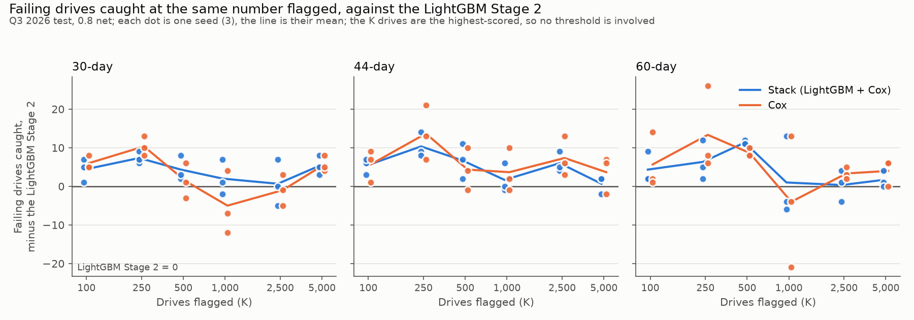

*Figure 8. Failing drives caught at the same number of drives flagged, Cox and
the stack minus the LightGBM Stage 2, one dot per seed and the line their mean,
Q3 2026, 0.8 net. Up to K = 500 the stack is above zero in every seed in all
three horizons (+1 to +14); Cox is above zero in 25 of 27 seed-and-K points, with
a larger spread (up to +26); from K = 1,000 the sign is mixed. Drawn by
`scripts/plot_stack_topk.py` from the saved top-K results; no new look at test.*

**What the stack adds.**

- **A small, consistent gain at the top of the list over the production Stage
  2.** Flagging the same number of drives, the stack catches more failing drives
  than the LightGBM Stage 2 at K = 100, 250 and 500 in 3 of 3 seeds in all three
  horizons: about 4 to 11 more on average out of about 1,100 failing (+1 to
  +14 in single seeds), 0.4 to 1 point of recall. That is the region of the primary threshold (138 drives caught, 234
  flagged) and of a strict drain tier.
- **At K = 100 and 250 the gain is Cox's.** Cox alone catches as many or more
  there; the stack beats it in 0 or 1 of 3 seeds. The 44-day stack's +6.1
  precision points at the 10% level are likewise +1.4 over Cox alone (63.2%).
- **At K = 500 the blend adds something of its own:** it beats both members in
  3 of 3 seeds in every horizon, the one place where combining the two views
  outranks the better of them.
- **Nothing changes from K = 1,000 or above about 35% recall**, where all the
  curves coincide - the same limit as Section 8.5.
- **The weights are not stable:** LightGBM / Cox 0.4 / 0.6, 0.5 / 0.5 and 0.6 /
  0.4 across the three 30-day seeds; 0.5 / 0.5, 0.4 / 0.6 and 0.3 / 0.7 at 44;
  0.5 / 0.5, 0.3 / 0.7 and 0.5 / 0.5 at 60. The stack's validation drive-level
  average precision, 0.544-0.547 (30), 0.573-0.581 (44) and 0.587-0.596 (60), is
  within about 0.01 of either member's.

**Why it is not adopted yet.** The evidence is weaker than "3 of 3" sounds:
the matched-K counts have no confidence intervals; the three seeds share the
same test drives, so they are not independent samples of the test set; the
matched-budget view was settled after a precision-only reading and a rule stated
before the run (interval above zero in at least 2 of 3 seeds at both 10% and 35%
recall, met by no horizon) disagreed; and Q3 had already been used as a test
set. The production Stage 2 stays the LightGBM on the 80% net (`c459046e` and the
44- and 60-day runs), and `log_two_stage` accepts only a LightGBM Stage 2. A
confirmation needs an untouched quarter, one metric stated in advance (failing
drives caught at a fixed number flagged, with a paired interval), Cox alone as a
third arm, and the rules of `docs/q3_horizon_and_cascade_run.md` section 6.

### 8.7 What the revised cascade delivers

- **Coverage that holds on new data.** Stage 1 reaches 80% of failing drives on
  a quarter it never saw (78.5% to 81.7% across horizons) while passing 5% to 6%
  of the fleet, and almost all of the fifth it misses show no SMART change
  before they fail.
- **A pool, not an alarm.** At 3.8% precision Stage 1's cut-off is never an
  action; it decides what the second stage looks at.
- **A sharper top of the list, not confirmed.** For the 30-day model Stage 2
  adds about 4 to 5 precision points at the strict end (+5.1 at 10% recall, +4.2
  at the primary threshold), with no such gain at 44 or 60 days; a stack of
  LightGBM and Cox adds a few more failing drives in the top 500. Neither
  changes the warn and cordon region (17.3% and 34.8% precision on Q3).
- **A clear limit.** No re-ranker moves the curve above about 30% recall, and
  no net reaches the silent fifth. What would move the result is new
  information (Section 15, items 5a and 7), not another learner on the same
  evidence.

The funnel is also where the action tiers' limit shows (Section 9.3):
migrate and drain share a cutoff that flags 6 drives in the 62-day Q3 test
window, so the agent
warns and cordons until the tier targets are set from the cost of each action.

---

## 9. The current model on Q3 2026

The current model is the chronological split run of 2026-11-10 (Section 9.1; frozen run
`6ea7a5bcfb954deeb4a4208e4d802744`): the 30-day two-stage LightGBM of Section 8 with the 80% Stage 1 net, trained on
rows 2026-01-01 to 04-20, validated on 05-21 to 06-16 and tested on 07-17 to 08-31 (inside Q3), with a 30-day gap at
each boundary. It has been the latest 30-day training run since it was made, so `score-fleet` and the agent load it by
default; no one chose that. Sources: runbook Section 1.1.9.

The previous model is the drive-holdout run `c459046e` (80% of drives trained on 2026-01-01 to 05-01, the other 20% the
validation holdout, all of Q3 the test), analysed in Sections 9.2 to 9.9. Two more runs with 44- and 60-day labels
used identical training rows; the deep dive, the cluster policy and the stability analyses were made on it and were
not repeated on the current model. Thresholds are chosen on validation; every figure is per drive. The method of that
run was written before it (`docs/q3_horizon_and_cascade_run.md`); every read of the test set is in the access log.
Sources: runbook Sections 1.1.4, 1.1.5, 1.1.6 and 1.9.

### 9.1 The chronological split run (the current model)

The chronological split of Section 4.3 was run on 2026-11-10 (runbook Section 1.1.9) to test one explanation for
the missing precision: that validation and test sat at failure rates a factor of two apart (0.59% and 0.30%), so a
threshold tuned for a precision goal on validation could not hold on test. Here they sit at 0.19% and 0.23%.
Everything below is per drive, 30-day horizon, on the 46-day test period (864 failing and 367,260 healthy drives).

**The goal is not met, on validation or on test.**

| At a glance (test) | Precision | Recall | Caught | False alarms |
|---|---|---|---|---|
| Stage 1 net (cutoff 0.1431) | 2.2% | 85.0% | 734 | 32,579 |
| LightGBM two-stage, primary threshold (frozen run) | 59.9% [52.5, 66.3] | 13.3% [11.1, 15.6] | 115 | 77 |
| Stack, the 10% recall level (mean of 3 seeds) | 55.4% | 16.2% | 140 | 113 |
| **The goal** | **68%** | **>= 10%** | | |

**Stage 1 works as designed.** The net is the validation threshold that keeps 80% of failing validation drives. It
keeps 80.3% of them (549 of 684) at 2.13% precision and 85.0% of the test drives (734 of 864) at 2.20%, passing 7.2%
and 9.0% of the fleet to Stage 2.

**The LightGBM two-stage model** (339-tree Stage 1, 103-tree Stage 2). The primary threshold is the
highest-recall validation threshold with precision of at least 68% and recall of at least 10%; none exists, so the
report fell back to the highest-precision threshold with recall of at least 10%: 51.5% at 10.2% on validation, 59.9%
at 13.3% on test (AUROC 0.906 and 0.923). Stage 2 adds 5.1 points of precision over Stage 1 alone at that recall [0.9,
9.4]. All four action tiers fire, unlike on the drive-holdout model, because the lift targets now convert at 0.19%
to precision targets of 10.9%, 18.1%, 28.9% and 43.4%:

| Tier (test) | Precision | Recall | Caught | False alarms | Flagged |
|---|---|---|---|---|---|
| Warn | 10.8% | 65.2% | 563 | 4,661 | 5,224 |
| Cordon | 18.1% | 56.1% | 485 | 2,192 | 2,677 |
| Migrate | 28.0% | 44.4% | 384 | 987 | 1,371 |
| Drain | 52.4% | 20.4% | 176 | 160 | 336 |
| Primary | 59.9% | 13.3% | 115 | 77 | 192 |

**The Stage 2 variants**, on the same Stage 1 net: a LightGBM Stage 2, a Cox Stage 2 and a rank-blend stack of the
two, mean of three seeds, thresholds set on validation for each recall level. Each cell is precision / recall
(drives caught / false alarms):

| Recall level | Stage 1 alone | LightGBM Stage 2 | Cox Stage 2 | Stack |
|---|---|---|---|---|
| 5% | 57.3% / 8.7% (75 / 55) | 62.1% / 8.3% (72 / 43) | 61.1% / 9.3% (80 / 51) | 64.0% / 8.3% (71 / 40) |
| **10%** | 55.8% / 13.0% (112 / 89) | 56.8% / 13.7% (118 / 89) | 52.6% / 17.6% (152 / 137) | 55.4% / 16.2% (140 / 113) |
| 20% | 44.3% / 26.0% (225 / 283) | 44.6% / 25.6% (221 / 275) | 45.2% / 26.5% (229 / 277) | 46.7% / 25.9% (224 / 256) |
| 35% | 31.5% / 42.0% (363 / 788) | 30.9% / 41.0% (355 / 794) | 32.5% / 41.0% (355 / 738) | 32.0% / 41.4% (357 / 762) |

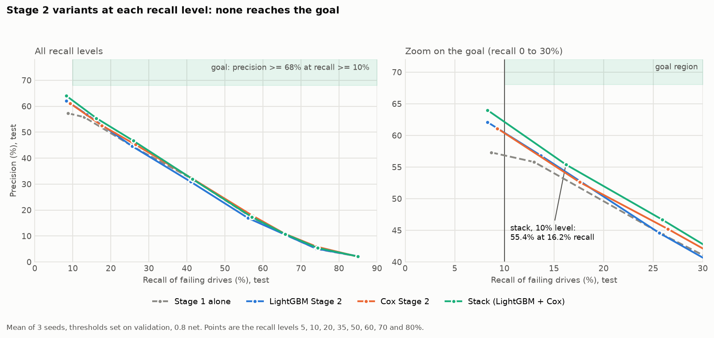

*Figure 31. Test precision against recall for Stage 1 alone and the LightGBM, Cox and stack Stage 2 at each recall
level (mean of three seeds), with the goal region (precision of at least 68% at recall of at least 10%) shaded; right,
a zoom on recall 0 to 30%. The curves coincide above about 30% recall, and none enters the goal region.*

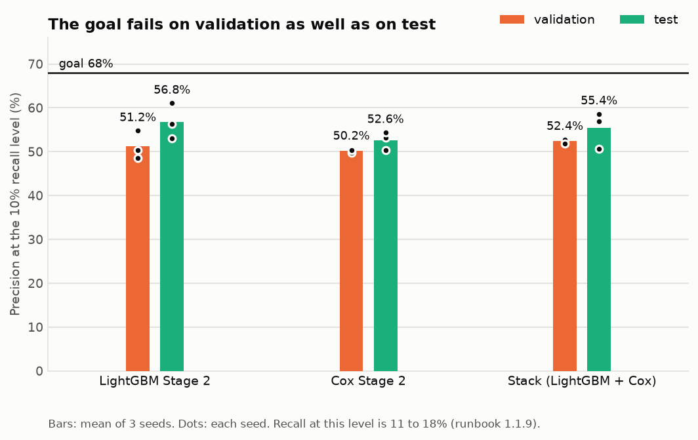

*Figure 32. Precision at the 10% recall level on validation and on test for each Stage 2 variant: the mean of three
seeds, with each seed as a dot. The goal fails on validation as well as on test.*

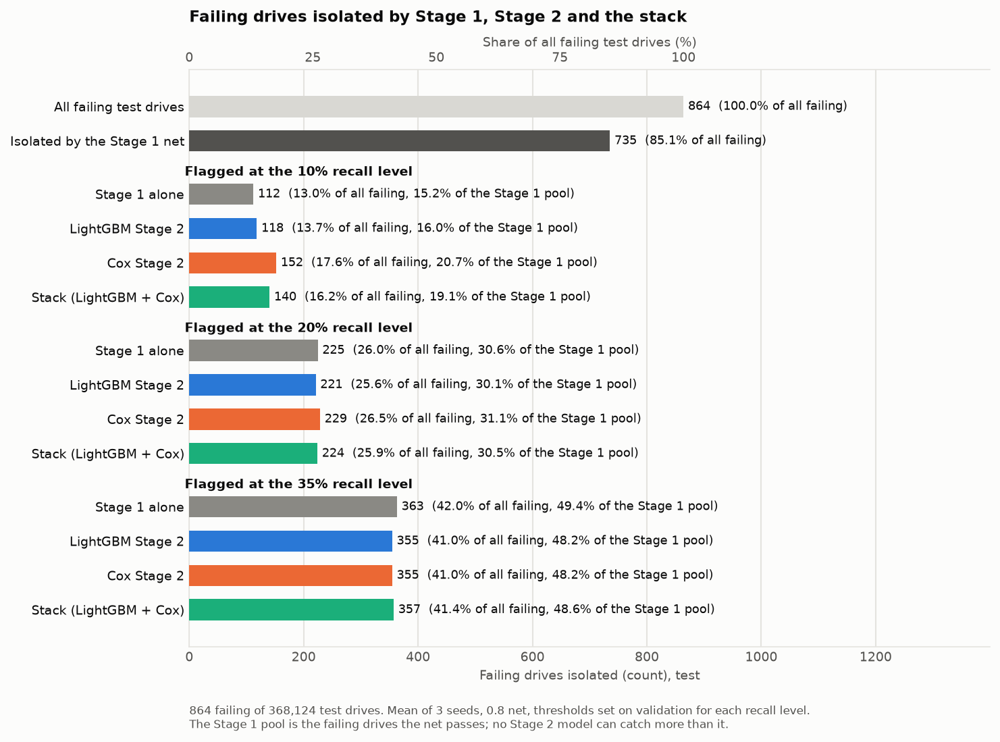

*Figure 33. Failing test drives isolated by the Stage 1 net (735 of 864) and flagged by Stage 1 alone, the LightGBM
and Cox Stage 2 and the stack at the 10, 20 and 35% recall levels, as counts (bottom axis) and shares (top axis). At
the 10% level the stack flags 140, Cox 152, LightGBM 118 and Stage 1 alone 112; from the 20% level up the four are
within about 4% of each other.*

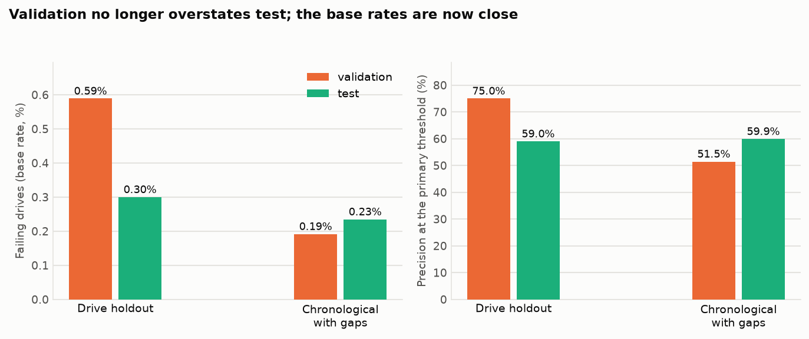

*Figure 34. Base rate (left) and precision at the primary threshold (right), validation against test, for the
drive-holdout split and the chronological split. Validation no longer overstates test.*

**The stack and its members are frozen for each of the three seeds** (`frozen_runs/stack_chrono_h30_seed{0,1,2}`),
refitted on validation rows only, each reproducing the experiment's report in 14 of 14 checks. They are separate fits
from the `make train` models:

| Seed | Stage 1 trees | LightGBM / Cox Stage 2 trees | Blend weights (LightGBM / Cox) | Validation primary: stack P / R | Test, 10% level: stack P / R |
|---|---|---|---|---|---|
| 0 | 396 | 142 / 272 | 0.6 / 0.4 | 52.8% / 12.6% | 58.6% / 16.2% |
| 1 | 401 | 354 / 355 | 0.4 / 0.6 | 52.8% / 11.1% | 50.6% / 14.1% |
| 2 | 400 | 199 / 268 | 0.3 / 0.7 | 51.8% / 12.7% | 57.0% / 18.4% |

What the run shows:

- **Strict separation did not move the result.** Test AUROC is 0.923 against 0.926, and the LightGBM two-stage gives
  59.9% at 13.3% against 59.0% at 12.5% on the drive-holdout split.
- **The base-rate mismatch is fixed, and it was not what kept the goal out of reach.** Validation no longer overstates
  test (51.5% against 59.9%), so a threshold tuned on validation transfers. But no threshold at 10% recall or more
  gets near 68% on validation either.
- **The stack does not help at the goal's operating point.** At the 10% level it is 1.4 points below the LightGBM Stage 2,
  with no seed's interval excluding zero; across seeds its test precision runs from 50.6% to 58.6%.
- **In counts**, at the 10% level every model flags 200 to 290 drives and catches 112 to 152 of the 864 failing drives.
  To reach 68% with the same 140 caught, the stack would have to flag about 206 drives, 66 of them false alarms,
  against 113 now.
- **Limits.** Three seeds, one test period of 46 days, and Q3 is not a fresh test (146 logged looks). A recall of 10% to
  18% rests on about 110 to 150 caught drives.

### 9.2 Headline results of the previous model

Sections 9.2 to 9.9 analyse the previous model, the drive-holdout run `c459046e`; the current model is Section 9.1.

| Test, Q3 2026 | 30-day (`c459046e`) | 44-day | 60-day |
|---|---|---|---|
| Failing / healthy drives | 1,105 / 367,583 | 1,106 / 363,685 | 1,117 / 359,895 |
| **Primary threshold: precision** [95% CI] | **59.0%** [52.3, 65.5] | 62.6% [55.3, 69.4] | 63.3% [55.7, 70.6] |
| **Primary threshold: recall** [95% CI] | **12.5%** [10.5, 14.3] | 9.9% [8.2, 11.7] | 9.0% [7.4, 10.7] |
| Caught / missed / false alarms | 138 / 967 / 96 | 109 / 997 / 65 | 100 / 1,017 / 58 |
| Drive AUROC / AUPRC | 0.926 / 0.288 | 0.925 / 0.298 | 0.919 / 0.300 |
| Recall at 0.1% false-alarm rate | 30.4% | 31.0% | 29.5% |
| Warn tier: precision / recall | 17.3% / 60.9% | 20.2% / 58.0% | 23.7% / 53.4% |
| Cordon tier: precision / recall | 34.8% / 42.4% | 38.8% / 40.1% | 45.0% / 33.6% |

Each model is judged against its own labels and its own test window (62, 48 and
32 days: each horizon is tested up to the last day its label is observed), so the
columns are not a like-for-like comparison. The goal (90% precision at 10% or more recall) is **not met**.

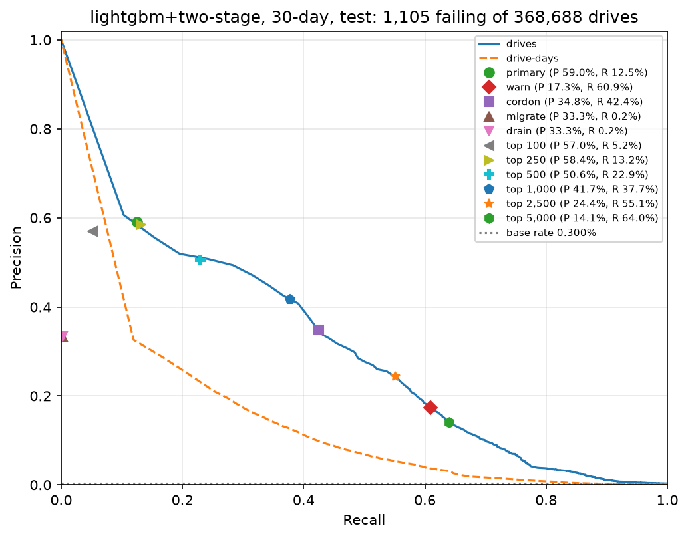

*Figure 9. Drive-level precision-recall curve of the previous model on Q3 2026
(solid), with the primary threshold, the action tiers and the top-K points
marked; the dashed curve is per drive-day and the dotted line the base rate.
The curve is thinned before drawing, so a marker can sit slightly off it; the
marker values are exact.*

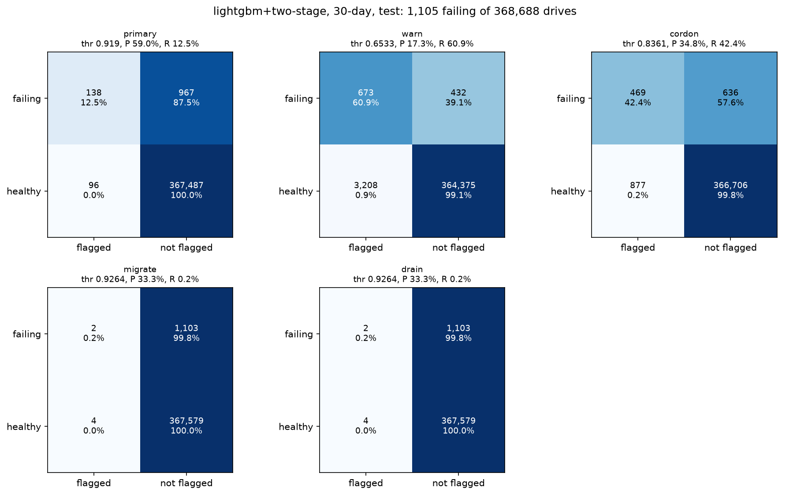

*Figure 10. Drive counts at the primary threshold and at each action tier on
Q3 2026. Migrate and drain share one cutoff and flag 6 drives between them.*

### 9.3 Only two of the four action tiers operate

Each tier's threshold is the validation cutoff with the most recall whose precision still
meets lift times the validation failure rate (Section 6.3). At 0.589% failing,
migrate's lift of 151 asks for 88.9% precision and drain's 226.4 for 133%:

| Tier | Lift | Target on validation | Threshold | Validation precision / recall | Q3 precision / recall |
|---|---|---|---|---|---|
| Warn | 56.6 | 33.3% | 0.653 | 33.3% / 63.6% | 17.3% / 60.9% |
| Cordon | 94.3 | 55.5% | 0.836 | 55.7% / 44.7% | 34.8% / 42.4% |
| Migrate | 151.0 | 88.9% | 0.926 | 100% / 0.5% (2 drives) | 33.3% / 0.2% |
| Drain | 226.4 | 133%, unreachable | 0.926 | same cutoff | same |

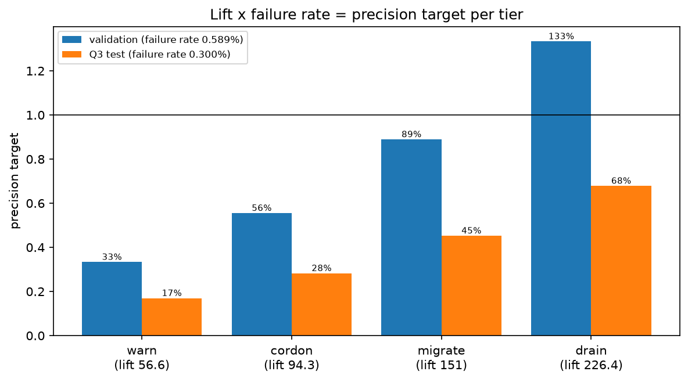

*Figure 11. The precision each tier must earn, lift times the failure rate, on
validation and on Q3. Drain's target exceeds 100% on validation; on Q3 the same
lifts would ask for 17% to 68%.*

The agent's reachable actions on this model are therefore warn and cordon,
whatever the model's confidence. Migrate's target is met only at the very top of
the validation curve and drain's is impossible, so both share the cutoff 0.926
and flag 6 drives on Q3; in the runbook's words, "on this model they are not
usable tiers" (runbook 1.9). The runbook's open items give the way forward:
tier targets set from the real cost of a false alarm for each action, which
they are not yet (Section 14).

### 9.4 Validation against test: the gap is the base rate

Validation precision at the primary threshold is 75.0%, test 59.0%. Validation
spans 121 days with 0.59% of drives failing, test 62 days with 0.30%. The ranking
transferred intact (AUROC 0.922 on validation, 0.926 on test; the same recall at
matched false-alarm rates), and test precision restated at the validation base
rate is 73.9%, which closes about 90% of the gap.

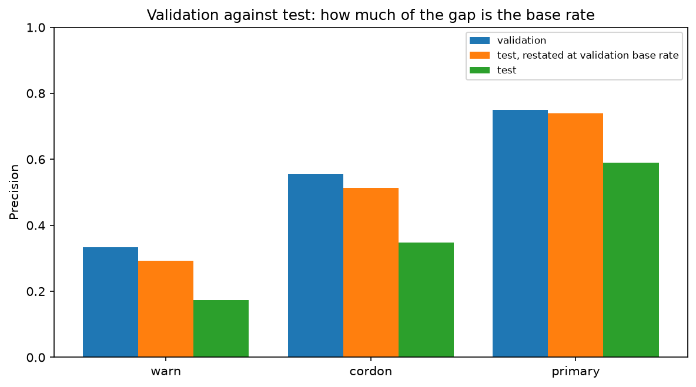

*Figure 12. Precision on validation, on Q3, and on Q3 restated at the validation
failure rate, at each operating point. The restated bar nearly reaches the
validation bar at every point.*

### 9.5 Horizon: 30 days stays

A longer horizon does not rank drives better. Scored on the same 361,012
drives against the same labels, the 44- and 60-day models differ from the
30-day one by AUROC +0.002 and +0.003 and by recall at a 0.1% false-alarm rate
of +0.3 and -1.0 points, every paired interval including 0 (AUROC intervals
-0.001 to +0.008, recall -2.9 to +1.9), with a median lead time of 14 to 15
days for all three. Precision rises with the label definition (40%,
45%, 49% for the same 30-day model against 30-, 44- and 60-day labels) because
the base rate does. The horizon stays at 30 days.

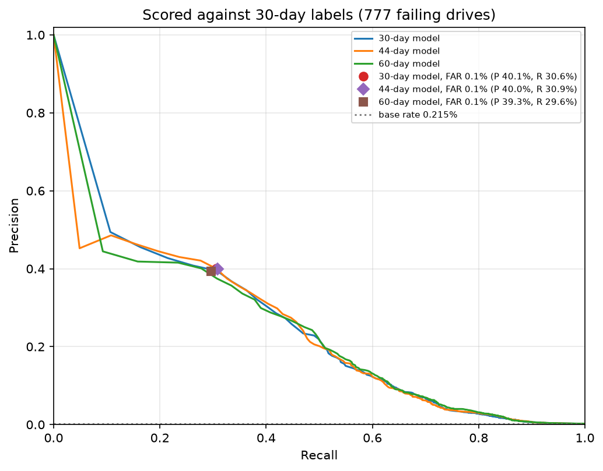

*Figure 13. Drive-level precision-recall curves of the 30-, 44- and 60-day
models on the same 361,012 Q3 drives, scored against the 30-day labels (777
failing drives), with each model's point at a 0.1% false-alarm rate. The curves
overlap; no horizon dominates.*

The cascade itself on these three runs - the Stage 1 coverage, the choice of
Stage 2 and the stacked Stage 2 - is in Sections 8.4 to 8.6.

### 9.6 Which failing drives are missed

The deep dive (`scripts/deep_dive_q3.py`, runbook 1.1.5) placed each failing
drive of the 30-day model at the strictest point that catches it:

| Where the failing drive stops | Drives | Share | Counter rose in window | Power-on age (years, median) |
|---|---|---|---|---|
| Caught at the primary threshold | 138 | 12.5% | 75.4% | 5.5 |
| Caught at cordon only | 331 | 30.0% | 72.2% | 5.5 |
| Caught at warn only | 204 | 18.5% | 66.7% | 5.2 |
| Passed Stage 1, below warn | 210 | 19.0% | 38.6% | 3.6 |
| Never passed Stage 1 | 222 | 20.1% | 1.4% | 2.9 |

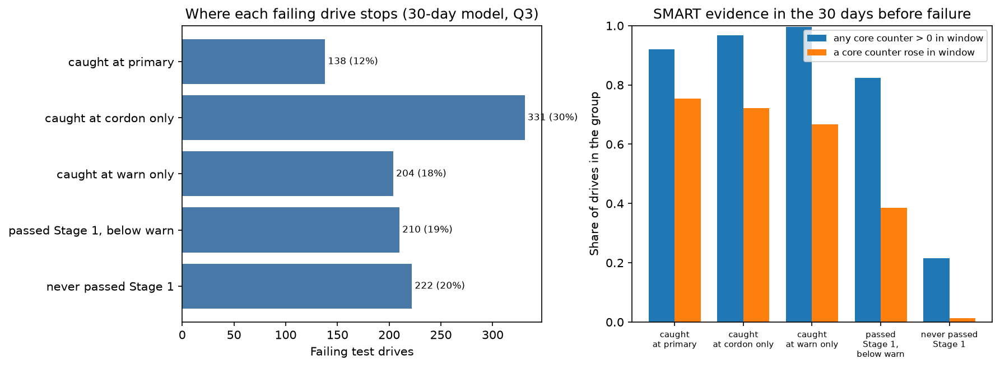

*Figure 14. Where each failing drive stops (left) and, for each group, the
share with any core counter above zero and with a counter that rose in the 30
days before failure (right). The last group has the evidence of neither.*

- **The fifth that Stage 1 never passes is silent.** 98.6% of them show no rise
  in any core counter in the 30 days before failing, with complete telemetry, so
  it is not missing data. They are young (median 2.9 years against 5.5), mostly
  early-life failures. Overall 21.2% of failing drives have every core counter at
  zero throughout. That is the recall ceiling of daily SMART, and only new
  information can move it.
- **Many catches come early.** 43% of caught drives were already flagged at warn
  more than 30 days before failing, which the 30-day label does not count
  (Section 10.4).
- **The primary point is mostly Seagate.** Western Digital reaches 78% recall at
  Stage 1 but 1.2% at the primary threshold; HGST reaches 92% at Stage 1 and 7%
  at primary.

### 9.7 Who the false alarms are

The healthy drives flagged at each point, followed to the end of the data
(2026-09-30):

| Point | Flagged healthy drives | Still active | Removed without failure | Failed later | Any core counter > 0 (healthy fleet: 8.9%) | Power-on age, years (fleet: 3.5) |
|---|---|---|---|---|---|---|
| Stage 1 | 22,463 | 97.6% | 2.3% | 23 | 59.8% | 3.9 |
| Warn | 3,208 | 90.4% | 9.0% | 20 | 99.8% | 5.4 |
| Cordon | 877 | 79.6% | 18.5% | 17 | 99.3% | 5.7 |
| Primary | 96 | 60.4% | 35.4% | 4 | 97.9% | 5.5 |

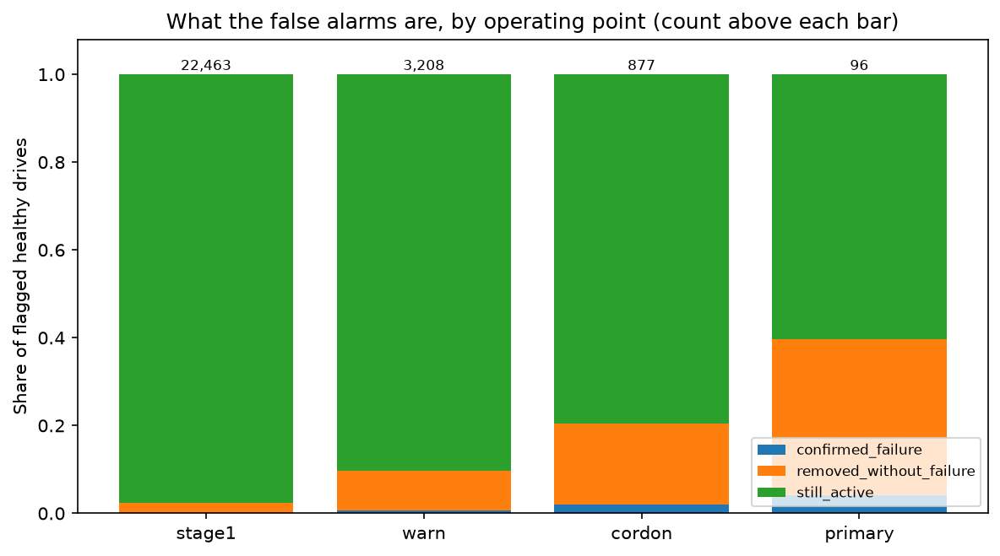

*Figure 15. What became of the healthy drives flagged at each point: still in
service, removed without a recorded failure, or failed after the label window.*

- **False alarms are damaged drives, not noise.** 98% to 99.8% of those at warn
  and above have a non-zero core counter, against 8.9% of the healthy fleet,
  and they are older (median 5.4 to 5.7 years against 3.5).
- **The stricter the point, the more of its false alarms were removed from
  service anyway:** 9.0% at warn, 18.5% at cordon, 35.4% at the primary
  threshold. Counting removals as correct would lift primary precision from 59%
  to about 74%; that is a definition to decide, not a result.
- HGST is over-represented among warn false alarms by a factor of 4.2 (28.8% of
  them from 6.9% of the fleet), Seagate 2.2 times among primary ones.

### 9.8 Stability over Q3

Primary recall stays at 6% to 8% and warn recall at 45% to 53% in
all nine Q3 weeks; primary precision is 36% to 43% in most weeks and 57% to 58%
in the last two, as failing drives per week fell from 461 to 352. The share
of drives passing Stage 1 rises from 3.4% to 3.8% across Q3, above every
validation week, with no matching rise in failures: SMART counters only
accumulate, so more healthy drives look suspicious over time. A weekly trend
check would catch this; the 2x drift threshold would not.

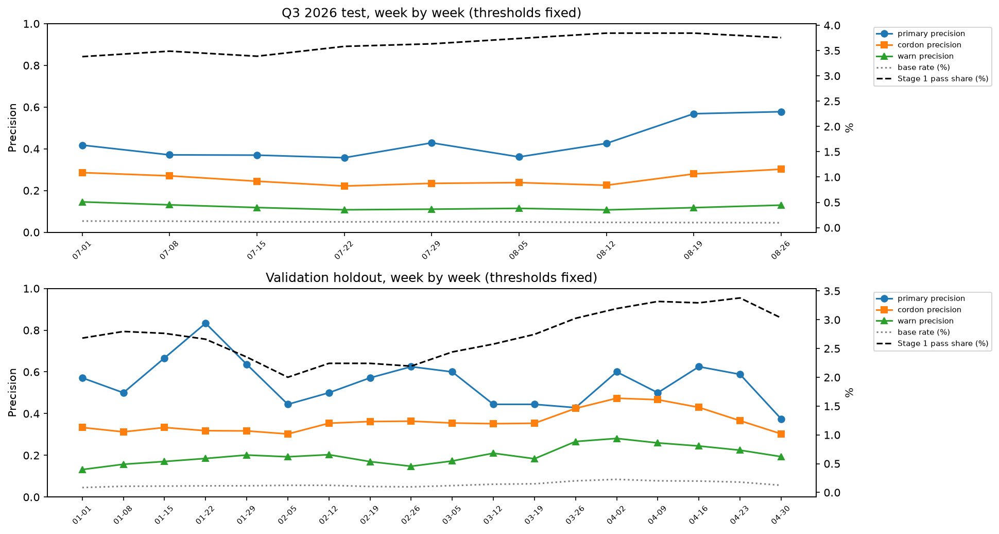

*Figure 16. Precision at the primary, cordon and warn points week by week on Q3
(top) and on the validation holdout (bottom), with the weekly failure rate and
the share of drives passing Stage 1 on the right axis. Weekly precision is below
the 62-day figures because each week is a shorter window with a lower base
rate.*

### 9.9 A cluster-based action policy

Could the agent act better if the action depended on what kind of damage a
drive shows, not only on its score tier? The Stage 1 suspects were clustered by
SMART signature (a Gaussian mixture of four clusters, chosen on validation; the
score and the vendor were not used), and the action for each (tier, cluster) cell
was fixed on validation. The rule for adopting it was written before the Q3 look
(`docs/cluster_action_policy.md`).

| Cluster | Reading | Share of suspects (Q3) | Failure rate validation / Q3 |
|---|---|---|---|
| C0 | no clear damage | 49.6% | 1.1% / 0.7% |
| C1 | reallocated sectors rising, defect acceleration | 14.3% | 4.7% / 2.7% |
| C2 | pending sectors | 23.6% | 11.7% / 4.5% |
| C3 | reallocated sectors rising, defect velocity | 12.4% | 33.4% / 16.1% |

The clusters are stable (Q3 shares within a factor of 2 of validation, refit
adjusted Rand index 0.87) and separate risk from about 1% to 33%. On Q3:

| Tier | Tier-only P / R | Cluster policy P / R | Precision gap [95%] | Recall gap [95%] |
|---|---|---|---|---|
| Warn | 17.3% / 60.9% | 25.3% / 52.1% | +8.0 [+7.1, +8.9] | **-8.8 [-10.5, -7.1]** |
| Cordon | 34.8% / 42.4% | 39.4% / 36.2% | +4.6 [+3.1, +5.9] | **-6.2 [-7.7, -4.9]** |

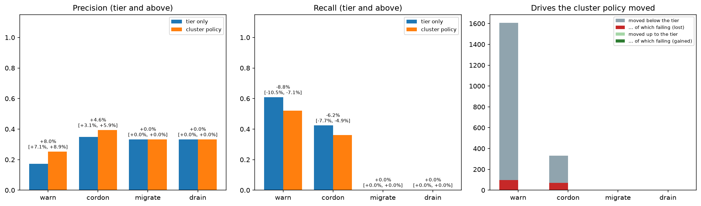

*Figure 17. The cluster policy against the tier-only policy on Q3: precision and
recall per tier with paired intervals, and the drives the policy moved. Every
move was downward; migrate and drain were untouched.*

**The rule was not passed**, so the agent was not changed. Precision rises but
recall falls, and the gain is not real: at the recall the cluster policy reaches,
a plain stricter threshold gives 26.0% (warn) and 42.5% (cordon) against its
25.3% and 39.4%, so its points lie on or below the score's own curve (Figure
18). Demoting at warn avoided 1,509 false alarms for 97 lost failing drives,
which pays only if a missed failure costs under about 16 false alarms. The
clusters remain a useful description and a watch list (C3 is 12% of suspects and
16% failing), not a policy.

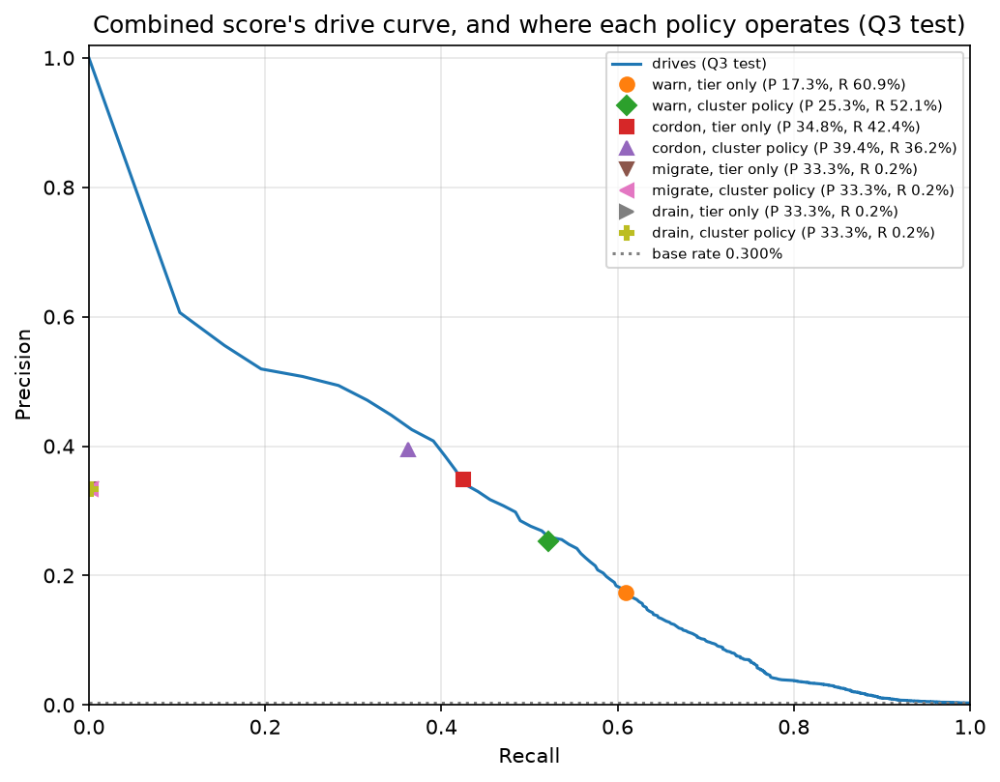

*Figure 18. The combined score's drive-level curve on Q3, with the tier-only
and cluster-policy operating points. The cluster policy's points sit on or
below the curve, where a plain threshold would do as well.*

---

## 10. How the design was reached

This section is the record behind Sections 8 and 9: how the project got from
its first working model to the cascade. Section 10.1 is the spine, the frozen
runs of 2026-11-05 and 2026-11-06 in the order they were made. Sections 10.2 to
10.9 hold the earlier evidence, newest first: the merged-model run, the LSTM
blend, the false alarms followed for a longer horizon, the agent's policy
measured point-in-time, the quarter-aligned run, and the retired model of
record. Three test windows appear, each labelled where it is used: 2026-05-11
to 05-31 (21 days, 621 failing drives) for the retired model of Sections 10.7 to
10.9; April and May 2026 (1,479 failing drives) for Sections 10.2 to 10.6; and
Q3 2026 for the last runs of Section 10.1. Section 10.10, the newest entry, is the
redesign of the split of 2026-11-10; it and Section 9.1 use the 46-day test period
07-17 to 08-31, inside Q3.

### 10.1 The frozen runs in order: from precision to coverage

Five frozen training runs and one frozen experiment were made between
2026-11-05 and 2026-11-06, each kept with its spec, thresholds, models or
outputs and checksums (`frozen_runs/`, `data/audit/`), and each answered the
question the previous one raised. Read in order they tell one
story: the project first chased precision at the strict end, found that every
model at that end misses almost nine failing drives in ten, turned to coverage,
and arrived at a two-stage design whose first stage reaches four failing
drives in five and whose second stage sharpens the top of the list.

**Run 1 - the quarter-aligned LightGBM (`839d92bc`, 2026-11-05).** The
two-stage LightGBM retrained on the repository's default window (train to
2026-01-15, test April and May), reproducing the earlier run `0c183df0` byte
for byte. Per drive on test: 57.1% precision at 12.0% recall, 178 of 1,479
failing drives caught for 134 false alarms, AUROC 0.923. The goal was not met,
and the second stage's gain was unconfirmed. This run is the control for
everything that follows.

**Run 2 - the merged approach (`fb58d957`, 2026-11-05): promising precision.**
Five models and two equal-weight rank blends scored on the same 21.3 million
test drive-days: the LightGBM two-stage, XGBoost AFT and Cox survival models, an
LSTM and a TCN (full results in Section 10.2). At the 10%-recall threshold AFT,
the TCN and both blends reached 68.5% to 70.5% precision against LightGBM's 57.1%,
and at a 0.1% false-alarm rate the LightGBM + AFT + TCN blend recalled 33.3%
against 26.8%. AFT beat LightGBM on validation as well as test, and the
four-model blend became the agent's configured ensemble.

**The catch: every one of them misses most of the failing drives.** At those
thresholds each model catches between 178 and 231 of 1,479 failing drives and
misses 84% to 88% (the table in Section 8.1). That is a setting, not a model
limit, and the precision gain itself rests on one seed and a test window read
many times. The honest reading was "AFT and the blends look better than
LightGBM alone", not a confirmed gain - and a system that misses seven failing
drives in eight was not the system wanted.

**Turning to coverage (2026-11-05).** A recall-first policy was replayed day by
day over the merged run's scores with validation-tuned weights (LightGBM 0.2,
AFT 0.5, TCN 0.3): 62.5% of failing drives warned at least a day ahead at 27.0%
precision, 56.6% cordoned at 33.5%, 35.1% at migrate at 54.8% (Section 10.2).
Sixty percent recall was reachable, at a price the warn tier can absorb and the
destructive tiers cannot. It also exposed a structural gap: the second stage
only re-ranks drives above its candidate net, which was set to keep 50% of
failing drives, so the 60% region had always been the first stage alone, with
no second model helping there.

**Widening the net (2026-11-06, April-May, 3 seeds).** Nets of 0.5, 0.7, 0.8
and 0.9 were compared against the first stage alone. At 60% recall the 80% net
gave 24.8% precision against 22.8%, about 330 fewer false alarms per test
window for 2 fewer drives caught; past about 70% recall every net hurt, because
the pool is mostly healthy drives. The decision rule fixed before the run
required recall not to drop, so by that rule nothing was adopted; the 80% net
was adopted anyway, post hoc, and that is recorded as such.

**Runs 3 to 5 - training on the past, testing on a quarter nothing had seen
(`c459046e`, `a2cd06d5`, `804a20ce`, 2026-11-06).** Three LightGBM two-stage
models with the 80% net, trained on January to April 2026 and tested on Q3 at
30, 44 and 60 days (Sections 8 and 9). This is the run that made the
two-stage design legible as a funnel (Figure 4): Stage 1 reached 79.9% of
failing Q3 drives (81.7% and 78.5% at 44 and 60 days) by passing 5% to 6% of the
fleet, almost all of the fifth it missed showed no SMART change before
failing, and the LightGBM second
stage sharpened only the top of the list (+5.1 points at 10% recall at 30 days,
nothing above 20%). Cox as a second stage matched it; AFT, which had beaten
LightGBM on both validation and test in Run 2, was 2 to 8 points worse, because its validation
thresholds do not carry to test. A longer horizon bought nothing (Figure 13), so
30 days stayed.

**Run 6 - a stacked second stage (`5ab8f0bb`, `7a568b77`, `47d8ff0c`,
2026-11-06).** With Stage 1 fixed at the 80% net and the second stage the only
place left to gain, a stack blended the two second-stage models that matched
each other, LightGBM and Cox, by validation rank (Section 8.6). Flagging the
same number of drives it caught more failing drives than the LightGBM second
stage at K = 100 to 500 in 3 of 3 seeds in every horizon, 4 to 11 more on average (Figure 8);
at K = 100 and 250 Cox alone did as well, and the blend's own contribution
appeared at K = 500. Nothing changed above about 35% recall.

**Where the storyline ends.** The design that came out of these six runs is a
funnel: a first stage set to reach 80% of failing drives - on Q3 almost all of
those it missed showed no SMART change before failing - and a second stage that
re-orders the 5% to 6% of the fleet it passes, with a small gain at the very top
from blending two second-stage models, not yet confirmed. The precision numbers that looked
promising in Run 2 were unconfirmed and bought at 12% recall; the coverage numbers of
Runs 3 to 5 are the ones the agent operates on. Two things are still open. The
stack is a lead, not a result: its counts have no intervals, its three seeds
share the same test drives, its metric was settled after a first reading, and
Q3 is already a test set, so it stays unadopted until an untouched quarter
confirms it with Cox alone as a third arm. And the funnel's lower tiers are the
only ones that act: migrate and drain share a cutoff that flags 6 drives a
quarter, so the agent's autonomy on this model is a watchlist and a cordon.

### 10.2 Survival models, a TCN and blends

The merged-approach run (`make train-merged`, frozen run `fb58d957`, April-May
test, 1,479 failing drives) compares XGBoost AFT and Cox survival models, the
LightGBM two-stage, an LSTM, a TCN (temporal convolutional network) and two rank
blends on the same drive-days. Thresholds come from validation as the highest
precision with at least 10% recall.

| Test, per drive | Precision [95% CI] | Recall | Caught / false alarms | AUROC | AUPRC |
|---|---|---|---|---|---|
| LightGBM two-stage | 57.1% [51.6, 62.6] | 12.0% | 178 / 134 | 0.923 | 0.339 |
| AFT | 68.5% [63.0, 74.1] | 12.4% | 183 / 84 | 0.921 | 0.387 |
| Cox | 62.9% [57.6, 67.9] | 13.7% | 202 / 119 | 0.927 | 0.357 |
| LSTM | 52.7% [48.2, 57.1] | 15.6% | 231 / 207 | 0.923 | 0.281 |
| TCN | 70.5% [65.2, 75.6] | 13.6% | 201 / 84 | 0.900 | 0.348 |
| Blend LightGBM + AFT + TCN | 70.1% [64.9, 75.0] | 13.7% | 202 / 86 | 0.921 | 0.389 |
| Blend LightGBM + LSTM + AFT + TCN | 69.7% [64.4, 75.0] | 12.6% | 186 / 81 | 0.925 | 0.382 |

At a matched false-alarm rate of 0.1% the LightGBM + AFT + TCN blend recalls 33.3%
against 26.8% for LightGBM. **Read this as "AFT and the blends look better than
LightGBM alone", not as a confirmed gain:** it is one seed, the test window has
been read many times, and the intervals resample drives only. The TCN's jump from
55.5% precision on validation to 70.5% on test is partly the higher test base rate
(0.417% against 0.323%) and partly 84 false alarms, within sampling noise.

**At these operating points every model misses 84% to 88% of failing drives.**
That is a setting, not a model limit. Choosing the threshold for at least 35%
recall gives 37% to 41% recall at 46% to 52% test precision for every model but
the LSTM. A recall-first policy replayed day by day (blend weights LightGBM 0.2 /
AFT 0.5 / TCN 0.3, a catch meaning at least a day's notice) gives:

| Tier (test) | Precision | Recall | Caught | False alarms |
|---|---|---|---|---|
| Warn | 27.0% | 62.5% | 925 | 2,506 |
| Cordon | 33.5% | 56.6% | 837 | 1,662 |
| Migrate | 54.8% | 35.1% | 519 | 428 |
| Drain | 75.8% | 3.2% | 47 | 15 |

As a workload this is about 37 new warnings a day and a watchlist of about 390
drives (peak 501), with a median lead of 21 days. The tiers nest, and 73% of
warned drives also reach cordon because the two thresholds sit close together,
so two of three cordons fall on drives that do not fail in time; making the
destructive tiers stricter than the lift targets is a cost decision this replay
does not settle. A second consecutive day above the threshold (`k` = 2) gives
about the same precision for fewer escalated catches.

The agent's configured ensemble is the four-model blend (`agent_ensemble:
lgbm_lstm_aft_tcn`), while the 30-day LightGBM run is the model `score-fleet`
uses; the blend was measured on April-May only and has not been read on Q3.

### 10.3 The sequence model (LSTM)

The tree model sees hand-built 7-, 14- and 30-day window statistics. A
recurrent model reading the raw daily history is the most direct test of
whether those features leave signal on the table (`make train-sequence`). It is
a two-layer LSTM over each drive's last 30 days of nine SMART attributes (log
values, with a flag for whether each attribute is reported), drive age, vendor
and capacity, trained with the tree model's recipe and scored on exactly the
same labelled drive-days, splits and drive-level metrics.

**Observation 1 - it learns fast and then memorizes.** Every run reached its
best validation score within two epochs, after which validation precision fell
while training loss kept falling. Three regularized settings (a lower learning
rate, more dropout, a smaller network) changed the peak by no more than noise
(validation average precision 0.518 to 0.530, against 0.528 for the standard
setting). The behaviour is the same across four seeds.

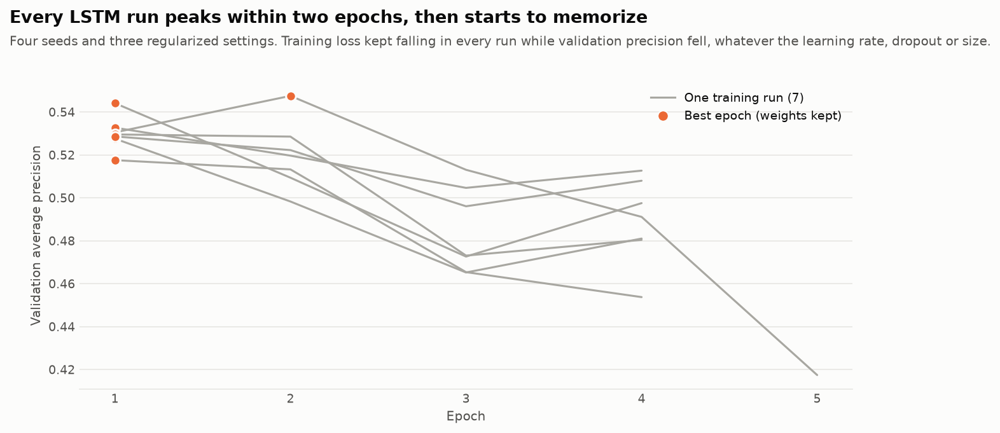

*Figure 19. Validation average precision per epoch for all seven training runs,
with the epoch whose weights were kept.*

**Observation 2 - alone it is close behind LightGBM.** Test drive-level AUROC
is 0.911 to 0.919 across the four seeds, against LightGBM's 0.923. At a
1-in-1,000 false-alarm rate it catches 18% to 27% of failing drives against
LightGBM's 26.8%. A recurrent reading of the raw history does not find signal
the window features miss.

**Observation 3 - it catches different drives.** The two models' drive scores
correlate at 0.65 to 0.74 (Spearman). At the strictest rate, 1 healthy drive in
10,000 alerted, the four-seed LSTM ensemble catches 79 failing drives and
LightGBM 54, with only 17 in common. Averaging seeds helps the LSTM most at this
strict end, where it catches more than LightGBM on its own.

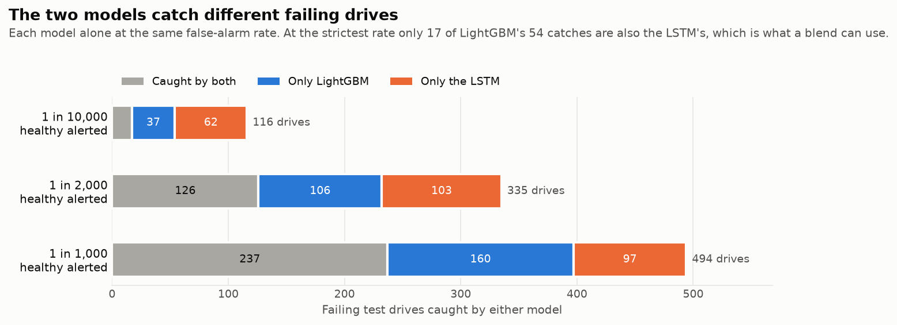

*Figure 20. Failing test drives caught by each model alone at the same
false-alarm rate, split into those both catch, only LightGBM catches and only
the LSTM catches.*

**Observation 4 - blended, they catch more for the same false alarms.** A
rank-average of the two scores, with the LSTM's weight chosen on validation
(0.1 to 0.2), raises recall at every budget:

| Test, 1,479 failing / 353,552 healthy drives | LightGBM | Blend, four-seed LSTM ensemble |
|---|---|---|
| Recall / precision at 1 in 10,000 false alarms | 3.7% / 60.7% | 4.2% / 63.9% |
| Recall / precision at 1 in 2,000 | 15.7% / 56.9% | 18.1% / 60.4% |
| Recall / precision at 1 in 1,000 | 26.8% / 52.9% | 29.3% / 55.1% |

Precision in this table is derived from the measured recall and the
false-alarm budget. AUROC is unchanged (0.923): the gain is at the operating
points the action tiers use.

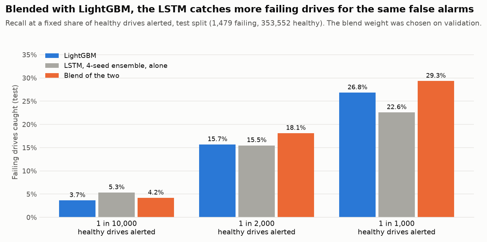

*Figure 21. Test recall at three false-alarm rates for LightGBM, the LSTM
ensemble alone and the blend.*

**Observation 5 - the gain is consistent and modest.** Every one of the four
seeds and the ensemble improves on LightGBM at all three budgets, by 0.5 to 3.4
points of recall, about +10% relative at the looser budgets. For the ensemble
the 95% paired interval clears zero at 1 in 2,000 and 1 in 1,000; at the
strictest budget it does not.

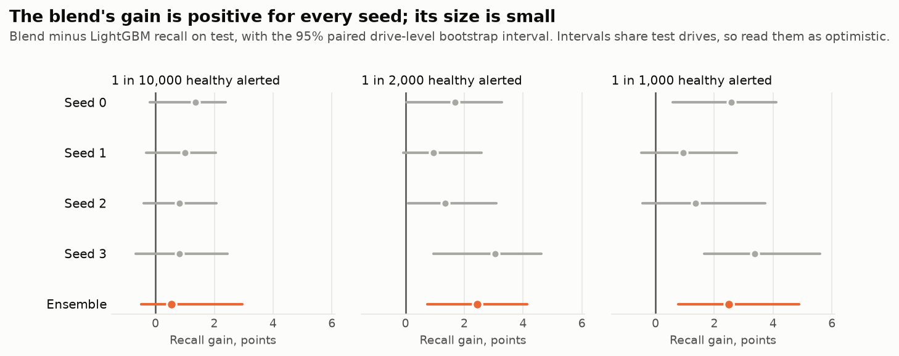

*Figure 22. Blend minus LightGBM recall on test for each LSTM run and the
ensemble, with the 95% paired drive-level bootstrap interval.*

**How far to take it.** The intervals resample the same test drives, so the
five rows are not independent evidence, and the blend weight was both chosen
and judged around the same test period. The blend is the strongest candidate
for the next model of record. It has not been read on Q3 2026 or any other
untouched period (Q3 became the test set of the LightGBM-only runs of runbook
1.1.4), so it is still to be confirmed.

### 10.4 Failures among the false alarms, over a longer horizon

The 30-day label calls an alert a false alarm when the drive survives 30 days.
The agent's point-in-time snapshots make it possible to ask the next question
directly: what happened to those drives afterwards? Four of the nine weekly
snapshots have their following 60 days fully inside the data, so every alert on
them can be followed to its outcome (`make plot-late-hits`). At cordon and
above that is 2,144 alerts:

| What happened | Alerts | Share |
|---|---|---|
| Failed within 30 days (counted correct) | 616 | 28.7% |
| Failed in days 31-60 (counted false; the alert was early) | 227 | 10.6% |
| Failed after day 60, seen to the end of the data | 66 | 3.1% |
| Left service, no failure recorded | 42 | 2.0% |
| Still in service at the end of the data | 1,193 | 55.6% |

**293 of the 1,528 alerts the label counts as false - 19.2% - went on to
fail.** Credited with days 31 to 60, precision at cordon and above rises from
28.7% to 39.3%. The 30-day figure stays the headline because the goal is stated
at 30 days; what this adds is how much of the remainder is early warning rather
than error.

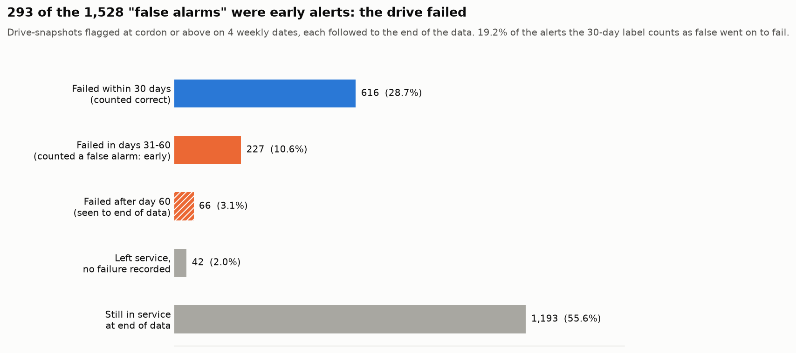

*Figure 23. What became of every alert at cordon and above, each followed to
the end of the data. Blue is counted correct by the 30-day label; orange (solid
and hatched) is counted false, but the drive failed later.*

**The warnings do not stop at the label boundary.** Plotted day by day, failures
after an alert are most frequent in the first days and continue past day 30 at
a lower but steady rate through day 60 (Figure 24). The label draws a line the drives do not
observe: an alert 31 days ahead of a failure is scored as wrong, one 30 days
ahead as right.

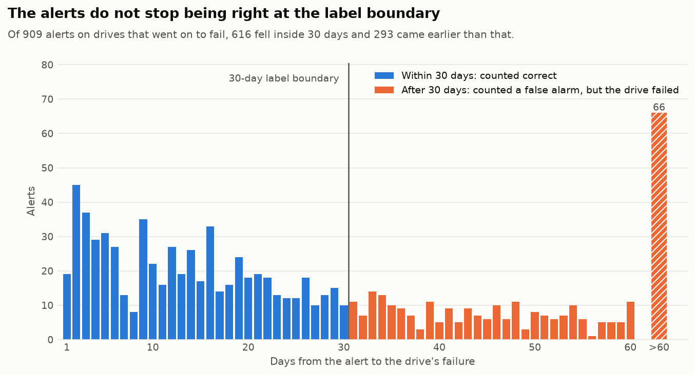

*Figure 24. Days from the alert to the failure, one bar per day, for every alert
on a drive that went on to fail. The vertical line is the 30-day label
boundary.*

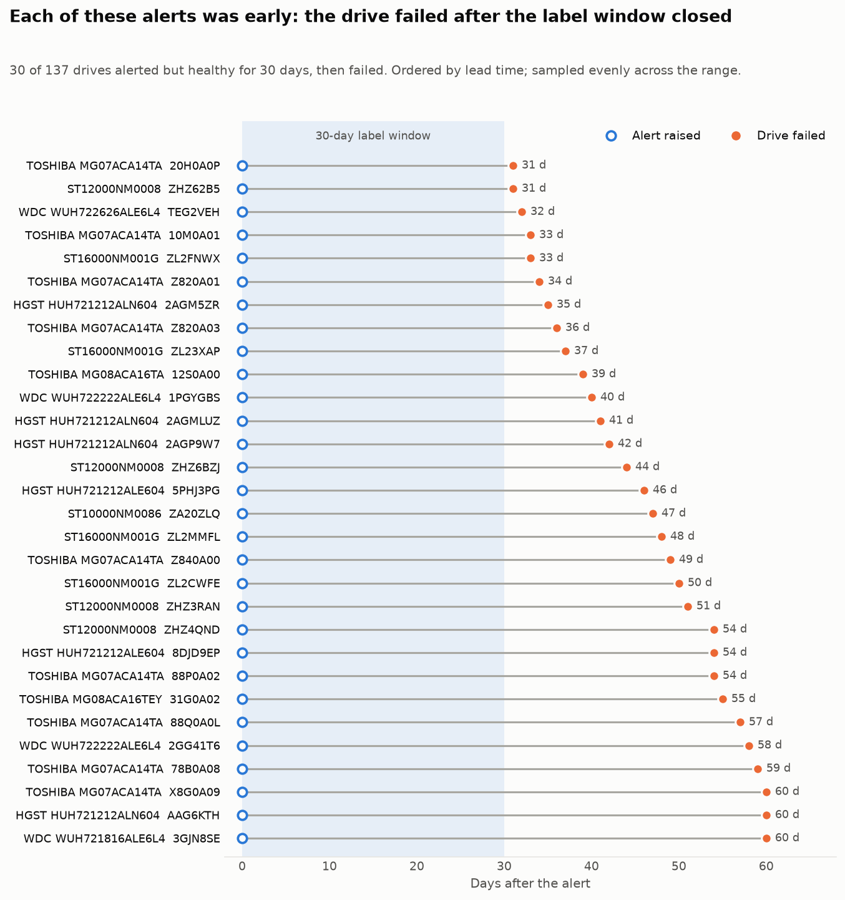

*Figure 25. Thirty of the 137 drives whose alert was early, sampled evenly
across lead times: the alert at day 0, the failure at day N, the 30-day label
window shaded. Labels are the drive model and a serial-number prefix
(Backblaze publishes the serials).*

**Every action tier gains, and the stricter tiers gain most.** Followed over 60
days, the share of each tier's alerts that were right rises at every tier:

| Tier and above | Alerts | Precision, 30-day label | Failed within 60 days | Share of false alarms that failed in days 31-60 |
|---|---|---|---|---|
| Warn | 5,091 | 18.7% | 26.1% | 9.1% |
| Cordon | 2,144 | 28.7% | 39.3% | 14.9% |
| Migrate | 491 | 43.4% | 58.5% | 26.6% |
| Drain | 53 | 50.9% | 58.5% | 15.4% |

At migrate and above, more than a quarter of the "false alarms" failed in the
following month. Drain rests on 53 alerts and 26 false alarms, too few to read
its share closely.

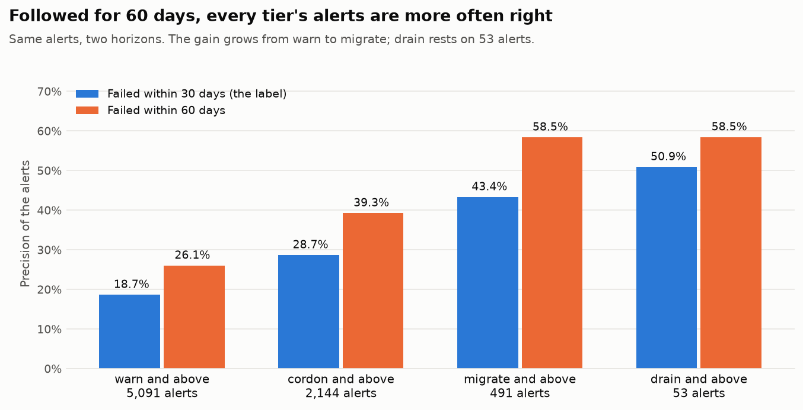

*Figure 26. Precision of each tier's alerts by the 30-day label (blue) and
counting failures within 60 days (orange).*

**A "false alarm" is far likelier than a typical drive to fail soon after.**
Across every drive-snapshot the label calls healthy, 0.10% fail in days 31 to
60. Among the label's false alarms the share is 87 times that at warn, 142
times at cordon and 254 times at migrate. That is the clearest sign these alerts
carry real information about failure; they are early, not random.

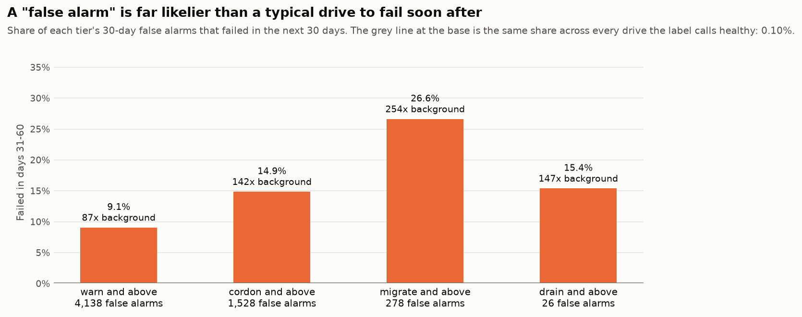

*Figure 27. Share of each tier's 30-day false alarms that failed in days 31 to
60, against the same share across every drive the label calls healthy (0.10%,
the grey line).*

**The drives that failed later looked less worn when they were alerted.** At
the moment of the alert their median counts of reallocated and pending sectors
were 24 and 24, against 85 and 208 for the drives that failed within 30 days.
That fits the model catching the same decline at an earlier stage. The drives
that never failed sit between the two (68 and 113), so these counts alone do
not tell an early warning from a drive that will keep running - which is why
the model's score, not a single counter, carries the alert.

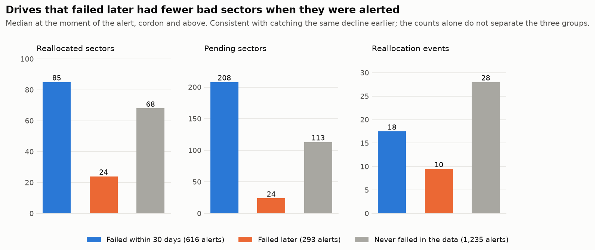

*Figure 28. Median value of three defect counters at the moment of the alert,
cordon and above, by what became of the drive.*

**What this means for the system.** For the mild actions - a warning, a cordon -
an alert that is 30 to 60 days early is useful, not wasted: it buys time to plan
a replacement. Read that way, the cordon tier's alerts were right about four
times in ten, not three. The same reading explains why a longer label raises
measured precision without changing the model (Section 11, item 16): the drives
were always flagged; the label simply starts counting them. The goal stays
stated at 30 days, so these figures sit beside the 30-day ones rather than
replacing them.

These counts use each drive's recorded event date. An earlier count of 195
early failures required the drive to still report telemetry on exactly day 30;
the 32 additional drives failed in days 31 to 59 after they had stopped
reporting.

### 10.5 The decision policy, measured point-in-time

`make agent-pit` scored the fleet as it stood on nine consecutive weekly dates
across the test period (3,142,390 drive-snapshots, 3,832 failing). Flagged at cordon and
above:

| Snapshot | Failure rate | Precision | Recall |
|---|---|---|---|
| Week 1 | 0.150% | 26.8% | 26.3% |
| Week 3 | 0.160% | 31.3% | 30.6% |
| Week 6 | 0.108% | 18.8% | 28.7% |
| Week 9 | 0.086% | 17.9% | 26.6% |
| **Pooled, nine dates** | 0.122% | **23.4%** | **29.3%** |

At drain, pooled: 40.3% precision (interval 29% to 52%) at 1.6% recall.

- **Precision tracks the month's failure rate; the model holds steady.** The
  failure rate fell 1.76 times across the nine dates and precision 1.50 times,
  while recall stayed between 26% and 33% with no trend. The same model at the
  same thresholds gives 17.6% to 31.3% depending on the date, which is why
  every precision figure here is quoted with its failure rate.
- **No sign of decay with distance from training.** Recall is 26.3% on the
  date nearest training and 26.6% on the furthest.
- **A second look does not help.** Flagging only drives above the threshold at
  both T-7 and T lowers recall at every false-alarm budget tested, by 0.5 to 3.3
  points, with intervals excluding zero at the three looser budgets (2.0, 2.3 and
  3.3 points) and including zero at the two stricter ones.

### 10.6 The quarter-aligned run

The same pipeline on the wider Q4 2025 to Q2 2026 window, 61-day test period
(1,479 failing and 353,552 healthy drives):

| | Test days | Failure rate | Recall | False-alarm rate | Precision |
|---|---|---|---|---|---|
| Frozen run (Section 10.7) | 21 | 0.175% | 8.7% | 1.61e-04 | 48.6% |
| Quarter-aligned run, test | 61 | 0.417% | 12.0% | 3.79e-04 | 57.1% |

Drive-level AUROC is 0.9232 on validation and 0.9226 on test, near-identical,
so thresholds chosen on validation carry to test. The higher precision is the
higher failure rate of a longer test window, not a better model: at a matched
false-alarm rate the frozen run catches slightly more (interpolated), and
measured point-in-time the gap is 1.2 to 1.3 points, within sampling error.
The run's value is a test set with 2.4 times as many failing drives, which
narrows every interval.

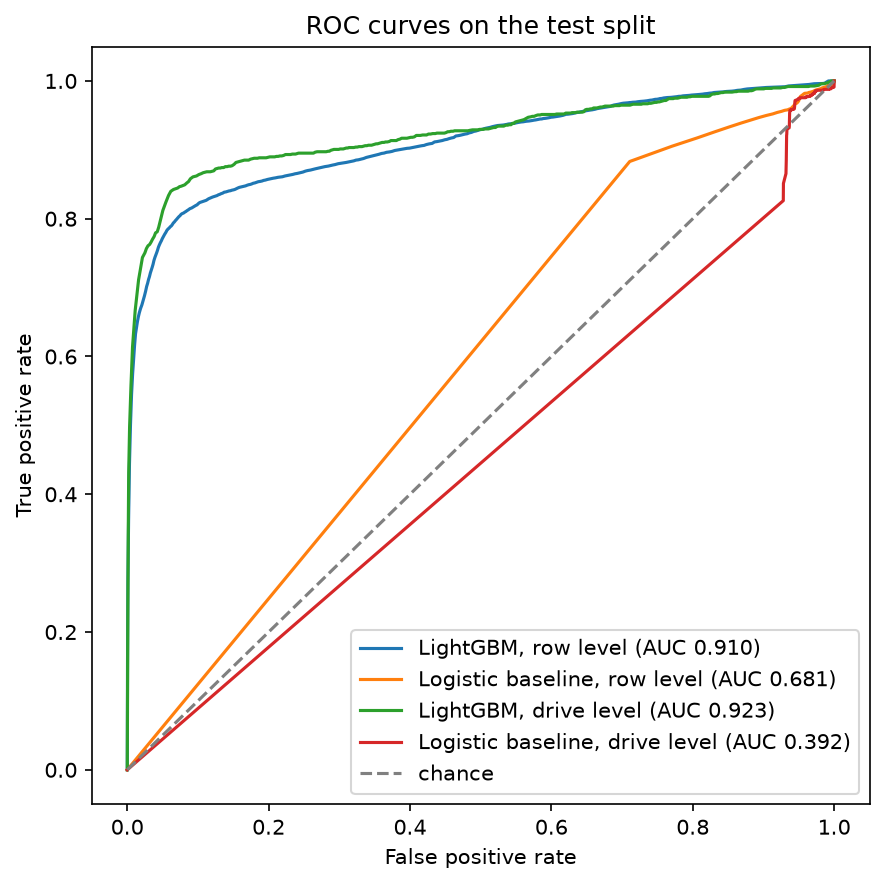

*Figure 29. ROC curves on the quarter-aligned test split, per drive-day and per
drive, for LightGBM and the logistic-regression sanity baseline. The LightGBM
drive-level curve (AUC 0.923) rises steeply at the very low false-alarm rates
where the action tiers operate. ROC is used to compare runs because neither
axis depends on how common failures are.*

### 10.7 The retired model of record: precision and recall

**The previous model of record**, a frozen training run, was **retired on
2026-11-06**: its artifacts
are not available to this repository, so it can never be scored on the sealed
quarter or the cross-vendor set, and Q3 2026 is now used as a test set. Its
results, kept as a historical record:

| Operating point | Precision, real fleet (0.18% fail) | Failing drives caught | At 15% failing | Lift |
|---|---|---|---|---|
| **Primary threshold** | **48.6%**, 95% CI [38.9%, 58.2%] | **8.7%** | 99.0% | 277 |
| Broader | 39.7% | 20.3% | - | - |
| Broadest | 29.5% | 33.3% | - | - |

The two broader rows come from the earlier version of this report; the run's
artifacts are no longer available to check them, and the runbook's own summary
of that run (its Section 7) gives slightly different points, 49.6% at 10.5%
recall and 28.7% at 32.4%. Treat the primary row, which the runbook records
with its interval, as the figure of record.

At 621 failing drives a point estimate cannot distinguish a real difference
from sampling noise, which is why the interval is quoted with it. The drive
counts these rates imply at the primary threshold are 54 of 621 failing
drives caught and 57 of 353,328 healthy drives alerted.

**An earlier freeze is void, not merely superseded.** A prior run,
`0ee06c01ff2a427ca76011fb1afb8ce3`, was trained before both bugs in Section
7.2 were fixed. Its training data had `attribute_coverage_factor` pinned at
a 0.6/1.0 vendor split and `recency_factor` pinned near 0.6065, which were
model *inputs*; scoring that run against the rebuilt data would feed it
three features far outside what it was trained on, silently, since every
one of its expected feature columns still exists in the new, 246-column
frame. It may not be scored on any held-out period or on SMART-Z.

**The breakdown that follows** - drive counts, action tiers and warning lead
time - comes from that earlier, now-void run, on an earlier 212-feature
build (46.2% precision at 9.7% recall at the primary threshold), and was
never re-measured for the current freeze:

| Operating point | Failing drives caught | Healthy drives alerted | Precision, real fleet (0.18% fail) | At 15% failing | At 50% failing | Lift |
|---|---|---|---|---|---|---|
| Strictest | 18 (2.9%) | 22 (0.006%) | 45.0% | 98.8% | 99.8% | 256 |
| Primary threshold | 60 (9.7%) | 70 (0.020%) | 46.2% | 98.9% | 99.8% | 263 |
| Broader | 129 (20.8%) | 164 (0.046%) | 44.0% | 98.7% | 99.8% | 251 |
| Broadest | 207 (33.3%) | 506 (0.143%) | 29.0% | 97.6% | 99.6% | 165 |

Lift is how many times more likely an alerted drive is to fail than a drive
chosen at random.

### 10.8 The retired model of record: action tiers

Each tier's threshold is chosen on validation from a **lift** target
(56.6 / 94.3 / 151.0 / 226.4 times the fleet failure rate) rather than a
precision target, because precision moves with the base rate of whichever
split it is measured on and lift does not. At the validation failure rate
those targets are equivalent to the precisions in the first column below.
These figures, like the breakdown above, are from the earlier, now-void run
and have not been re-measured on the current freeze:

| Tier | Equivalent precision target on validation | Test precision | Test recall |
|---|---|---|---|
| Warn | 15% | 9.9% | 62.5% |
| Cordon | 25% | 17.4% | 51.2% |
| Migrate | 40% | 29.1% | 33.0% |
| Drain | 60% | 46.0% | 10.3% |

Test precision falls short of each validation target. More drives failed in
the validation period than in the test period (0.27% against 0.18%), which
accounts for about half of the difference; the rest is unexplained. At a
fixed failure rate of 15%, validation and test agree (99.0% and 98.9% at the
primary threshold).

### 10.9 The retired model of record: other measures and fleet scoring

At the earlier, now-void run's primary threshold:

- Warning time: median 14 days before failure, mean 17.9.
- False-alarm rate: 70 of 353,328 healthy drives, about 1 in 5,000.

Fleet scoring with that run: it scored all 363,548 drives and proposed an
action for 3,973 of them. Per Section 7.2, none of those 3,973 proposals
could have been anything stronger than Cordon, because the feature-
confidence floor was unreachable fleet-wide at the time they were scored.
The current, fixed pipeline has not yet re-scored the fleet.

### 10.10 Redesigning the split (2026-11-10)

Two things led to it. The goal had become a precision target, and Section 9.4 showed that a threshold tuned on the
drive-holdout validation (0.59% failing) read 15 to 20 points higher than on test (0.30%). And a check of the
quarter-aligned window found its missing validation-to-test gap (Section 7.4).

Layouts were counted from the 30-day label table before one was chosen (failing drives per period):

| Layout | Train | Validation | Test | Verdict |
|---|---|---|---|---|
| A plain 50/5/45 split of Q1 and Q2 | to 03-31 | 04-01 to 04-09 | 04-10 to 06-30 | rejected: the labels of each period run into the next |
| The strict version of that | 01-01 to 03-01 (974) | 04-01 to 04-09 (777) | 05-10 to 06-30 (1,070; 636 if labels stop at 05-31) | half the training (974 against 2,018 failing drives) and a nine-day validation |
| **Chosen** | 01-01 to 04-20 (2,018) | 05-21 to 06-16 (684) | 07-17 to 08-31 (864) | the split of Section 4.3 |
| A longer training period | 01-01 to 04-30 (2,158) | 05-31 to 06-30 (755) | 07-31 to 08-31 (684) | a smaller test for a slightly larger train |

The chosen layout puts validation and test at 0.19% and 0.23% of drives and leaves 684 and 864 failing drives
in them. The 44- and 60-day horizons do not fit it: gaps of 44 and 60 days leave tests of 35 and 23 days
and training of 8 to 12 weeks, so the horizon comparison of Section 9.5 stands as it was run, on the drive-holdout
design. Q3 is not fresh either way: 139 test looks had been logged, and the first Q4 2026 download is the only fully
clean test.

It was built and run the same day: the settings, the checks and their tests, then the rebuild of the features and
labels, `make train`, the Stage 2 experiment, the freezing of the run and of three seeds' stacks. The first four
steps took 77 minutes (the estimate from the earlier logs had been about two hours). The experiment was run a second
time to save the models it fits; it reproduced the first run to 2e-8, and the three seeds' stacks are tracked.

---

## 11. What was tried

Every row was measured on real data against the standard model on the same
drives.

| # | Approach | Result |
|---|---|---|
| 1 | Fixing the training collapse (weighting, regularization, early stopping) | Necessary: produced the working model |
| 2 | Hyperparameter variants | Plateau |
| 3 | XGBoost in place of LightGBM | Same (test ranking 0.208 against 0.213) |
| 4 | One model per drive family | Worse than the pooled model for all three largest families |
| 5 | A second quarter of data | Same precision, tighter estimate |
| 6 | Four more SMART attributes; velocity, recency and age features | No measurable change (all variants within 0.01 of each other) |
| 7 | Requiring several consecutive high-score days | Lower precision |
| 8 | **30-day horizon in place of 14 days** | **Gain: 33.6% to 46.3% precision near 10% recall, same test period** |
| 9 | Survival model (time to failure) | Same as the classifier (0.216 against 0.213) |
| 10 | Anomaly detection (isolation forest), alone, as a filter, as a feature | Alone far worse (24% against 46%); the others within noise |
| 11 | Second-stage model | **Not confirmed.** See below |
| 12 | One fleet-wide action-tier threshold against one per drive model | **Fleet-wide is better.** 7 of 81 models had enough failing validation drives to earn their own thresholds; against those, per-model thresholds lost 7-8 points of recall for under 1 point of precision at the lenient tiers, and lost on both axes at drain (64 caught from 173 alerts against 76 from 162) |
| 13 | A wider, older training window (quarter-aligned, Q4 2025 and Q1 2026) | Same ranking: within 1.2-1.3 recall points of the frozen run at matched false-alarm rate, inside sampling error (Section 10.6) |
| 14 | A second look a week apart before flagging | Lower recall at every budget: -0.5 to -3.3 points, clear of zero at the three looser budgets (Section 10.5) |
| 15 | Per-family recalibration (a shrunk score offset per drive model) | Same as the raw score: within 0.6 points at five of six budgets, -1.4 at the sixth |
| 16 | 7- and 14-day horizons beside 30, same data and splits | AUROC flat (0.925, 0.924, 0.923); 7 days is less precise near 10% recall (46% against 57%) |
| 17 | LSTM over each drive's raw 30-day history | Close behind LightGBM: AUROC 0.915 against 0.923; recall at a 1-in-1,000 false-alarm rate 20.1% against 26.8% |
| 18 | **LSTM blended with LightGBM** (rank average, weight chosen on validation) | **Gain:** +0.5 to +3.4 recall points across four seeds at matched false-alarm rates, AUROC unchanged; not yet read on an untouched period |
| 19 | 44- and 60-day horizons beside 30, identical training rows, tested on Q3 2026 | No gain once the base rate is removed: AUROC +0.002 to +0.003, recall at a matched false-alarm rate within 1.3 points (every interval includes 0), median lead 14-15 days for all; precision rises with the label (40% to 49%) |
| 20 | Cox and AFT survival models as Stage 2 on the 0.8 net's candidates | Cox matches the LightGBM Stage 2 within about 1 point; AFT is 2-8 points worse (3 of 3 seeds) |
| 21 | Stage 1 net widened from 0.5 to 0.8, run on Q3 2026 | +5.1 points at 10% recall for 30 days (1 of 3 seeds above 0), none at 44 or 60 days; above 20% recall no gain; not worse than 0.5; not confirmed |
| 22 | XGBoost AFT and Cox survival models, an LSTM, a TCN and two rank blends, all scored on the same drives (April-May test) | AFT and the blends look better than LightGBM alone (precision 68-70% against 57.1% at 12-14% recall); one seed, not confirmed; goal still not met (Section 10.2) |
| 23 | A stack of the LightGBM and Cox Stage 2 models, Q3 2026 | Catches 4 to 11 more failing drives than LightGBM when 100 to 500 drives are flagged, in 3 of 3 seeds at every horizon; at 100 and 250 the gain is Cox's; no difference above about 35% recall; not adopted (Section 8.6) |
| 24 | Cluster-based action policy: suspects grouped by SMART signature, action chosen by (tier, cluster) | **Rule not passed.** Precision up 4.6 to 8.0 points, recall down 6.2 to 8.8 points, on or below the score's own curve; agent unchanged (Section 9.9) |

**Item 11 is reported at the strength of its current evidence, and how that
changed is itself a finding.** A five-seed repeat
showed a gain in every seed at the primary and broader operating points
(42.4% to 47.7% precision at the same recall). On the strength of that, a
direct paired-bootstrap significance test was run once, on the run that was
then frozen, and gave a gap of 10.7 points with a 95% CI of [3.2, 18.5] -
excluding zero, reported at the time as "real, not noise." A second such
test, run on the next frozen run (the 2026-10-09 run, after the Section 7.2
fixes and the sixth attribute, since retired; Section 10.7), gave a gap of 3.6
points with a 95% CI of
**[-5.5, 12.8]** - including zero. The two point estimates do not contradict
each other; each sits inside the other's interval, consistent with a true
gain somewhere in the 3- to 8-point range that the first test happened to
measure at its high end. What is no longer defensible is the earlier claim
that one paired test had settled the question. The second stage stays the
pipeline's default, on the standing five-seed evidence, reported now as
"adopted, not confirmed" rather than "real, not noise." The Q3 runs (item 21,
Section 8.5) add a third measurement: three seeds and three horizons, paired
against Stage 1 alone, show the gain only below about 20% recall (+5.1 points at
10% recall for the 30-day model, one of three seeds clear of zero) and nothing
above it, where the two curves coincide.

Items 17 and 18 are described, with figures, in Section 10.3.

Item 12's own inference is worth stating plainly, because the guardrail
instinct behind it was reasonable even though the fix it proposed was not:
prediction quality genuinely differs by drive model (pooled drive-level
AUPRC 0.473 on one Seagate family against 0.244 on an HGST family in the
latest run), so "the model is less reliable on drives we predict worse"
is true. But thresholding a single, well-calibrated score is already the
right way to spend a fixed precision budget across a population of mixed
risk; a different drive model sitting at a different point on one shared
curve is what a calibrated score does to populations of differing risk, not
evidence that the curve itself is mis-cut per population. Per-family
*thresholds* lost; per-family *models* had already lost earlier, for a
related reason (item 4) - the pooled model simply sees more failures to
learn from than any one family does.

---

## 12. Validation of the autonomous system

The agent, guardrails, simulator and reliability checker were validated with
automated tests, not on real hardware.

| Test layer | Tests | What it covers |
|---|---|---|
| Unit | 777 | Features, labels, model code, the two-stage cascade and stack, guardrail rules, trust score, API, the sequence model and the late-hit figures |
| Property-based | 10 | Invariants of hysteresis, trust score and metrics over generated inputs |
| Golden data | 3 | Feature pipeline against a fixed reference data set |
| Integration | 16 | Full decision cycles with the real guardrail engine and simulator |
| Chaos | 5 | Stale telemetry, correlated multi-drive failure, action timeout, human-review timeout, guardrail latency |
| Smoke | 3 | End-to-end start-up |

814 tests in total, all passing on 2026-11-07 with the optional PyTorch extra
installed (657 when the earlier version of this report was written); `ruff`
and `mypy` run with them in `make ci`. Without the extra the sequence-model
tests skip.

Behaviours demonstrated by these tests:

- A high-risk drive is drained through the simulator end to end.
- A low-confidence prediction is downgraded to cordon.
- A drain that would break quorum, or that targets the last healthy node, is
  blocked and routed to human review; approval resumes and executes it,
  rejection ends without executing.
- After a simulated crash, replay does not repeat the action.
- An action that times out triggers a compensating action with no data loss.
- An unanswered review falls back to the safe action.
- Hysteresis requires a risk to persist over cycles before escalation, and a
  cooldown prevents an immediate repeat drain.
- Each of 2,000 guardrail evaluations completes within the 500 ms budget.

None of these fixtures build a drive with the real, gold-pipeline-computed
`feature_confidence` from Section 7.2 - every one of them sets confidence
directly, as a test input, which is exactly why none of them caught the bug
described there. That gap is unchanged by this report; it is the reason the
bug reached a real model-training run before it was found.

---

## 13. Discussion

### 13.1 Why precision stops where it does

The false-alarm rate is already very low. At the primary threshold the retired
model alerted roughly 1 healthy drive in 6,000 and was under 50% precise; the
previous model alerted 96 of 367,583 healthy Q3 drives (about 1 in 3,800) and was 59.0% precise, and the current model
alerts 77 of 367,260 (about 1 in 4,800) and is 59.9% precise (arithmetic on the reported counts). Precision stays well
short of 90% because failing drives are rarer still: to reach 90% at the primary
threshold the model would have to alert only a handful of healthy drives out of
over 350,000, many times fewer than it does.

Four observations place the limit in the data rather than the model.
Different model families, feature sets, problem framings and now a sequence
model reading the raw history all arrive at the same ranking; drive-level
AUROC is the same at 7-, 14- and 30-day horizons. Most of the remaining false
alarms are drives whose SMART readings really are abnormal, and on the
telemetry they look like failing drives: each priority counter is non-zero in
nearly the same share of false alarms and true alerts. A fifth of them are
early rather than wrong (Section 10.4). And a fifth of failing drives give no
warning in their SMART readings at all: on Q3, 21% have every core counter at
zero throughout, and 98.6% of the drives Stage 1 never passes show no counter
rise in their last 30 days with complete telemetry (Section 9.6). That caps
recall near 80%, and at 70% recall precision is about 12%, so a high-precision
target in that band is several times beyond what this telemetry supports.

The chronological run (Section 9.1) tested one more explanation, that validation and test sat at failure rates
a factor of two apart. With the two at 0.19% and 0.23% the goal still fails on validation itself (about 52% for
the stack at 10% recall), the ranking is the same (AUROC 0.923 against 0.926), and at 10% recall every model
flags 200 to 290 drives to catch 112 to 152 failing ones. To reach 68% the stack would have to flag about 206
drives, 66 of them false alarms, for the same 140 caught, against 113. Moving the split moved the figures a few
points and the ceiling not at all.

### 13.2 What did help, and why

Lengthening the horizon from 14 to 30 days helped because the model was being
marked wrong for warnings that came early: of 330 test drives it flagged
that did not fail within 14 days, 43 failed within the following six weeks.
The horizon comparison later confirmed the mechanism: AUROC is flat across 7,
14 and 30 days, so the model's ranking is the same and a longer label counts
more of its early warnings as correct. Section 10.4 shows the same effect from
the other side, beyond 30 days. The LSTM blend helps for a different reason:
the two models catch partly different drives, so combining them recovers
failures either would miss alone.
The second stage appears to help, modestly, for a reason that still looks
sound even though its significance is no longer confirmed: once the easy
healthy drives are set aside, a model trained only on the hard cases can
separate them slightly better. On Q3 that help is confined to the strict end of
the list, below about 20% recall (Section 8.5).

### 13.3 Comparison with published work

Published studies commonly report precision above 90%. They are usually
measured on one drive model, with random splits, and on test sets with far
more failures than a fleet contains. On a test set with 15% failing drives
this model's alerts are 99.0% precise at the primary threshold. The two
statements are consistent: they describe the same alerts judged against
different populations. This report gives the real-fleet figure first because
it is what an operator would experience.

### 13.4 What the result means for autonomy

What the model provides is a short, highly enriched list: half to six in ten
of the drives at its strictest setting fail within 30 days, more within 60, and
every alerted drive is hundreds of times likelier to fail than a typical one.
That is the right input for graduated autonomy. Warnings and cordons act on the
list directly, where an early alert buys time; drains stay behind rules that
do not depend on the model and, where needed, a person - which is how this
system is built. On the previous model that division was also where autonomy stopped: migrate and drain shared a cutoff that flagged 6
drives in the 62-day Q3 test window (Section 9.3), so in practice the agent warned and cordoned. On the current model
all four tiers fire (1,371 drives at migrate and 336 at drain on the 46-day test), but at lift-derived targets of 28.9%
and 43.4% precision; whether destructive actions should run at those, or wait on targets set from the cost of each
action, is a policy decision.

### 13.5 What the confidence-floor bug says about that claim

Section 7.2's finding is a direct test of the design principle in Section
3.3 and 13.4: does safety actually hold when a component is wrong? For
roughly two months of this project's life, one of the two independent
pre-action checks was wrong in a way that made it fail *closed* for every
real drive - it blocked destructive actions it should have allowed, not the
reverse. No unsafe action resulted from the bug, because the system's
response to "a check fired" is to downgrade or escalate to human review, the
same response it gives a legitimate low-confidence reading; an observer
watching only the agent's outputs would have seen a conservative system, not
a broken one. That is the behaviour a layered, veto-based design is meant to
produce when one layer fails - but it is also exactly why the bug went two
months without being noticed by anyone watching the outputs, and why only a
direct measurement of the intermediate value (`0% of drive-days clear the
floor`), not an outcome-level test, found it. The lesson generalizes beyond
this one bug: a system built so that failure is safe still needs to verify,
separately, that failure is also rare - "fails safe" and "works" are not the
same claim, and this project had, for a time, only checked the first one.

---

## 14. Limitations

- **A safety floor that no real drive could reach, found and fixed.**
  Section 7.2 and Section 13.5. The frozen run in Section 10.7 is the first one
  trained after the fix; the batch fleet scores on record predate it.
- **The second-stage model's gain is not confirmed.** Two paired significance
  tests on two different runs disagree about whether the interval excludes
  zero (Section 11, item 11), and on Q3 it helps only below about 20% recall
  (Section 8.5). It stays the default on five-seed evidence, not on any paired
  test alone.
- **Migrate and drain did not operate on the previous model, and their targets are placeholders on the current one.**
  On the previous model the lift targets converted to 89% and 133% precision at the validation failure rate; migrate's
  was met only by the top 2 validation drives and drain's not at all, so both shared one cutoff that flagged 6 drives
  on Q3 (Sections 6.3, 9.3). On the current model the validation failure rate is 0.19%, the same lifts convert to 28.9%
  and 43.4%, and every tier fires; the targets stay placeholders until they are set from cost.
- **Per-drive-model action-tier thresholds were tried and lost.** Section 11,
  item 12. The code is kept as the measurement, not as something anything
  else consumes.
- **The live service runs on a demonstration fleet.** The agent and batch
  scoring take their tier thresholds from the trained run through one shared
  path, and the agent's policy has been measured offline against the real
  fleet (Section 10.5). The running agent and API still drive a two-drive
  demonstration snapshot whose confidence values are set directly, so it was
  never exposed to the defect in Section 7.2 either way.
- **Two fleet-safety guardrails need real topology data.** The last-healthy-
  node and quorum rules are implemented and tested, but the demonstration
  wiring supplies no node or replication state, so they cannot fire there.
- **Simulation only.** No action touches real hardware, and the API has no
  authentication of any kind. The approval queue, decision trail and
  guardrail violations are written through to SQLite and survive a restart;
  the last fleet snapshot and prediction list are not, since each cycle
  rebuilds them. Nothing sweeps the queue for reviews that have missed their
  SLA, so the safe-fallback logic that exists is never triggered in the
  running service.
- **One data source.** All results are Backblaze drives. The retired run (Section 10.7) has a
  single three-week test period; the quarter-aligned run widens that to nine
  weeks and the point-in-time evaluation to nine weekly snapshots. The
  bootstrap interval covers sampling across drives and the five-seed test
  covers training randomness; neither shows how results would vary in another
  period. Q3 2026 gave a second period for the LightGBM two-stage model (59.0%
  precision at 12.5% recall, against 57.1% at 12.0% on April-May: held up), but
  the survival models, the TCN, the LSTM and the blends were not rerun on it, and
  there is no further untouched period.
- **Q3 is now a test set that has been read many times** (three training runs,
  the horizon comparison, the cascade, the stack, the deep dive and the cluster
  policy). The stack and the 0.8 net are leads, not confirmed gains. 146 test looks are
  logged in all, 139 before the chronological run.
- **The chronological split run is small and short.** Three seeds, a 46-day test period with 864 failing drives, and
  a recall of 10% to 18% that rests on about 110 to 150 caught drives. The stack's test precision at the 10% level runs
  from 50.6% to 58.6% across seeds, as wide as the gap between models. It is the only run under strict separation;
  the 44- and 60-day horizons, the merged approach and a comparison at a matched false-alarm rate were not run on it.
- **Which 30-day model the code loads was not decided.** `score-fleet` and the agent take the latest training run for
  the horizon, which is now the chronological run (`6ea7a5bc`), not `c459046e`; the stack is frozen for three seeds
  that are separate fits, and one safeguard is missing, a frozen record of thresholds and hashes before the test
  scorer runs (Section 7.4).
- **The knowledge store and the point-in-time validation scripts were not adapted** to the chronological split; they
  were built on drive-holdout validation drives, and their validation split is now a later period of all drives.
- **A fifth of failing drives are invisible to daily SMART.** 98.6% of the drives
  Stage 1 never passes show no counter rise in their last 30 days, so recall has
  a ceiling that no model on this telemetry removes (Section 9.6).
- **No cross-vendor result.** SMART-Z has a split reserved for it and the
  harmonization code to read it, but it has not been evaluated, so
  generalization beyond Backblaze is unmeasured.
- **Validation precision exceeded test precision on the previous model, and does not on the current one.** On the
  previous model the gap was 75.0% against 59.0% at the primary threshold and about 90% of it was the base rate: the
  ranking transfers, the failure share does not (Section 9.4). On the current model validation reads 51.5% against 59.9% on
  test, at base rates of 0.19% and 0.23%.
- **The test period has been read many times.** Every test-split computation
  is logged, and the LSTM blend was both chosen and judged around the same
  test period, and has not been read on an untouched period.
- **Results come from three test windows.** Sections 9 and 8.4 to 8.6 use Q3
  2026; Sections 8.1, 8.3 and 10.2 to 10.6 use the quarter-aligned window (test
  April and May 2026); Sections 10.7 to 10.9 the retired model's 21-day window
  (2026-05-11 to 05-31).
  Each is labelled where it is used; Figures 1 to 3 and 29 are drawn from the
  quarter-aligned run's reports.
- **The maturity gate reads the dataset's last date**, so any backtest that
  consults it looks ahead (Section 7.3). The point-in-time evaluation does not
  consult it; for scoring the current fleet, where a drive that has stopped
  reporting really is gone, the gate's reading is the right one.
- **Action-tier targets are placeholders.** They are expressed as lift,
  which at least compares across splits, but the numbers themselves should
  come from the real cost of a false alarm for each action. Converted at a
  validation failure rate of 0.59%, the migrate lift is met only by the top 2
  validation drives and the drain lift by none (Section 9.3).
- **Explanations describe the first-stage model only.**

---

## 15. Future work

1. Re-score the real fleet with the current, fixed pipeline (`make
   score-fleet`); the 3,973 proposals on record all predate the fix in
   Section 7.2 and could not have reached migrate or drain regardless of
   score.
2. ~~Settle the second-stage question with a multi-seed paired comparison~~:
   done on 2026-11-06 (runbook 4.12 and 1.1.4, three horizons, three seeds).
   The second stage helps only at the strict end (about 10% recall); above 20%
   recall no Stage 2 kind (LightGBM, Cox, AFT) beats Stage 1 alone by more
   than about a point.
3. Drive the live agent's predictor from the trained model (the API and demo
   still score a two-drive fixture; the tier thresholds already come from the
   trained run through `src/models/trained_thresholds.py`), with real topology
   data for the fleet-safety guardrails.
4. Read the LSTM blend on an untouched period, once, as the candidate for the
   next model of record. The sealed quarter that was to hold this was used as
   a test set on 2026-11-06, so it needs new data.
5. Credit early warnings where they are useful: a cost model per action, so
   that an alert 30 to 60 days ahead counts for the mild tiers (Section 10.4).
   The 44- and 60-day horizons were run on 2026-11-06 (runbook 1.1.4): they
   rank drives no better than 30 days and warn no earlier; the precision gain
   is the base rate.
5a. Candidates from the Q3 deep dive (untested): a separate warn threshold for
   HGST, which is over-represented among warn false alarms 4.2 times; reporting
   drives removed without failure as their own outcome; a weekly trend monitor on
   the share of drives passing Stage 1; features that could see early-life
   failures, the group SMART does not reach. Rerun the survival models, TCN and
   blends on a new untouched quarter.
5b. Untested ideas for the 60-80% recall band, from the 2026-11-06 review: a
   cohort feature (recent failure rate of the drive's batch or vault, a cheap
   validation-only screen first) and a sequence-model third stage on the Stage
   1 suspects. Expected gain is a few points of precision at most; SVM or
   autoencoder stages and a longer-window PatchTST were judged unlikely to add
   information.
6. Feed the LSTM's score to the second stage, with out-of-fold scores for the
   training rows so the second stage never sees the LSTM's memorized ones.
7. Add signals beyond daily SMART: I/O latency, error logs and workload.
8. Set tier targets from operational cost, and measure the precision of
   actions taken after human review. This is now the first thing that would
   change what the agent does: on the previous model the migrate and drain
   lifts converted to precision targets met only at the very top of the curve
   (migrate) or not at all (drain), so the destructive tiers flagged 6 drives in the
   62-day Q3 test window (Section 9.3); on the current model they convert to 28.9%
   and 43.4%, the destructive tiers fire (1,371 and 336 drives on test), and the
   targets are still placeholders.
9. Evaluate on the second data set to test generalization across vendors.
10. Schedule the trust-score resolution and drift checks that currently run
   only on demand.
11. Raise the "expected attribute" coverage threshold in `model_expected_attributes`
   past 50%, which currently still under-serves a small set of SSD/laptop
   drive models (ADR 0002).
12. Score the next quarter once, under the chronological split, as the first fully untouched test (Q4 2026 data
   is needed); until then every Q3 figure is a held-out one, not a prospective one.
13. Pin the model run that `score-fleet` and the agent load, so that training a new run no longer changes it
   silently, and decide which of the three frozen seeds, if any, the agent should use.
14. Build the missing safeguard of Section 7.4: thresholds, blend weights and model hashes committed before the
   test scorer runs, with the access log counting every look.
15. Adapt the knowledge store and the point-in-time validation scripts to a chronological validation period, and
   repeat the horizon comparison under strict separation with gaps sized to each horizon.

---

## 16. Conclusion

The project delivered a working, tested system that goes from raw fleet
telemetry to an audited action, and ran it on a real fleet of more than
360,000 drives within a 20 GB memory budget.

The model is a two-stage cascade built around what SMART data can and cannot
see. Its first stage reached 85.0% of the failing drives of the current model's test
period (79.9% on the first Q3 run) while passing 9% of the fleet (6% on the
first run); most of those it misses show no SMART change before failing, so no model on this telemetry reaches them. Its
second stage, trained only on those suspects, sharpens the top of the list, and
a stack of two second-stage models adds a few more failing drives there, still
to be confirmed. On the current model's test period the cascade warns on 65.2% of failing drives at
10.8% precision, cordons 56.1% at 18.1%, and reaches 59.9% precision at 13.3%
recall at its primary threshold (on the first Q3 run: 60.9% at 17.3%, 42.4% at
34.8% and 59.0% at 12.5%). At the fleet's own failure rate precision is
set by how rare failures are and by what daily SMART data reveals: twenty-four
approaches agree on that ceiling. The two that moved it on the earlier model
were the 30-day horizon, which took precision near 10% recall from 34% to 46%,
and the second stage, which added about 5 points on five-seed evidence, not
confirmed by a paired test; that model reached 48.6%, and its
alerts were about 277 times more likely than chance to be right and 99% precise
on a test set with the failure share of published work.

The current model, trained under a stricter split, gives the same answer. With 30-day gaps between training, validation and test, validation and test
at nearly the same failure rate, and nothing fitted on an earlier period able to see a later one, the precision goal
of 68% at 10% recall still fails on validation (about 52%) and on test (59.9% at 13.3% for the LightGBM two-stage, 55.4% at
16.2% for the stack of LightGBM and Cox Stage 2 models). The gap between validation and test that had hidden behind a
factor of two in failure rate is gone, and the ceiling is where it was.

Much of what the 30-day label counts as error is early warning. Followed for a
longer horizon, a fifth of the agent's "false alarms" were on drives that went
on to fail, at 87 to 254 times the background rate, and counting those raises
precision at every action tier. A sequence model adds a second view of the
same telemetry: it catches partly different drives, and blended with LightGBM
it catches more failing drives for the same number of false alarms, a gain
consistent across every seed and still to be confirmed on an untouched period.

The safety design held when tested against real data. A defect in one of its
two independent pre-action checks made it impossible to pass for drives scored
through the real pipeline; the system's response was to decline destructive
actions, never to take unsafe ones, and the check now has a guard in the build.
The lesson the project carries forward is to verify each safety mechanism on
real data, not only that the system as a whole fails safe.

The system would become more autonomous, not differently built, as better
signals improve the model: graduated actions, independent guardrails, human
approval, rollback and audit already let it act usefully on a model of this
quality. Today that autonomy reaches warn and cordon. The destructive tiers'
targets, converted from lift at the validation failure rate, are met only at the
very top of the curve or not at all, so migrate and drain stay effectively closed until
their targets come from the cost of each action - the next decision this
project needs, and a policy decision rather than a modelling one.

---

## References

1. Backblaze. *Hard Drive Data and Stats* (drive statistics data set), Q4 2025
   to Q3 2026.
2. Amram, M., et al. *Interpretable predictive maintenance for hard drives.*
   2021.
3. Klein, A. *Using Machine Learning to Predict Hard Drive Failures.*
   Backblaze blog, 2021.
4. Lu, S., et al. *Making Disk Failure Predictions SMARTer!* USENIX FAST 2020.
5. Wei, et al. *SMART-Z data set.* Scientific Data, 2025.
6. Pinheiro, E., Weber, W.-D. and Barroso, L. A. *Failure trends in a large
   disk drive population.* USENIX FAST 2007.
7. Kephart, J. and Chess, D. *The Vision of Autonomic Computing.* 2003.
8. Chen, T. and Guestrin, C. *XGBoost: A Scalable Tree Boosting System.* KDD
   2016.
9. Ke, G., et al. *LightGBM: A Highly Efficient Gradient Boosting Decision
   Tree.* NeurIPS 2017.
10. Liu, F. T., Ting, K. M. and Zhou, Z.-H. *Isolation Forest.* ICDM 2008.
11. LangGraph documentation.

---

## Appendix A. Reproducing the results

```bash
make install
make download-backblaze        # quarters set in configs/data.yaml
make ingest-backblaze
make build-silver
make build-features
make build-labels
make train                     # two-stage model, reports, model card
make score-fleet
make final-report              # runs make plots first
```

Scoring a sealed or external split, once, against a frozen run (refused for
`sealed` while nothing is sealed; see Section 7):

```bash
make evaluate-frozen ARGS="--run-id <mlflow run id> --split sealed"
```

The commands behind the previous model and the first Q3 2026 results of Sections 8
and 9 (9.2 to 9.9), run on 2026-11-06 (`docs/model_status_and_runbook.md` Section 1.1.4 lists
each step's code commit; every test look is a line of
`data/audit/test_access_log.jsonl`, which records their order;
`data/audit/q3_logs/` and `data/audit/stack_q3_logs/` hold the launchers and the
tracked logs). `plot_cascade_funnel.py` was added afterwards and reads no data:

```bash
make download-backblaze ARGS="--quarters Q3_2026"
make ingest-backblaze ARGS="--start-date 2026-07-01 --end-date 2026-09-30"
make build-silver
make build-features
make build-labels                                   # horizons 30, 44, 60; 20% drive holdout
make train TRAIN_TAG=h30_q1q2_q3 TRAIN_ARGS="--horizon-days 30 --keep-work-dir --save-scores"   # run c459046e
make train TRAIN_TAG=h44_q1q2_q3 TRAIN_ARGS="--horizon-days 44 --keep-work-dir --save-scores"
make train TRAIN_TAG=h60_q1q2_q3 TRAIN_ARGS="--horizon-days 60 --keep-work-dir --save-scores"
uv run python scripts/compare_horizons.py --scores 30=<scores> 44=<scores> 60=<scores>
make experiment-model EXPERIMENT_ARGS="--work-dir <kept work dir> --variants --skip-baseline --two-stage --two-stage-out data/audit/cascade_q3_h30"
make experiment-model EXPERIMENT_ARGS="--work-dir <kept work dir> --variants --skip-baseline --two-stage --stage2-kinds lightgbm cox stack --two-stage-out data/audit/stack_q3_h30"
uv run python scripts/plot_stack_topk.py            # Figure 8, from the saved top-K results
uv run python scripts/plot_cascade_funnel.py        # Figure 4, from the published counts (no data read)
uv run python scripts/deep_dive_q3.py --run-dir frozen_runs/c459046e4f1645169151e7be25ff064d --scores <scores> --test-ids <work dir>/test_ids.parquet
uv run python scripts/cluster_action_policy.py --run-dir frozen_runs/c459046e4f1645169151e7be25ff064d --scores <scores> --validation-only
uv run python scripts/cluster_action_policy.py --run-dir frozen_runs/c459046e4f1645169151e7be25ff064d --scores <scores>   # the one Q3 look
```

The three horizons' experiment steps repeat with the 44- and 60-day work
directories. Figures 4 to 18 are in `docs/figures/q3_2026/`: Figures 4 and 8
are drawn there by `scripts/plot_cascade_funnel.py` and `scripts/plot_stack_topk.py`,
and the rest are copies of the frozen run's `figures/` folder,
`data/audit/deep_dive_q3_h30/figures/`, `data/audit/cluster_policy_h30/figures/`
and the horizon, cascade and stack outputs; its README maps each copy to its
source. The source folders are tracked.

The chronological split run of Section 9.1, the current model (runbook Section 1.1.9), the configured design since 2026-11-10. This
replaces `data/gold/`, which the drive-holdout design also reads (back it up first, or restore the values in the
comment of `configs/model.yaml` `splits` to return to that design):

```bash
make chrono-run               # everything below, one log per step in data/audit/chrono_logs/ (about 95 minutes)
make chrono-data              # build-features, build-labels, check-splits (must print OK)
make chrono-train             # Stage 1 and LightGBM Stage 2, 30 days, tag chrono_h30; prints work_dir_kept
make chrono-stack CHRONO_WORK_DIR=data/tmp/train_model_frame_<id>   # LightGBM, Cox and stack Stage 2; saves each seed's stack
make chrono-freeze CHRONO_WORK_DIR=data/tmp/train_model_frame_<id> CHRONO_SEED=<0|1|2>   # freeze one seed's stack
make plot-chrono-split        # Figures 30 to 34, from the saved results
```

Figures 30 to 34 are in `docs/figures/chrono_split/` (its README maps each to its source).

Model comparisons, on arrays kept from a training run:

```bash
make full-experiment FULL_EXPERIMENT_ARGS="--variants reg_spw xgboost xgboost_aft --skip-baseline --two-stage --two-stage-seeds 5 --anomaly-stage --deep-dive reg_spw --per-model 5"
```

The raw-attribute screen behind Section 7.2/11's smart_196 and vault/pod
findings runs directly against downloaded CSVs, independent of the gold
pipeline:

```bash
uv run python scripts/screen_raw_attributes.py
uv run python scripts/check_confidence_distribution.py   # after rebuilding gold features
```

The agent's policy at fixed dates, the false-alarm follow-up of Section 10.4,
the sequence model of Section 10.3 and the per-family recalibration:

```bash
make agent-pit                 # nine weekly point-in-time snapshots
make plot-late-hits            # Figures 23-28 and late_hits_summary.json
uv sync --extra dev --extra torch
make train TRAIN_ARGS=--save-scores
make train-sequence            # and SEQUENCE_ARGS="--seed N --tag sN" for more seeds
uv run --extra torch python scripts/compare_sequence_vs_tree.py
uv run python scripts/plot_sequence_comparison.py   # Figures 19-22
make family-calibration
```

The figures in this report are copied from `data/audit/plots/` into
`docs/figures/`.

Outputs: the evaluation report and final report under
`data/audit/data_quality_reports/`, the model card under
`data/audit/model_cards/`, plots under `data/audit/plots/`, fleet scores
under `data/audit/predictions/`, frozen-split results under
`data/audit/frozen_evaluations/`, and the log of test-split computations at
`data/audit/test_access_log.jsonl`.

The real-data runs were made on a separate machine, so this repository's
MLflow store does not contain the frozen run; `docs/model_status_and_runbook.md`
section 1.1 is the record for it.

## Appendix B. Key settings

| Setting | Value |
|---|---|
| Horizon | 30 days |
| Splits, frozen run | training rows the first 75 days of Q1 and Q2 2026, validation the 25 days after the 30-day purge, test the following 21 days |
| Splits, quarter-aligned run | training rows the first 107 days of Q4 2025 to Q2 2026, validation the last 45 days of Q1, test the first 61 days of Q2 |
| Splits, chronological run (configured since 2026-11-10) | train rows 2026-01-01 to 04-20, validation 05-21 to 06-16, test 07-17 to 08-31, a 30-day gap at each boundary, no drive holdout, feature statistics from rows before 04-21 |
| Current model | frozen run `6ea7a5bc` (the chronological run, Section 9.1): 30-day two-stage LightGBM, 246 features, rows 2026-01-01 to 04-20, tested on 07-17 to 08-31; 339 Stage 1 and 103 Stage 2 trees; the stack is frozen as `frozen_runs/stack_chrono_h30_seed{0,1,2}` |
| Current model, thresholds | Stage 1 candidate cutoff 0.1431 (net 0.8); primary 0.943; warn 0.530; cordon 0.734; migrate 0.857; drain 0.935 (Section 9.1) |
| Sealed window | Q3 2026 until 2026-11-06, now a test set; nothing is sealed at present |
| Previous model | frozen run `c459046e`: 30-day two-stage LightGBM, 246 features, 80% of drives trained on 2026-01-01 to 05-01, tested on Q3 2026; 310 Stage 1 and 74 Stage 2 trees |
| Previous model, thresholds | Stage 1 candidate cutoff 0.235 (net 0.8); primary 0.919; warn 0.653; cordon 0.836; migrate and drain share 0.926 (Section 9.3) |
| Frozen run (earlier) | retired 2026-11-06 (dataset version `20261009T051152748998Z`) |
| Features | 246 (212 before the sixth priority attribute and the confidence-formula fixes) |
| First stage | LightGBM, 31 leaves, at least 200 rows per leaf, L2 10, learning rate 0.05; 339 trees in the current model (310 in the previous) |
| Class weighting | square root of the healthy-to-failing ratio |
| Second stage | LightGBM, at least 50 rows per leaf, candidates from the Stage 1 score at the validation threshold that keeps 80% of failing drives (50% before 2026-11-06) |
| Memory cap | 20 GB resident per process |
| Action-tier targets | lift 56.6 / 94.3 / 151.0 / 226.4 (warn / cordon / migrate / drain) |
| Feature-confidence floor | 0.80 (`configs/agent.yaml`); 86.1% of drive-days clear it, against 0% before the Section 7.2 fixes |

## Appendix C. Where to find more

| Topic | Document |
|---|---|
| Short overview | `docs/system_summary.md` |
| Every measured result and the run history | `docs/model_status_and_runbook.md` |
| The chronological split: design, run and result | runbook Sections 1.1.8 and 1.1.9, `docs/dataset_strategy.md` Section 9.6, `frozen_runs/README.md` |
| The attribute screen and the confidence-floor bug, in full | `docs/adr/0002-attribute-selection-and-vendor-aware-confidence.md` |
| Features and the reasons for them | `docs/feature_engineering.md` |
| Commands and options | `docs/pipeline_usage.md` |
| Code structure and known gaps | `docs/developer_guide.md` |
| Operating the system | `docs/user_guide.md` |
| Original goals and plan | `docs/design_goal.md`, `docs/project_plan.md`, `docs/dataset_strategy.md` |
| Why training runs as four processes | `docs/adr/0001-training-memory-isolation.md` |
