# AI-Based Autonomous System Validation and Reliability Checker

## Predictive Disk-Failure Self-Healing Agent for Server Fleets

**Project report.** Author: Aditri Paul.
Repository: `github.com/aditripaul/predictive_disk_failure`, branch `adi_dev`.

---

## Abstract

Storage drives fail, and a failed drive can take data and service with it.
This project builds a system that predicts drive failure from SMART health
telemetry and acts on the prediction autonomously, and then asks the harder
question: can the autonomous system be trusted to act safely on predictions
that are often wrong?

The system has two layers. The first is a self-healing agent: a data pipeline,
a failure-prediction model, and a guardrailed decision loop that chooses among
warn, cordon, migrate and drain. The second is a reliability checker that
audits every decision and gives it a trust score, with a veto when a safety
rule is broken.

The pipeline was run end to end on real Backblaze data: 62.6 million
drive-days from 363,548 drives over the first half of 2026, and 93.5 million
over three quarters in a wider run. Measured per drive, on a later period than
the model was trained on, the model catches 8.7% of failing drives at 48.6%
precision at its primary threshold (95% confidence interval 38.9% to 58.2%),
and about 62% of failing drives at its most lenient action level. An alerted
drive is about 277 times more likely to fail than a typical drive, and fewer
than 1 healthy drive in 6,000 is alerted. On a test set in which 15% of drives
fail - the convention of most published results - the same alerts are 99%
precise.

Many of the remaining "false alarms" are early warnings. The agent's
point-in-time snapshots were followed for a longer horizon: of the alerts the
30-day label counts as false, 19.2% were on drives that went on to fail, most
of them 31 to 60 days after the alert. Such a "false alarm" is 87 to 254 times
likelier than a typical healthy drive to fail in the following month, and
counting failures within 60 days raises precision at every action tier - from
28.7% to 39.3% at cordon and from 43.4% to 58.5% at migrate.

Eighteen approaches were measured against the same drives. A 30-day horizon
and a second-stage model raised precision; a blend with an LSTM sequence model
catches more failing drives at the same false-alarm rate (+0.5 to +3.4 points
of recall across four seeds), because the two models catch different drives.
The others matched the standard model, which places the remaining limit in how
rare failures are and in how much daily SMART data reveals, rather than in the
choice of model.

The design is built around that limit: mild actions tolerate false alarms, and
destructive actions pass through independent safety checks and human approval.
Testing against real data also found and fixed a defect in one of those checks
- a feature-confidence floor that no drive scored through the real pipeline
could reach - whose effect was a system that declined to take destructive
actions, never one that took unsafe ones. Measured as the agent's policy would
run, on nine fixed weekly dates, the cordon tier and above is 23.4% precise at
29.3% recall, with precision following each month's failure rate and the
model's ranking steady throughout.

---

## 1. Introduction

### 1.1 The problem

Data-centre operators replace failed drives constantly. Predictive
maintenance tries to move the work earlier: detect a failing drive, move its
data, and take it out of service before it fails. The next step, and the
subject of this project, is to let software take those actions without
waiting for a person.

Autonomy changes the cost of a wrong prediction. A wrong warning costs a
glance at a dashboard. A wrong drain takes healthy capacity out of service,
and a drain issued at the wrong moment, for example on the last healthy node
of a replication group, can itself cause the outage it was meant to prevent.
So the central question is not only whether failures can be predicted but
whether a system can act safely on predictions that are uncertain.

### 1.2 What was built

1. A **data pipeline** that turns raw daily SMART telemetry into model-ready
   features and labels at fleet scale, within a fixed memory budget.
2. A **failure-prediction model** with thresholds tied to actions.
3. An **autonomous agent** that runs a Monitor - Analyze - Plan - Execute loop
   with a guardrail engine, human approval, rollback and crash recovery.
4. A **fleet simulator** in which the agent's actions and failures can be
   exercised safely.
5. A **reliability checker** that scores every decision.
6. A **dashboard and API** for operators.

### 1.3 Contributions

- A complete, tested pipeline from raw telemetry to audited action, run on
  real fleet data sets of two and three quarters.
- A measurement of what SMART-based prediction achieves on a time-ordered
  split at real fleet failure rates, with eighteen approaches compared on the
  same drives, and each result reported at the strength of its evidence.
- An evaluation method that reports results per drive and at stated failure
  rates, and five corrections to the evaluation found during the work, each
  of which had made results look better than they were (Section 7).
- A raw-attribute screen that went beyond re-slicing the nine SMART counters
  already in use, and that found a safety-relevant bug no synthetic test
  fixture could have caught.
- A point-in-time evaluation of the agent's policy at fixed dates, which
  found and withdrew an earlier backtest that had looked ahead (Section 7.3).
- A measurement, with figures, of the failures among the "false alarms" when
  the agent's alerts are followed for a longer horizon (Section 8.6).
- A sequence model scored on exactly the tree model's rows and metrics, and a
  blend of the two that catches more failing drives (Section 8.7).
- A system design in which safety does not depend on the model being right -
  demonstrated, in this case, by the fact that a structural bug in one of
  its independent checks degraded the system toward being unable to act at
  all, not toward acting unsafely.

---

## 2. Objectives and outcome

| Objective | Target | Outcome |
|---|---|---|
| Prediction precision, per drive, real fleet | 95% in the original specification (later 90%) | **48.6%** at the primary threshold, 95% CI [38.9%, 58.2%]; 99.0% on a 15%-failure test set, the published convention; 39.3% at cordon when failures within 60 days are counted (Section 8.6). The gap to the specification is set by the fleet's failure rate (Section 11.1) |
| Prediction recall | 35-50% (later at least 10%) | 8.7% at the primary threshold; 33.3% at 29.5% precision; about 62% at the warn level |
| Pipeline runs on real fleet data within a memory cap | 20 GB | **Met.** Three quarters, 93.5 million drive-days |
| Guardrail evaluation latency | under 500 ms | **Met** in test: every one of 2,000 evaluations under the budget |
| Hard-guardrail compliance in simulation | 100% | **Met** in the integration and chaos tests |
| Data loss and quorum violations in simulation | 0 | **Met** in the chaos tests |
| Duplicate actions after crash recovery | 0 | **Met** in the replay test |
| Human review of blocked or uncertain actions | approve and reject paths work | **Met** in the integration tests |
| Every decision audited with a trust score | all | **Met** |
| A safety-critical check actually enforces what it claims to | yes | **Found and fixed.** Testing on real data showed the feature-confidence floor was unreachable for drives scored through the real pipeline; 86.1% of drive-days now clear it, and the build refuses a table in which none can (Section 7.2) |
| Live agent driven by the trained model | yes | **Partly.** The agent and batch scoring now take their tier thresholds from the trained run through one shared path, and the agent's policy was measured offline against the real fleet (Section 8.5). The live service still runs on a two-drive demonstration snapshot |
| An agent figure that can be quoted | measured point-in-time | **Met.** 23.4% precision at 29.3% recall at cordon and above, pooled over nine weekly snapshots (Sections 7.3, 8.5) |
| Failures among false alarms over a longer horizon | measured | **Met.** 19.2% of the alerts the 30-day label counts as false went on to fail (Section 8.6) |
| Second data source (SMART-Z) | evaluated | **Ready, pending data.** Supported in code, with a split reserved for it |
| A final period held back from every modelling choice | yes | **Met.** Q3 2026 is sealed and has not been read; it is scored once, against the frozen run |

---

## 3. System design

### 3.1 How one decision flows

```text
SMART telemetry (daily, per drive)
   -> data pipeline: ingest -> harmonize -> features -> labels
   -> failure model: score that the drive fails within 30 days
   -> action tier: warn / cordon / migrate / drain, each with its own cut-off
   -> guardrail engine: 11 rules; a hard violation always blocks
   -> execute in the fleet simulator, or pause for human approval
   -> validate the outcome; roll back if the action failed
   -> reliability checker: trust score, veto on any safety violation
   -> dashboard and audit trail
```

### 3.2 Components

| Component | Role | Technology |
|---|---|---|
| Data pipeline | Bronze (raw), Silver (harmonized) and Gold (features, labels) tables | Polars, PyArrow, Parquet |
| Model | Failure score per drive-day | LightGBM, two stages; MLflow for tracking |
| Agent | Decision loop with checkpoints | LangGraph |
| Guardrails | Rule engine between plan and execution | Python rule catalogue, optional Redis state |
| Simulator | Drives, nodes, replication groups, injected faults | Python |
| Reliability checker | Trust score per decision, drift measures | Python |
| Operator interface | Approval queue, audit trail, fleet view | FastAPI, Streamlit |

### 3.3 Designing for an imperfect model

Failure is rare: in the test period about 1 drive in 570 failed. At that rate
any predictor raises false alarms, so the design makes a false alarm cheap
and a wrong destructive action unlikely.

- **Graduated actions.** A low score only warns. Draining needs the highest
  score.
- **Two independent checks before a destructive action.** Low feature
  confidence or stale telemetry downgrades an action when it is planned, and
  the guardrail engine blocks it again if the first check is bypassed.
- **Fleet-safety rules that ignore the model.** The agent may not drain the
  last healthy node in a failure domain, break replication quorum, or exceed
  a limit on concurrent drains, however confident the model is.
- **Human approval** for anything blocked or uncertain.
- **Rollback and idempotence.** A failed action is compensated; an action
  ledger prevents a crash from repeating an action.
- **Audit.** The reliability checker scores each decision on correctness,
  necessity and timeliness, and sets the score to zero on any safety or
  hard-guardrail violation.

The guardrail catalogue has six hard pre-action rules (score cut-off, feature
confidence, telemetry freshness, last healthy node, quorum, concurrent
drains), three soft rules (high I/O, maintenance window, rate limit) and two
hard post-action checks (data integrity, service continuity).

**The first of those two independent checks failed closed, not open, and
that distinction matters.** Section 7.2 describes a bug that made the
feature-confidence check fail every drive scored through the real pipeline,
fleet-wide, regardless of actual telemetry quality. The system never took an
unsafe destructive action because of it - the opposite failure, "this check
never blocks anything," is the one a safety design has to fear, and it is
not what happened here. But a check that always fails is not doing the job
it was built for either: it is indistinguishable, from the outside, from a
fleet that genuinely never clears the bar. Designing so that safety does not
depend on the model being right does not, by itself, guarantee the safety
mechanism is implemented correctly; only testing against real data found
this, because every synthetic fixture in the test suite builds drives with
ideal confidence inputs.

---

## 4. Data

### 4.1 Source and volume

The data is the public Backblaze drive statistics for Q1 and Q2 2026: one row
per drive per day with SMART attributes and a failure flag.

| | |
|---|---|
| Period | Q1 and Q2 2026 (181 daily files) |
| Drive-days | 62,565,487 |
| Drives | 363,548 |
| Failing drives in the test period | 621 of about 354,000 (0.18%) |

That is the window of the frozen model of record (Section 8.1). The repository
default is now a quarter-aligned window, used for the runs in Sections 8.4 to
8.7 and Section 9 items 13 to 18:

| | |
|---|---|
| Period | Q4 2025 to Q2 2026 (273 days) |
| Drive-days | 93,507,195 |
| Drives | 364,674 |
| Failing drives in the test period | 1,479 of 355,031 (0.42%) |

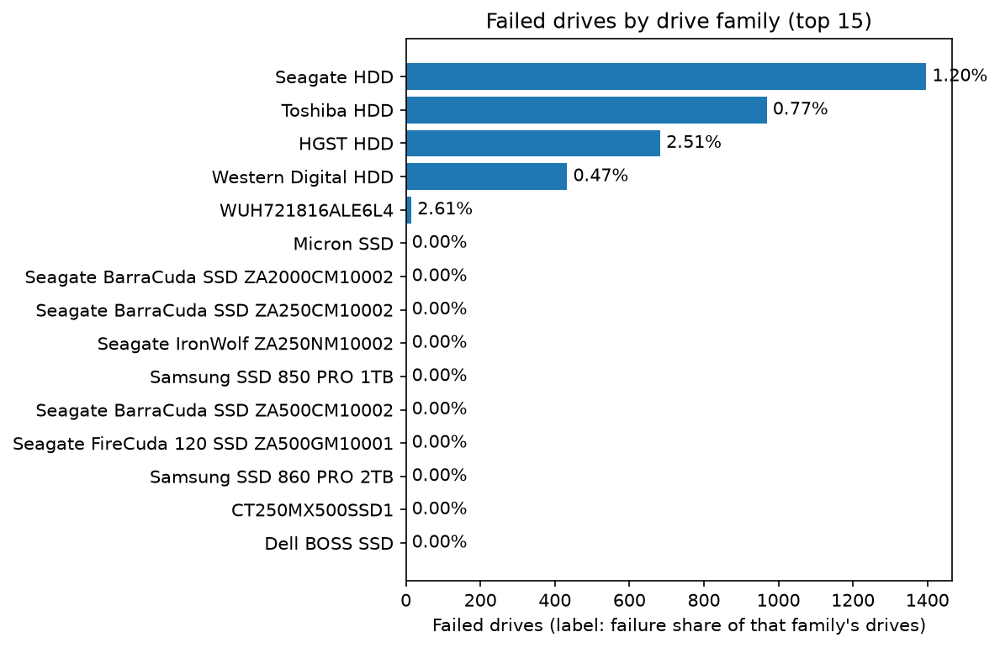

*Figure 1. Failed drives by drive family over the quarter-aligned window
(`make plots`). Bar length is the count of failed drives; the label is the
share of that family's drives that failed. Four hard-drive vendors account for
almost every failure; the SSD families have none in this period.*

### 4.2 Processing

Ingestion reads every SMART column as a number and replaces rows by drive and
date, after an early run failed on a column that was empty at the start of
one file and was read as text. Harmonization maps vendor attribute numbers to
canonical names and records telemetry gaps. The whole pipeline works in
batches of whole drives and writes results to disk batch by batch, so its
memory use is set by the batch size and not by the size of the data. A
watchdog stops any process whose resident memory exceeds 20 GB.

### 4.3 Labels and splits

A drive-day is positive if the drive fails within the horizon (30 days) after
that day, negative if the drive is observed for the whole horizon without
failing, and unlabelled otherwise.

The split is by time:

| Split | Dates | Rule |
|---|---|---|
| Train | the first 75 days | stops 30 days before the training cut-off, so every training label is settled before validation begins |
| Validation | the 25 days after the cut-off | only days after the training cut-off |
| Test | the following 21 days | ends 30 days before the data does, so every test label is complete |

The quarter-aligned window splits the same way:

| Split | Dates | Rule |
|---|---|---|
| Train | the first 107 days | the 30-day purge before the cut-off, as above |
| Validation | the 45 days after the cut-off | ends at the end of Q1 |
| Test | the first 61 days of Q2 | ends 30 days before the data does |
| Sealed | Q3 2026 | read by no training, validation or test step |

Ten percent of drives are also held out of training altogether. Random
splitting is not used: it would let the model see each drive's future.

---

## 5. Features

The model sees 246 features per drive-day (`docs/feature_engineering.md`).

- **Core error counters** (SMART 5, 187, 188, 197, 198 and
  196: reallocated, reported uncorrectable, command timeout,
  pending and offline uncorrectable sectors, and reallocation event count)
  receive the full family: rolling mean, maximum and standard deviation over
  7, 14 and 30 days, deltas, slopes, counts of days with increases, spike
  counts, and z-scores against other drives of the same model.
- **Context attributes** (seek error rate, power-on hours, temperature, CRC
  error count) receive a light family: the value and its 7- and 30-day change.
- **Cross-attribute features:** total active defects and its velocity and
  acceleration, days since each counter last increased, age, ratios such as
  uncorrectable errors per power-on hour, and a temperature spike measure.
- **Telemetry quality:** coverage and freshness, combined into a feature
  confidence that the agent uses to block destructive actions on thin data -
  computed against the attributes each drive's own model is
  expected to report, and charging recency only for time beyond the normal
  daily telemetry cadence (Section 7.2).

The 196th attribute was added on measured evidence, not literature priors: a
raw-attribute screen (`scripts/screen_raw_attributes.py`) measured
single-attribute drive-day AUC for every SMART column Backblaze publishes,
and SMART 196 separated failing from healthy drive-days better than four of
the existing five core counters, at roughly double their coverage on
non-Seagate drives. The same screen tested whether Backblaze's newer
`vault_id`/`pod_id` fields carried a genuinely new signal (clustered failure
within a chassis) and found the clustering was a cohort effect of filling a
vault with one drive batch, not local correlation worth featurizing.

The tiering keeps the feature table narrow enough for the memory budget.

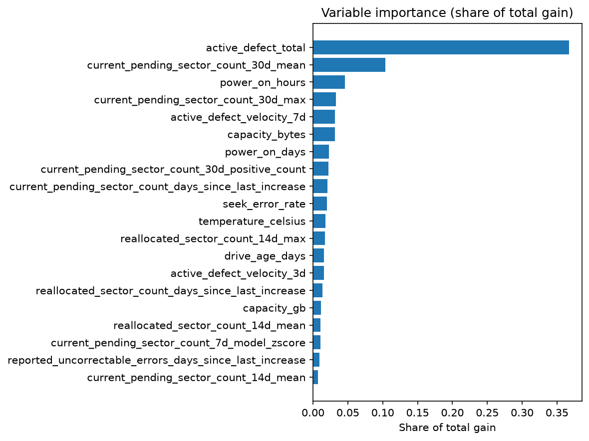

*Figure 2. The 20 features with the largest share of the first-stage model's
total gain, quarter-aligned run. The total of active defect counters carries
over a third of the gain on its own; pending-sector windows, age and the
velocity of new defects follow. The ranking is gain, not a causal claim, and it
describes the first stage only.*

---

## 6. Model

### 6.1 First stage

A LightGBM binary classifier. Failing rows are weighted by the square root
of the class ratio, trained on every failing row plus a hash-sampled subset
of healthy rows up to a 5,000,000-row cap. The trees are regularized (31
leaves, at least 200 rows per leaf, L2 penalty 10, capped leaf output) and
training stops when average precision on validation stops improving.

These choices came from a failure early in the project. With the standard
class-balancing option the model collapsed on real data, producing extreme
scores for a handful of drives. A later attempt at early stopping watched the
wrong metric and stopped after about 13 trees. Regularization, square-root
weighting and early stopping on average precision alone produced the first
working model.

### 6.2 Second stage

A second LightGBM re-ranks the drive-days the first model finds most
suspicious: those scoring above the validation threshold that still catches
half of the failing drives. It is trained only on such rows, with the first
model's score as an extra feature, so all of its capacity goes to telling
failing drives from the healthy drives that resemble them. Training rows
receive their first-stage score from a model that never saw their drive, so
the second stage learns from scores like those it meets in use. Rows below
the candidate threshold keep their first-stage score, so the lenient action
levels are unaffected.

Whether this second stage reliably improves precision is now an open
question again, not a settled one - see Section 9's discussion of what
changed between the two measurements.

### 6.3 Thresholds and action tiers

All thresholds are chosen on validation at the drive level and then applied
unchanged to test. The primary threshold is the most precise point that
still catches 10% of failing drives. Each action tier has its own threshold,
set from the **lift** that action can tolerate - how many times more likely
an alerted drive must be to fail than a drive picked at random. Lift is used
rather than precision because precision depends on the failure rate of
whichever split it is measured on, while lift does not, so a target
expressed in lift carries from validation to test and from one fleet to
another.

A per-drive-model variant of this policy - one set of tier thresholds per
drive model instead of one fleet-wide set - was built and measured on test, and the fleet-wide policy proved better;
Section 9 and ADR 0002 give the result and why.

A monotone isotonic map, fitted on validation, is reported beside the raw
scores so that a number presented as a probability means what it says; it
leaves every decision unchanged, because a monotone map preserves ranking.
Above a calibrated probability of about 0.5 the bins hold too few drives to
be read with confidence.

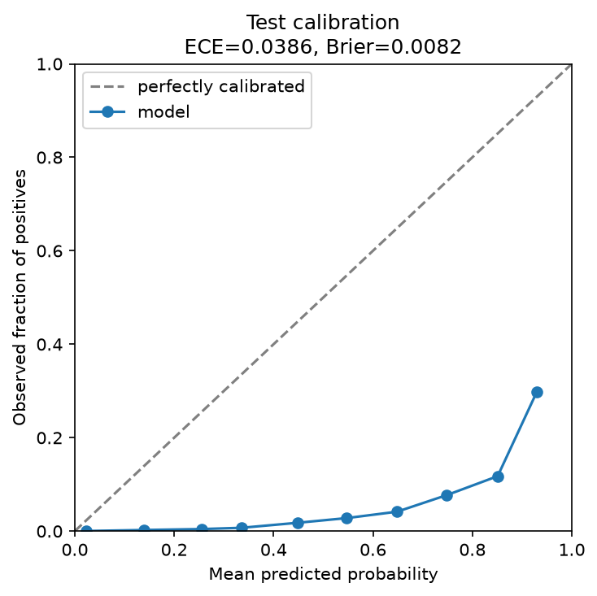

*Figure 3. Reliability of the raw first-stage score on the test split,
quarter-aligned run, per drive-day. The raw score is class-weighted, so it sits
far below the diagonal: drive-days scored 0.9 fail about 30% of the time. This
is why the raw score is never read as a probability and the isotonic map is
reported beside it.*

---

## 7. Evaluation method

- **Per drive, not per drive-day.** A failing drive produces about thirty
  nearly identical positive rows, so row-level figures count it thirty times.
  A failing drive is *caught* if any day in its window scores above the
  threshold; a healthy drive is a *false alarm* if any of its days does.
- **Later data only.** The test period follows the validation period, which
  follows training.
- **Thresholds from validation.** No number in this report was obtained by
  tuning on test, and every computation that touched the test split is
  recorded in an append-only log, so the number of comparisons behind a
  reported figure is a fact rather than a recollection.
- **Headline numbers carry an interval.** Test precision and recall are given
  with a 1000-draw bootstrap interval that resamples whole drives, and the
  second stage is judged by a paired interval on shared drives rather than
  by comparing two point estimates - which is precisely how its earlier,
  stronger-sounding claim came to be revised (Section 9).
- **A final period is sealed.** Q3 2026 is labelled `sealed` and is read by no
  training, validation or test step. It is scored once, against a model frozen
  before it arrived, so there is one untouched period left to test stability
  over time.
- **Precision is reported with its failure rate.** Precision depends on how
  common failures are among the drives judged. For catch rate *r*,
  false-alarm rate *f* and failure rate *p*,
  precision = *r·p* / (*r·p* + *f*·(1 − *p*)). The catch rate and false-alarm
  rate do not depend on *p*; precision does. Results are therefore given at
  the fleet's own failure rate and, restated, at 15% and 50%, the rates
  typical of published evaluations. The restated figures are arithmetic on
  the measured rates, not separate experiments.

### 7.1 Corrections made to the evaluation

Three errors were found and fixed early in the project. Each had flattered
the results, and each is recorded with its effect in
`docs/model_status_and_runbook.md`.

1. **The test set ran past its intended end.** In the last days of the data a
   healthy drive-day has no label yet, but a failing one does, so those days
   added failing drives with no healthy drives beside them. Correcting this
   lowered 14-day precision near 10% recall from 39.6% to 33.6%.
2. **Training labels reached into the validation period.** A training row
   dated just before the cut-off is labelled by what happens after it.
   Training now stops one horizon earlier.
3. **Validation contained rows from the training period** (the held-out
   drives' history), which made validation look easier than the future.
   Validation now holds only later dates. After this, a threshold chosen to
   catch 20% of failing drives on validation caught 18.7% on test with the
   single model; before, it caught 12.6%.

### 7.2 A fourth correction, found after a model was already frozen

A fourth error was found later, by a different route: not a leak into the
evaluation, but a bug in a safety mechanism that only real data could expose.

**What was found.** `feature_confidence` - the score the
`FEATURE_CONFIDENCE` guardrail compares against a 0.80 floor before any
migrate or drain - was computed by multiplying three factors together. Two
of them were wrong in a way that pinned the product below 0.80 regardless of
the third:

1. **Attribute coverage counted every priority attribute for every drive**,
   including SMART 187/188, which only Seagate drives report. A non-Seagate
   drive therefore capped at 3 of 5 = 0.60, however complete its own
   telemetry was.
2. **Recency charged the ordinary daily telemetry cadence as staleness.**
   Backblaze and SMART-Z both report once a day, so the interval since the
   last reading is always about 24 hours; the formula charged that interval
   in full, capping every drive-day at `exp(-24/48) = 0.6065` however fresh
   the reading actually was.

Measured directly on the gold feature table built from the real data: **0%
of 62,565,487 drive-days cleared the 0.80 floor** before either fix. For any
drive scored through this pipeline, no migrate or drain action was ever
reachable, fleet-wide, however confident the underlying model prediction
was - a scope that includes every one of the 3,973 actions `make
score-fleet` proposed against the real fleet (Section 8.3), none of which
could have been anything stronger than Cordon. It does **not** include the
hardcoded two-drive demonstration fleet `make agent-demo`/`make api` run
against by default, whose confidence values are set directly rather than
computed, so that path was never exposed to this bug.

**Why no test caught it.** Every guardrail and chaos test fixture in the
suite builds synthetic drives with complete, fresh telemetry - exactly the
input these two bugs needed to still produce a value near 1.0 under the
wrong formula, so the tests could not distinguish the broken computation
from a correct one. Only computing it over real data, where drive models and
telemetry intervals vary, exposed the gap.

**What was fixed, and the measured effect.** Attribute coverage is now
scored against the attributes each drive's own model is expected to report
(`src/features/cross_vendor.py::model_expected_attributes`); recency now
charges only the time beyond the expected one-day cadence. Measured on the
rebuilt gold table: **86.1%** of drive-days now clear the floor, with 0.00%
newly blocked - a per-model denominator can only be as strict as the global
one it replaced, never stricter. The remaining ~13% is the expected 30-day
telemetry warm-up a new drive has not yet accumulated, not residual
breakage. `build_gold_features` now refuses to produce a gold table in which
no drive-day can ever clear the floor, so a third bug of this exact
multiplicative shape would fail the build rather than ship silently.

Because both fixes change feature *values*, not just the confidence formula
itself (the attribute set a model expects is now a real per-model property
of the data, the recency term is now a different number for the same raw
interval), the model previously frozen on the old feature set could not
simply be re-scored on the corrected data - its own trained splits would
have been fed three features far outside the distribution they were fitted
on. The frozen run in Section 8 is a genuinely new training run on the
corrected gold table, not the same model re-evaluated.

### 7.3 A fifth correction: the agent backtest looked ahead

The first run of the agent's policy over the test window reported 61.8%
precision at 48.3% recall. Its per-tier breakdown showed why that could not be
right: migrate and drain were 0 of 71 correct, while the actions the evidence
gates had downgraded were 90% correct. Two causes were confirmed:

1. **The maturity gate read the outcome.** `feature_maturity` is assigned from
   the dataset's last date, so in a backtest "mature" meant "still reporting a
   month after the snapshot" - a drive that cannot have failed inside the
   horizon. Of the flagged drives, those marked decommissioned were 88.8%
   failures and those marked mature 0.2%.
2. **The latest row of a departed drive is its last day alive.** 85% of the
   "caught" drives were scored on the day they died, with a median notice of
   0 days.

The point-in-time design that replaced it (`make agent-pit`) scores every drive
reporting on a fixed date, judges it on the label at that date, and consults no
maturity label. Its results are in Section 8.5. The mechanism is pinned by
`tests/unit/test_maturity_lookahead.py`.

---

## 8. Results

Backblaze Q1 + Q2 2026, 30-day horizon, two-stage model, 246 features. Test
set: 621 failing and 353,328 healthy drives.

### 8.1 Precision and recall

**The model of record** is a frozen training run
(`29e338248d8948ccb41ee58db5321e76`), kept unchanged so that the sealed
quarter and the cross-vendor set can each be scored against it exactly once:

| Operating point | Precision, real fleet (0.18% fail) | Failing drives caught | At 15% failing | Lift |
|---|---|---|---|---|
| **Primary threshold** | **48.6%**, 95% CI [38.9%, 58.2%] | **8.7%** | 99.0% | 277 |
| Broader | 39.7% | 20.3% | - | - |
| Broadest | 29.5% | 33.3% | - | - |

At 621 failing drives a point estimate cannot distinguish a real difference
from sampling noise, which is why the interval is quoted with it. The drive
counts these rates imply at the primary threshold are 54 of 621 failing
drives caught and 57 of 353,328 healthy drives alerted.

**An earlier freeze is void, not merely superseded.** A prior run,
`0ee06c01ff2a427ca76011fb1afb8ce3`, was trained before both bugs in Section
7.2 were fixed. Its training data had `attribute_coverage_factor` pinned at
a 0.6/1.0 vendor split and `recency_factor` pinned near 0.6065, which were
model *inputs*; scoring that run against the rebuilt data would feed it
three features far outside what it was trained on, silently, since every
one of its expected feature columns still exists in the new, 246-column
frame. It may not be used for the sealed quarter or SMART-Z.

**The breakdown that follows** - drive counts, action tiers and warning lead
time - comes from that earlier, now-void run, on an earlier 212-feature
build (46.2% precision at 9.7% recall at the primary threshold), and was
never re-measured for the current freeze:

| Operating point | Failing drives caught | Healthy drives alerted | Precision, real fleet (0.18% fail) | At 15% failing | At 50% failing | Lift |
|---|---|---|---|---|---|---|
| Strictest | 18 (2.9%) | 22 (0.006%) | 45.0% | 98.8% | 99.8% | 256 |
| Primary threshold | 60 (9.7%) | 70 (0.020%) | 46.2% | 98.9% | 99.8% | 263 |
| Broader | 129 (20.8%) | 164 (0.046%) | 44.0% | 98.7% | 99.8% | 251 |
| Broadest | 207 (33.3%) | 506 (0.143%) | 29.0% | 97.6% | 99.6% | 165 |

Lift is how many times more likely an alerted drive is to fail than a drive
chosen at random.

### 8.2 Action tiers

Each tier's threshold is chosen on validation from a **lift** target
(56.6 / 94.3 / 151.0 / 226.4 times the fleet failure rate) rather than a
precision target, because precision moves with the base rate of whichever
split it is measured on and lift does not. At the validation failure rate
those targets are equivalent to the precisions in the first column below.
These figures, like the breakdown above, are from the earlier, now-void run
and have not been re-measured on the current freeze:

| Tier | Equivalent precision target on validation | Test precision | Test recall |
|---|---|---|---|
| Warn | 15% | 9.9% | 62.5% |
| Cordon | 25% | 17.4% | 51.2% |
| Migrate | 40% | 29.1% | 33.0% |
| Drain | 60% | 46.0% | 10.3% |

Test precision falls short of each validation target. More drives failed in
the validation period than in the test period (0.27% against 0.18%), which
accounts for about half of the difference; the rest is unexplained. At a
fixed failure rate of 15%, validation and test agree (99.0% and 98.9% at the
primary threshold).

### 8.3 Other measures, and the current run's fleet scoring

At the earlier, now-void run's primary threshold:

- Warning time: median 14 days before failure, mean 17.9.
- False-alarm rate: 70 of 353,328 healthy drives, about 1 in 5,000.

Fleet scoring with that run: it scored all 363,548 drives and proposed an
action for 3,973 of them. Per Section 7.2, none of those 3,973 proposals
could have been anything stronger than Cordon, because the feature-
confidence floor was unreachable fleet-wide at the time they were scored.
The current, fixed pipeline has not yet re-scored the fleet.

### 8.4 The quarter-aligned run

The same pipeline on the wider Q4 2025 to Q2 2026 window, 61-day test period
(1,479 failing and 353,552 healthy drives):

| | Test days | Failure rate | Recall | False-alarm rate | Precision |
|---|---|---|---|---|---|
| Frozen run (Section 8.1) | 21 | 0.175% | 8.7% | 1.61e-04 | 48.6% |
| Quarter-aligned run, test | 61 | 0.417% | 12.0% | 3.79e-04 | 57.1% |

Drive-level AUROC is 0.9232 on validation and 0.9226 on test, near-identical,
so thresholds chosen on validation carry to test. The higher precision is the
higher failure rate of a longer test window, not a better model: at a matched
false-alarm rate the frozen run catches slightly more (interpolated), and
measured point-in-time the gap is 1.2 to 1.3 points, within sampling error.
The run's value is a test set with 2.4 times as many failing drives, which
narrows every interval.

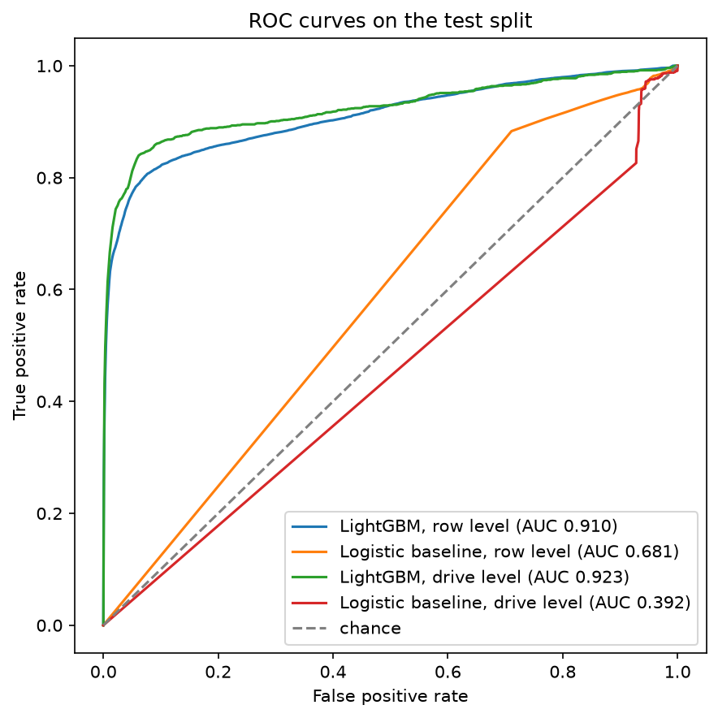

*Figure 4. ROC curves on the quarter-aligned test split, per drive-day and per
drive, for LightGBM and the logistic-regression sanity baseline. The LightGBM
drive-level curve (AUC 0.923) rises steeply at the very low false-alarm rates
where the action tiers operate. ROC is used to compare runs because neither
axis depends on how common failures are.*

### 8.5 The decision policy, measured point-in-time

`make agent-pit` scored the fleet as it stood on nine consecutive weekly dates
across the test period (3,142,390 drive-snapshots, 3,832 failing). Flagged at cordon and
above:

| Snapshot | Failure rate | Precision | Recall |
|---|---|---|---|
| Week 1 | 0.150% | 26.8% | 26.3% |
| Week 3 | 0.160% | 31.3% | 30.6% |
| Week 6 | 0.108% | 18.8% | 28.7% |
| Week 9 | 0.086% | 17.9% | 26.6% |
| **Pooled, nine dates** | 0.122% | **23.4%** | **29.3%** |

At drain, pooled: 40.3% precision (interval 29% to 52%) at 1.6% recall.

- **Precision tracks the month's failure rate; the model holds steady.** The
  failure rate fell 1.76 times across the nine dates and precision 1.50 times,
  while recall stayed between 26% and 33% with no trend. The same model at the
  same thresholds gives 17.6% to 31.3% depending on the date, which is why
  every precision figure here is quoted with its failure rate.
- **No sign of decay with distance from training.** Recall is 26.3% on the
  date nearest training and 26.6% on the furthest.
- **A second look does not help.** Flagging only drives above the threshold at
  both T-7 and T lowers recall at every false-alarm budget tested, by 0.5 to 3.3
  points, with intervals excluding zero at the three looser budgets (2.0, 2.3 and
  3.3 points) and including zero at the two stricter ones.

### 8.6 Failures among the false alarms, over a longer horizon

The 30-day label calls an alert a false alarm when the drive survives 30 days.
The agent's point-in-time snapshots make it possible to ask the next question
directly: what happened to those drives afterwards? Four of the nine weekly
snapshots have their following 60 days fully inside the data, so every alert on
them can be followed to its outcome (`make plot-late-hits`). At cordon and
above that is 2,144 alerts:

| What happened | Alerts | Share |
|---|---|---|
| Failed within 30 days (counted correct) | 616 | 28.7% |
| Failed in days 31-60 (counted false; the alert was early) | 227 | 10.6% |
| Failed after day 60, seen to the end of the data | 66 | 3.1% |
| Left service, no failure recorded | 42 | 2.0% |
| Still in service at the end of the data | 1,193 | 55.6% |

**293 of the 1,528 alerts the label counts as false - 19.2% - went on to
fail.** Credited with days 31 to 60, precision at cordon and above rises from
28.7% to 39.3%. The 30-day figure stays the headline because the goal is stated
at 30 days; what this adds is how much of the remainder is early warning rather
than error.

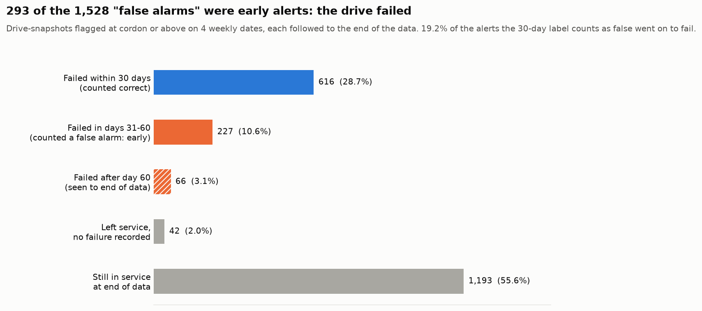

*Figure 5. What became of every alert at cordon and above, each followed to
the end of the data. Blue is counted correct by the 30-day label; orange (solid
and hatched) is counted false, but the drive failed later.*

**The warnings do not stop at the label boundary.** Plotted day by day, failures
after an alert are most frequent in the first days and continue past day 30 at
a lower but steady rate through day 60 (Figure 6). The label draws a line the drives do not
observe: an alert 31 days ahead of a failure is scored as wrong, one 30 days
ahead as right. The median early alert came 44 days before the failure.

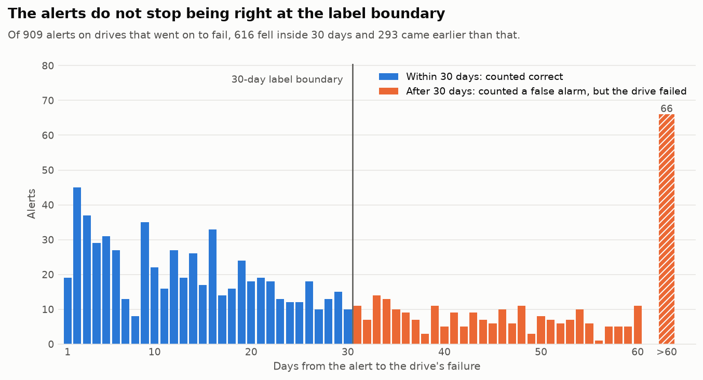

*Figure 6. Days from the alert to the failure, one bar per day, for every alert
on a drive that went on to fail. The vertical line is the 30-day label
boundary.*

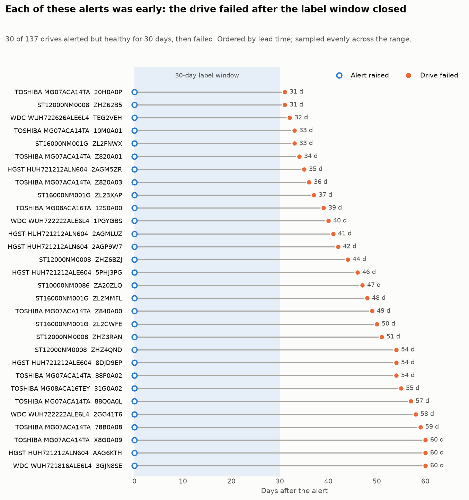

*Figure 7. Thirty of the 137 drives whose alert was early, sampled evenly
across lead times: the alert at day 0, the failure at day N, the 30-day label
window shaded. Labels are the drive model and a serial-number prefix
(Backblaze publishes the serials).*

**Every action tier gains, and the stricter tiers gain most.** Followed over 60
days, the share of each tier's alerts that were right rises at every tier:

| Tier and above | Alerts | Precision, 30-day label | Failed within 60 days | Share of false alarms that failed in days 31-60 |
|---|---|---|---|---|
| Warn | 5,091 | 18.7% | 26.1% | 9.1% |
| Cordon | 2,144 | 28.7% | 39.3% | 14.9% |
| Migrate | 491 | 43.4% | 58.5% | 26.6% |
| Drain | 53 | 50.9% | 58.5% | 15.4% |

At migrate and above, more than a quarter of the "false alarms" failed in the
following month. Drain rests on 53 alerts and 26 false alarms, too few to read
its share closely.

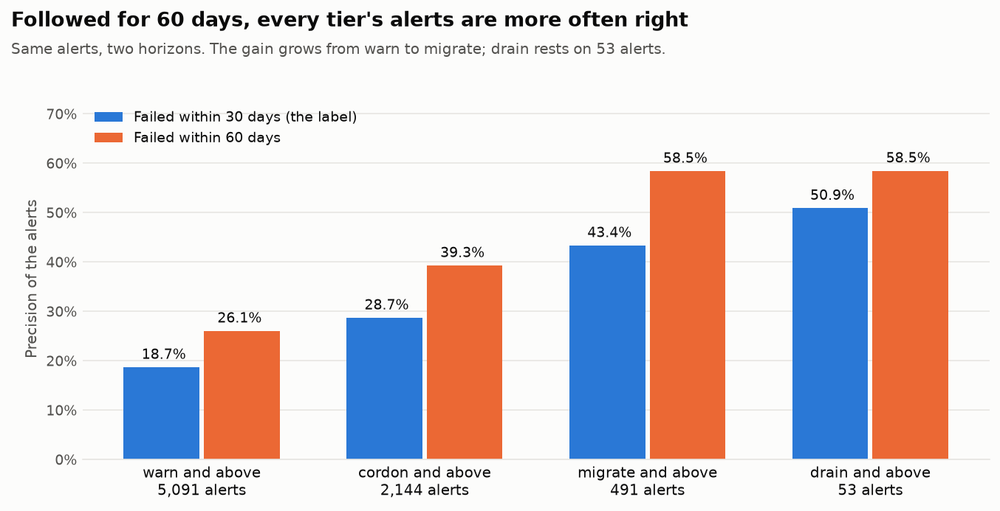

*Figure 8. Precision of each tier's alerts by the 30-day label (blue) and
counting failures within 60 days (orange).*

**A "false alarm" is far likelier than a typical drive to fail soon after.**
Across every drive-snapshot the label calls healthy, 0.10% fail in days 31 to
60. Among the label's false alarms the share is 87 times that at warn, 142
times at cordon and 254 times at migrate. That is the clearest sign these alerts
carry real information about failure; they are early, not random.

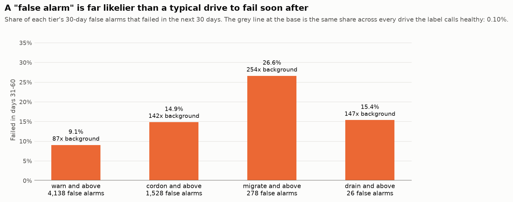

*Figure 9. Share of each tier's 30-day false alarms that failed in days 31 to
60, against the same share across every drive the label calls healthy (0.10%,
the grey line).*

**The drives that failed later looked less worn when they were alerted.** At
the moment of the alert their median counts of reallocated and pending sectors
were 24 and 24, against 85 and 208 for the drives that failed within 30 days.
That fits the model catching the same decline at an earlier stage. The drives
that never failed sit between the two (68 and 113), so these counts alone do
not tell an early warning from a drive that will keep running - which is why
the model's score, not a single counter, carries the alert.

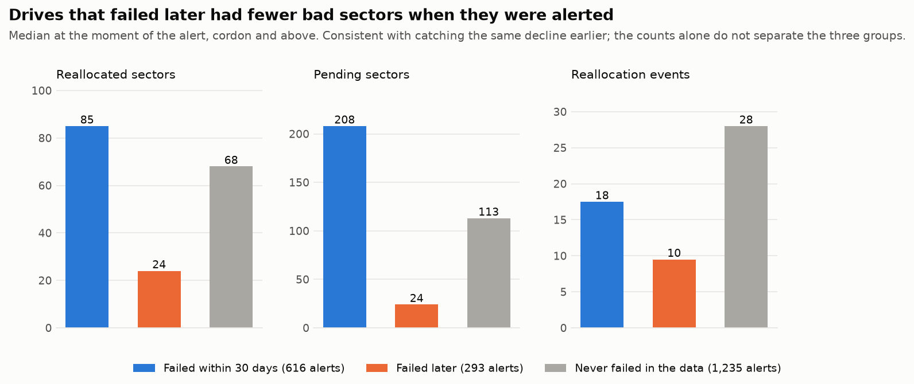

*Figure 10. Median value of three defect counters at the moment of the alert,
cordon and above, by what became of the drive.*

**What this means for the system.** For the mild actions - a warning, a cordon -
an alert that is 30 to 60 days early is useful, not wasted: it buys time to plan
a replacement. Read that way, the cordon tier's alerts were right about four
times in ten, not three. The same reading explains why a longer label raises
measured precision without changing the model (Section 9, item 16): the drives
were always flagged; the label simply starts counting them. The goal stays
stated at 30 days, so these figures sit beside the 30-day ones rather than
replacing them.

These counts use each drive's recorded event date. An earlier count of 195
early failures required the drive to still report telemetry on exactly day 30;
the 32 additional drives failed in days 31 to 59 after they had stopped
reporting.

### 8.7 The sequence model (LSTM)

The tree model sees hand-built 7-, 14- and 30-day window statistics. A
recurrent model reading the raw daily history is the most direct test of
whether those features leave signal on the table (`make train-sequence`). It is
a two-layer LSTM over each drive's last 30 days of nine SMART attributes (log
values, with a flag for whether each attribute is reported), drive age, vendor
and capacity, trained with the tree model's recipe and scored on exactly the
same labelled drive-days, splits and drive-level metrics.

**Observation 1 - it learns fast and then memorizes.** Every run reached its
best validation score within two epochs, after which validation precision fell
while training loss kept falling. Three regularized settings (a lower learning
rate, more dropout, a smaller network) changed the peak by no more than noise
(validation average precision 0.518 to 0.530, against 0.528 for the standard
setting). The behaviour is the same across four seeds.

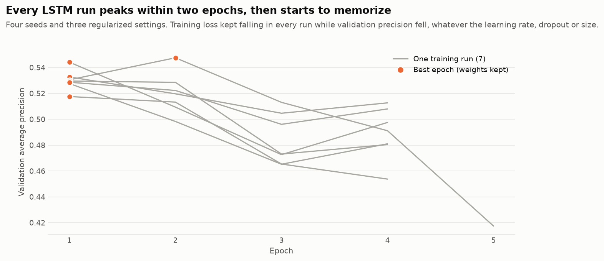

*Figure 11. Validation average precision per epoch for all seven training runs,
with the epoch whose weights were kept.*

**Observation 2 - alone it is close behind LightGBM.** Test drive-level AUROC
is 0.911 to 0.919 across the four seeds, against LightGBM's 0.923. At a
1-in-1,000 false-alarm rate it catches 18% to 27% of failing drives against
LightGBM's 26.8%. A recurrent reading of the raw history does not find signal
the window features miss.

**Observation 3 - it catches different drives.** The two models' drive scores
correlate at 0.65 to 0.74 (Spearman). At the strictest rate, 1 healthy drive in
10,000 alerted, the four-seed LSTM ensemble catches 79 failing drives and
LightGBM 54, with only 17 in common. Averaging seeds helps the LSTM most at this
strict end, where it catches more than LightGBM on its own.

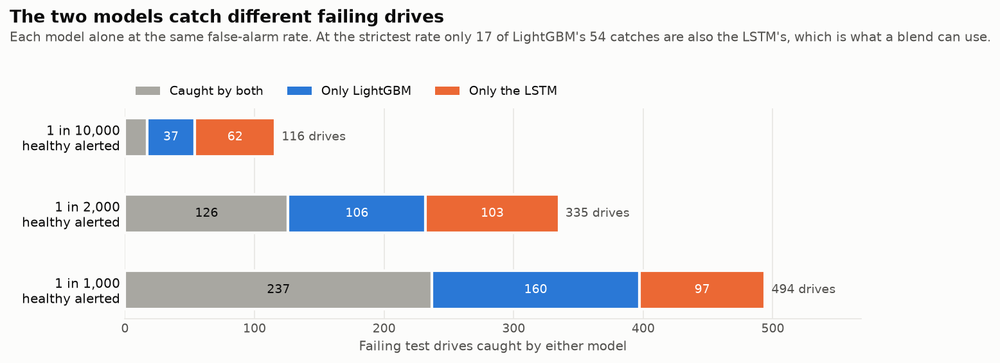

*Figure 12. Failing test drives caught by each model alone at the same
false-alarm rate, split into those both catch, only LightGBM catches and only
the LSTM catches.*

**Observation 4 - blended, they catch more for the same false alarms.** A
rank-average of the two scores, with the LSTM's weight chosen on validation
(0.1 to 0.2), raises recall at every budget:

| Test, 1,479 failing / 353,552 healthy drives | LightGBM | Blend, four-seed LSTM ensemble |
|---|---|---|
| Recall / precision at 1 in 10,000 false alarms | 3.7% / 60.7% | 4.2% / 63.9% |
| Recall / precision at 1 in 2,000 | 15.7% / 56.9% | 18.1% / 60.4% |
| Recall / precision at 1 in 1,000 | 26.8% / 52.9% | 29.3% / 55.1% |

Precision in this table is derived from the measured recall and the
false-alarm budget. AUROC is unchanged (0.923): the gain is at the operating
points the action tiers use.

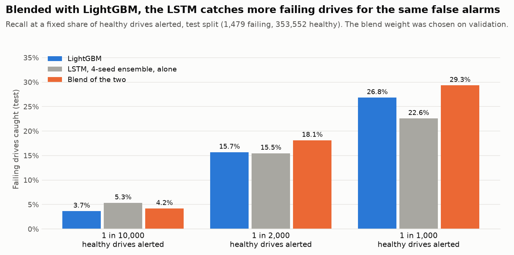

*Figure 13. Test recall at three false-alarm rates for LightGBM, the LSTM
ensemble alone and the blend.*

**Observation 5 - the gain is consistent and modest.** Every one of the four
seeds and the ensemble improves on LightGBM at all three budgets, by 0.5 to 3.4
points of recall, about +10% relative at the looser budgets. For the ensemble
the 95% paired interval clears zero at 1 in 2,000 and 1 in 1,000; at the
strictest budget it does not.

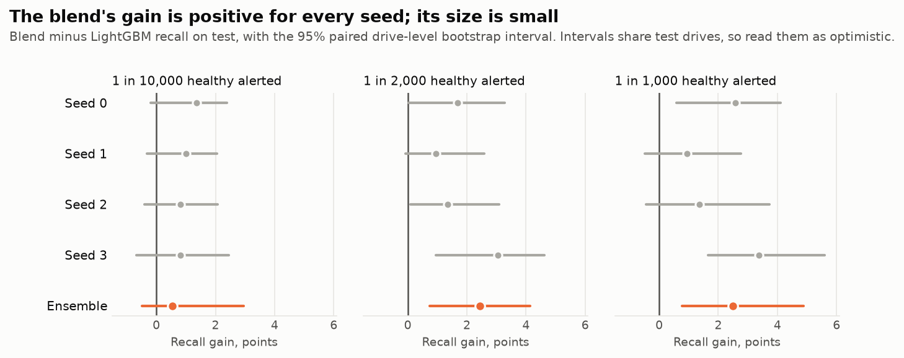

*Figure 14. Blend minus LightGBM recall on test for each LSTM run and the
ensemble, with the 95% paired drive-level bootstrap interval.*

**How far to take it.** The intervals resample the same test drives, so the
five rows are not independent evidence, and the blend weight was both chosen
and judged around the same test period. The blend is the strongest candidate
for the next model of record, and the sealed quarter is where it is read once,
cleanly, before it is relied on.

---

## 9. What was tried

Every row was measured on real data against the standard model on the same
drives.

| # | Approach | Result |
|---|---|---|
| 1 | Fixing the training collapse (weighting, regularization, early stopping) | Necessary: produced the working model |
| 2 | Hyperparameter variants | Plateau |
| 3 | XGBoost in place of LightGBM | Same (test ranking 0.208 against 0.213) |
| 4 | One model per drive family | Worse than the pooled model for all three largest families |
| 5 | A second quarter of data | Same precision, tighter estimate |
| 6 | Four more SMART attributes; velocity, recency and age features | No measurable change (all variants within 0.01 of each other) |
| 7 | Requiring several consecutive high-score days | Lower precision |
| 8 | **30-day horizon in place of 14 days** | **Gain: 33.6% to 46.3% precision near 10% recall, same test period** |
| 9 | Survival model (time to failure) | Same as the classifier (0.216 against 0.213) |
| 10 | Anomaly detection (isolation forest), alone, as a filter, as a feature | Alone far worse (24% against 46%); the others within noise |
| 11 | Second-stage model | **Not confirmed.** See below |
| 12 | One fleet-wide action-tier threshold against one per drive model | **Fleet-wide is better.** 7 of 81 models had enough failing validation drives to earn their own thresholds; against those, per-model thresholds lost 7-8 points of recall for under 1 point of precision at the lenient tiers, and lost on both axes at drain (64 caught from 173 alerts against 76 from 162) |
| 13 | A wider, older training window (quarter-aligned, Q4 2025 and Q1 2026) | Same ranking: within 1.2-1.3 recall points of the frozen run at matched false-alarm rate, inside sampling error (Section 8.4) |
| 14 | A second look a week apart before flagging | Lower recall at every budget: -0.5 to -3.3 points, clear of zero at the three looser budgets (Section 8.5) |
| 15 | Per-family recalibration (a shrunk score offset per drive model) | Same as the raw score: within 0.6 points at five of six budgets, -1.4 at the sixth |
| 16 | 7- and 14-day horizons beside 30, same data and splits | AUROC flat (0.925, 0.924, 0.923); 7 days is less precise near 10% recall (46% against 57%) |
| 17 | LSTM over each drive's raw 30-day history | Close behind LightGBM: AUROC 0.915 against 0.923; recall at a 1-in-1,000 false-alarm rate 20.1% against 26.8% |
| 18 | **LSTM blended with LightGBM** (rank average, weight chosen on validation) | **Gain:** +0.5 to +3.4 recall points across four seeds at matched false-alarm rates, AUROC unchanged; to be read once on the sealed quarter |

**Item 11 is reported at the strength of its current evidence, and how that
changed is itself a finding.** A five-seed repeat
showed a gain in every seed at the primary and broader operating points
(42.4% to 47.7% precision at the same recall). On the strength of that, a
direct paired-bootstrap significance test was run once, on the run that was
then frozen, and gave a gap of 10.7 points with a 95% CI of [3.2, 18.5] -
excluding zero, reported at the time as "real, not noise." A second such
test, run on the next frozen run (the current one, after the Section 7.2
fixes and the sixth attribute), gave a gap of 3.6 points with a 95% CI of
**[-5.5, 12.8]** - including zero. The two point estimates do not contradict
each other; each sits inside the other's interval, consistent with a true
gain somewhere in the 3- to 8-point range that the first test happened to
measure at its high end. What is no longer defensible is the earlier claim
that one paired test had settled the question. The second stage stays the
pipeline's default, on the standing five-seed evidence, reported now as
"adopted, not confirmed" rather than "real, not noise."

Items 17 and 18 are described, with figures, in Section 8.7.

Item 12's own inference is worth stating plainly, because the guardrail
instinct behind it was reasonable even though the fix it proposed was not:
prediction quality genuinely differs by drive model (pooled drive-level
AUPRC 0.473 on one Seagate family against 0.244 on an HGST family in the
latest run), so "the model is less reliable on drives we predict worse"
is true. But thresholding a single, well-calibrated score is already the
right way to spend a fixed precision budget across a population of mixed
risk; a different drive model sitting at a different point on one shared
curve is what a calibrated score does to populations of differing risk, not
evidence that the curve itself is mis-cut per population. Per-family
*thresholds* lost; per-family *models* had already lost earlier, for a
related reason (item 4) - the pooled model simply sees more failures to
learn from than any one family does.

---

## 10. Validation of the autonomous system

The agent, guardrails, simulator and reliability checker were validated with
automated tests, not on real hardware.

| Test layer | Tests | What it covers |
|---|---|---|
| Unit | 620 | Features, labels, model code, guardrail rules, trust score, API, the sequence model and the late-hit figures |
| Property-based | 10 | Invariants of hysteresis, trust score and metrics over generated inputs |
| Golden data | 3 | Feature pipeline against a fixed reference data set |
| Integration | 16 | Full decision cycles with the real guardrail engine and simulator |
| Chaos | 5 | Stale telemetry, correlated multi-drive failure, action timeout, human-review timeout, guardrail latency |
| Smoke | 3 | End-to-end start-up |

657 tests in total, all passing with the optional PyTorch extra installed,
with `ruff` and `mypy` clean. Without the extra the sequence-model tests skip.

Behaviours demonstrated by these tests:

- A high-risk drive is drained through the simulator end to end.
- A low-confidence prediction is downgraded to cordon.
- A drain that would break quorum, or that targets the last healthy node, is
  blocked and routed to human review; approval resumes and executes it,
  rejection ends without executing.
- After a simulated crash, replay does not repeat the action.
- An action that times out triggers a compensating action with no data loss.
- An unanswered review falls back to the safe action.
- Hysteresis requires a risk to persist over cycles before escalation, and a
  cooldown prevents an immediate repeat drain.
- Each of 2,000 guardrail evaluations completes within the 500 ms budget.

None of these fixtures build a drive with the real, gold-pipeline-computed
`feature_confidence` from Section 7.2 - every one of them sets confidence
directly, as a test input, which is exactly why none of them caught the bug
described there. That gap is unchanged by this report; it is the reason the
bug reached a real model-training run before it was found.

---

## 11. Discussion

### 11.1 Why precision stops where it does

The false-alarm rate is already very low: roughly 1 healthy drive in 6,000
at the primary threshold. Precision is still under 50% because failing
drives are rarer still. To reach 90% precision at the primary threshold the
model would have to alert only a handful of healthy drives out of over
350,000, many times fewer than it does.

Four observations place the limit in the data rather than the model.
Different model families, feature sets, problem framings and now a sequence
model reading the raw history all arrive at the same ranking; drive-level
AUROC is the same at 7-, 14- and 30-day horizons. Most of the remaining false
alarms are drives whose SMART readings really are abnormal, and on the
telemetry they look like failing drives: each priority counter is non-zero in
nearly the same share of false alarms and true alerts. A fifth of them are
early rather than wrong (Section 8.6). And many failing drives give no warning
in their SMART readings at all, which caps recall.

### 11.2 What did help, and why

Lengthening the horizon from 14 to 30 days helped because the model was being
marked wrong for warnings that came early: of 330 test drives it flagged
that did not fail within 14 days, 43 failed within the following six weeks.
The horizon comparison later confirmed the mechanism: AUROC is flat across 7,
14 and 30 days, so the model's ranking is the same and a longer label counts
more of its early warnings as correct. Section 8.6 shows the same effect from
the other side, beyond 30 days. The LSTM blend helps for a different reason:
the two models catch partly different drives, so combining them recovers
failures either would miss alone.
The second stage appears to help, modestly, for a reason that still looks
sound even though its significance is no longer confirmed: once the easy
healthy drives are set aside, a model trained only on the hard cases can
separate them slightly better.

### 11.3 Comparison with published work

Published studies commonly report precision above 90%. They are usually
measured on one drive model, with random splits, and on test sets with far
more failures than a fleet contains. On a test set with 15% failing drives
this model's alerts are 99.0% precise at the primary threshold. The two
statements are consistent: they describe the same alerts judged against
different populations. This report gives the real-fleet figure first because
it is what an operator would experience.

### 11.4 What the result means for autonomy

What the model provides is a short, highly enriched list: about half of the
drives at its strictest setting fail within 30 days, more within 60, and every
alerted drive is hundreds of times likelier to fail than a typical one. That
is the right input for graduated autonomy. Warnings and cordons act on the
list directly, where an early alert buys time; drains stay behind rules that
do not depend on the model and, where needed, a person - which is how this
system is built.

### 11.5 What the confidence-floor bug says about that claim

Section 7.2's finding is a direct test of the design principle in Section
3.3 and 11.4: does safety actually hold when a component is wrong? For
roughly two months of this project's life, one of the two independent
pre-action checks was wrong in a way that made it fail *closed* for every
real drive - it blocked destructive actions it should have allowed, not the
reverse. No unsafe action resulted from the bug, because the system's
response to "a check fired" is to downgrade or escalate to human review, the
same response it gives a legitimate low-confidence reading; an observer
watching only the agent's outputs would have seen a conservative system, not
a broken one. That is the behaviour a layered, veto-based design is meant to
produce when one layer fails - but it is also exactly why the bug went two
months without being noticed by anyone watching the outputs, and why only a
direct measurement of the intermediate value (`0% of drive-days clear the
floor`), not an outcome-level test, found it. The lesson generalizes beyond
this one bug: a system built so that failure is safe still needs to verify,
separately, that failure is also rare - "fails safe" and "works" are not the
same claim, and this project had, for a time, only checked the first one.

---

## 12. Limitations

- **A safety floor that no real drive could reach, found and fixed.**
  Section 7.2 and Section 11.5. The frozen run in Section 8 is the first one
  trained after the fix; the batch fleet scores on record predate it.
- **The second-stage model's gain is not confirmed.** Two paired significance
  tests on two different runs disagree about whether the interval excludes
  zero (Section 9, item 11). It stays the default on five-seed evidence, not
  on either paired test alone.
- **Per-drive-model action-tier thresholds were tried and lost.** Section 9,
  item 12. The code is kept as the measurement, not as something anything
  else consumes.
- **The live service runs on a demonstration fleet.** The agent and batch
  scoring take their tier thresholds from the trained run through one shared
  path, and the agent's policy has been measured offline against the real
  fleet (Section 8.5). The running agent and API still drive a two-drive
  demonstration snapshot whose confidence values are set directly, so it was
  never exposed to the defect in Section 7.2 either way.
- **Two fleet-safety guardrails need real topology data.** The last-healthy-
  node and quorum rules are implemented and tested, but the demonstration
  wiring supplies no node or replication state, so they cannot fire there.
- **Simulation only.** No action touches real hardware, and the API has no
  authentication of any kind. The approval queue, decision trail and
  guardrail violations are written through to SQLite and survive a restart;
  the last fleet snapshot and prediction list are not, since each cycle
  rebuilds them. Nothing sweeps the queue for reviews that have missed their
  SLA, so the safe-fallback logic that exists is never triggered in the
  running service.
- **One data source.** All results are Backblaze drives. The frozen run has a
  single three-week test period; the quarter-aligned run widens that to nine
  weeks and the point-in-time evaluation to nine weekly snapshots. The
  bootstrap interval covers sampling across drives and the five-seed test
  covers training randomness; neither shows how results would vary in another
  period. The sealed quarter exists to answer that and has not been scored.
- **No cross-vendor result.** SMART-Z has a split reserved for it and the
  harmonization code to read it, but it has not been evaluated, so
  generalization beyond Backblaze is unmeasured.
- **Validation precision exceeded test precision on the earlier run**, and
  only about half of the difference was explained; not yet re-measured on
  the current freeze.
- **The test period has been read many times.** Every test-split computation
  is logged, and the LSTM blend was both chosen and judged around the same
  test period; the sealed quarter is where it is read once, cleanly.
- **Sections 8.4 to 8.7 use the quarter-aligned window**, not the frozen model
  of record, and are labelled so; Figures 1 to 4 are drawn from that run's
  reports.
- **The maturity gate reads the dataset's last date**, so any backtest that
  consults it looks ahead (Section 7.3). The point-in-time evaluation does not
  consult it; for scoring the current fleet, where a drive that has stopped
  reporting really is gone, the gate's reading is the right one.
- **Action-tier targets are placeholders.** They are expressed as lift,
  which at least compares across splits, but the numbers themselves should
  come from the real cost of a false alarm for each action.
- **Explanations describe the first-stage model only.**

---

## 13. Future work

1. Re-score the real fleet with the current, fixed pipeline (`make
   score-fleet`); the 3,973 proposals on record all predate the fix in
   Section 7.2 and could not have reached migrate or drain regardless of
   score.
2. Settle the second-stage question with the decisive experiment that is
   already built but not yet run: a multi-seed paired comparison, which
   separates the gain from seed variance instead of reporting one paired
   test or one seed average.
3. Drive the live agent from the trained model, with the trained tier
   thresholds and real topology data for the fleet-safety guardrails.
4. Score the sealed quarter against the frozen run, once, to test stability
   over time - and read the LSTM blend there, once, as the candidate for the
   next model of record.
5. Credit early warnings where they are useful: a cost model per action, so
   that an alert 30 to 60 days ahead counts for the mild tiers (Section 8.6).
   The 60-day horizon run is set up but not run: the data is downloaded, and
   resuming needs a config change and a rebuild.
6. Feed the LSTM's score to the second stage, with out-of-fold scores for the
   training rows so the second stage never sees the LSTM's memorized ones.
7. Add signals beyond daily SMART: I/O latency, error logs and workload.
8. Set tier targets from operational cost, and measure the precision of
   actions taken after human review.
9. Evaluate on the second data set to test generalization across vendors.
10. Schedule the trust-score resolution and drift checks that currently run
   only on demand.
11. Raise the "expected attribute" coverage threshold in `model_expected_attributes`
   past 50%, which currently still under-serves a small set of SSD/laptop
   drive models (ADR 0002).

---

## 14. Conclusion

The project delivered a working, tested system that goes from raw fleet
telemetry to an audited action, and ran it on a real fleet of more than
360,000 drives within a 20 GB memory budget.

The model is strongly informative. Its alerts are about 277 times more likely
than chance to be right, fewer than 1 healthy drive in 6,000 is alerted, and
on the test sets of published work the same alerts are 99% precise. At the
fleet's own failure rate its precision is set by how rare failures are and by
what daily SMART data reveals: eighteen approaches agree on that ceiling, and
the two that moved it took precision at the primary threshold from about 34%
to about 49%.

Much of what the 30-day label counts as error is early warning. Followed for a
longer horizon, a fifth of the agent's "false alarms" were on drives that went
on to fail, at 87 to 254 times the background rate, and counting those raises
precision at every action tier. A sequence model adds a second view of the
same telemetry: it catches partly different drives, and blended with LightGBM
it catches more failing drives for the same number of false alarms, a gain
consistent across every seed and ready to be confirmed on the sealed quarter.

The safety design held when tested against real data. A defect in one of its
two independent pre-action checks made it impossible to pass for drives scored
through the real pipeline; the system's response was to decline destructive
actions, never to take unsafe ones, and the check now has a guard in the build.
The lesson the project carries forward is to verify each safety mechanism on
real data, not only that the system as a whole fails safe.

The system would become more autonomous, not differently built, as better
signals improve the model: graduated actions, independent guardrails, human
approval, rollback and audit already let it act usefully on a model of this
quality.

---

## References

1. Backblaze. *Hard Drive Data and Stats* (drive statistics data set), Q1 and
   Q2 2026.
2. Amram, M., et al. *Interpretable predictive maintenance for hard drives.*
   2021.
3. Klein, A. *Using Machine Learning to Predict Hard Drive Failures.*
   Backblaze blog, 2021.
4. Lu, S., et al. *Making Disk Failure Predictions SMARTer!* USENIX FAST 2020.
5. Wei, et al. *SMART-Z data set.* Scientific Data, 2025.
6. Pinheiro, E., Weber, W.-D. and Barroso, L. A. *Failure trends in a large
   disk drive population.* USENIX FAST 2007.
7. Kephart, J. and Chess, D. *The Vision of Autonomic Computing.* 2003.
8. Chen, T. and Guestrin, C. *XGBoost: A Scalable Tree Boosting System.* KDD
   2016.
9. Ke, G., et al. *LightGBM: A Highly Efficient Gradient Boosting Decision
   Tree.* NeurIPS 2017.
10. Liu, F. T., Ting, K. M. and Zhou, Z.-H. *Isolation Forest.* ICDM 2008.
11. LangGraph documentation.

---

## Appendix A. Reproducing the results

```bash
make install
make download-backblaze        # quarters set in configs/data.yaml
make ingest-backblaze
make build-silver
make build-features
make build-labels
make train                     # two-stage model, reports, model card
make score-fleet
make final-report              # runs make plots first
```

Scoring a sealed or external split, once, against a frozen run:

```bash
make evaluate-frozen ARGS="--run-id <mlflow run id> --split sealed"
```

Model comparisons, on arrays kept from a training run:

```bash
make full-experiment FULL_EXPERIMENT_ARGS="--variants reg_spw xgboost xgboost_aft --skip-baseline --two-stage --two-stage-seeds 5 --anomaly-stage --deep-dive reg_spw --per-model 5"
```

The raw-attribute screen behind Section 7.2/9's smart_196 and vault/pod
findings runs directly against downloaded CSVs, independent of the gold
pipeline:

```bash
uv run python scripts/screen_raw_attributes.py
uv run python scripts/check_confidence_distribution.py   # after rebuilding gold features
```

The agent's policy at fixed dates, the false-alarm follow-up of Section 8.6,
the sequence model of Section 8.7 and the per-family recalibration:

```bash
make agent-pit                 # nine weekly point-in-time snapshots
make plot-late-hits            # Figures 5-10 and late_hits_summary.json
uv sync --extra dev --extra torch
make train TRAIN_ARGS=--save-scores
make train-sequence            # and SEQUENCE_ARGS="--seed N --tag sN" for more seeds
uv run --extra torch python scripts/compare_sequence_vs_tree.py
uv run python scripts/plot_sequence_comparison.py   # Figures 11-14
make family-calibration
```

The figures in this report are copied from `data/audit/plots/` into
`docs/figures/`.

Outputs: the evaluation report and final report under
`data/audit/data_quality_reports/`, the model card under
`data/audit/model_cards/`, plots under `data/audit/plots/`, fleet scores
under `data/audit/predictions/`, frozen-split results under
`data/audit/frozen_evaluations/`, and the log of test-split computations at
`data/audit/test_access_log.jsonl`.

The real-data runs were made on a separate machine, so this repository's
MLflow store does not contain the frozen run; `docs/model_status_and_runbook.md`
section 1.1 is the record for it.

## Appendix B. Key settings

| Setting | Value |
|---|---|
| Horizon | 30 days |
| Splits, frozen run | training rows the first 75 days of Q1 and Q2 2026, validation the 25 days after the 30-day purge, test the following 21 days |
| Splits, quarter-aligned run | training rows the first 107 days of Q4 2025 to Q2 2026, validation the last 45 days of Q1, test the first 61 days of Q2 |
| Sealed window | Q3 2026; read only by the single-shot frozen evaluation |
| Frozen run | `29e338248d8948ccb41ee58db5321e76`; its dataset version is recorded in the runbook, Section 1.1 |
| Features | 246 (212 before the sixth priority attribute and the confidence-formula fixes) |
| First stage | LightGBM, 31 leaves, at least 200 rows per leaf, L2 10, learning rate 0.05 (tree count for this specific run not recorded in the runbook) |
| Class weighting | square root of the healthy-to-failing ratio |
| Second stage | LightGBM, at least 50 rows per leaf, candidates from the Stage 1 score at the recall-0.5 validation threshold (tree count and threshold for this specific run not recorded) |
| Memory cap | 20 GB resident per process |
| Action-tier targets | lift 56.6 / 94.3 / 151.0 / 226.4 (warn / cordon / migrate / drain) |
| Feature-confidence floor | 0.80 (`configs/agent.yaml`); 86.1% of drive-days clear it, against 0% before the Section 7.2 fixes |

## Appendix C. Where to find more

| Topic | Document |
|---|---|
| Short overview | `docs/system_summary.md` |
| Every measured result and the run history | `docs/model_status_and_runbook.md` |
| The attribute screen and the confidence-floor bug, in full | `docs/adr/0002-attribute-selection-and-vendor-aware-confidence.md` |
| Features and the reasons for them | `docs/feature_engineering.md` |
| Commands and options | `docs/pipeline_usage.md` |
| Code structure and known gaps | `docs/developer_guide.md` |
| Operating the system | `docs/user_guide.md` |
| Original goals and plan | `docs/design_goal.md`, `docs/project_plan.md`, `docs/dataset_strategy.md` |
| Why training runs as four processes | `docs/adr/0001-training-memory-isolation.md` |
